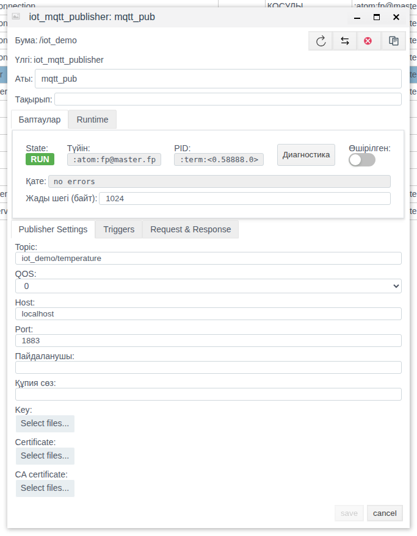
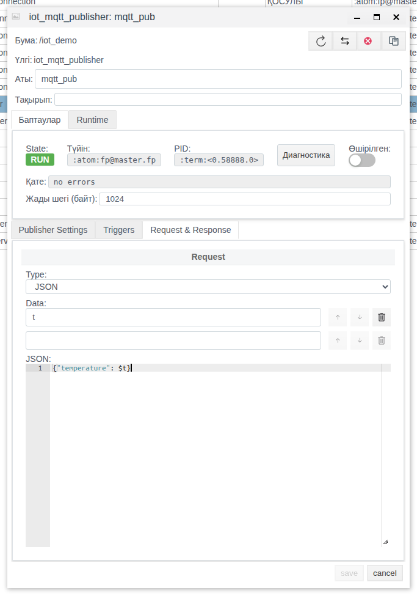
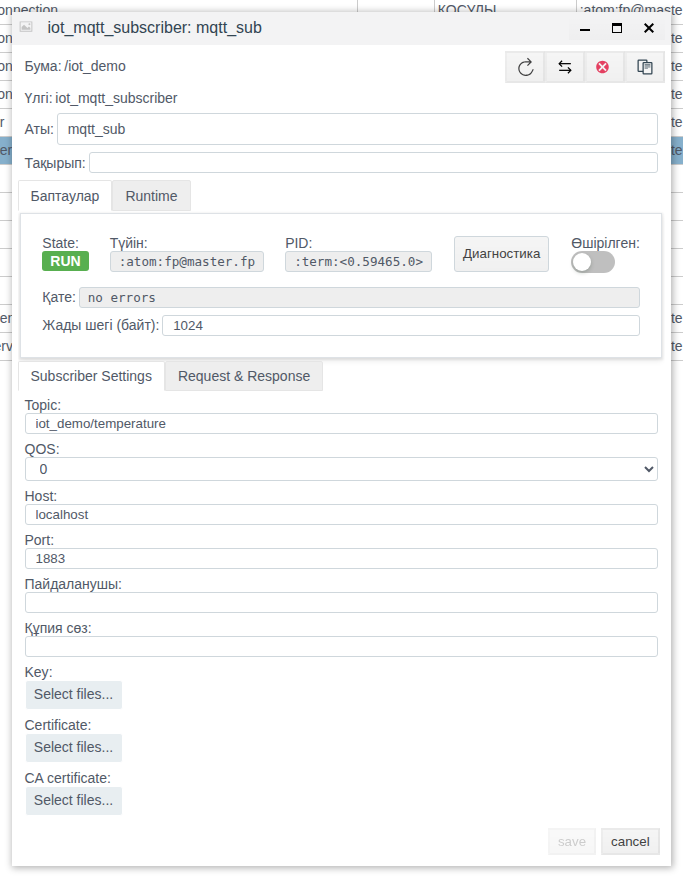

# MQTT-қосылымдар

Бұл құжат интегратор инженерге арналған. Жалпы ұғымдар (рөлдер, **Data** айнымалылары, хабарлама пішімі, **Triggers** қойындысы, диагностика) [«IoT-қосылымдар»](IoT.md) құжатында сипатталған.

# Мазмұны

- [Кіріспе](#кіріспе)
- [Негізгі бөлім](#негізгі-бөлім)
    - [iot_mqtt_publisher](#iot_mqtt_publisher)
    - [iot_mqtt_subscriber](#iot_mqtt_subscriber)
- [Қорытынды](#қорытынды)

# Кіріспе

MQTT-қосылымдар сыртқы брокер арқылы жұмыс істейді: `iot_mqtt_publisher` хабарламаларды топикке жариялайды, `iot_mqtt_subscriber` оларды алады. Құжаттағы мысал — `t_src` → брокер → `t_mqtt` тізбегі.

Жобаны өзгерту құқығы бар тіркелгімен Studio ортасына (`http://<сервер>:9000/fp/studio`) кіру мүмкіндігі қажет.

# Негізгі бөлім

## iot_mqtt_publisher

MQTT-жариялаушы: **Triggers** қойындысындағы шарт бойынша **Request** хабарламасын брокер топигіне жариялайды. MQTT-брокер FACEPLATE құрамына кірмейді.

| Өріс (**Publisher Settings** қойындысы) | Мақсаты | Әдепкі мәні |
|---|---|---|
| **Topic** | Жариялау топигі. Міндетті өріс | бос |
| **QOS** | Жеткізу кепілдігінің деңгейі: 0, 1 немесе 2 | `0` |
| **Host** | Брокер мекенжайы | `localhost` |
| **Port** | Брокер порты | `1883` |
| **Пайдаланушы**, **Құпия сөз** | Брокердің тіркелгі деректері. Екі өріс те толтырылғанда ғана пайдаланылады, әйтпесе қосылу анонимді | бос |
| **Key**, **Certificate**, **CA certificate** | TLS-қосылуға арналған файлдар. Брокер сертификаты тексерілмейді | жүктелмеген |

Мысал — `mqtt_pub` жариялаушысы `t_src` мәнін әр 5 секунд сайын жариялайды:

1. `iot_demo` бумасында `iot_mqtt_publisher` түріндегі `mqtt_pub` жасаңыз. **Publisher Settings**: **Topic** `iot_demo/temperature`, **Host** — брокер мекенжайы.

   

2. **Triggers** қойындысы: **Cycle** `5000` — жіберу кезеңі, мс.
3. **Request & Response**, **Request**: **Type** `JSON`, **Data** `t`, үлгі `{"temperature": $t}`. Сақтаңыз.

   

4. `mqtt_pub` ішінде `iot_tag_source` түріндегі `from_t_src` жасаңыз: `t` — `/iot_demo/t_src` — `value`.

Брокердің `iot_demo/#` топигіне жазылған жазылушы `iot_demo/temperature {"temperature":21.5}` алады.

## iot_mqtt_subscriber

MQTT-жазылушы: **Topic** топигіне жазылады және әр алынған хабарламаны **Request** үлгісімен талдайды, айнымалылар әрекеттерге беріледі. Қосылу параметрлері жариялаушымен бірдей (**Subscriber Settings** қойындысы), **Triggers** қойындысы жоқ.

Мысал — `mqtt_sub` жазылушысы топиктегі температураны `t_mqtt` тегіне жазады:

1. `iot_demo` бумасында `iot_mqtt_subscriber` түріндегі `mqtt_sub` жасаңыз. **Subscriber Settings**: **Topic** `iot_demo/temperature`, **Host** — брокер мекенжайы.

   

2. **Request & Response**, **Request**: **Type** `JSON`, **Data** `t`, үлгі `{"temperature": $t}`. Сақтаңыз.
3. `mqtt_sub` ішінде `iot_tag_action` түріндегі `to_t_mqtt` жасаңыз: `t` — `/iot_demo/t_mqtt` — `value`.

`mqtt_pub` қосылымымен бірге `t_src` → брокер → `t_mqtt` тізбегі шығады: `t_mqtt` тегінде `21.5` пайда болады.

# Қорытынды

- Брокер FACEPLATE құрамына кірмейді, оның мекенжайын **Host** және **Port** өрістерінде көрсетіңіз.
- Жариялаушыға **Triggers** қойындысында жіберу шартын беріңіз.
- Алмасу болмаса, **Диагностика** терезесін ашыңыз: онда брокерге қосылу журналы көрінеді.
