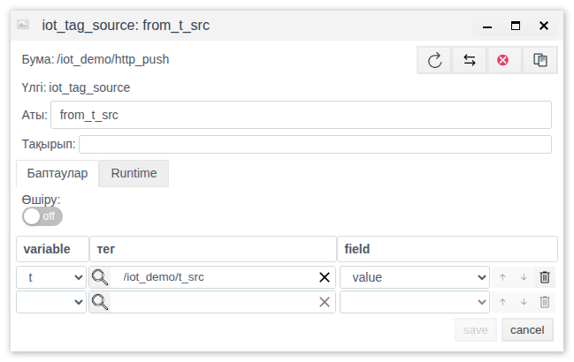
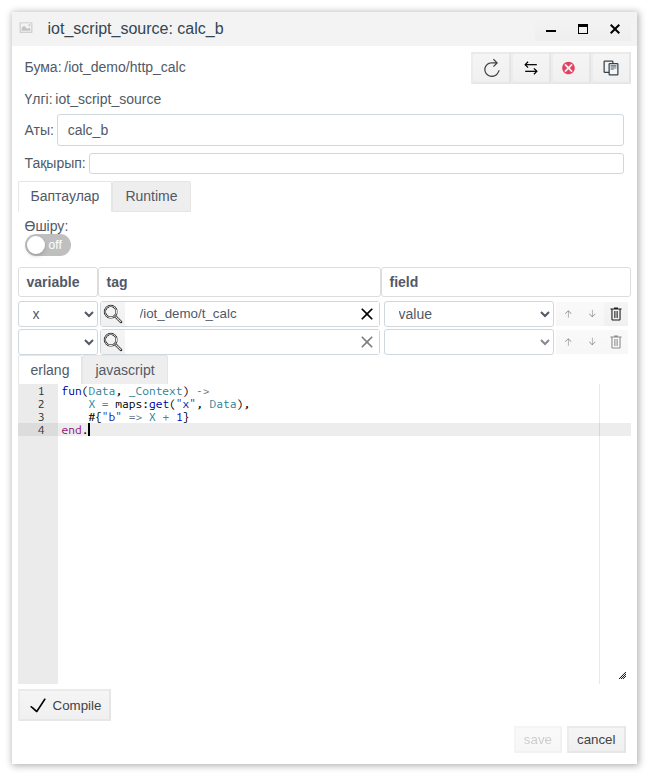
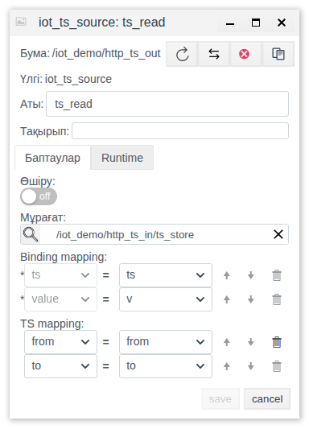
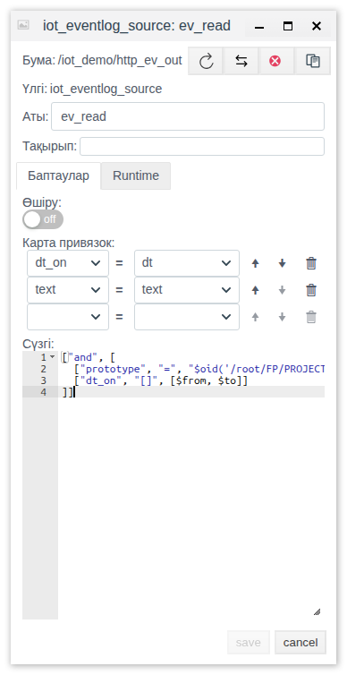

# IoT дереккөздері

Бұл құжат интегратор инженерге арналған. Жалпы ұғымдар (рөлдер, **Data** айнымалылары, хабарлама пішімі, **Triggers** қойындысы, диагностика) [«IoT-қосылымдар»](IoT.md) құжатында сипатталған.

# Мазмұны

- [Кіріспе](#кіріспе)
- [Негізгі бөлім](#негізгі-бөлім)
    - [iot_tag_source](#iot_tag_source)
    - [iot_script_source](#iot_script_source)
    - [iot_ts_source](#iot_ts_source)
    - [iot_eventlog_source](#iot_eventlog_source)
- [Қорытынды](#қорытынды)

# Кіріспе

Дереккөз қосылымның шығыс хабарламасының айнымалыларын толтырады: клиентте — сұраудың, серверде — жауаптың. Дереккөздер тек қосылым ішінде жасалады, олардың айнымалылары тиісті жақтың **Data** тізімінен алынады. Баптау реті мен мысал — [«IoT-қосылымдар»](IoT.md) құжатының [«Дереккөз бен әрекет қосылыммен қалай байланысады»](IoT.md#дереккөз-бен-әрекет-қосылыммен-қалай-байланысады) бөлімінде.

Жобаны өзгерту құқығы бар тіркелгімен Studio ортасына (`http://<сервер>:9000/fp/studio`) кіру мүмкіндігі қажет.

# Негізгі бөлім

## iot_tag_source

Тег өрістерінің мәндерін қосылым айнымалыларына береді. Әр байланыстыру жолы: **variable** (**Data** тізіміндегі айнымалы) — **тег** (үлкейткіш әйнек батырмасымен таңдалатын тег) — **field** (тег өрісі). Алдыңғы жол толтырылғаннан кейін жаңа бос жол пайда болады.



Мысалдар: [`http_push`](http.md#iot_http_client_connection), [`mqtt_pub`](mqtt.md#iot_mqtt_publisher), [`ws_push`](websocket.md#iot_websocket_client_connection) ішіндегі `from_t_src`.

## iot_script_source

Қосылым айнымалыларын скриптпен есептейді. Редактордың үстіндегі байланыстыру жолдарында скрипт айнымалылары беріледі: олардың атаулары **Data** тізімінен алынады, мәндері көрсетілген тегтерден оқылады. `fun(Data, Context)` функциясы `Data` ішінде осы айнымалылардың мәндерін, `Context` ішінде қызметтік деректерді (клиентте — `from` және `to` аралығының шектерін) алады да, `қосылым айнымалысының атауы => мән` картасын қайтарады. **Compile** батырмасын басып, содан кейін сақтаңыз.



Мысал — [iot_script_action](actions.md#iot_script_action) бөлімін қараңыз: `calc_b` дереккөзі `t_calc` тегін оқып, жауапта 1-ге артық мәнді қайтарады.

## iot_ts_source

Аралықтағы мұрағат мәндерін береді. **Мұрағат** — мұрағат нысаны: `ARCHIVE` немесе [`iot_ts_action`](actions.md#iot_ts_action). **Binding mapping** уақыт белгілері (`ts`) мен мәндер (`value`) массивтеріне арналған айнымалыларды көрсетеді. **TS mapping** аралықтың `from` және `to` шектері бар айнымалыларды көрсетеді.

- Клиентте **TS mapping** толтырылмауы мүмкін: аралық **Triggers** қойындысынан алынады (соңғы сәтті сұраудан ағымдағы сәтке дейін).
- Серверде шектер сұрауда келеді. `from` және `to` айнымалыларын сұраудың **Data** тізіміне де, жауаптың **Data** тізіміне де қосыңыз: **TS mapping** ішінде жауап айнымалылары ұсынылады.
- Шектер — Unix миллисекундтары немесе күн жолы.
- Жауаптың бірінші нүктесі — `from` сәтіндегі мұрағат мәні. Бұл сәтте мән болмаса, жауапта `"undefined"` болады.

Мысал — `http_ts_out` сервері `ts_store` мұрағатының (оны [`iot_ts_action`](actions.md#iot_ts_action) толтырады) сұраудағы аралықтағы нүктелерін береді:

1. `iot_demo` бумасында `iot_http_server_connection` түріндегі `http_ts_out` жасаңыз: **Шығу тегі** `/ts_out`, **Method** `POST`.
2. **Request**: **Type** `JSON`, **Data** `from`, `to`, үлгі `{"from": $from, "to": $to}`. **Response**: **Type** `JSON`, **Data** `ts`, `v`, `from`, `to`, үлгі `{"ts": $ts, "value": $v}`. Сақтаңыз.
3. `http_ts_out` ішінде `iot_ts_source` түріндегі `ts_read` жасаңыз: **Мұрағат** `/iot_demo/http_ts_in/ts_store`; **Binding mapping** `ts` = `ts`, `value` = `v`; **TS mapping** `from` = `from`, `to` = `to`. Сақтаңыз.

   

```
curl -X POST -d '{"from": 1792387500000, "to": 1792387550000}' http://<сервер>:7080/ts_out
```

Жауап — `{"ts":[1792387500000,1792387513000,1792387543000],"value":["undefined",10.5,11.25]}`. Нысандар массиві (`[{"ts": ..., "value": ...}]`) қажет болса, жауапты скриптпен құрыңыз — [«IoT-қосылымдар»](IoT.md) құжатының [«Хабарлама скрипті»](IoT.md#хабарлама-скрипті) бөлімін қараңыз.

## iot_eventlog_source

Оқиғалар журналының жазбаларын береді. **Карта привязок** оқиға өрістерін (`dt_on`, `dt_off`, `text`, `type`, `active` және т. б.) айнымалылармен байланыстырады: әр айнымалы барлық табылған жазбалар бойынша өріс мәндерінің массивін алады. **Сүзгі** — JSON-үлгі түріндегі іріктеу шарты, онда айнымалыларды пайдалануға болады:

| Сүзгі элементі | Мағынасы |
|---|---|
| `["and", [шарт, ...]]`, `["or", [...]]`, `["andnot", [шарт, шарт]]` | Логикалық амалдар |
| `["өріс", "=", мән]` | Өрісті мәнмен салыстыру, мысалы `=` |
| `["өріс", "[]", [$from, $to]]` | Аралықтағы уақыт |
| `"$oid('/root/FP/PROJECT/...')"` | Жоба нысанына сілтеме, мысалы `prototype` өрісіндегі оқиға үлгісіне |

`$from` және `$to` — аралықтың шектері: клиентте **Triggers** қойындысынан, серверде — осы атаулары бар сұрау айнымалылары.

Мысал — `http_ev_out` сервері `ev_store` әрекетінің ([iot_eventlog_action](actions.md#iot_eventlog_action) бөлімін қараңыз) сұраудағы аралықтағы оқиғаларын береді:

1. `iot_demo` бумасында `iot_http_server_connection` түріндегі `http_ev_out` жасаңыз: **Шығу тегі** `/ev_out`, **Method** `POST`.
2. **Request**: **Type** `JSON`, **Data** `from`, `to`, үлгі `{"from": $from, "to": $to}`. **Response**: **Type** `JSON`, **Data** `dt`, `text`, үлгі `{"dt": $dt, "text": $text}`. Сақтаңыз.
3. `http_ev_out` ішінде `iot_eventlog_source` түріндегі `ev_read` жасаңыз: **Карта привязок** `dt_on` = `dt`, `text` = `text`; **Сүзгі**:

   ```json
   ["and", [
     ["prototype", "=", "$oid('/root/FP/PROJECT/iot_demo/http_ev_in/ev_store')"],
     ["dt_on", "[]", [$from, $to]]
   ]]
   ```

   Сақтаңыз.

   

```
curl -X POST -d '{"from": 1792406000000, "to": 1792407000000}' http://<сервер>:7080/ev_out
```

Жауап — `{"dt":[1792406684717,1792406684854],"text":["Door open","Door closed"]}`.

# Қорытынды

- Тег мәндері үшін `iot_tag_source`, есептеулер үшін `iot_script_source` пайдаланыңыз.
- Мұрағат үшін `iot_ts_source`, оқиғалар журналы үшін оқиға үлгісі мен аралық бойынша сүзгісі бар `iot_eventlog_source` пайдаланыңыз.
