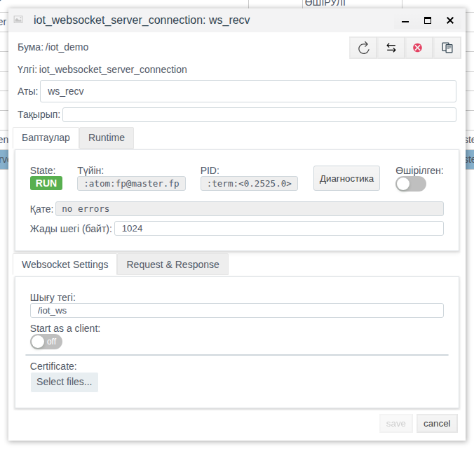

# WebSocket-қосылымдар

Бұл құжат интегратор инженерге арналған. Жалпы ұғымдар (рөлдер, **Data** айнымалылары, хабарлама пішімі, **Triggers** қойындысы, диагностика) [«IoT-қосылымдар»](IoT.md) құжатында сипатталған.

# Мазмұны

- [Кіріспе](#кіріспе)
- [Негізгі бөлім](#негізгі-бөлім)
    - [iot_websocket_client_connection](#iot_websocket_client_connection)
    - [iot_websocket_server_connection](#iot_websocket_server_connection)
- [Қорытынды](#қорытынды)

# Кіріспе

WebSocket-қосылымдар тұрақты арнаны ұстайды: `iot_websocket_client_connection` серверге қосылады, `iot_websocket_server_connection` қосылымдарды қабылдайды. Құжаттағы мысал — бір FACEPLATE ішіндегі клиент → сервер жұбы: `t_src` мәні `t_ws` тегіне түседі.

Жобаны өзгерту құқығы бар тіркелгімен Studio ортасына (`http://<сервер>:9000/fp/studio`) кіру мүмкіндігі қажет.

# Негізгі бөлім

## iot_websocket_client_connection

WebSocket-клиент: сервермен тұрақты қосылымды ұстайды, **Triggers** қойындысындағы шарт бойынша **Request** жіберіп, жауап күтеді.

| Өріс (**Client Settings** қойындысы) | Мақсаты | Әдепкі мәні |
|---|---|---|
| **URL** | Сервер мекенжайы: `ws://<хост>:<порт>/<жол>` немесе `wss://...` | бос |
| **Initialization request**, **Initialization response** | Қосылғаннан кейінгі танысу: FACEPLATE **Initialization request** ішіндегі JSON жіберіп, **Initialization response** JSON-үлгісіне сәйкес жауап күтеді. Жауап сәйкес келмесе, қосылым орнатылмайды | `user`/`password` және `acknowledge` мысалы |
| **Key**, **Certificate**, **CA certificate** | WSS үшін файлдар | жүктелмеген |

Мысал — `ws_push` клиенті `t_src` мәнін келесі бөлімдегі `ws_recv` серверіне әр 5 секунд сайын жібереді:

1. `iot_demo` бумасында `iot_websocket_client_connection` түріндегі `ws_push` жасаңыз. **Client Settings**: **URL** `ws://127.0.0.1:6080/iot_ws`, танысу өрістерін тазалаңыз.
2. **Triggers** қойындысы: **Cycle** `5000` — жіберу кезеңі, мс.
3. **Request & Response**, **Request**: **Type** `JSON`, **Data** `t`, үлгі `{"temperature": $t}`. **Response**: **Type** `Const`. Сақтаңыз.
4. `ws_push` ішінде `iot_tag_source` түріндегі `from_t_src` жасаңыз: `t` — `/iot_demo/t_src` — `value`.

## iot_websocket_server_connection

WebSocket-сервер: **Шығу тегі** жолына келген қосылымдарды қабылдайды, әр хабарламаны **Request** үлгісімен талдайды және **Response** хабарламасымен жауап береді. Серверлер 6080 (WS) және 6443 (WSS) порттарын тыңдайды.

| Өріс (**Websocket Settings** қойындысы) | Мақсаты | Әдепкі мәні |
|---|---|---|
| **Шығу тегі** | Қосылу жолы. Толық мекенжай: `ws://<сервер>:6080<Шығу тегі>` | `/myserver` |
| **Start as a client** | Қосылым сыртқы серверге **URL** бойынша өзі қосылады (клиенттегідей танысумен), бірақ кіріс хабарламаларды сервер ретінде өңдейді. Деректерді сыртқы жүйе жіберетін, ал қосылуды FACEPLATE жасауы керек болғанда қажет | өшірулі |
| **Certificate** | Қосылуға рұқсат етілген клиенттердің сертификаттары | жүктелмеген |

Мысал — `ws_recv` сервері `ws_push` жіберген температураны `t_ws` тегіне жазады:

1. `iot_demo` бумасында `iot_websocket_server_connection` түріндегі `ws_recv` жасаңыз. **Websocket Settings**: **Шығу тегі** `/iot_ws`.

   

2. **Request & Response**, **Request**: **Type** `JSON`, **Data** `t`, үлгі `{"temperature": $t}`. **Response**: **Type** `Const`, **Мәтін** `OK`. Сақтаңыз.
3. `ws_recv` ішінде `iot_tag_action` түріндегі `to_t_ws` жасаңыз: `t` — `/iot_demo/t_ws` — `value`.

`ws_push` қосылымымен бірге `t_ws` тегінде `21.5` пайда болады.

# Қорытынды

- Клиентте танысу өрістерін сервер талап еткендей толтырыңыз немесе сервер танысуды талап етпесе, оларды тазалаңыз.
- Клиентке **Triggers** қойындысында жіберу шартын беріңіз.
- **Start as a client** режимі деректерді сыртқы жүйе жіберетін, ал қосылуды FACEPLATE жасауы керек болғанда қажет.
