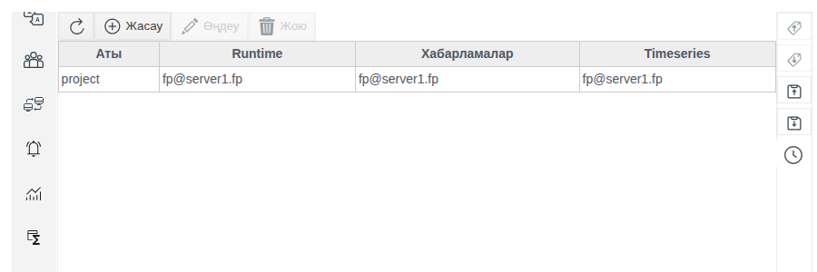
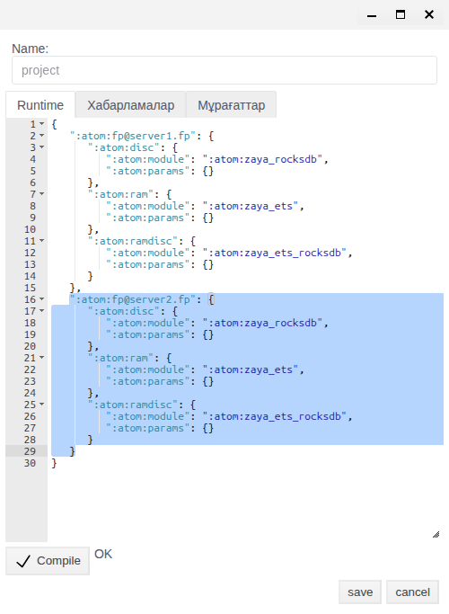
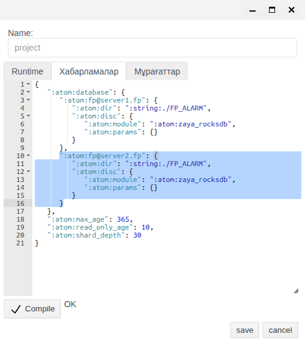
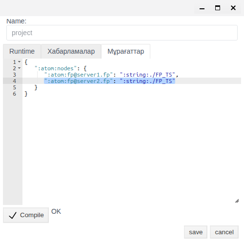
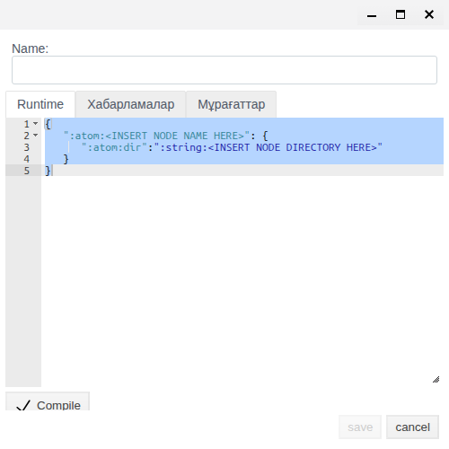
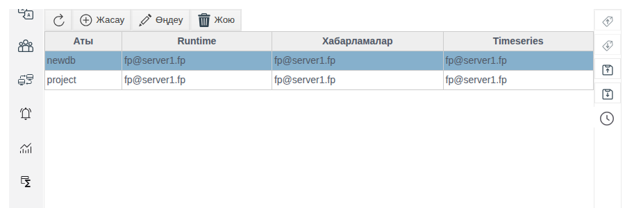
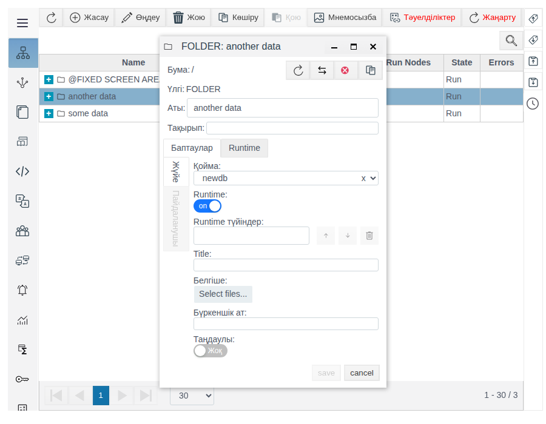
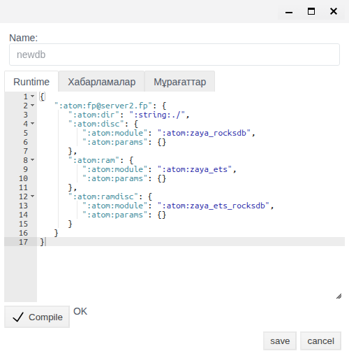
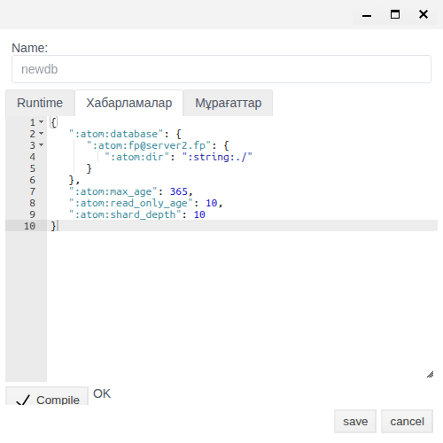
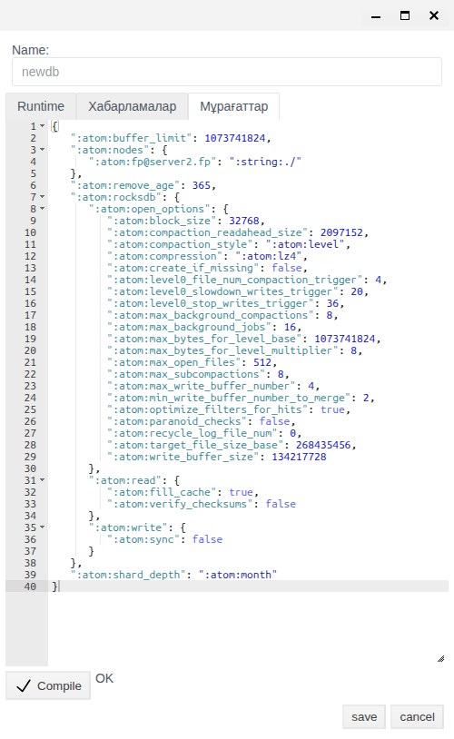

# Қоймалар: жоба деректері қай серверлерде сақталады

Бұл құжат FACEPLATE жобасының деректері қайда сақталатынын шешетін интегратор инженерге арналған: сервер істен шыққанда жүйе жұмысын жалғастыруы үшін, үлкен жобаны дискілер мен серверлерге бөлу үшін немесе жүйені тоқтатпай деректерді басқа серверге ауыстыру үшін.

# Мазмұны

- [Терминдер сөздігі](#терминдер-сөздігі)
- [Кіріспе](#кіріспе)
- [Негізгі бөлім](#негізгі-бөлім)
    - [Серверлерді дайындау](#серверлерді-дайындау)
    - [«Қоймалар» редакторы](#қоймалар-редакторы)
    - [Резервтеу: екінші сервердегі база көшірмесі](#резервтеу-екінші-сервердегі-база-көшірмесі)
    - [Бума үшін бөлек база](#бума-үшін-бөлек-база)
    - [Базаны басқа серверге ауыстыру](#базаны-басқа-серверге-ауыстыру)
    - [Журнал бойынша тексеру](#журнал-бойынша-тексеру)
- [Қорытынды](#қорытынды)

# Терминдер сөздігі

| Термин | Мағынасы |
|---|---|
| Дерекқор | FACEPLATE жоба деректерін сақтайтын орын. Алғаш іске қосылғанда `project` базасы құрылады, және жобадағының бәрі сонда сақталады. **Қоймалар** редакторында басқа базалар құруға болады |
| База бөліктері | Әр базаның үш бөлігі бар, редактордың әр қойындысына біреуден: **Runtime** — жоба нысандары және олардың ағымдағы мәндері; **Хабарламалар** — хабарламалар мен дабылдар журналы; **Мұрағаттар** — мәндер мұрағаттары |
| База көшірмесі | Базаның нақты сервердегі данасы. Базаның екі серверде көшірмесі болса, FACEPLATE оларды бірдей ұстайды және бір сервер істен шыққанда екіншісімен жұмыс істейді |
| Түйін | `fp@<хост>` түріндегі атауы бар FACEPLATE сервері. Кластер түйіндері **Серверлер** панелінде көрінеді, [«Кластер түйіндері»](../../administration/nodes/nodes.md) құжатын қараңыз |
| Кластер | Бір жүйеге біріктірілген бірнеше түйін, [«Ресурстарды резервтеу»](../../administration/redundancy/redundancy.md#faceplate-қызметтерін-резервтеу) құжатын қараңыз |
| Бума үшін бөлек база | Жоба бумасына **Қойма** қасиетімен қосылған база: бұл бумада құрылатынның бәрі `project` базасында емес, осы базада сақталады. Басқаша — шард |
| Сегмент | Хабарламалар немесе мұрағаттар базасының бір кезеңге арналған бөлігі. Сегмент атауында күндер бар, мысалы `project___2026_01_20__2026_02_18` |

# Кіріспе

Әдепкі бойынша бүкіл жоба — бір сервердегі бір `project` базасы. Барлық нысандар, хабарламалар мен мұрағаттар осы сервердің дискісінде жатады. Сервер тоқтаса, оны қайта іске қосқанша Studio және Runtime қолжетімсіз.

**Қоймалар** редакторы деректердің қайда жататынын жүйені тоқтатпай өзгертеді. Онымен үш міндет шешіледі:

| Міндет | Сіз не істейсіз | Не аласыз |
|---|---|---|
| Резервтеу | Базаға екінші серверде көшірме қосасыз | Серверді жоғалтуға болады: Studio және Runtime басқа серверде жұмысын жалғастырады, оператордың Runtime ортасы өзі ауысады ([«Кластер түйіндері»](../../administration/nodes/nodes.md#runtime-үшін-түйін-мекенжайы) құжатын қараңыз). Деректер жоғалмайды: көшірмелер бірдей |
| Бума үшін бөлек база | Жаңа база құрып, оны жоба бумасына қосасыз | Бұл буманың деректері бөлек сақталады: басқа дискіде немесе серверде. Үлкен жоба бір база болудан қалады, жүктеме дискілер мен серверлер арасында бөлінеді |
| Ауыстыру | Базаға жаңа серверде көшірме қосып, ескісін алып тастайсыз | Жүйе жұмыс істеп тұрған кезде деректер басқа серверге көшеді. Мысалы, мұрағаттар — бөлек мұрағаттар серверіне ([Historian Server](../../../en/data_storage/historian/historian_server_en.md) құжатын қараңыз) |

Мұндағы резервтеу — деректерді резервтеу. Жабдықпен байланыс арналарын резервтеу бөлек, [«Ресурстарды резервтеу»](../../administration/redundancy/redundancy.md#plc-қосылымдарын-резервтеу) құжатында сипатталған.

Өтпелі мысал — `fp@server1.fp` және `fp@server2.fp` екі сервері. Мысалда `project` базасы `server2` серверінде көшірме алады, содан кейін `another data` бумасы үшін `newdb` базасы құрылады, ал соңында `newdb` базасы `server2` серверіне ауыстырылады. Сізде серверлердің, жолдардың атаулары және параметрлердің мәндері басқа болуы мүмкін: баптауларда сіздің бірінші серверіңізде тұрған мәндер көшіріледі.

Жобаны өзгерту құқығы бар тіркелгімен Studio ортасына (`http://<сервер>:9000/fp/studio`) кіру мүмкіндігі қажет. Резервтеу мен ауыстыру үшін — кемінде екі серверден тұратын кластер.

# Негізгі бөлім

## Серверлерді дайындау

Резервтеу мен ауыстыру бір кластердің серверлері арасында жұмыс істейді. Қоймаларды баптамас бұрын серверлерді былай дайындайды:

* серверлер арасындағы тұрақты байланыс арнасы — кемінде 100 Мбит/с;
* серверлер арасында 4369 портына және FACEPLATE түйіндері арасындағы алмасу портына ашық қатынау. Алмасу порты әдепкі бойынша әр іске қосылған сайын қайта таңдалады; оны желіаралық экранда ашу үшін оны `vm.args` ішінде мәндері бірдей екі жолмен бекітіңіз, мысалы:
    * `-kernel inet_dist_listen_min 9100`
    * `-kernel inet_dist_listen_max 9100`
* жұмыс орындарынан 9000 (HTTP) және 9443 (HTTPS) порттарына, ECOMET интерфейсіне — 8000 портына ашық қатынау, толығырақ [«Іске қосу»](../../../en/general/project_structure/FACEPLATE-start.md#launch) бөлімінде;
* әр сервердің `faceplate/releases/<нұсқа>/vm.args` ішінде өз атауы (`-name` параметрі, [«Ресурстарды резервтеу»](../../administration/redundancy/redundancy.md#виртуалды-машинаны-баптау-vmargs) құжатын қараңыз) және ортақ `-setcookie` бар;
* серверлер бір-бірін атаулары бойынша табады: әр сервердің `/etc/hosts` файлында кластердің барлық серверлерінің мекенжайлары жазылған.

Мысалда бірінші сервердің `vm.args` файлында `-name fp@server1.fp`, екіншісінде — `-name fp@server2.fp`, ал екі сервердің де `/etc/hosts` файлында:

```
192.168.1.11   server1.fp
192.168.1.22   server2.fp
```

Кластер былай құрастырылады: бірінші сервер әдеттегі командамен іске қосылады, екіншісі — біріншіні көрсететін `ATTACH_TO` айнымалысымен. Командалар — [«Ресурстарды резервтеу»](../../administration/redundancy/redundancy.md#кластерді-іске-қосу-және-құрастыру) құжатында. Мысалда:

```bash
# server1
ulimit -n 200000
./faceplate/bin/faceplate console

# server2, server1 іске қосылғаннан кейін
ulimit -n 200000
env ATTACH_TO=fp@server1.fp ./faceplate/bin/faceplate console
```

Консольде `---FACEPLATE STARTED---` жолы пайда болып, Studio ашылғанда сервер дайын. Екі сервер де **Серверлер** панелінде көрінеді.

Қосылғаннан кейін бірден екінші сервер біріншіде жатқан `project` базасымен жұмыс істейді. Оның өз көшірмесі жоқ: бірінші сервер тоқтаса, екіншісі жұмыс істей алмайды. Көшірме **Қоймалар** редакторында қосылады, [Резервтеу](#резервтеу-екінші-сервердегі-база-көшірмесі) бөлімін қараңыз.

## «Қоймалар» редакторы

Studio сол жақ мәзірінде **Қоймалар** тармағын ашыңыз. Тізім жоба базаларын және әр база бөлігі жатқан серверлерді көрсетеді.



| Баған | Мағынасы |
|---|---|
| **Аты** | База атауы |
| **Runtime** | Жоба нысандары мен ағымдағы мәндердің көшірмесі бар серверлер |
| **Хабарламалар** | Хабарламалар журналының көшірмесі бар серверлер |
| **Timeseries** | Мұрағаттардың көшірмесі бар серверлер |

Тізімнің үстіндегі батырмалар:

| Батырма | Мақсаты |
|---|---|
| **Жасау** | Жаңа база құру, [Бума үшін бөлек база](#бума-үшін-бөлек-база) бөлімін қараңыз |
| **Өңдеу** | Белгіленген базаны өзгерту үшін ашу |

Жолды екі рет шерткенде база тек қарау үшін ашылады: мұндай терезеде **save** батырмасы белсенді емес.

База терезесі:

| Элемент | Мақсаты |
|---|---|
| **Name** | База атауы. Құру кезінде беріледі, кейін өзгермейді. Латын әріптері мен цифрлар, бос орынсыз және арнайы таңбаларсыз |
| **Runtime**, **Хабарламалар**, **Мұрағаттар** қойындылары | Базаның үш бөлігінің JSON пішіміндегі баптаулары |
| **Compile** | Қойынды мәтінін тексеру. Жанында `OK` немесе қате пайда болады |
| **save** | Базаны сақтау. Өзгерістер бірден қолданылады, деректерді көшіру фондық режимде жүреді |

Рет әрқашан бірдей: қойындыны түзету → **Compile** → `OK` → **save**. Жаңа база үш қойындының бәрі толтырылғанда ғана сақталады.

Әр қойындыда базаның осы бөлігі жатқан серверлер тізбектелген. Сервер `":atom:fp@<хост>"` кілтімен жазылады:

| Қойынды | Серверлер тізімі қайда | Сервер үшін не жазылған |
|---|---|---|
| **Runtime** | Жоғарғы деңгейдегі кілттер | Каталог (`:atom:dir`) және сақтау модульдері (`:atom:disc`, `:atom:ram`, `:atom:ramdisc`) |
| **Хабарламалар** | `":atom:database"` ішінде | Каталог және сақтау модулі. Қалған кілттер (`read_only_age`, `max_age`, `shard_depth`) [«Хабарламалар мен дабылдар»](../../../en/alarms/alarm/alarm_en.md#9-storage-and-automatic-processing) құжатында сипатталған |
| **Мұрағаттар** | `":atom:nodes"` ішінде | Каталог. Қалған кілттер мұрағаттарды сақтауды береді және сервер қосылғанда немесе жойылғанда өзгермейді |

Каталог (`":atom:dir"`) `faceplate/DB` базалар каталогынан бастап есептеледі: `":string:./"` — `faceplate/DB` каталогының өзі, `":string:./FP_ALARM"` — `faceplate/DB/FP_ALARM`.

Сервер қосу үшін бұрыннан бапталған сервердің блогын көшіріп, көшірмедегі атауды ауыстырыңыз. Блок ішіндегі мәндер сіздің орнатылымыңыздан алынады, оларды жаңадан ойлап таппайды. Серверді алып тастау үшін оның блогын жойыңыз.

## Резервтеу: екінші сервердегі база көшірмесі

Екінші сервердегі база көшірмесі мыналарды береді:

* **істен шыққанда жұмыс.** Бірінші сервер тоқтаса, Studio және Runtime екіншісінде жұмысын жалғастырады. Түйіндерде мекенжайлар берілген болса, оператордың Runtime ортасы өзі ауысады ([«Кластер түйіндері»](../../administration/nodes/nodes.md#runtime-үшін-түйін-мекенжайы) құжатын қараңыз);
* **деректердің сақталуы.** Көшірмелер бірдей, өзгерістер екеуіне бірден түседі;
* **жүктемені бөлу.** Базаға сұраныстарға екі сервер де қызмет көрсетеді.

Көшірме бөліктер бойынша, әр қойындыда бөлек қосылады. Суреттерде — мысалдағы `project` базасы:

1. **Қоймалар** → база жолы → **Өңдеу**.
2. **Runtime** қойындысы: бірінші сервердің блогын көшіріп, көшірмедегі сервер атауын екіншісінің атауына ауыстырыңыз. **Compile** → `OK` → **save**.

    

3. Қайтадан **Өңдеу**, **Хабарламалар** қойындысы: дәл солай `":atom:database"` ішінде. **Compile** → `OK` → **save**.

    

4. Қайтадан **Өңдеу**, **Мұрағаттар** қойындысы: дәл солай `":atom:nodes"` ішінде. **Compile** → `OK` → **save**.

    

Әр **save** басылғаннан кейін екінші сервер базаның осы бөлігінің көшірмесін алады. Көшіру көлемі жинақталған деректерге байланысты: жоба нысандары тез көшіріледі, хабарламалар мен мұрағаттар — сегменттер бойынша, бұл уақыт алуы мүмкін. Көшіруді қалай бақылау керектігін [Журнал бойынша тексеру](#журнал-бойынша-тексеру) бөлімінен қараңыз.

Нәтиже тізімде көрінеді: базаның **Runtime**, **Хабарламалар** және **Timeseries** бағандарында екі сервер де көрсетілген. Екінші сервердің `faceplate/DB` каталогында база файлдары пайда болады.

Мысалда `project` базасына `":atom:fp@server1.fp"` блогындағы мәндермен бірдей `":atom:fp@server2.fp"` блоктары қосылған. Осыдан кейін `server1` тоқтатылса, `server2` жұмысын жалғастырады.

Кез келген басқа база да дәл осылай көшірме алады — мысалы, бума үшін бөлек база.

## Бума үшін бөлек база

Әдепкі бойынша жобаның барлық нысандары бір `project` базасында сақталады. Миллиондаған нысаны және тығыз деректер ағыны бар жобада бір база тар жерге айналады. Бума үшін бөлек база жобаны бөліктерге бөледі: логикалық тұрғыдан бұл бұрынғыдай бір жоба, ал физикалық тұрғыдан буманың мазмұны өз базасында — бөлек дискіде немесе серверде сақталады. Linux жүйесінде дискіні каталогқа монтаждау осылай жұмыс істейді: каталогқа жазылғанның бәрі физикалық тұрғыдан монтаждалған дискіде жатады.

База құру:

1. **Қоймалар** → **Жасау**. Әр қойындыда үлгісі бар терезе ашылады.

    

2. **Name** — база атауы.
3. Әр қойындыда `<INSERT NODE NAME HERE>` мәтінін сервер атауына, ал `<INSERT NODE DIRECTORY HERE>` мәтінін каталогқа ауыстырыңыз, мысалы `./`. Әр қойындыда **Compile** → `OK`.
4. **save**.

База тізімде пайда болады.



Сервердің `faceplate/DB` каталогында база каталогтары пайда болады: `<атау>` (нысандар), `<атау>___<күндер>` (хабарламалар сегменті), `<атау>_ts_database` (мұрағаттар).

Базаны бумаға қосу:

1. **Жалпы құрылым** → бума құрыңыз немесе барын белгілеңіз → **Өңдеу**.
2. **Баптаулар** қойындысы → **Қойма** → базаны таңдаңыз. Тізімде жобаның барлық базалары бар.
3. **save**.



Бұл бумада одан әрі құрылатынның бәрі таңдалған базада сақталады. Studio және Runtime ортасында нысандармен жұмыс өзгермейді.

Мысалда `server1` серверінде `./` каталогымен `newdb` базасы құрылған. `another data` бумасы `newdb` базасына қосылған, `some data` бумасы — бөлек базасыз: оның нысандары `project` базасында сақталады.

## Базаны басқа серверге ауыстыру

Деректер басқа серверде тұруы керек болғанда ауыстыру қажет: жаңа сервер қуаттырақ, ескісінде диск таусылып барады немесе мұрағаттар бөлек серверге шығарылады. Ауыстыру кезінде жүйе тоқтамайды.

Ауыстыру — алдыңғы бөлімдердегі екі операцияның қатарынан орындалуы. Суреттерде — мысалдағы `newdb` базасы, оның барлық қойындыларында тек `server2` қалады:

1. Базаға [Резервтеу](#резервтеу-екінші-сервердегі-база-көшірмесі) бөліміндегідей үш қойындының бәрінде жаңа серверде көшірме қосыңыз. Көшірудің аяқталуын күтіңіз ([Журнал бойынша тексеру](#журнал-бойынша-тексеру) бөлімін қараңыз).
2. **Өңдеу** → **Runtime** қойындысында ескі сервердің блогын жойып, тек жаңасын қалдырыңыз. **Compile** → `OK` → **save**.

    

3. Дәл солай **Хабарламалар** қойындысында `":atom:database"` ішінде.

    

4. Дәл солай **Мұрағаттар** қойындысында `":atom:nodes"` ішінде.

    

Әр **save** басылғаннан кейін ескі сервер базаның осы бөлігінің өз көшірмесін жабады. Тізімде базаның бағандарында тек жаңа сервер қалады. Базаға қосылған бумалардың мазмұны бұрынғыдай кластердің кез келген серверінде Studio және Runtime ортасында ашылады. Ескі сервердің дискісіндегі база файлдары қалады.

Мысалда `newdb` базасы `server1` серверінен `server2` серверіне ауыстырылған: алдымен `":atom:fp@server2.fp"` блоктары қосылды, содан кейін `":atom:fp@server1.fp"` блоктары жойылды.

## Журнал бойынша тексеру

Базаларды көшіру және жабу әр сервердің `console.log` журналында көрінеді (журнал жолы `fp.logger.config` ішінде беріледі, [«Ресурстарды резервтеу»](../../administration/redundancy/redundancy.md#журналдау-конфигурациясы-fploggerconfig) құжатын қараңыз). Хабарламалар мен мұрағаттар үшін жолдар әр сегмент бойынша қайталанады.

| Әрекет | Сервер | Журнал жолдары |
|---|---|---|
| Көшірме қосылды (**Runtime**, **Хабарламалар**) | Деректері бар сервер | `copy: <база> to '<жаңа сервер>'` — басы;<br>`<база> db opened at '<жаңа сервер>'` — көшірме дайын |
| | Жаңа сервер | `copy: <база> from '<деректері бар сервер>'` — басы;<br>`copy: <база> from '<деректері бар сервер>' finish copy` — көшірме дайын |
| Көшірме қосылды (**Мұрағаттар**) | Деректері бар сервер | `<база>_ts_database node '<жаңа сервер>' with path "<каталог>" added to schema`, содан кейін мұрағат бөліктері бойынша `copy:` жолдары |
| База құрылды | База сервері | `creating a new database <база>___<күндер>`;<br>`DB pool Supervisor has been started <база>_ts_database` |
| Көшірме алынды (**Runtime**, **Хабарламалар**) | Ескі сервер | `<база> database close` — басы;<br>`<база> copy removed from '<ескі сервер>'` — көшірме алынды |
| | Басқа серверлер | `<база> db closed at '<ескі сервер>'`;<br>`<база> copy removed from '<ескі сервер>'` |
| Көшірме алынды (**Мұрағаттар**) | Ескі сервер | `<база>_ts_database node '<ескі сервер>' removed from schema`, содан кейін мұрағат бөліктері бойынша `copy removed` |

Хабарламалар үшін жолдарда `<база>` орнына сегмент атауы тұрады, мысалы `project___2026_01_20__2026_02_18`.

# Қорытынды

Әдепкі бойынша бүкіл жоба бір сервердегі бір `project` базасында сақталады. **Қоймалар** редакторы мұны жүйені тоқтатпай өзгертеді. Екінші сервердегі база көшірмесі сервердің істен шығуынан және деректердің жоғалуынан қорғайды. Бума үшін бөлек база жобаның бір бөлігін басқа дискіге немесе серверге шығарады. Ауыстыру — жаңа серверде көшірме қосу және ескісін алып тастау. Кез келген өзгеріс бірдей жасалады: **Runtime**, **Хабарламалар**, **Мұрағаттар** қойындыларында сервер блогын көшіру немесе жою, әрқайсысында **Compile** → `OK` → **save**, және нәтижені тізімнен және журналдан тексеру.
