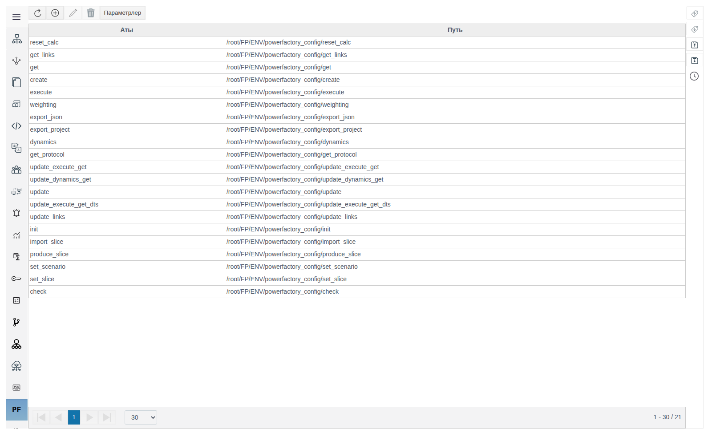
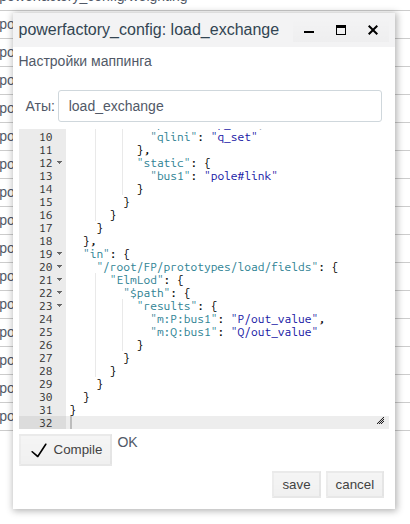
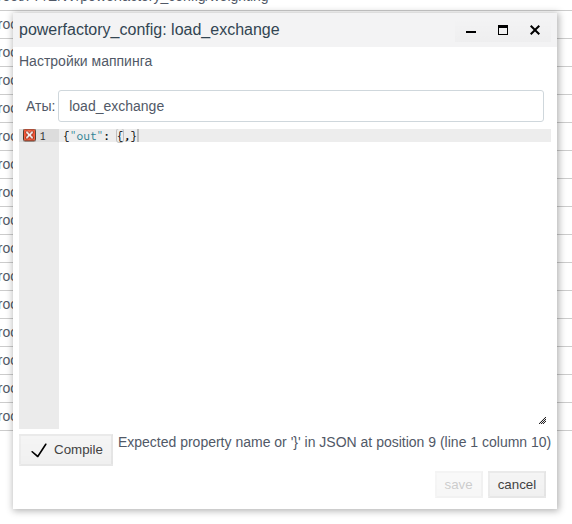
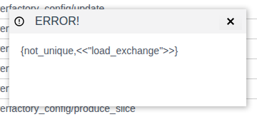
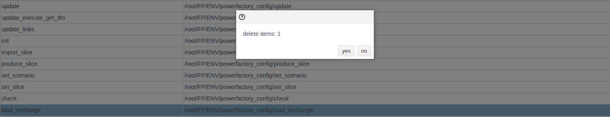
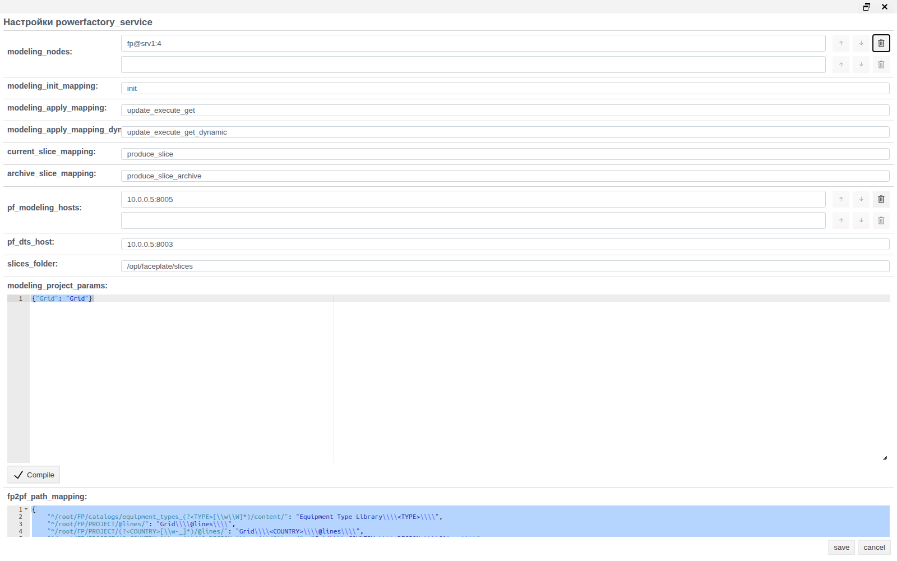
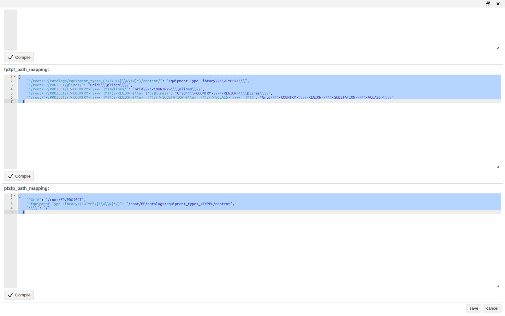
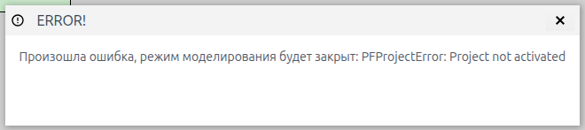

# Powerfactory Service

Құжат Faceplate жобасының DIgSILENT PowerFactory сыртқы есептеу сервисімен деректер алмасуын баптайтын интегратор инженерге арналған.

# Мазмұны

- [Терминдер сөздігі](#терминдер-сөздігі)
- [Кіріспе](#кіріспе)
- [Негізгі бөлім](#негізгі-бөлім)
    - [Маппингтер бөлімі](#маппингтер-бөлімі)
    - [Стандартты маппингтер](#стандартты-маппингтер)
    - [Маппинг жасау](#маппинг-жасау)
    - [Өзгерту және жою](#өзгерту-және-жою)
    - [Маппинг құрылымы](#маппинг-құрылымы)
    - [Сервис баптаулары](#сервис-баптаулары)
    - [Runtime ортасындағы зерттеу режимі](#runtime-ортасындағы-зерттеу-режимі)
    - [Интерфейс ерекшеліктері](#интерфейс-ерекшеліктері)
- [Қорытынды](#қорытынды)

# Терминдер сөздігі

| Термин | Мағынасы |
|---|---|
| Powerfactory Service | Studio басты мәзірінің бөлімі (**PF** белгішесі): PowerFactory интеграциясының маппингтері мен баптаулары |
| Маппинг | Faceplate нысандарының қай өрістері PowerFactory-ге жіберілетінін және алынған мәндер қай өрістерге жазылатынын сипаттайтын атаулы JSON |
| PowerFactory хосты | PowerFactory сыртқы сервисінің `хост[:порт]` түріндегі мекенжайы. Порт көрсетілмесе, 80 қолданылады |
| Модельдеу түйіні | Модельдеу сеанстарын ашуға рұқсат етілген Faceplate кластерінің түйіні |
| Кесінді | Желі күйінің JSON-суреті. Кесінді файлдары Faceplate серверіндегі бумада сақталады |
| Зерттеу режимі | Жобаның ағымдағы күйі бойынша Runtime ортасынан PowerFactory-де желіні есептеу. Нәтижелерді режимді іске қосқан оператор ғана көреді |
| DTS | Диспетчер тренажерінің режимі. PowerFactory-дің бөлек хосты арқылы жұмыс істейді |
| Жолдарды түрлендіру | Faceplate нысанының жолы PowerFactory нысанының жолына және кері айналатын ережелер |

# Кіріспе

Powerfactory Service Faceplate жобасының нысандарын PowerFactory-дегі желі моделімен байланыстырады. Бөлім екі бөліктен тұрады:

| Бөлік | Қай жерде | Нені береді |
|---|---|---|
| Маппингтер | Бөлімнің кестесі | Қандай нысандардың қандай өрістері алмасуға қатысады және олар PowerFactory-дің қандай атрибуттарымен байланысты |
| Баптаулар | **Параметрлер** батырмасы | Қайда қосылу керек, модельдеуге қай жерде рұқсат етілген, әр операция үшін қай маппинг қолданылады, жолдар қалай түрлендіріледі |

Оператор бапталған интеграцияны Runtime ортасында қалай пайдаланады — [«Runtime ортасындағы зерттеу режимі»](#runtime-ортасындағы-зерттеу-режимі) бөлімінде.

Құжат бойындағы мысал: жүктемелерге арналған `load_exchange` маппингі. Жобадағы жүктеме — `p_set`, `q_set`, `pf_outserv` өрістері, түйінге `pole` сілтемесі және `P`, `Q` еншілес нысандары бар `load` [прототипінің](../../project_objects/prototypes/prototypes.md) данасы. PowerFactory-де оған `ElmLod` класы сәйкес келеді.

Жобаны өзгерту құқығы бар тіркелгімен Studio ортасына (`http://<сервер>:9000/fp/studio`) кіру мүмкіндігі және PowerFactory-дегі желі моделін білу қажет: элементтер кластары және олардың атрибуттарының атаулары.

# Негізгі бөлім

## Маппингтер бөлімі

Studio басты мәзірінде **Powerfactory Service** бөлімін ашыңыз. Кестеде маппингтің **Аты** және оның жобадағы **Путь** жолы көрсетілген.



Панель батырмалары солдан оңға қарай: жаңарту, жасау, өңдеу, жою, **Параметрлер**. Өңдеу және жою жолды таңдағаннан кейін қолжетімді. Жолды екі рет шерту де маппингті ашады.

## Стандартты маппингтер

Жаңа жобада бөлімде әдепкі операцияларға арналған маппингтер бар, оның ішінде зерттеу режиміне арналған `init` және `update_execute_get`. Олар белгілі атаулары бар прототиптерге және PowerFactory кластарына есептелген:

| PowerFactory класы | Faceplate прототиптері |
|---|---|
| `ElmSite` | `substation` |
| `ElmSubstat` | `voltage class` |
| `ElmTerm` | `terminal`, `bus terminal`, `line terminal` |
| `ElmCoup` | `circuit_breaker`, `isolator` |
| `ElmBranch` | `line_branch` |
| `ElmLne` | `line` |
| `ElmLnesec` | `linesec` |
| `ElmTr2` | `transformer-2w2t`, `auto-transformer-2w2t` |
| `ElmTr3` | `transformer-3w3t`, `auto-transformer-3w3t` |
| `ElmLod` | `load` |
| `ElmSym` | `generator` |
| `ElmShnt` | `reactor` |
| `ElmXnet` | `external_grid` |

Стандартты маппингтер прототип атауларынан басқа прототиптерде белгілі өрістердің және жобада PowerFactory есептеу командасы нысанының (`ComLdf` класы) болуын күтеді. Қолданар алдында маппингті, мысалы `update_execute_get`, ашып, оны жоба прототиптерімен салыстырыңыз. Егер олар сәйкес келмесе, өз маппингтеріңізді жазыңыз ([«Маппинг жасау»](#маппинг-жасау) қараңыз) және оларды **Параметрлер** ішінде көрсетіңіз.

## Маппинг жасау

1. Жасау батырмасын басыңыз. **Настройки маппинга** терезесі ашылады.
2. **Аты** өрісіне `load_exchange` енгізіңіз. Маппинг **Параметрлер** ішінде осы атпен көрсетіледі.
3. Редакторда маппингтің JSON мәтінін жазыңыз (пішімі [«Маппинг құрылымы»](#маппинг-құрылымы) бөлімінде сипатталған).
4. **Compile** басыңыз. Жанында `OK` пайда болады, және **save** батырмасы қолжетімді болады.
5. Сақтаңыз.



> **Маңызды.** Редактор мәтінді тек **Compile** батырмасы арқылы қабылдайды. Жаңа маппингте **save** **Compile** басылғанша қолжетімсіз. Бар маппингте **save** тек **Аты** өрісін түзеткеннен кейін де қосылады; егер редакторда компиляцияланбаған мәтін қалса, ескертусіз бұрынғы JSON сақталады. Сақтар алдында әрқашан **Compile** басып, `OK` күтіңіз.

### Қателер

| Не көрінеді | Себебі | Не істеу керек |
|---|---|---|
| Редактор жолының жанында қызыл айқыш және **Compile** жанында қате мәтіні, мысалы `Expected property name or '}' in JSON at position 9 (line 1 column 10)` | Мәтін дұрыс JSON емес | Көрсетілген жолды түзетіп, **Compile** қайталаңыз |
| `{not_unique,<<"атау">>}` мәтіні бар **ERROR!** терезесі | Мұндай атпен маппинг бар | Басқа **Аты** беріңіз |





## Өзгерту және жою

Маппингті екі рет шертіп ашыңыз, түзетулер енгізіңіз, **Compile** басыңыз, сақтаңыз. Атын өзгерту сол жерде, **Аты** өрісінде орындалады. Атын өзгерткеннен кейін, егер ескі ат **Параметрлер** ішінде көрсетілсе, оны ауыстырыңыз.

Жою үшін бір немесе бірнеше жолды таңдап, жою батырмасын басыңыз. Растау терезесі атауларсыз тек жолдар санын көрсетеді (`delete items: 1`). **yes** батырмасымен растаңыз.



## Маппинг құрылымы

`load_exchange` маппингі толығымен:

```json
{
  "links": [],
  "out": {
    "/root/FP/prototypes/load/fields": {
      "ElmLod": {
        "$path": {
          "params": {
            "outserv": "pf_outserv",
            "plini": "p_set",
            "qlini": "q_set"
          },
          "static": {
            "bus1": "pole#link"
          }
        }
      }
    }
  },
  "in": {
    "/root/FP/prototypes/load/fields": {
      "ElmLod": {
        "$path": {
          "results": {
            "m:P:bus1": "P/out_value",
            "m:Q:bus1": "Q/out_value"
          }
        }
      }
    }
  }
}
```

Жүктеменің тапсырмалары және оның қосылу түйіні PowerFactory-ге жіберіледі. Есептелген P және Q әр жүктеменің `P` және `Q` еншілес нысандарының `out_value` өрісіне жазылады.

### Жоғарғы деңгейдегі бөлімдер

| Кілт | Мақсаты |
|---|---|
| `out` | PowerFactory-ге не жіберіледі. Прототипке арналған ереже тек `pf_active` өрісі `true` болатын даналарға қолданылады |
| `out_all` | `out` сияқты, бірақ `pf_active` мәніне қарамастан прототиптің барлық даналары үшін. Егер прототип `out` ішінде де сипатталса, `out_all` ережесі ол үшін әрекет етпейді |
| `in` | PowerFactory-ден алынған мәндер қайда жазылады |
| `links` | Басқа маппингтердің атаулары. Олардың ережелері ағымдағы маппингке қосылады, осылайша ортақ бөліктер қайталанбайды |

Барлық бөлім міндетті емес: тек нәтижелерді оқитын маппинг жалғыз `in` бөлімінен тұруы мүмкін.

### Бөлім ішіндегі деңгейлер

| Деңгей | Мысалда | Мағынасы |
|---|---|---|
| Кілт | `/root/FP/prototypes/load/fields` | Прототип өрістері: оның барлық даналарына арналған ереже. `/root/FP/PROJECT` немесе `/root/FP/catalogs/<каталог>/content/` деп басталатын кілт бір нақты нысанға арналған ережені береді |
| PowerFactory класы | `ElmLod` | PowerFactory моделіндегі элемент класы. Бір кілт үшін бір класс көрсетіңіз |
| `$path` | — | **Параметрлер** ішіндегі жолдарды түрлендіру ережелері бойынша нысанның PowerFactory-дегі жолы қойылады |
| Топ | `params`, `results`, `static` | PowerFactory-мен алмасудағы атрибуттар тобы |
| Жұп | `"plini": "p_set"` | Сол жақта PowerFactory атрибуты, оң жақта Faceplate өрісі |

### Faceplate өрісінің жазылуы

Жұптың оң жақ бөлігінің пішімі: `[сілтеме-өріс:][еншілес нысан/]өріс[#түр]`.

| Жазба | Мән қайдан алынады немесе қайда жазылады |
|---|---|
| `p_set` | Нысанның өзінің `p_set` өрісі |
| `P/out_value` | `P` еншілес нысанының `out_value` өрісі |
| `pole:P/out_value` | `pole` өрісі сілтейтін нысан; оның `P` еншілес нысаны, `out_value` өрісі |
| `pole#link` | Сілтеме түріндегі `pole` өрісі: PowerFactory жолына түрлендірілген нысан жолы жіберіледі |

`#` кейінгі түрлер: `link`, `int`, `float`, `json`, `string`.

## Сервис баптаулары

**Параметрлер** басыңыз. Терезе бүкіл экранға ашылады.



### Қосылу және модельдеу

Оператор модельдеумен қалай жұмыс істейді — [«Runtime ортасындағы зерттеу режимі»](#runtime-ортасындағы-зерттеу-режимі) бөлімінде.

| Өріс | Әдепкі | Мақсаты |
|---|---|---|
| **pf_modeling_hosts** | бос | Модельдеу сеанстарына арналған PowerFactory хосттары, `хост[:порт]`. Сеанстар хосттар арасында бөлінеді |
| **pf_dts_host** | бос | DTS режиміне арналған PowerFactory хосты, `хост[:порт]` |
| **modeling_nodes** | бос | `түйін[:N]` түріндегі модельдеу түйіндері, мысалы `fp@srv1:4`. `N` — түйіндегі бір мезгілдегі сеанстардың ең көп саны, `N` болмаса шектеу жоқ. Тізімде жоқ түйінде модельдеу сеансы ашылмайды |
| **modeling_project_params** | `{"Grid": "Grid"}` | PowerFactory жобасының параметрлері бар JSON. Модельдеу сеансы жұмыс істегенде PowerFactory-ге жіберіледі. Онда, мысалы, жоба, есептеу шарты (study case) және жедел сценарий беріледі |

### Операциялар маппингтері

Әр өрісте бөлім кестесіндегі маппингтің **Аты** көрсетіледі. Сервис маппингті атаудың дәл сәйкестігі бойынша іздейді.

| Өріс | Әдепкі | Қашан қолданылады |
|---|---|---|
| **modeling_init_mapping** | `init` | Модельдеу сеансын іске қосу: сеансқа жобаның қандай деректерін жүктеу керек |
| **modeling_apply_mapping** | `update_execute_get` | Сеанстағы есептеу: PowerFactory-ге не жіберу және нәтижені қайда жазу керек |
| **modeling_apply_mapping_dynamic** | `update_execute_get_dynamic` | Динамикалық есептеу. Стандартты жиынтықта мұндай атты маппинг жоқ: оны жасаңыз немесе басқасын көрсетіңіз |
| **current_slice_mapping** | `produce_slice` | **slices_folder** ішіндегі файлдан кесіндіні жоба нысандарына жүктеу |
| **archive_slice_mapping** | `produce_slice_archive` | Мұрағат деректері бойынша кесіндіге арналған маппинг аты. Стандартты жиынтықта мұндай атты маппинг жоқ: оны жасаңыз немесе басқасын көрсетіңіз |

Операция мысалдағы маппинг бойынша жұмыс істеуі үшін тиісті өріске `load_exchange` көрсетіп, сақтаңыз.

### Кесінділер мен жолдар

| Өріс | Әдепкі | Мақсаты |
|---|---|---|
| **slices_folder** | бос | Faceplate серверіндегі кесінділер бумасының абсолютті жолы, мысалы `/opt/faceplate/slices`. Міндетті өріс |
| **fp2pf_path_mapping** | `/root/FP/PROJECT` және жабдық түрлері каталогтарына арналған ережелер | Faceplate жолдарын PowerFactory жолдарына түрлендіру |
| **pf2fp_path_mapping** | `Grid` және `Equipment Type Library` үшін ережелер | Кері түрлендіру |

### Пішінмен жұмыс

- Тізімдік өрістерде (**modeling_nodes**, **pf_modeling_hosts**) мәнді енгізгеннен кейін келесі мәнге арналған бос жол пайда болады. Көрсеткілер ретін өзгертеді, себет жолды жояды.
- **slices_folder** бос тұрғанда, кез келген басқа түзетулерде **save** қолжетімсіз. Бірінші баптау кезінде кесінділер бумасын толтырыңыз.
- Пішіннің төменгі жағындағы JSON-өрістер түзетуді тек өрістің астындағы **Compile** батырмасы арқылы қабылдайды. **Compile** басылмаса, осы өрістің бұрынғы мәні сақталады.



### Жолдарды түрлендіру

**fp2pf_path_mapping** және **pf2fp_path_mapping** ішіндегі әр ереже — «тұрақты өрнек — алмастыру» жұбы. `(?<АТЫ>…)` атаулы топтары алмастыруға `<АТЫ>` ретінде қойылады. Ережелерді нысан жолы тек бір ережеге сәйкес келетіндей құрыңыз.

Ереже:

```json
"^/root/FP/PROJECT/(?<COUNTRY>[\\w-_]*)/(?<REGION>[\\w-_]*)/@lines/": "Grid\\\\<COUNTRY>\\\\<REGION>\\\\@lines\\\\"
```

`/root/FP/PROJECT/C1/NORTH/@lines/L1` жолын `Grid\C1\NORTH\@lines\L1` жолына түрлендіреді.

Ережелер жоба бумаларының құрылымын көрсетуі керек. Егер түрлендіруден кейін нысан жолы PowerFactory моделіндегі жолмен сәйкес келмесе, оның деректері алмасуға түспейді.

## Runtime ортасындағы зерттеу режимі

Зерттеу режимі — жобаның ағымдағы күйі бойынша PowerFactory-де желінің орныққан режимін есептеу. Оператор сызбаларда желі элементтерінің күйін өзгертеді және өзгерістерді есептеуге жібереді. Жоба деректері бұл кезде өзгермейді.

Режим үшін [«Қосылу және модельдеу»](#қосылу-және-модельдеу) бөліміндегі баптаулар қажет: **modeling_nodes** ішінде Faceplate түйіні, **pf_modeling_hosts** ішінде хост және **modeling_init_mapping** мен **modeling_apply_mapping** ішінде маппингтер (әдепкі бойынша `init` және `update_execute_get`). PowerFactory-дегі желі моделі құрылымы бойынша жобаға сәйкес келуі керек, [«Жолдарды түрлендіру»](#жолдарды-түрлендіру) қараңыз.

Режим Runtime (`http://<сервер>:9000/fp/runtime`) жоғарғы жолындағы колба белгішесі мен PF әріптері бар батырмамен іске қосылады, ол сағаты бар күнтізбе белгішесі мен лупаның арасында орналасқан. Батырма **modeling_nodes** ішіндегі түйіндерде болады. Runtime баптауларды бетті ашқан кезде тексереді: оларды өзгерткеннен кейін Runtime бетін жаңартыңыз.


Оператордың жұмыс реті:

1. Оператор батырманы басады. Есептеу сеансы дайындалып жатқанда Runtime «Preparing powerfactory research mode...» мәтіні бар **Please wait** терезесін көрсетеді. Содан кейін **calculate** және **close** батырмалары бар «Меню режима исследования» терезесі ашылады.
2. Терезе ашық тұрғанда оператор сызбаларда жобаның басқару элементтерімен енгізетін өзгерістерді — коммутациялық аппараттардың күйін, генерацияны, жүктемені — тек ол өзі көреді. Олар жобаға жазылмайды, басқа пайдаланушыларда сызбалар жоба деректерін көрсетеді.
3. **calculate** өзгерістерді **modeling_apply_mapping** ішіндегі маппинг бойынша есептеуге жібереді. Есептеу нәтижесі сызбаларда пайда болады.
4. **close** немесе айқыш терезені жабады және режимді аяқтайды. Сызбалар қайтадан жоба деректерін көрсетеді, оператордың өзгерістері сақталмайды.


Егер жобада динамиканы ескеретін есептеу бапталса, терезеде **dynamic** / **static** ауыстырғышы және **tstop** өрісі — есептеу уақыты бар. Мұндай есептеу үшін **modeling_apply_mapping_dynamic** ішіндегі маппинг қолданылады.

Қателер:

| Қате | Оператор не көреді | Әрі қарай не болады |
|---|---|---|
| Ескерту | Мәзірдің үстінде PowerFactory мәтіні бар терезе | Терезе айқышпен жабылады, режимдегі жұмыс жалғасады |
| Есептеу кезіндегі сыни қате | **ERROR!** терезесі: «Произошла ошибка, режим моделирования будет закрыт: <қате мәтіні>» | Терезе жабылғаннан кейін режим аяқталады, оны қайта іске қосады |
| **pf_modeling_hosts** ішінде хост жоқ | `no_modeling_instance_running` мәтіні бар **ERROR!** терезесі | **Параметрлер** ішінде хостты көрсетіңіз |
| Түйінде **modeling_nodes** ішінде рұқсат етілгендей сеанс ашылған | **ERROR!** терезесі: «PF Research: the server did not return a session ID» | Режимді басқа оператор өз режимін жапқанда іске қосады |
| Іске қосу кезіндегі сыни қате | Қате мәтіні бар **ERROR!** терезесі | Режим ашылмайды |



Егер қатеге оператордың өзгерістері себеп болса, оларды бастапқы күйге қайтарады немесе режимді қайта іске қосады. Қайта іске қосқанда өзгерістер жоғалады.

## Интерфейс ерекшеліктері

| Экранда | Қай жерде |
|---|---|
| Аударылмаған **save**, **cancel**, **Compile**, **yes**, **no** батырмалары | Маппинг, баптаулар, растау терезелері |
| `delete items: N` жазуы | Жоюды растау |
| `{not_unique,<<"атау">>}` түріндегі сервер қателері | **ERROR!** терезесі |
| **modeling_apply_mapping_dynamic** өрісінің ұзын атауы қиылған | Баптаулар терезесі |
| Кестенің төменгі жағындағы жолдар санағышы жойғаннан кейін бірден жаңармайды | Маппингтер кестесі |

# Қорытынды

Интеграцияны баптау реті:

1. **Параметрлер** ішінде **pf_modeling_hosts** және қажет болса **pf_dts_host** көрсетіңіз.
2. **modeling_nodes** ішінде модельдеуге рұқсат етілген Faceplate түйіндерін сеанстар шегімен тізіп шығыңыз.
3. **slices_folder** толтырыңыз: онсыз баптаулар сақталмайды.
4. **fp2pf_path_mapping** және **pf2fp_path_mapping** ішінде жоба құрылымы мен PowerFactory моделінің сәйкестігін сипаттаңыз.
5. Маппингтерді жазыңыз: әр прототип үшін PowerFactory класын және `out` пен `in` ішінде «атрибут — өріс» жұптарын көрсетіңіз. Ортақ бөліктерді бөлек маппингке шығарып, `links` арқылы қосыңыз.
6. Операциялар өрістерінде маппингтердің атауларын көрсетіңіз.
7. JSON әр сақтау алдында **Compile** басып, `OK` күтіңіз.
8. Зерттеу режимін тексеріңіз: **modeling_nodes** ішіндегі түйінде Runtime бетін жаңартыңыз, жоғарғы жолда зерттеу режимінің батырмасы пайда болуы керек.
