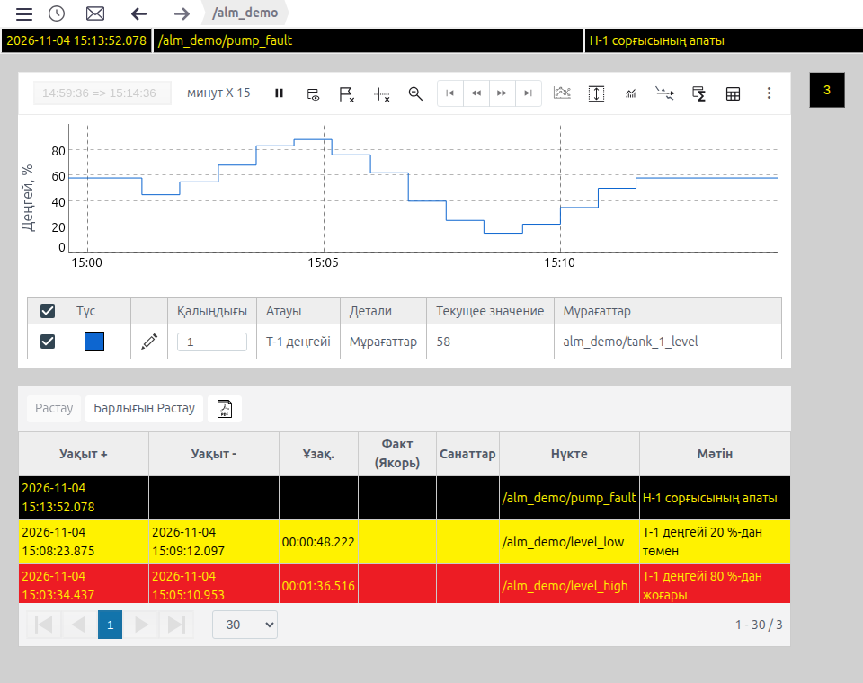
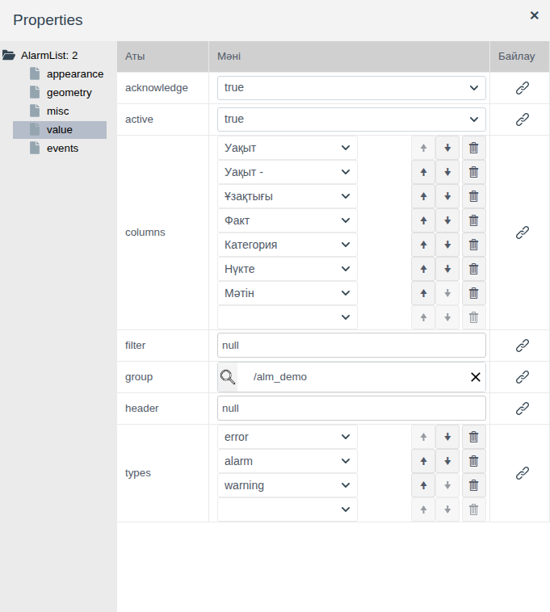
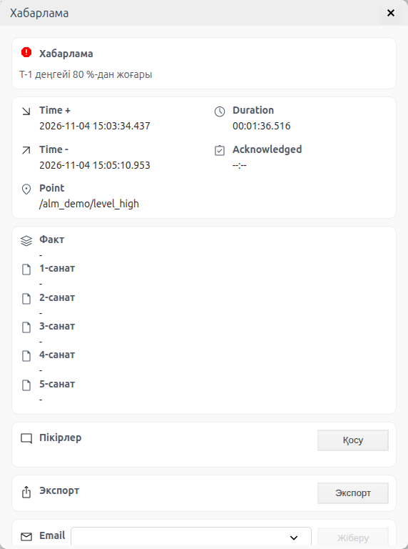
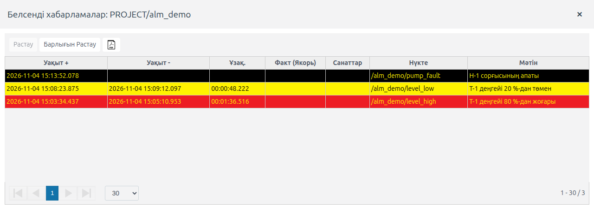
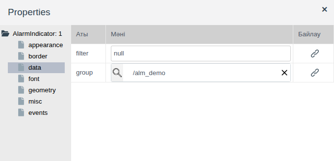
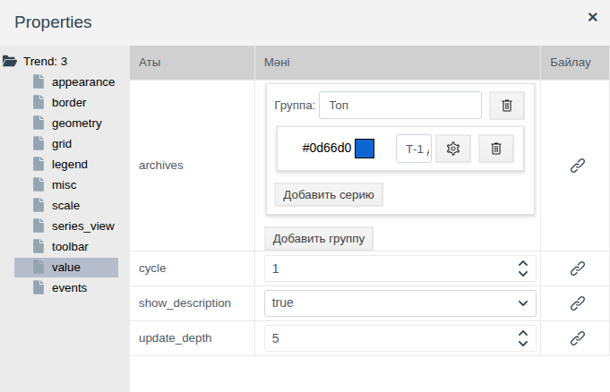
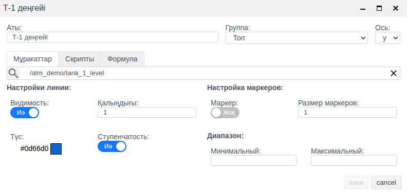
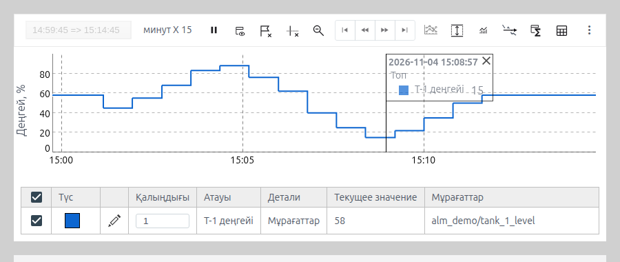

# Экрандағы дабылдар мен трендтер

Бұл құжат мнемосызбада операторға өз жабдығының дабылдарын және соңғы минуттардағы немесе сағаттардағы мән графигін көрсетуі қажет интегратор инженерге арналған.

# Мазмұны

- [Терминдер сөздігі](#терминдер-сөздігі)
- [Кіріспе](#кіріспе)
- [Негізгі бөлім](#негізгі-бөлім)
    - [Палитрадағы элементтер](#палитрадағы-элементтер)
    - [Хабарламалар тізімі: тізімге не түседі](#хабарламалар-тізімі-тізімге-не-түседі)
    - [Хабарламалар тізімі: бағандар және Runtime ортасындағы көрінісі](#хабарламалар-тізімі-бағандар-және-runtime-ортасындағы-көрінісі)
    - [Хабарламалар тізімі: оператордың жұмысы](#хабарламалар-тізімі-оператордың-жұмысы)
    - [Хабарлама индикаторы](#хабарлама-индикаторы)
    - [Тренд: сериялар](#тренд-сериялар)
    - [Тренд: скрипт немесе формула бойынша серия](#тренд-скрипт-немесе-формула-бойынша-серия)
    - [Тренд: уақыт терезесі, шкалалар және жаңарту](#тренд-уақыт-терезесі-шкалалар-және-жаңарту)
    - [Тренд: безендіру және легенда](#тренд-безендіру-және-легенда)
    - [Тренд: құралдар панелі](#тренд-құралдар-панелі)
- [Қорытынды](#қорытынды)

# Терминдер сөздігі

| Термин | Мағынасы |
|---|---|
| Хабарлама үлгісі | `alarm_template` түріндегі жоба нысаны: тег өрісін бақылайды және шарт орындалғанда хабарлама жасайды. Үлгіні жасау [Messages and alarms in Faceplate, «Configuring a message» бөлімі](../../en/alarms/alarm/alarm_en.md#2-configuring-a-message) құжатында сипатталған |
| Хабарлама | Үлгі жасайтын журнал жазбасы: пайда болу уақыты, жойылу уақыты, мәтін, түр. Дабыл — бұзушылық туралы хабарлама |
| Хабарлама түрі | `error`, `alarm`, `warning`, `info`, `dsf` — үлгіде беріледі. Тізімдегі жолдың түсі және индикатордың түсі түрге байланысты |
| Белсенді хабарлама | Үлгі шарты әлі орындалып тұр: жойылу уақыты бос |
| Растау | Оператордың хабарламаны көргенін растауы. Белсенділікті алмайды: расталған хабарлама шарт орындалып тұрғанша белсенді болып қалады |
| Топ | Элемент хабарламаларын көрсететін жоба бумасы немесе жеке үлгі |
| Мұрағат | Тег өрісінің мәндер тарихын жазатын `ARCHIVE` түріндегі жоба нысаны. Мұрағат жасау [Archives: configuring sources and recording data](../../en/data_storage/archives/archives_en.md) құжатында сипатталған |
| Серия | Трендтің бір сызығы: мұрағат, скрипт немесе формула, өз түсі мен осі бар |
| Қима | Трендтегі тік сызық: сол сәттегі уақыт пен серия мәндерінің жазуы бар |
| Легенда | Тренд графигіндегі тақта: тінтуір меңзері астындағы нүктенің уақыты, сол нүктедегі сериялардың атаулары мен мәндері |
| Деңгей сызығы | Трендтегі берілген мәндегі көлденең сызық |

«Тег», «Байланыстыру» терминдері — [Батырмалар және мәндерді енгізу](controls.md#терминдер-сөздігі) құжатында, «Сызба», «Палитра», «Элемент» — [Мнемосызбалар редакторы](editor.md#терминдер-сөздігі) құжатында түсіндірілген.

# Кіріспе

Жоба дабылдары операторға сызбаның үстіндегі дабыл жолағында және хабарламалар журналында көрінеді. Экранда бір қондырғы болғанда бұл жеткіліксіз: операторға дәл осы қондырғы жабдығының дабылдары оның мнемосызбасының жанында және мәннің шекке қалай жақындағанын көрсететін параметр графигі қажет. Ол үшін сызбаға үш элемент қойылады:

- **Хаттар тізімі** — таңдалған буманың хабарламалар кестесі, растау мүмкіндігімен;
- **Хабар көрсеткіші** — хабарламалар саны бар шаршы, түсі ең ауыр түрді көрсетеді; шерткенде тізімі бар терезені ашады;
- **Трендтер** — тарихты қарауға арналған панелі бар мұрағат мәндерінің графигі.

Құжатта осы элементтердің қасиеттері және олардың Runtime ортасындағы көрінісі сипатталған. Редактордағы жұмыс (қосу, белгілеу, қасиеттер, сақтау) [Мнемосызбалар редакторы](editor.md) құжатында сипатталған.

Құжат бойындағы мысал — `alm_demo` бумасының `screen` сызбасы. Бумада `level` (float, ыдыстағы деңгей, %) және `fault` (integer, сорғы апаты) өрістері бар өз `demo_alm` примитивінің `tank_1` нысаны, `level` өрісінің `tank_1_level` мұрағаты және үш хабарлама үлгісі бар:

| Үлгі | Шарт | Түр | Мәтін |
|---|---|---|---|
| `level_high` | `level` > 80 | `alarm` | Т-1 деңгейі 80 %-дан жоғары |
| `level_low` | `level` < 20 | `warning` | Т-1 деңгейі 20 %-дан төмен |
| `pump_fault` | `fault` ≠ 0 | `error` | Н-1 сорғысының апаты |

Мысалда деңгей 80 %-дан жоғары көтеріліп, 20 %-дан төмен түсті, содан кейін сорғы апаты қосылды. Тренд соңғы 15 минуттағы деңгейді, тізім — үш хабарламаны, индикатор — қара фондағы 3 санын көрсетеді: расталмаған `error` апаты бар.



Жобаны өзгерту құқығы бар тіркелгімен Studio ортасына (`http://<сервер>:9000/fp/studio`) кіру мүмкіндігі қажет. Нәтиже Runtime ортасында (`http://<сервер>:9000/fp/runtime`) тексеріледі, жобаның Runtime ортасы іске қосулы болуы керек.

# Негізгі бөлім

## Палитрадағы элементтер

Үш элемент те **Controls** палитрасында орналасқан:

| Белгіше кеңесі | Қасиеттер ағашының түбірі | Мақсаты |
|---|---|---|
| Хаттар тізімі | `AlarmList` | Растау батырмалары бар топ хабарламаларының кестесі |
| Хабар көрсеткіші | `AlarmIndicator` | Топ хабарламаларының санағышы, түсі ең ауыр түр бойынша |
| Трендтер | `Trend` | Мұрағат мәндерінің графигі |

**appearance**, **geometry**, **misc** және **events** топтары сызбаның басқа элементтеріндегідей ([Графикалық элементтер, «Ортақ қасиеттер» бөлімі](graphics.md#ортақ-қасиеттер) құжатын қараңыз).

Редакторда элементтер дайындаманы көрсетеді: тізім — толтырғыш жолдарды, тренд — шартты қисықты. Хабарламалар мен мұрағат деректері тек Runtime ортасында пайда болады.

## Хабарламалар тізімі: тізімге не түседі

Қандай хабарламаларды көрсету керектігін **value** тобы береді.



| Қасиет | Мақсаты |
|---|---|
| `group` | Лупа арқылы таңдалған бума немесе хабарлама үлгісі. Тізім осы буманың үлгілерінің немесе бір үлгінің хабарламаларын көрсетеді. Бос — бүкіл жобаның хабарламалары. Мысалда `/alm_demo` |
| `acknowledge` | `true` — расталмаған хабарламаларды көрсету |
| `active` | `true` — белсенді хабарламаларды көрсету |
| `types` | Хабарлама түрлері. Жаңа элементте `error`, `alarm`, `warning`; төменгі бос жолда тағы `info` таңдауға болады, себет түрді алып тастайды. Барлық жолды жойсаңыз, түр бойынша шектеу болмайды: тізім қызметтік хабарламаларды да көрсетеді — «Диспетчер кеңесшісінің» жиынтықтарын (`dsf`) және пайдаланушылардың жүйеге кіруін (`oper`; олар бумаға байланбаған және тек `group` бос болғанда көрінеді). Қызметтік хабарламалардың жолдары ақ |
| `filter` | **JSON** терезесіндегі қосымша іріктеу шарты |

`acknowledge` және `active` бірге жұмыс істейді:

| `acknowledge` | `active` | Тізім не көрсетеді |
|---|---|---|
| `true` | `false` | Расталмаған хабарламалар: белсенділері де, жойылғандары да. Жаңа элементте осылай |
| `false` | `true` | Белсенді хабарламалар: расталғандары да, расталмағандары да |
| `true` | `true` | Белсенді немесе расталмаған хабарламалар. Хабарлама жойылған әрі расталған кезде тізімнен кетеді |
| `false` | `false` | Топтың барлық хабарламалары, жойылған және расталғандарын қоса |

Қондырғы экраны үшін әдетте `true` / `true` таңдалады: оператор әлі назар аударуды қажет ететіннің бәрін көреді, ал расталған, бірақ жойылмаған дабыл жоғалмайды. Мысалда осылай жасалған.

`filter` хабарлама өрістері бойынша іріктеуді тарылтады. Әдепкі мән `null` — шарт жоқ. Мән өрісін шерткенде `{}` дайындамасы бар **JSON** терезесі ашылады; оны `[өріс, оператор, мән]` шарт-массивімен ауыстырыңыз, мысалы тек бір үлгінің хабарламалары:

```
["point", "=", "/<бума>/<үлгі>"]
```

`point` өрісі — үлгінің жолы, ол **Нүкте** бағанында көрінеді. Енгізгеннен кейін **Compile**, содан кейін **OK** басыңыз.

## Хабарламалар тізімі: бағандар және Runtime ортасындағы көрінісі

`columns` қасиеті — бағандардың ретімен берілген тізімі. Әр жол — ашылмалы тізім, бағыттауыштар ретті өзгертеді, себет бағанды жояды, төменгі бос жол жаңасын қосады.

| `columns` ішіндегі баған | Runtime ортасындағы тақырып | Мазмұны |
|---|---|---|
| Уақыт | Уақыт + | Пайда болу уақыты |
| Уақыт - | Уақыт - | Жойылу уақыты. Хабарлама белсенді болғанша бос |
| Ұзақтығы | Ұзақ. | Хабарламаның қанша уақыт белсенді болғаны |
| Факт | Факт (Якорь) | Үлгіде хабарламалар байланыстырылған болса, байланысты оқиға |
| Категория | Санаттар | Үлгідегі 1–5 санаттар `/` арқылы |
| Нүкте | Нүкте | Хабарлама үлгісінің жолы |
| Мәтін | Мәтін | Хабарлама мәтіні |

Runtime ортасында жолдар пайда болу уақыты бойынша сұрыпталған, жаңалары жоғарыда. Жолдың түсі хабарлама түріне байланысты (`types` ішіндегі түрлер):

| Түр | Жол фоны | Мәтін |
|---|---|---|
| `error` | Қара | Сары |
| `alarm` | Қызыл | Сары |
| `warning` | Сары | Қара |
| `info` | Көгілдір | Қара |

Тізім өздігінен жаңарады: жаңа хабарлама сызбаны қайта жүктемей-ақ жоғарыда пайда болады, жойылғанына жойылу уақыты мен ұзақтығы қосылады. Кестенің астында — беттерді ауыстырғыш және беттегі жолдар саны (әдепкі 30), оң жақта — жолдар ауқымы және хабарламалардың жалпы саны.

Мысалда тізім 860 × 290 пиксель, барлық жеті баған; мұндай енде күн мен уақыт екінші жолға тасымалданады.

## Хабарламалар тізімі: оператордың жұмысы

Кестенің үстінде үш батырма бар:

| Батырма | Әрекет |
|---|---|
| **Растау** | Белгіленген жолдарды растайды. Ештеңе белгіленбегенше белсенді емес. Жол шертумен, бірнеше жол Ctrl басылған шертулермен белгіленеді |
| **Барлығын Растау** | Тізімнің ағымдағы бетіндегі барлық жолды растайды |
| PDF белгішесі | Тізім жазбаларын A4 парағына альбомдық бағдарда кесте түрінде басып шығаруға жібереді. Браузердің басып шығару терезесінде принтерді немесе PDF-ке сақтауды таңдаңыз |

Растаудан кейін жол `acknowledge` және `active` мәндеріне байланысты қалады немесе кетеді. Мысалда (`true` / `true`) расталған `level_high` дабылы әлдеқашан жойылған, сондықтан тізімнен кетеді, ал расталған `pump_fault` апаты белсенді болғанша қалады.

Жолды екі рет шерту хабарлама карточкасын ашады: мәтін, пайда болу және жойылу уақыты, ұзақтығы, растау, нүкте, факт және санаттар. Төменде — **Қосу** (пікір), **Экспорт** батырмалары және **Email** жолы. Карточкамен жұмыс [Messages and alarms in Faceplate, «Operator actions» бөлімі](../../en/alarms/alarm/alarm_en.md#3-operator-actions) құжатында сипатталған.

**Email** хабарламаны хатпен жібереді. Ашылмалы тізімде — `operators` рөлі бар пайдаланушылар; хат олардың тіркелгісінің **Email** өрісіндегі мекенжайға жіберіледі (Studio → **Пайдаланушы құқықтары** → **Пайдаланушылар**). Бір немесе бірнеше алушыны таңдап, **Жіберу** басыңыз; жіберілгеннен кейін жіберілгені туралы хабар шығады. Хатта хабарлама мәтіні, түрі, нүктесі, пайда болу уақыты, факт және санаттар бар. Жіберу үшін Studio → **Хабарлама** → **Параметрлер** → «Жалпы параметрлер» ішінде SMTP параметрлері толтырылып, «Email хабарландыруларын қосу» ауыстырғышы қосулы болуы керек ([Messages and alarms in Faceplate, «Email notifications» бөлімі](../../en/alarms/alarm/alarm_en.md#7-email-notifications) құжатын қараңыз). Мысалда `level_high` туралы хат `mail_test` пайдаланушысына жіберіліп, алынды.



## Хабарлама индикаторы

Индикатор — топ хабарламаларының саны бар шаршы. Ол аз орын алады, сондықтан оны сызбаның бұрышына немесе қондырғыға өту батырмасына қояды, ал тізімді тек қондырғының өз экранына қояды.

Индикатор тек `error`, `alarm` және `warning` түрлеріндегі белсенді немесе расталмаған хабарламаларды санайды; басқа түрдегі хабарламаларды ескермейді. Есептелген хабарламалар бойынша ол көрінісін таңдайды:

| Топ хабарламаларының күйі | Индикатордың көрінісі |
|---|---|
| Белсенді де, расталмаған да жоқ | Индикатор жасырын |
| Расталмағандары бар | Жыпылықтайды, түсі расталмағандардың ең ауыр түрі бойынша |
| Бәрі расталған, бірақ кейбірі белсенді | Жыпылықтамай жанады, түсі ең ауыр түр бойынша |

Түстер: `error` — қара фондағы сары сан, `alarm` — қызыл фондағы сары, `warning` — сары фондағы қара. Сан — қанша хабарлама есептелгені, 99-дан көп болса — `99+`.

Мысалда индикатор 40 × 40 пиксель, сызбаның оң жақ жоғарғы бұрышында. Үш хабарламаның бәрі расталғаннан кейін ол жыпылықтауды тоқтатып, қара фонда 1 санын көрсетеді: сорғы апаты әлі белсенді. Ол жойылғаннан кейін индикатор жасырылады.

Индикаторды шерту «Белсенді хабарламалар: PROJECT/<бума>» терезесін ашады, онда сол хабарламалар тізімі және сол **Растау**, **Барлығын Растау** және PDF батырмалары бар.



Нені санау керектігін **data** тобы береді; сан мен жиектің көрінісін — **font** және **border** топтары.



| Топ | Қасиет | Мақсаты |
|---|---|---|
| **data** | `group` | Индикатор хабарламаларын санайтын бума немесе үлгі. Бір үлгі таңдалса, индикатор тек соны бақылайды |
| | `filter` | Тізімдегідей **JSON** терезесіндегі қосымша шарт. Мысалы `["type", "=", "alarm"]` — тек `alarm` дабылдарын санау |
| **font** | `font_family`, `font_size`, `bold`, `italic` | Санның қарпі |
| **border** | `border_width`, `border_color`, `border_style`, `border_radius` | Жиек; `border_radius` бұрыштарды дөңгелейді, радиус қабырғаның жартысына тең болса, индикатор дөңгелек болады |

Фон мен санның түсін хабарлама түрі береді, олар үшін бөлек қасиет жоқ.

## Тренд: сериялар

Тренд нені салатынын **value** тобындағы `archives` қасиеті береді. Мәні — серия топтарының жиыны. Әр топта атауы бар **Группа** өрісі және серия жолдары бар: түс, атау, баптау батырмасы (тісті доңғалақ) және себет. **Серия қосу** топқа жол қосады, **Топ қосу** — жаңа топ.



Тісті доңғалақ серия терезесін ашады:



| Өріс | Мақсаты |
|---|---|
| **Аты** | Сипаттама кестесіндегі, легендадағы және қималардағы серия жазуы |
| **Группа** | Серия қай серия тобына кіреді. Топ атауы легенда мен қимада серияның үстінде шығады |
| **Ось** | `y` — сол жақ ось, `y2` — оң жақ. `y2` осіне басқа ауқымды параметр шығарылады, мысалы деңгейдің жанындағы қысым |
| **Мұрағаттар** | Серия мәндерін салатын мұрағат. Лупа арқылы таңдалады |
| **Видимость** | **Жоқ** — сызба ашылғанда серия жасырын, сипаттама кестесіндегі оның жалаушасы алынған. Оператор жалаушаны белгілеп, серияны көрсетеді. Үнемі қажет емес көмекші серияларға ыңғайлы |
| **Қалыңдығы**, **Түс** | Сызықтың қалыңдығы мен түсі |
| **Ступенчатость** | **Иә** — мән мұрағаттың келесі жазбасына дейін сақталады, сызық сатылы. **Жоқ** — нүктелер көлбеу кесінділермен қосылады |
| **Маркер**, **Размер маркеров** | **Иә** — мұрағаттың әр жазбасында нүкте; нүктенің пиксельдегі өлшемі |

Серия терезесінде **save** басыңыз, содан кейін сызбаны сақтаңыз.

Runtime ортасында графиктің астында — серияларды сипаттау кестесі: көріну жалаушасы, түсі, қалыңдығы, атауы, дереккөз түрі (**Детали**), ағымдағы мәні және мұрағаты. Жалаушаны алып тастау сызықты жасырады.

Мысалда «Топ» деген бір топ және `/alm_demo/tank_1_level` мұрағаты бойынша «Т-1 деңгейі» деген бір серия, `y` осі, түсі көк, қалғаны әдепкі.

## Тренд: скрипт немесе формула бойынша серия

Мұрағаттан басқа серия бірнеше мұрағаттан есептелген мәнді көрсете алады: шығындар қосындысын, температуралар айырмасын, басқа өлшем бірліктеріне қайта есептеуді. Ол үшін серия терезесінде **Скрипты** және **Формула** қойындылары бар.

Екі қойындыда да жоғарыда **variablearchive** айнымалылар тізімі бар: жолда айнымалы атауы және лупа арқылы таңдалған мұрағат. Соңғы жол толтырылғаннан кейін жаңа жол пайда болады.

**Скрипты** қойындысында — JavaScript функциясы. Ол айнымалылар мәндерін `VARS` ішінде алып, сан немесе `null` қайтарады:

```javascript
function(VARS) {
   const result = VARS.<айнымалы> * 2;
   if (typeof result !== 'number') return null;
   return result;
}
```

Енгізгеннен кейін **Compile**, содан кейін **save** басыңыз.

**Формула** қойындысында — электрондық кесте формулалары стиліндегі өрнек: айнымалы атаулары, арифметика және функциялар, мысалы `ROUND`:

```
ROUND(<айнымалы> / 10, 0) * 10
```

Сипаттама кестесінде мұндай серияның **Детали** бағанында — «Скрипт» немесе формула мәтіні, **Мұрағаттар** бағанында — айнымалылар атаулары. Мәні 65,46 болатын деңгей мұрағатында тексерілді: `VARS.lv * 2` скрипті 130,91 берді, `ROUND(lv / 10, 0) * 10` формуласы — 70.

## Тренд: уақыт терезесі, шкалалар және жаңарту

Тренд ағымдағы уақытпен бірге жылжитын соңғы уақыт кесіндісін көрсетеді.

| Топ | Қасиет | Мақсаты |
|---|---|---|
| **scale** | `time_step` | Терезе ұзындығының бірлігі: `second`, `minute`, `hour` |
| | `time_factor` | Осы бірліктердегі терезе ұзындығы. `minute` және 15 — соңғы 15 минут |
| | `range_min`, `range_max` | Сол жақ осьтің шекаралары. Бос — деректер бойынша таңдалады |
| | `y2_range_min`, `y2_range_max` | Оң жақ осьтің шекаралары |
| **value** | `cycle` | Графикті жаңарту кезеңі, секундпен. Мұрағаттың жаңа мәні графикте `cycle` секундтан кешіктірмей пайда болады |
| | `show_description` | `false` — графиктің астындағы серияларды сипаттау кестесі жасырын, график бүкіл биіктікті алады |
| | `update_depth` | Жаңарту кезінде мұрағатты қайта оқу тереңдігі, секундпен. 1-ден бастап бүтін сан, әдепкі 5 |

Терезе ұзындығы Runtime ортасында панель батырмасында көрінеді, мысалы «минут X 15». Мысалда `time_step` = `minute`, `time_factor` = 15, `range_min` = 0, `range_max` = 100, `cycle` = 1.

Ось шекаралары бос болса, ось көрінетін мәндерге бейімделеді: деңгей тұрақтыға жақын болғанда шағын тербелістер бүкіл биіктікке созылады. Ауқымы белгілі параметр үшін оператор сызықтың орнын шектермен салыстыра алуы үшін шекараларды анық беріңіз.

Сызба ашылғанда тренд бүкіл терезені жүктейді, ал әр жаңартуда мұрағаттың соңғы `update_depth` секундын қайта оқиды. Мұрағатқа кешігіп түсетін мәндерді — жазу сәтінен ертерек уақыт белгісімен, мысалы `ts` қайтаратын мұрағат скриптінен ([Archives, «Script sources» бөлімі](../../en/data_storage/archives/archives_en.md#script-sources) құжатын қараңыз), — кешігу `update_depth` мәнінен аз болса, тренд іліп алады. Мұндай мұрағат үшін `update_depth` мәнін жазу кешігуінен үлкен етіп беріңіз.

## Тренд: безендіру және легенда

| Топ | Қасиет | Мақсаты |
|---|---|---|
| **series_view** | `ylabel`, `y2label` | Сол жақ және оң жақ осьтердің жазулары. Мысалда `ylabel` = «Деңгей, %» |
| | `ylabel_width` | Ось жазуы қарпінің өлшемі, 12-ден 32-ге дейін |
| | `fill_graph` | `true` — сызықтың астындағы аймақ серия түсімен боялады |
| | `fill_opacity` | Бояудың мөлдір еместігі, 0-ден 1-ге дейін |
| **grid** | `grid` | `false` — торсыз |
| | `grid_x`, `grid_y` | Тордың көлденең және тік қадамы, пиксельмен |
| **legend** | `legend` | Легенданы — мәндері бар серия жазуларын — қашан көрсету: `always` — әрқашан графиктің сол жақ жоғарғы бұрышында, `follow` — тінтуір меңзерінің жанында, `never` — көрсетпеу |
| | `legend_font_family`, `legend_font_size`, `legend_text_color`, `legend_background_color` | Легенданың қарпі, мәтін және фон түсі |
| | `legend_max_numbers_after_point` | Легенда мәндеріндегі және **Текущее значение** бағанындағы үтірден кейінгі таңбалар саны |
| | `max_hairlines` | Бір мезгілде қанша қима қоюға болады |
| **misc** | `background_color` | Элемент фоны |
| **border** | `border_width`, `border_color`, `border_style`, `border_radius` | Элемент жиегі |

Қиманы оператор графикті оң жақ батырмамен шертіп қояды: сол сәттегі күні, уақыты және серия мәндері бар тік сызық. Қима тінтуірмен сүйреледі, × оны жабады. Қималар саны `max_hairlines` мәніне жеткенде, жаңа қима ең ескісін ауыстырады. Графикті екі рет шерту меңзер астындағы мәнге деңгей сызығын қосады, ол сипаттама кестесінде «Линия уровня 1» ретінде пайда болады.



## Тренд: құралдар панелі

Графиктің үстінде — құралдар панелі. **toolbar** тобының жалаушалары онда қандай батырмалар көрінетінін анықтайды. Осылайша интегратор операторға тек қажетті құралдарды қалдырады, мысалы ауысым экранынан экспорт пен аналитиканы алып тастайды.

| Қасиет | Мән | Панель |
|---|---|---|
| `toolbar_visible` | `show` | Панель көрінеді. Жаңа элементте осылай |
| | `hide` | Панель жоқ, оның орнын график алады |
| | `roll up` | Панель жиналған; сол жақ жоғарғы бұрыштағы үшбұрыш оны ашады және жинайды |

Батырмалар солдан оңға қарай орналасқан. Кеңес — батырманың үстіне меңзерді апарғанда шығатын мәтін. Элемент тар болса, соңғы батырмалар панельдің оң жақ шетіндегі **⋮** мәзіріне кетеді.

| Жалауша | Батырма кеңесі | Мақсаты |
|---|---|---|
| `set_period` | — | Терезенің «басы => соңы» өрісі. Үзілісте онда еркін кезең беріледі |
| `set_interval` | Кезең | Терезе ұзындығы, батырмада «минут X 15» түрінде |
| | Старт-Стоп | Үзіліс: график жылжуды тоқтатады. Қайта басу ағымдағы уақытқа қайтарады |
| | Басына өту, Артқа қадам, Алға қадам, Соңына өту | Терезені оның ұзындығына жылжыту. Тек үзілісте қолжетімді |
| `set_show_description` | Сипаттаманы көрсету/жасыру | Серияларды сипаттау кестесін көрсету |
| `annotations` | Удалить аннотации и срезы | Графиктен қималар мен белгілерді алып тастайды |
| `crosshair` | Удалить трассировку и выноски | Трассировка сызықтары мен шығарма жазуларды алып тастайды |
| `reset_zoom` | Reset zoom | Учаскені тінтуірмен үлкейткеннен кейін масштабты қайтару |
| `compare_period`, `set_interval` | Сравнение периода | Ағымдағы кезеңге басқа кезеңді қабаттастыру. Тек үзілісте қолжетімді |
| `set_scale` немесе `select_range` | Масштаб тапсырмасы | Қарау кезінде осьтер шекаралары |
| `select_archives` | Редактор групп | Қарау кезінде сериялар мен топтардың құрамы |
| `add_level_lines` | Линии уровня | Деңгей сызықтарының тізімі |
| `analytics` | Аналитика | Кезеңдегі серия көрсеткіштері |
| `analytics_export` немесе `export` | Экспорт аналитики | Көрсеткіштерді экспорттау |
| `data_export` немесе `export` | Сақтауға .csv | Терезедегі серия мәндерін .csv немесе .xlsx файлына экспорттау |
| `appearance` | Баптаулар | Қарау кезінде графикті безендіру |
| `hairline_grid` | Қиырлар кестесі | Қойылған қиманың мәндері кесте түрінде |
| `export` | Басып шығару | Графикті басып шығару |
| — | Трендтерді файлға экспорттау, Файлдан трендтерді импорттау | Тренд құрамын .tnd файлымен сақтау және жүктеу. Әрқашан көрінеді |
| — | Толық экран | Тренд бөлек терезеде толық экранға. Әрқашан көрінеді |

Бір жолда «Жалауша» бағанында екі қасиет болса, олардың кез келгені `true` болғанда батырма көрінеді; батырманы алып тастау үшін екеуін де өшіріңіз. Жаңа элементте барлық жалауша қосулы.

# Қорытынды

Элементті қалай таңдау керек:

| Нені көрсету керек | Элемент |
|---|---|
| Қондырғы дабылдарын растау мүмкіндігімен тікелей оның сызбасында | Хаттар тізімі, `group` — қондырғы бумасы |
| Қондырғыда дабылдар бар екенін, шолу сызбасында немесе өту батырмасында | Хабар көрсеткіші, `group` — қондырғы бумасы |
| Дабыл пайда болғанда параметр қалай өзгергенін | Осы параметр мұрағаты бойынша сериясы бар тренд |
| Бірнеше параметрден есептелген шаманы | Скрипт немесе формула бойынша сериясы бар тренд |

Тізіммен және индикатормен жұмыс реті:

1. Қондырғы бумасында хабарлама үлгілерін жасаңыз.
2. **Хаттар тізімі** элементін қосып, `group` ішінде буманы таңдаңыз, `acknowledge`, `active`, қажет болса `types`, `filter` және `columns` беріңіз.
3. `group` ішінде сол бумамен **Хабар көрсеткіші** элементін қосыңыз.
4. Сызбаны сақтап, Runtime ортасында хабарламаларды, растауды және индикаторды тексеріңіз.

Трендпен жұмыс реті:

1. Көрсету қажет өрістің мұрағатын жасаңыз.
2. **Трендтер** элементін қосып, `archives` ішінде серия терезесін тісті доңғалақпен ашыңыз, атауын беріп, мұрағатты таңдаңыз.
3. Терезе ұзындығын (`time_step`, `time_factor`), осьтер шекараларын және жазуларды беріңіз.
4. Панельде қажетті батырмаларды **toolbar** тобының жалаушаларымен қалдырыңыз.
5. Сызбаны сақтап, Runtime ортасында графикті тексеріңіз.
