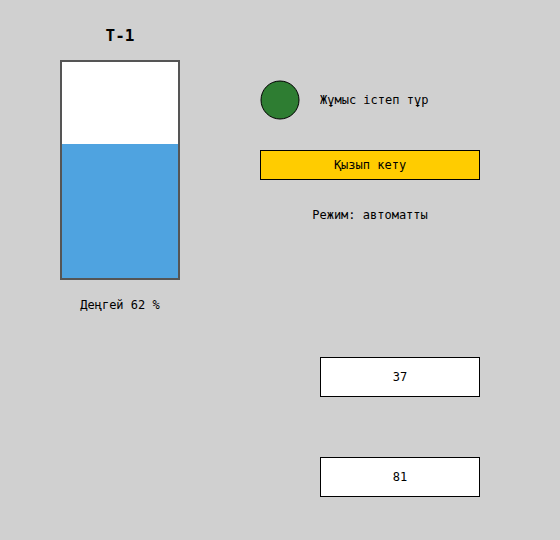
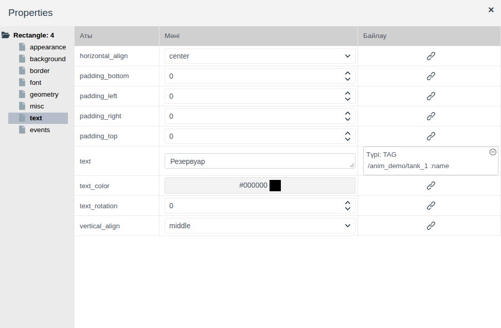
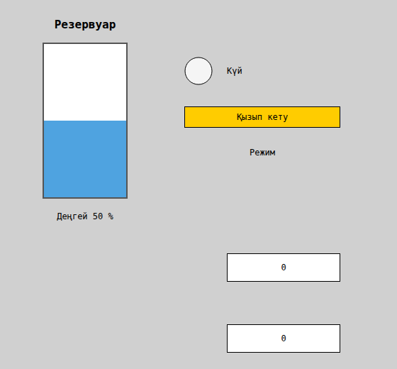
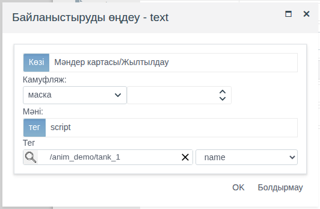
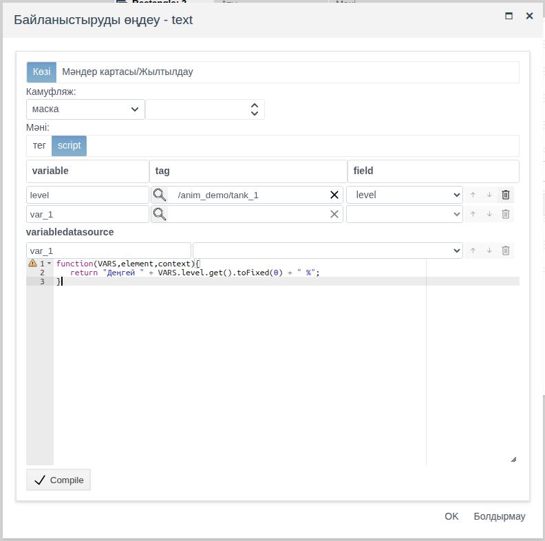
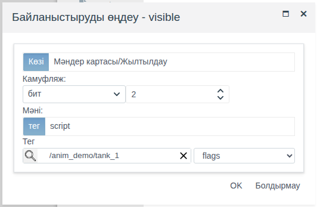
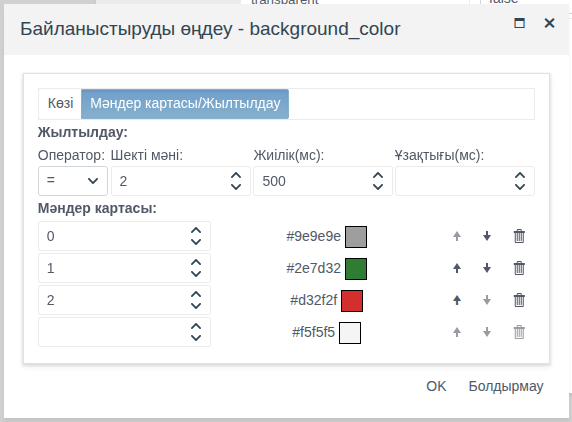
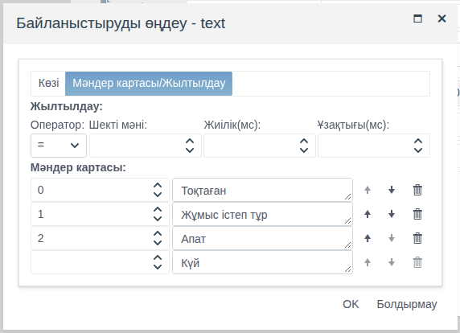
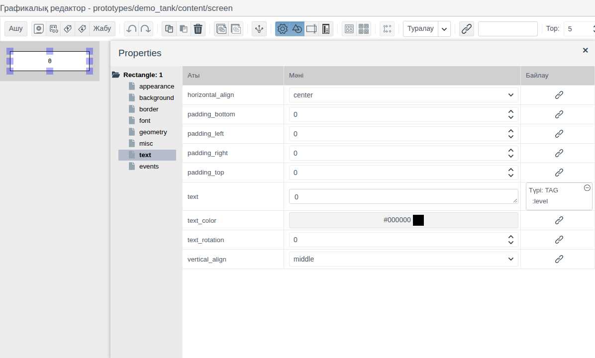

# Байланыстыру және анимация

Бұл құжат мнемосызбаны жандандыратын интегратор инженерге арналған: элементтер тег мәндерін көрсетуі, жабдық күйіне қарай түсі мен мәтінін өзгертуі, апат кезінде жыпылықтауы, өлшенетін шамаға қарай қозғалуы және өлшемін өзгертуі керек.

# Мазмұны

- [Терминдер сөздігі](#терминдер-сөздігі)
- [Кіріспе](#кіріспе)
- [Негізгі бөлім](#негізгі-бөлім)
    - [Байлау бағаны](#байлау-бағаны)
    - [Байланыстыру терезесі](#байланыстыру-терезесі)
    - [Тегке байланыстыру](#тегке-байланыстыру)
    - [script байланыстыруы](#script-байланыстыруы)
    - [Маскалау](#маскалау)
    - [Мәндер картасы](#мәндер-картасы)
    - [Жыпылықтау](#жыпылықтау)
    - [Қозғалыс және өлшем](#қозғалыс-және-өлшем)
    - [Прототип сызбасындағы байланыстыру](#прототип-сызбасындағы-байланыстыру)
- [Қорытынды](#қорытынды)

# Терминдер сөздігі

| Термин | Мағынасы |
|---|---|
| Байланыстыру | Элемент қасиеті мен жоба деректерінің арасындағы байланыс. Runtime ортасында қасиет тег өрісінің мәнін немесе скрипт нәтижесін алып, сонымен бірге өзгереді |
| Айнымалы | Байланыстыру скриптінде тег өрісіне қол жеткізуге арналған атау: `VARS.<атау>.get()` |
| Шек | Мәндер картасының жолындағы немесе жыпылықтау баптауындағы өріс мәнімен салыстырылатын сан |

«Тег», енгізу өрістеріне қатысты «Байланыстыру» терминдері — [Батырмалар және мәндерді енгізу](controls.md#терминдер-сөздігі) құжатында, «Сызба», «Палитра», «Элемент» — [Мнемосызбалар редакторы](editor.md#терминдер-сөздігі) құжатында түсіндірілген.

# Кіріспе

Байланыстыру сызба элементтерінің қасиеттеріне беріледі: фон түсі, мәтін, көрінуі, орны, өлшемі. Оның көмегімен шам сорғы күйіне қарай боялады, жазу режимді көрсетеді, апат биті орнатылғанда ескерту пайда болады, ал резервуардағы деңгей өлшенетін мәнмен бірге көтеріледі және төмендейді. Анимацияға арналған бөлек элементтер жоқ: барлығы байланыстыру арқылы жасалады.

Құжатта байланыстыру терезесі және оның барлық режимі сипатталған: тег мәні, скрипт, биттерді маскалау, мәндер картасы, жыпылықтау. Геометрияны байланыстыру (қозғалыс және өлшем) мен прототип сызбасындағы байланыстыру бөлек көрсетілген. Редактордағы жұмыс (элементтер қосу, қасиеттер панелі, сақтау) — [Мнемосызбалар редакторы](editor.md) құжатында, элементтердің өзі — [Графикалық элементтер](graphics.md) құжатында сипатталған. Кері бағыт — оператор әрекеті бойынша тегтерге жазу — оқиғалар арқылы беріледі, [Скрипттер мен оқиғалар](events.md) құжатын қараңыз.

Құжат бойындағы мысал — `anim_demo` бумасының `screen` сызбасы. Бумада `demo_anim` меншікті примитивінің `tank_1` нысаны бар:

| Өріс | Түрі | Мағынасы |
|---|---|---|
| `level` | float | Резервуардағы деңгей, % |
| `state` | integer | Сорғы күйі: 0 — тоқтаған, 1 — жұмыс істеп тұр, 2 — апат |
| `flags` | integer | Күй сөзі: 0–1 биттері — режим (0 қолмен, 1 автоматты, 2 қашықтан), 2-бит — қызып кету |
| `name` | string | Резервуардың позициялық белгіленуі |

Мысал сызбасында резервуар атауы, деңгейге қарай толтырылатын резервуар және деңгей жазуы, сорғы шамы мен күй жазуы, «Қызып кету» тақташасы және режим жазуы бар. Төменде `demo_tank` прототипінің екі данасы орналасқан, әрқайсысы өз деңгейін көрсетеді.



Жобаны өзгерту құқығы бар тіркелгімен Studio ортасына (`http://<сервер>:9000/fp/studio`) кіру мүмкіндігі қажет. Нәтиже Runtime ортасында (`http://<сервер>:9000/fp/runtime`) тексеріледі.

# Негізгі бөлім

## Байлау бағаны

**Properties** панелінде қасиет мәнінің оң жағында **Байлау** бағаны орналасқан. Шынжыр буыны бар батырма «Байланыстыру жасау - <қасиет>» терезесін ашады. **OK** басылғаннан кейін ұяшықта батырманың орнына байланыстыру сипаттамасы көрсетіледі:

- `Type: TAG` және өріс жолы: `/<бума>/<нысан> :<өріс>`. Мысалда — `/anim_demo/tank_1 :name`;
- `Type: SCRIPT` және әр скрипт айнымалысына бір жол.

Сипаттаманы басқанда байланыстыруды өзгерту терезесі ашылады. Ұяшық бұрышындағы ⊖ белгішесі **yes** арқылы растаудан кейін байланыстыруды жояды.



Редакторда элемент **Мәні** бағанындағы мәнді, Runtime ортасында байланыстырудан алынған мәнді көрсетеді. Мысалда кенептегі резервуар жартылай толтырылған, ал жазуларда «Күй», «Режим» деген үлгі мәтіндер көрсетілген; Runtime ортасында олардың орнына `tank_1` деректері шығады. Тег өрісінің өзгерісі ашық сызбада бірден көрінеді. Мән алынбаса (өрісте әлі мән жоқ немесе скрипт қатемен аяқталса), Runtime ортасындағы элемент сұр болып, редактордағы мәнді көрсетеді.



Байланыстыру сызбамен бірге сақталады: байланыстыруларды баптағаннан кейін сызбаны сақтаңыз.

## Байланыстыру терезесі

Терезе екі қойындыдан тұрады.

| Қойынды | Өріс | Мақсаты |
|---|---|---|
| **Көзі** | **Камуфляж** | Бүтін саннан биттерді бөліп алу: «маска» немесе «бит» режимі және сан. Сан өрісі бос болса, маскалау қолданылмайды. [Маскалау](#маскалау) бөлімін қараңыз |
| | **Мәні** | Мәннің қайдан алынатыны: **тег** — нысан өрісі, **script** — скрипт нәтижесі. [Тегке байланыстыру](#тегке-байланыстыру), [script байланыстыруы](#script-байланыстыруы) бөлімдерін қараңыз |
| **Value map/Shimmer** | **Жылтылдау** | Қасиет жыпылықтайтын шарт. [Жыпылықтау](#жыпылықтау) бөлімін қараңыз |
| | **Мәндер картасы** | Шектер және оларға сәйкес қасиет мәндері. [Мәндер картасы](#мәндер-картасы) бөлімін қараңыз |

Мән қойындылар ретімен өңделеді: маскалау, содан кейін жыпылықтау және мәндер картасы.

## Тегке байланыстыру

Қасиет өріс мәнін өзгеріссіз алады.

1. Элементті белгілеңіз, қасиет тобын ашып, **Байлау** бағанындағы батырманы басыңыз.
2. **Көзі** қойындысында **Мәні** = **тег** күйінде қалдырыңыз.
3. Үлкейткіш әйнек белгішесін басып, нысанды таңдаңыз және **OK** басыңыз. Оң жақтағы тізімнен өрісті таңдаңыз.
4. **OK** басыңыз.

Мысалда резервуар үстіндегі жазудың `text` қасиеті `tank_1.name` өрісіне байланыстырылған: редактордағы жазу — «Резервуар», Runtime ортасында — «Т-1».



Өріс қасиет қабылдай алатын мән беруі керек:

| Қасиет | Тег өрісі |
|---|---|
| `text`, `title` | Кез келген: жол өзгеріссіз, сан сан түрінде көрсетіледі |
| `background_color`, `border_color`, `text_color`, `gradient_color` | Түс коды бар `string`, мысалы `#00aa00` |
| `visible`, `bold`, `italic`, `transparent` | `bool` |
| `left`, `top`, `width`, `height`, `font_size`, `border_width`, `border_radius`, `text_rotation`, `z_index` | Қасиет үшін рұқсат етілген аралықтағы `integer`, `float` |
| `border_style`, `gradient` | Қасиет тізіміндегі мәндердің бірі бар `string`, мысалы `dashed`, `horizontal` |
| `texture` | Кескіндер кітапханасындағы суреттің жолы бар `string`, мысалы `/IMAGES/textures/red_brick.jpg` |

Санды түске немесе күй мәтініне [мәндер картасы](#мәндер-картасы), биттерді «иә/жоқ» мәніне [маскалау](#маскалау) түрлендіреді, ал кез келген басқа түрлендіруді [скрипт](#script-байланыстыруы) орындайды.

## script байланыстыруы

Қасиет JavaScript функциясының нәтижесін алады. Осылайша мән қайта есептеледі (деңгей пиксельге), пішімделеді (сан өлшем бірлігі бар жолға) немесе бірнеше өрістен құрастырылады.

1. **Көзі** қойындысында **Мәні** = **script** таңдаңыз.
2. **variable** / **tag** / **field** кестесінде айнымалыларды беріңіз: айнымалы атауы, нысан (үлкейткіш әйнек белгішесі) және өріс. Төменгі бос жол айнымалы қосады.
3. Төмендегі редакторда функцияны жазып, **Compile** басыңыз. Батырманың жанында **OK** пайда болады.
4. Терезенің **OK** батырмасын басыңыз.

Функция айнымалыларды `VARS` ішінде алады. Өріс мәні — `VARS.<атау>.get()`. Функция `return` арқылы қайтарған нәтиже қасиет мәніне айналады. Скрипт сызба ашылғанда және айнымалылардың кез келген өрісі өзгерген сайын орындалады.

Мысалда резервуар астындағы жазу деңгейді өлшем бірлігімен көрсетеді. `level` айнымалысы — `tank_1.level` өрісі:

```javascript
function(VARS,element,context){
   return "Деңгей " + VARS.level.get().toFixed(0) + " %";
}
```



Айнымалы бірнешеу болуы мүмкін: кестенің әр жолы — жеке айнымалы, скриптте олардың барлығына `VARS` арқылы қол жеткізуге болады. Мысалда `name` және `level` өрістері үшін `return VARS.tname.get() + ": " + VARS.level.get();` нәтижесі — «Т-1: 62». `text` қасиеті сөз көрсетуі үшін жолды қайтарыңыз.

Скрипт дереккөз жазбаларының жиыны бойынша да мән есептей алады — терезенің **variabledatasource** бөлімі ([Сызбадағы дереккөздер, «Скрипттегі дереккөз» бөлімі](datasources.md#скрипттегі-дереккөз) құжатын қараңыз).

## Маскалау

Маскалау бүтін санды өрістен — контроллердің күй сөзінен — биттерді бөліп алады. **Көзі** қойындысында беріледі: **Камуфляж** тізіміндегі режим және оң жақтағы сан.

| Режим | Сан | Нәтиже |
|---|---|---|
| bit | 0-ден басталатын бит нөмірі | Бит орнатылса — 1, әйтпесе — 0 |
| mask | Маска, мысалы 3 (0 және 1 биттері) | Өріс мәніне маскамен биттік ЖӘНЕ амалы қолданылады: өріс мәні 5 және маска 3 болғанда — 1 |

«бит» режимі «иә/жоқ» қасиеттеріне (`visible`, `bold`, `transparent`) жарайды. «маска» режимінің нәтижесі — сан; мәндер картасы оны түске немесе мәтінге түрлендіреді.

Мысалдағы «Қызып кету» тақташасы: `visible` қасиеті `tank_1.flags` өрісіне байланыстырылған, «бит», 2. `flags` = 5 болғанда (2-бит орнатылған) тақташа көрінеді, `flags` = 2 болғанда жасырылады.



Мысалдағы режим жазуы: `text` қасиеті `tank_1.flags` өрісіне байланыстырылған, «маска», 3, ал мәндер картасы 0, 1, 2 мәндерін «Режим: қолмен», «Режим: автоматты», «Режим: қашықтан» мәтіндеріне түрлендіреді. Қызып кету биті режимге әсер етпейді: `flags` = 5 болғанда жазу — «Режим: автоматты».


## Мәндер картасы

Карта санды қасиет мәніне, мысалы түске немесе мәтінге түрлендіреді. **Value map/Shimmer** қойындысының **Мәндер картасы** бөлімінде беріледі: әр жол — шек (бүтін сан) және қасиет мәні. Мән өрісі қасиеттер панеліндегідей: түс үшін түс таңдау терезесі ашылады, мәтін үшін енгізу өрісі көрсетіледі.

Шегі жоқ төменгі жол — бос үлгі: шекті енгізсеңіз, жол картаға қосылады, ал төменде жаңа бос үлгі пайда болады.

Өріс мәніне одан аспайтын ең үлкен шегі бар жол сәйкес келеді. Бірінші шектен төмен мәндерге бірінші жол сәйкес келеді. 3 → жасыл, 8 → қызыл картасы үшін: 3…7 — жасыл, 8 және одан жоғары — қызыл, 0 — жасыл.

Карта сандық өрістермен (`integer`, `float`) және маскалау нәтижесімен жұмыс істейді.

Мысалдағы сорғы шамы: `background_color` қасиеті `tank_1.state` өрісіне байланыстырылған, карта 0 → сұр, 1 → жасыл, 2 → қызыл.



Мысалдағы күй жазуы: `text` қасиеті сол өріске байланыстырылған, карта 0 → «Тоқтаған», 1 → «Жұмыс істеп тұр», 2 → «Апат».



## Жыпылықтау

Жыпылықтау оператордың назарын аударады: шарт орындалып тұрған кезде қасиет байланыстырудағы мән мен редактордағы мәнді кезекпен қабылдайды. **Value map/Shimmer** қойындысының **Жылтылдау** бөлімінде беріледі:

| Өріс | Мақсаты |
|---|---|
| **Оператор** | Өріс мәнін шекпен салыстыру: `=`, `>`, `>=`, `<`, `<=` |
| **Шекті мәні** | Шек, бүтін сан |
| **Frame rate(ms)** | Мәндер бірін-бірі алмастыратын уақыт аралығы, миллисекундпен |
| **Duration(ms)** | Мән өзгергеннен кейін жыпылықтау қанша миллисекундқа созылады. Бос болса — шарт орындалып тұрғанша |

Шек пен жиілік берілгенде жыпылықтау қосылады.

Мысалда шамның операторы `=`, шегі 2, жиілігі 500: апат кезінде (`state` = 2) шам қызыл (картадағы түс) және ашық сұр (редактордағы `background_color`) түспен жыпылықтайды. `state` өзгергенде жыпылықтау тоқтап, шам картадағы түсті қабылдайды.

Ұзақтығы берілген жыпылықтау жаңа оқиғаны білдіреді: ол мән өзгергенде басталып, берілген уақыттан кейін тоқтайды. Сызба ашылған кезде шарт орындалып тұрса, жыпылықтау болмайды.

Мәндер картасы болмаса, жыпылықтау өріс мәнінің өзімен жұмыс істейді: мысалы, `border_width` тег мәні мен редактордағы қалыңдықты кезекпен қабылдайды.

## Қозғалыс және өлшем

Элементтің орны мен өлшемі де түс сияқты қасиеттер: **geometry** тобының `left`, `top`, `width`, `height` қасиеттері. Оларды байланыстыру элементті қозғалтады және өлшемін өзгертеді, `text_rotation` тіктөртбұрыштың мәтінін бұрады.

Мысалда резервуардың толтырылуы — биіктігі 216 пиксель болатын жақтаудың ішіндегі көк тіктөртбұрыш (жақтаудың `top` мәні 60, түбі 278-де). Толтырылу биіктігі деңгейге пропорционал, ал төменгі шеті резервуар түбінде қалуы үшін жоғарғы шеті төмен түседі. Екі байланыстыру да `level` айнымалысы бар script:

| Қасиет | Скрипт |
|---|---|
| `height` | `return VARS.level.get() * 2.16;` |
| `top` | `return 278 - VARS.level.get() * 2.16;` |

Мысалда `level` = 62 болғанда толтырылу биіктігі 134 пиксель, 20 болғанда — 43, 90 болғанда — 194.

Қозғалыс та осылай жасалады: ысырма орны, арбаша орны немесе деңгей бойынша скрипт есептейтін `left` не `top`.

## Прототип сызбасындағы байланыстыру

Прототип сызбасы барлық данаға ортақ болғандықтан, ондағы байланыстыру нысанға емес, прототип өрісіне сілтейді. Жоба сызбасына қойылған әр дана өз мәндерін көрсетеді.

1. Прототип сызбасын ашыңыз ([Мнемосызбалар редакторы, «Прототип сызбалары» бөлімі](editor.md#прототип-сызбалары) құжатын қараңыз).
2. Байланыстыру терезесін ашып, үлкейткіш әйнек белгішесін басыңыз. Таңдау терезесінде бір нысан — прототиптің өзі бар. Оны таңдап, **OK** басыңыз және прототип өрісін таңдаңыз.
3. **OK** басыңыз. **Байлау** бағанында `Type: TAG` және жолы көрсетілмеген өріс пайда болады, мысалы `:level`.



Өрістер тізімінде прототип өрістері көрсетіледі ([Прототиптер, «Өрістер» бөлімі](../prototypes/prototypes.md#өрістер) құжатын қараңыз).

Мысалда `demo_tank` прототипінде `level` өрісі бар, ал оның `screen` сызбасында `text` қасиеті `:level` өрісіне байланыстырылған тіктөртбұрыш орналасқан. `anim_demo` сызбасында `tank_p1` және `tank_p2` даналары бар: Runtime ортасында біріншісі 37, екіншісі 81 көрсетеді ([Кіріспедегі скриншотты](#кіріспе) қараңыз).

# Қорытынды

| Міндет | Қалай орындау керек |
|---|---|
| Өріс мәнін көрсету | Тегке байланыстыру |
| Қайта есептеу, пішімдеу, бірнеше өрістен құрастыру | script байланыстыруы |
| Күйге қарай бояу немесе жазу көрсету | Мәндер картасы |
| Күй сөзінің битіне қарай көрсету немесе жасыру | `visible` қасиетінде «бит» маскалауы |
| Биттер тобын (режимді) түсіндіру | «маска» маскалауы + мәндер картасы |
| Апатқа назар аударту | Жыпылықтау |
| Элементті қозғалту, өлшемін өзгерту | `left`, `top`, `width`, `height` қасиеттерін байланыстыру |
| Барлық данаға ортақ бір сызба | Прототип сызбасындағы өріске байланыстыру |

Жұмыс реті:

1. Тег өрістерін дайындаңыз: күйлер мен деңгейлер үшін сандар, мәтіндер мен түс кодтары үшін жолдар.
2. Элементтерді сызып, редакторда оператор деректер жоқ кезде және жыпылықтаудың екінші фазасында көретін мәндерді беріңіз.
3. Қасиеттерді байланыстырыңыз: тег, қажет болса маскалау, мәндер картасы, жыпылықтау немесе скрипт.
4. Сызбаны сақтап, Studio ортасындағы нысан пішінінде өріс мәндерін өзгерте отырып, Runtime ортасында тексеріңіз.
