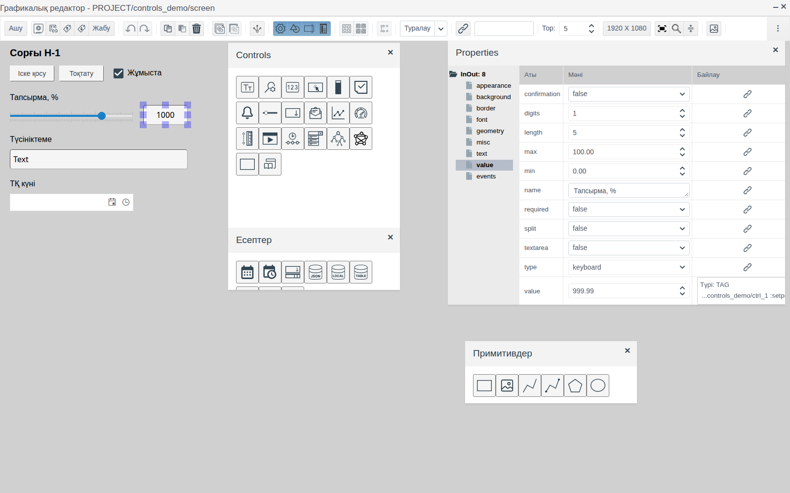
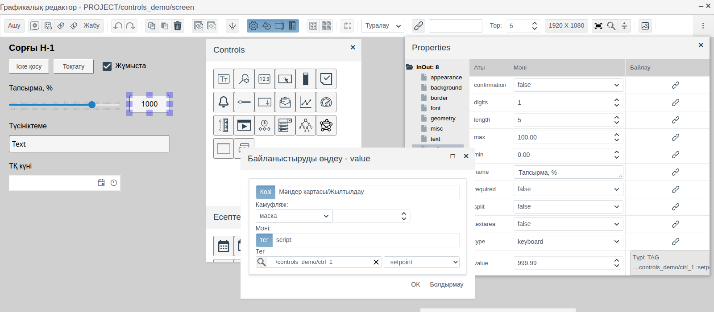
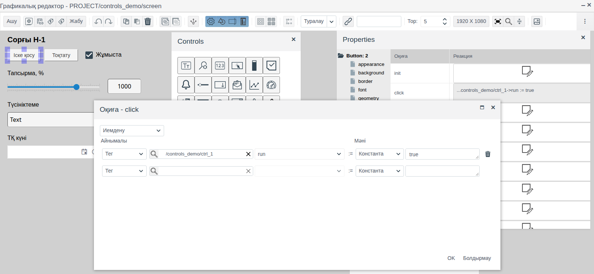
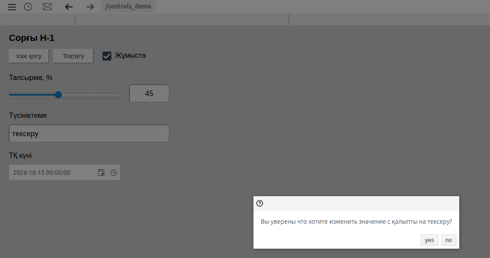
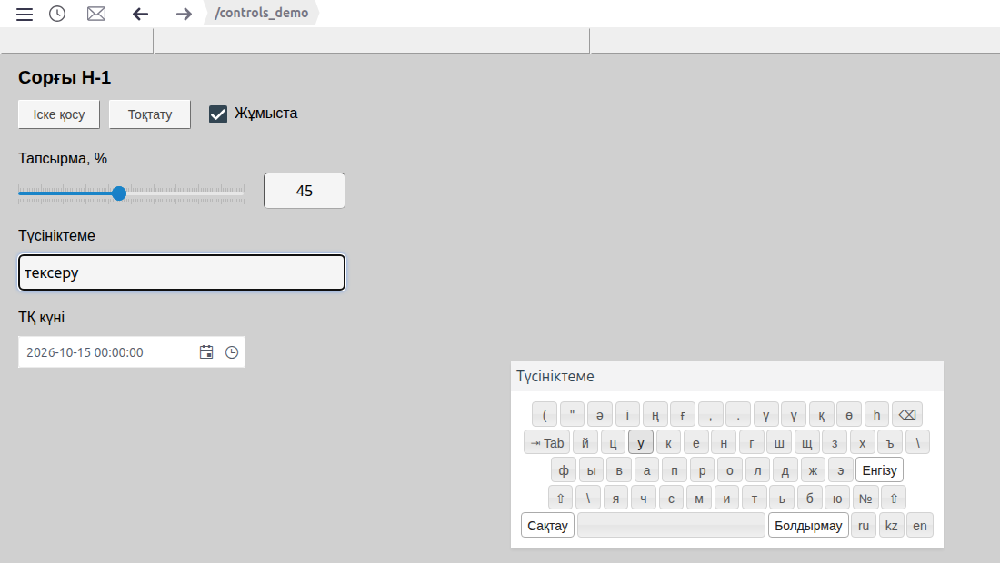
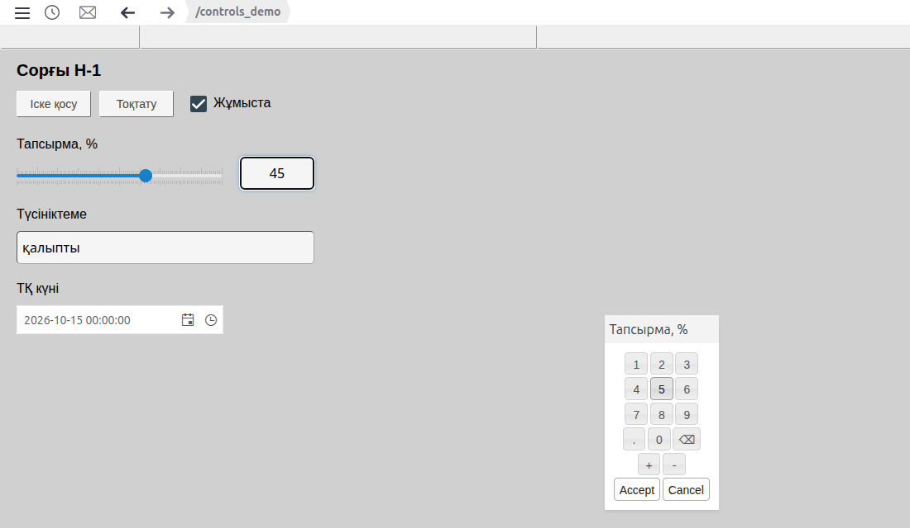
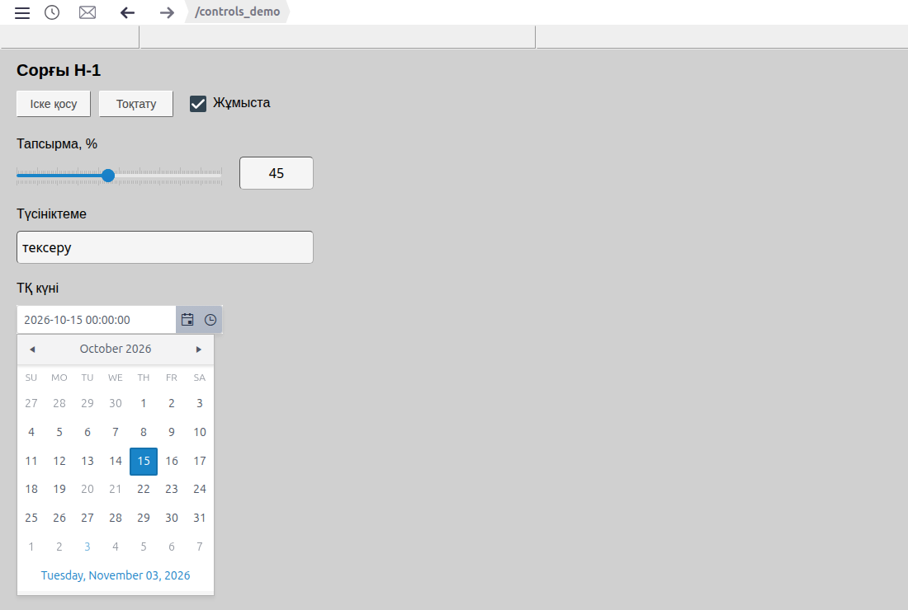
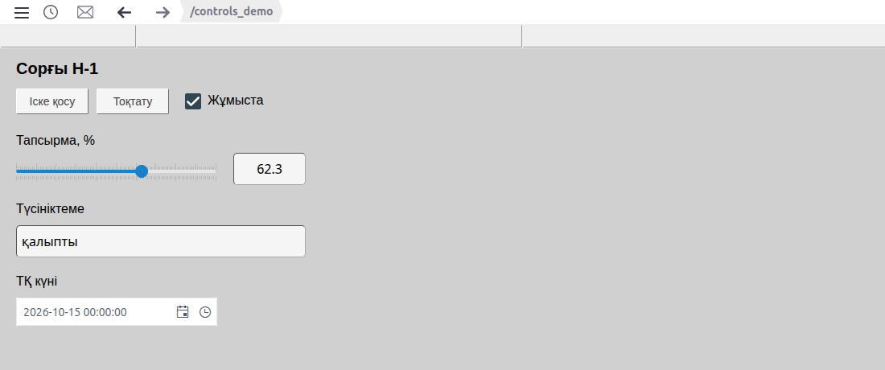

# Батырмалар және мәндерді енгізу

Бұл құжат мнемосызбада басқару элементтерін жасайтын интегратор инженерге арналған: команда батырмалары, жалаушалар, жүгірткілер, тағайындалған мәндерді, мәтінді және күнді енгізу өрістері.

# Мазмұны

- [Терминдер сөздігі](#терминдер-сөздігі)
- [Кіріспе](#кіріспе)
- [Негізгі бөлім](#негізгі-бөлім)
    - [Палитралардағы элементтер](#палитралардағы-элементтер)
    - [Элементті тегке байланыстыру](#элементті-тегке-байланыстыру)
    - [Ортақ қасиеттер](#ортақ-қасиеттер)
    - [Батырма](#батырма)
    - [Жалауша](#жалауша)
    - [Жүгірткі](#жүгірткі)
    - [Сан енгізу өрісі](#сан-енгізу-өрісі)
    - [Мәтін енгізу өрісі](#мәтін-енгізу-өрісі)
    - [Экрандық пернетақта](#экрандық-пернетақта)
    - [Күнді және күн мен уақытты таңдау](#күнді-және-күн-мен-уақытты-таңдау)
- [Қорытынды](#қорытынды)

# Терминдер сөздігі

| Термин | Мағынасы |
|---|---|
| Тег | Өрісін сызба элементі көрсететін немесе өзгертетін жоба нысаны. Мысалда — `ctrl_1` данасы |
| Байланыстыру | Элемент қасиеті мен тег өрісінің арасындағы байланыс. **Properties** панелінің **Байлау** бағанындағы батырма арқылы беріледі |
| Меншіктеу | Элемент оқиғасына скриптсіз реакция: тег өрісіне тұрақты мәнді немесе басқа өрістің мәнін жазу |
| Экрандық пернетақта | Физикалық пернетақтасыз, тінтуірмен немесе түрту арқылы мән енгізуге арналған пернелері бар терезе |

«Сызба», «Элемент», «Палитра» терминдері [Мнемосызбалар редакторы](editor.md) құжатында түсіндірілген.

# Кіріспе

Енгізу элементтері мнемосызбаны суреттен басқару пультіне айналдырады: Runtime ортасында оператор жабдықты іске қосып, тоқтатады, тағайындалған мәндерді өзгертеді, түсініктемелер жазады, күндерді белгілейді. Әр элемент тег өрісінің ағымдағы мәнін көрсетіп, оператор енгізген мәнді сол өріске жазады.

Құжатта енгізу элементтері, олардың қасиеттері және Runtime ортасындағы әрекеті сипатталған. Редактордағы жұмыс (қосу, белгілеу, қасиеттер, сақтау) [Мнемосызбалар редакторы](editor.md) құжатында, пішіндер мен жазуларды безендіру [Графикалық элементтер](graphics.md) құжатында сипатталған.

Құжат бойындағы мысал — `controls_demo` бумасының `screen` сызбасы: сорғыны басқару панелі. Деректер `run` (bool), `setpoint` (float), `note` (string) және `service_dt` (string) өрістері бар `demo_ctrl` меншікті примитивінің `ctrl_1` нысанында орналасқан. Сызбада **Іске қосу** және **Тоқтату** батырмалары, «Жұмыста» жалаушасы, жүгірткі мен тағайындалған мән өрісі, түсініктеме өрісі және техникалық қызмет көрсету күні өрісі бар.



Жобаны өзгерту құқығы бар тіркелгімен Studio ортасына (`http://<сервер>:9000/fp/studio`) кіру мүмкіндігі қажет. Нәтиже Runtime ортасында (`http://<сервер>:9000/fp/runtime`) тексеріледі.

# Негізгі бөлім

## Палитралардағы элементтер

Элементтер палитрадағы белгішені кенепке сүйреп апару арқылы қосылады. Элемент атауы белгішенің қалқымалы кеңесінде, ал түрі қасиеттер ағашының түбірінде көрсетіледі.

| Палитра | Белгішенің кеңесі | Қасиеттер ағашының түбірі | Мақсаты |
|---|---|---|---|
| **Controls** | Button | `Button` | Шерткенде орындалатын команда: іске қосу, тоқтату, квиттеу, бастапқы күйге қайтару |
| **Controls** | Checbox | `Checkbox` | Логикалық белгіні қосу және өшіру |
| **Controls** | Slider | `Slider` | Берілген диапазонда санды бірқалыпты өзгерту |
| **Controls** | Input-output field (`123` белгішесі) | `InOut` | Санды көрсету және енгізу |
| **Controls** | Input-output field (`Tт` белгішесі) | `InOutText` | Мәтінді көрсету және енгізу |
| **Есептер** | Date | `DatePicker` | Күнді таңдау |
| **Есептер** | Date - Time | `DateTimePicker` | Күн мен уақытты таңдау |

## Элементті тегке байланыстыру

Жалаушада, жүгірткіде, енгізу өрістерінде және күн өрістерінде мән **value** тобының `value` қасиетінде сақталады. Элемент тег өрісін көрсетіп, оған оператор енгізген мәнді жазуы үшін:

1. Элементті белгілеңіз, **value** тобын ашып, `value` жолының **Байлау** бағанындағы батырманы басыңыз.
2. Байланыстыру терезесінің **Көзі** қойындысында **тег** режимін қалдырыңыз.
3. Үлкейткіш әйнек белгішесін басып, нысанды таңдаңыз (мысалда `ctrl_1`), содан кейін **OK** батырмасын басыңыз. Оң жақтағы тізімнен өрісті таңдаңыз.
4. **OK** батырмасын басыңыз. **Байлау** бағанында `Type: TAG` және өріске апаратын жол пайда болады.



Толтырылған байланыстыруды шерту оны өңдеу үшін ашады. Басқа байланыстыру режимдері (скрипт, маскалау, мәндер картасы, жыпылықтау) [Байланыстыру және анимация](bindings.md) құжатында сипатталған.

Өріс түрі элементке сәйкес болуы керек:

| Элемент | Тег өрісінің түрі |
|---|---|
| Жалауша | `bool` |
| Жүгірткі, сан енгізу өрісі | `integer`, `float` |
| Мәтін енгізу өрісі | `string` |
| Күн, күн мен уақыт | `string`: күн ISO 8601 пішімінде UTC бойынша жазылады, мысалы `2026-10-14T19:00:00.000Z` |

Бір өріске бірнеше элементті байланыстыруға болады: мысалда жүгірткі мен тағайындалған мән өрісі `setpoint` мәнін көрсетеді, олардың біріндегі өзгеріс екіншісінде бірден көрінеді.

## Ортақ қасиеттер

| Топ | Қасиет | Мақсаты |
|---|---|---|
| **misc** | `enabled` | `false` — элемент енгізуді қабылдамайды. Батырма мәтіні `disabled_color` түсімен көрсетіледі |
| **value** | `name` | Енгізу өрістері үшін: экрандық пернетақта терезесінің тақырыбы |
| | `required` | Енгізу өрістері үшін: `true` — бос мән қабылданбайды, оператор хабарлама көреді |

**appearance**, **geometry**, **misc** (`z_index`, `title`, `cursor`), **border** және **font** топтары графикалық элементтердегідей ([Графикалық элементтер, «Ортақ қасиеттер» бөлімі](graphics.md#ортақ-қасиеттер) құжатын қараңыз).

## Батырма

Мәтіні бар батырма. Өздігінен ештеңе жазбайды: әрекет **events** тобында, әдетте `click` оқиғасына беріледі.

Батырма тегке скриптсіз мән жазуы үшін:

1. Батырманы белгілеңіз, **events** тобын ашып, `click` жолындағы **Реакция** ұяшығын шертіңіз.
2. «Оқиға - click» терезесінде **Иемдену** режимін қалдырыңыз.
3. **Айнымалы** бағанында: **Тег**, үлкейткіш әйнек белгішесі → нысан → **OK**, оң жақта өріс. Мысалда `ctrl_1`, `run` өрісі.
4. **Мәні** бағанында: **Константа** және батырма жазатын мән. Мысалда **Іске қосу** батырмасы үшін `true`, **Тоқтату** үшін `false`.
5. **OK** батырмасын басыңыз.



Жол толтырылғаннан кейін оның астында келесі меншіктеуге арналған бос жол пайда болады. Себет жолды жояды. **Мәні** бағанында тұрақты мәннің орнына басқа тегтің өрісін (**Тег**) алуға болады. Басқа оқиғалар мен оқиға скрипті [Скрипттер мен оқиғалар](events.md) құжатында сипатталған.

| Топ | Қасиет | Мақсаты |
|---|---|---|
| **text** | `text` | Батырмадағы жазу. Enter жаңа жолға көшіреді |
| | `text_color`, `disabled_color` | Қолжетімді және қолжетімсіз (`enabled` = `false`) батырмадағы жазудың түсі |
| | `horizontal_align`, `vertical_align`, `padding_*` | Жазуды туралау және шегіністер, тіктөртбұрыштағыдай |
| **background** | `background_color`, `transparent` | Фон, мөлдір фон |
| **border** | `border_width`, `border_color`, `border_radius` | Жиек |

Қолжетімсіз батырма жазуды `disabled_color` түсімен көрсетеді және шертуге жауап бермейді.

## Жалауша

`bool` өрісіне арналған құсбелгісі бар шаршы. Мысалда «Жұмыста» жалаушасы `ctrl_1.run` өрісіне байланыстырылған: **Іске қосу** басылғаннан кейін белгіленеді, **Тоқтату** басылғаннан кейін белгісі алынады. Runtime ортасында жалаушаны шерту өріс мәнін ауыстырады.

Жалаушаның жазуы фоны мен жиегі жоқ жеке тіктөртбұрыш арқылы жасалады ([Графикалық элементтер, «Тіктөртбұрыш» бөлімі, «Жазу» абзацы](graphics.md#тіктөртбұрыш) құжатын қараңыз).

## Жүгірткі

Жүгірткісі бар шкала. Оператор жүгірткіні сүйрейді немесе шкаланы шертеді, мән тег өрісіне жазылады.

| Қасиет (**value** тобы) | Мақсаты |
|---|---|
| `min`, `max` | Шкала шектері |
| `small_step` | Жүгірткі қадамы және шкаланың ұсақ бөлік сызықтары |
| `large_step` | Жазулары бар шкаланың ірі бөлік сызықтары |

**appearance** тобының `orientation` қасиеті: `horizontal` немесе `vertical`. Мысалда диапазоны 0…100, қадамы 1, бөлік сызықтары әр 10 сайын орналасқан жүгірткі `ctrl_1.setpoint` өрісіне байланыстырылған.

## Сан енгізу өрісі

`InOut` өрісі санды көрсетеді және енгізуді қабылдайды. Енгізу тәсілі **value** тобының `type` қасиетімен беріледі:

| `type` | Оператор мәнді қалай енгізеді |
|---|---|
| бос | Енгізу жоқ, өріс мәнді тек көрсетеді |
| `direct` | Өрісті шертіп, пернетақтадан енгізу; Enter пернесін басу немесе басқа жерге өту мәнді жазады. Тек цифрлар, нүкте және таңба қабылданады |
| `keyboard` | Меңзерді апарғанда өрістің оң жағында пернетақта белгішесі бар батырма пайда болады. Ол сандық экрандық пернетақтаны ашады |

**value** тобының басқа қасиеттері:

| Қасиет | Мақсаты |
|---|---|
| `digits` | Көрсеткенде нүктеден кейінгі таңбалар саны. Енгізілген мән дөңгелектелмей жазылады |
| `length` | Санды көрсеткенде алатын таңбалар саны |
| `split` | `true` — разрядтар бос орынмен бөлінеді |
| `min`, `max` | Рұқсат етілген диапазон. Одан тыс мән жазылмайды, оператор бұзылған шек көрсетілген хабарлама көреді |
| `confirmation` | `true` — жазу алдында оператор өзгерісті растайды ([Мәтін енгізу өрісі](controls.md#мәтін-енгізу-өрісі) бөлімін қараңыз) |

Егер енгізілген мән қабылданбаса (диапазоннан тыс, `required` кезінде бос, сан емес), өріс бұрынғы мәніне қайтады.

Мысалда тағайындалған мән өрісі: `digits` = 1, `min` = 0, `max` = 100, `type` = `keyboard`, `name` = «Тапсырма, %», `value` қасиеті `ctrl_1.setpoint` өрісіне байланыстырылған.

Безендіру — **text** (`align`, `padding`, `text_color`), **font**, **background**, **border** топтары (`border_radius` — бұрыштарды дөңгелектеу).

## Мәтін енгізу өрісі

`InOutText` өрісі жолдар үшін дәл осылай жұмыс істейді. `type` қасиеті: бос, `direct` немесе `keyboard`; олар сан өрісіндегідей жұмыс істейді. **value** тобының қасиеттері:

| Қасиет | Мақсаты |
|---|---|
| `length` | Мәтіннің ең үлкен ұзындығы. Одан ұзын мәтін жазылмайды, оператор рұқсат етілген ұзындық көрсетілген хабарлама көреді |
| `textarea` | `true` — көпжолды өріс |
| `confirmation` | `true` — жазу алдында терезе ескі мәнді жаңасына ауыстыруды растауды сұрайды, **yes** және **no** батырмалары бар. **no** бұрынғы мәнді қайтарады |

Мысалда түсініктеме өрісі: `type` = `keyboard`, `length` = 40, `confirmation` = `true`, `value` қасиеті `ctrl_1.note` өрісіне байланыстырылған.



Тег өрісінде мән болмаған кезде енгізу және күн өрістері Runtime ортасында сұр түспен көрсетіледі.

## Экрандық пернетақта

Физикалық пернетақтасы жоқ панельдерде қажет. Сан немесе мәтін енгізу өрісінде `type` = `keyboard` қасиетімен қосылады. Runtime ортасында меңзерді өріске апарыңыз: оң жақта пернетақта белгішесі бар батырма пайда болады. Пернетақта терезесінің тақырыбы `name` қасиетінен алынады.

Мәтін өрісінде **ru**, **kz**, **en** жаймалары бар толық пернетақта ашылады. **Сақтау** мәнді жазады, **Болдырмау** терезені мәнді жазбай жабады.



Сан өрісінде сандық пернетақта ашылады: цифрлар, нүкте, `+`, `-`, таңбаны жою. **Accept** мәнді `min`/`max` бойынша тексеріп жазады, **Cancel** терезені мәнді жазбай жабады.



## Күнді және күн мен уақытты таңдау

**Есептер** палитрасындағы **Date** және **Date - Time** элементтері — күнтізбесі бар өрістер. **Date** күнді таңдайды (`yyyy-MM-dd` түрінде көрсетіледі), **Date - Time** күн мен уақытты таңдайды (`yyyy-MM-dd HH:mm:ss` түрінде көрсетіледі): күнтізбе батырмасы айды, сағат батырмасы уақыт тізімін ашады. Күн мен уақытты өріске теріп енгізуге де болады.

| Қасиет (**value** тобы) | Мақсаты |
|---|---|
| `value` | Мән; тегке жазу үшін `string` өрісіне байланыстырыңыз |
| `interval` | Тек **Date - Time** үшін: уақыт тізімінің минутпен берілген қадамы, әдепкі мәні 30 |
| `config` | JSON пішіміндегі баптаулар. `disableDates` — таңдауға болмайтын күндер тізімі |

`config` JSON терезесінде өңделеді: мәтінді енгізіп, **Compile** батырмасын басыңыз, `ok` шыққаннан кейін **OK** батырмасын басыңыз. Мысалда техникалық қызмет көрсету күні өрісі үшін:

```json
{
  disableDates: ["2026-10-20", "2026-10-21"]
}
```

Күнтізбеде бұл күндер сұр түспен көрсетіледі және таңдалмайды.



# Қорытынды

Енгізу элементтерімен жұмыс реті:

1. Қажетті түрдегі өрістері бар тегті дайындаңыз: жалауша үшін `bool`, жүгірткі мен сандар үшін `integer`/`float`, мәтін мен күндер үшін `string`.
2. **Controls** және **Есептер** палитраларынан элементтерді сүйреп апарып, оларға фоны жоқ тіктөртбұрыштар арқылы жазу қосыңыз.
3. Әр элементтің `value` қасиетін тег өрісіне байланыстырыңыз. Батырмаларға `click` оқиғасы үшін **Иемдену** беріңіз.
4. Сандар үшін `min`, `max`, `digits`; мәтін үшін `length`; маңызды мәндер үшін `confirmation` қасиеттерін беріңіз.
5. Сенсорлық панельдерде `type` = `keyboard` қосып, `name` қасиетін — пернетақта терезесінің тақырыбын беріңіз.
6. Сызбаны сақтап, Runtime ортасында енгізуді тексеріңіз.


