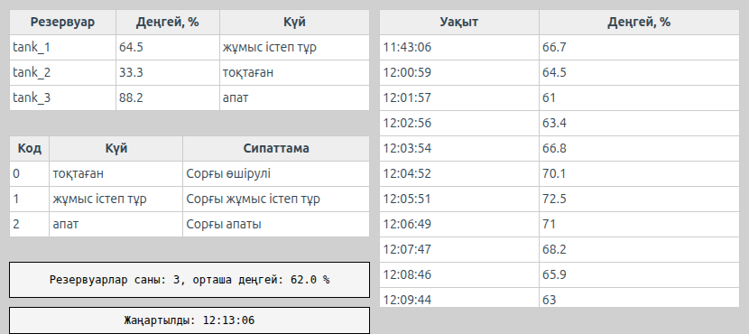
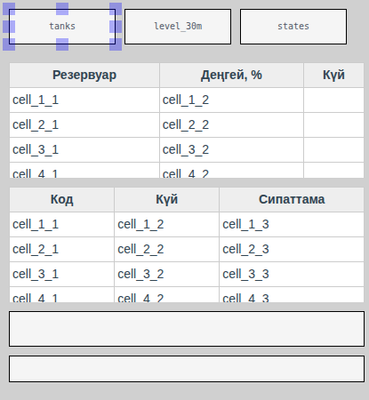
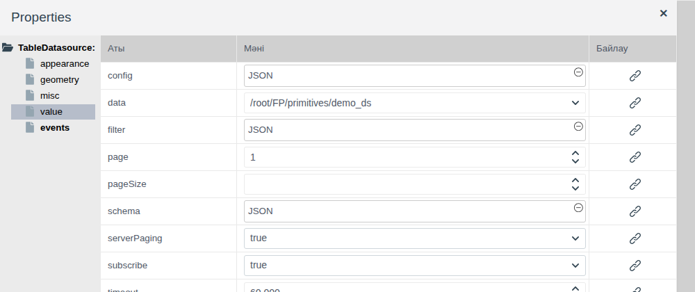
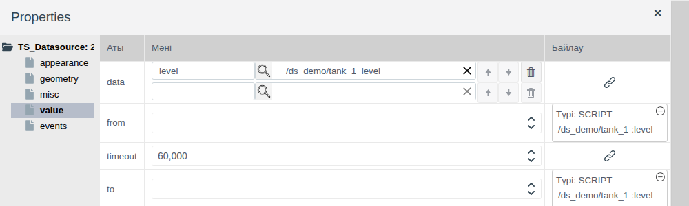
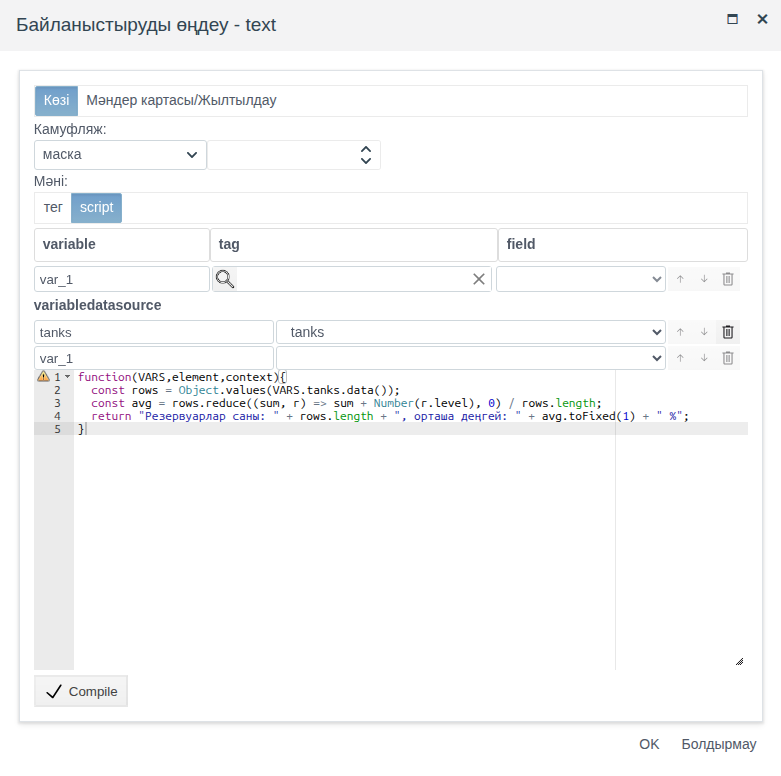

# Сызбадағы дереккөздер

Бұл құжат мнемосызбада бір мәнді емес, жазбалар жиынын көрсетуі қажет интегратор инженерге арналған: нысандар тобы бойынша жиынтық, белгілі бір кезеңдегі шама тарихы, анықтамалық кесте, бірнеше нысан бойынша есептелген қорытынды.

# Мазмұны

- [Терминдер сөздігі](#терминдер-сөздігі)
- [Кіріспе](#кіріспе)
- [Негізгі бөлім](#негізгі-бөлім)
    - [Палитрадағы дереккөздер](#палитрадағы-дереккөздер)
    - [Барлық дереккөзге ортақ](#барлық-дереккөзге-ортақ)
    - [Local Datasource: сызбадағы жазбалар](#local-datasource-сызбадағы-жазбалар)
    - [Table Datasource: жоба нысандары](#table-datasource-жоба-нысандары)
    - [Time-series datasource: мұрағаттардағы тарих](#time-series-datasource-мұрағаттардағы-тарих)
    - [Дереккөзді қандай элементтер оқиды](#дереккөзді-қандай-элементтер-оқиды)
    - [Скрипттегі дереккөз](#скрипттегі-дереккөз)
    - [change оқиғасы](#change-оқиғасы)
- [Қорытынды](#қорытынды)

# Терминдер сөздігі

| Термин | Мағынасы |
|---|---|
| Дереккөз | Басқа элементтер мен скрипттерге арналған жазбалар жиынын сақтайтын сызба элементі. Редакторда өз атауы бар тіктөртбұрыш түрінде көрінеді, Runtime ортасында көрінбейді |
| Жазба | Жиынның бір жолы: жоба нысаны, анықтамалық жолы немесе тарих нүктесі. Жазба өрістерін дереккөздің `schema` қасиеті анықтайды |
| Мұрағаттың бүркеншік аты | Мұрағат мәндері **Time-series datasource** жазбаларына түсетін атау. `data` қасиетінде мұрағаттың жанында беріледі |
| Дереккөз айнымалысы | Скрипт терезесінің **variabledatasource** бөліміндегі жол: скриптте дереккөзге `VARS` арқылы қол жеткізетін атау |

«Тег», «Байланыстыру» терминдері — [Батырмалар және мәндерді енгізу](controls.md#терминдер-сөздігі) құжатында, «Сызба», «Палитра», «Элемент» — [Мнемосызбалар редакторы](editor.md#терминдер-сөздігі) құжатында, «Кесте», «Мұрағат» — [Кестелер және уақыт шкаласы](tables.md#терминдер-сөздігі) құжатында, «Оқиға» — [Скрипттер мен оқиғалар](events.md#терминдер-сөздігі) құжатында түсіндірілген.

# Кіріспе

Байланыстыру элемент қасиетін бір тегтің бір өрісімен байланыстырады. Кесте мен диаграммаға бұл жеткіліксіз: оларға жазбалар жиыны қажет — буманың барлық сорғылары, жарты сағаттағы тарих нүктелері, анықтамалық жолдары. Мұндай жиынды дереккөз сақтайды. Элемент дереккөзді атауы бойынша таңдайды, ал бір дереккөз бірден бірнеше элемент пен скриптке деректер бере алады.

Құжатта **Есептер** палитрасының үш дереккөзі сипатталған: әрқайсысы жазбаларды қайдан алады, оны қалай баптау керек, қандай элементтер оны оқиды, скрипттен жазбаларға қалай қол жеткізуге және олардың өзгерісін қалай қадағалауға болады. Редактордағы жұмыс (қосу, белгілеу, қасиеттер, сақтау) — [Мнемосызбалар редакторы](editor.md) құжатында, кесте бағандары мен тақырыптары — [Кестелер және уақыт шкаласы](tables.md#кесте-бағандар-мен-тақырыптар) құжатында сипатталған.

Құжат бойындағы мысал — `ds_view` бумасының `screen` сызбасы. Деректер `ds_demo` бумасында орналасқан: `level` (float, деңгей) және `state` (integer, күй) өрістері бар `demo_ds` меншікті примитивінің `tank_1`…`tank_3` нысандары және `tank_1.level` мәнін жазатын `tank_1_level` мұрағаты. Сызбада:

- **Table Datasource** `tanks` дереккөзінен алынған резервуарлар кестесі;
- **Time-series datasource** `level_30m` дереккөзінен алынған `tank_1` деңгейінің соңғы 30 минуттағы тарихы;
- **Local Datasource** `states` дереккөзінен алынған күй кодтарының анықтамалығы;
- скрипт `tanks` жазбалары бойынша есептейтін орташа деңгейі бар жол;
- `change` оқиғасы орнататын `tanks` дереккөзінің соңғы жаңартылған уақыты бар.



Жобаны өзгерту құқығы бар тіркелгімен Studio ортасына (`http://<сервер>:9000/fp/studio`) кіру мүмкіндігі қажет. Нәтиже Runtime ортасында (`http://<сервер>:9000/fp/runtime`) тексеріледі.

# Негізгі бөлім

## Палитрадағы дереккөздер

| Белгішенің кеңесі | Қасиеттер ағашының түбірі | Жазбалар қайдан алынады | Жазбалар қашан өзгереді |
|---|---|---|---|
| Local Datasource | `LocalDatasource` | Сызбадағы `data` қасиетінде берілген немесе тегтің жолдық өрісінен алынады | `data` өзгергенде |
| Table Datasource | `TableDatasource` | Шарт бойынша іріктелген бір түрдегі жоба нысандары | Жазылым қосулы болса, нысан өрістері өзгергенде |
| Time-series datasource | `TS_Datasource` | `from`…`to` кезеңіндегі бір немесе бірнеше мұрағаттың тарихы | `from` немесе `to` өзгергенде |

Қалай таңдау керек:

| Міндет | Дереккөз |
|---|---|
| Анықтамалық, режимдер тізімі, кодтардың түсіндірмесі — жұмыс кезінде өзгермейтін деректер | Жазбалары `data` ішінде берілген Local Datasource |
| Сыртқы жүйе немесе скрипт құрастырып, тег өрісіне жазатын кесте | `data` қасиеті өріске байланыстырылған Local Datasource |
| Бір түрдегі көптеген нысан өрістерінің ағымдағы мәндері | Table Datasource |
| Өткен кезеңдегі шамалардың мәндері | Time-series datasource |

## Барлық дереккөзге ортақ



Дереккөз кез келген элемент сияқты **Есептер** палитрасынан қосылады. Жұмыс реті:

1. Дереккөзді қосып, оған атау беріңіз: **misc** тобы, `name` қасиеті. Элементтер мен скрипттер дереккөзді осы атаумен табады. Мысалда — `tanks`, `level_30m`, `states`.
2. **value** тобының қасиеттерін баптаңыз — әр дереккөздің өз қасиеттері бар, олар төменде сипатталған.
3. Дереккөзді оқитын элементті қосып, оның `datasource` қасиетінде дереккөзді таңдаңыз. Дереккөз сызбада осы элементтен бұрын орналасуы керек.
4. Сызбаны сақтап, жазбаларды Runtime ортасында тексеріңіз: редакторда кестелер мен диаграммалар үлгі көрсетеді.

Дереккөздің сызбадағы орны мен өлшемі ештеңеге әсер етпейді: Runtime ортасында ол көрінбейді. Дереккөздерді сызбаның бір бұрышына орналастырған ыңғайлы.

`schema`, `data` және `filter` қасиеттері **JSON** терезесінде өңделеді: мән өрісін басып, мәтінді енгізіңіз, **Compile**, содан кейін **OK** батырмасын басыңыз.

Жазба өрістерін `schema` сипаттайды: өріс атауы және оның түрі. Жаңа Local Datasource үлгісі:

```
{
   "column1": {type: fp.item.types.primitives.String},
   "column2": {type: fp.item.types.primitives.Integer},
   "column3": {type: fp.item.types.primitives.Bool}
}
```

Local Datasource және Table Datasource жазбаларды беттерге бөліп шығара алады:

| Қасиет | Мақсаты |
|---|---|
| `pageSize` | Бір жолы қанша жазба беру керек. Бос болса — барлық жазба |
| `page` | 1-ден басталатын бет нөмірі |

Мысалы, `pageSize` = 2 және `page` = 2 болса, кесте үшінші және төртінші жазбаларды көрсетеді.

## Local Datasource: сызбадағы жазбалар

**Local Datasource** жазбаларды **value** тобының `data` қасиетінде сақтайды — әр жазбаға бір нысаннан келетін нысандар массиві. Мысалда `states` дереккөзі сорғы күйінің кодтарын түсіндіреді:

```
schema:
{
  "code": {type: fp.item.types.primitives.Integer},
  "state": {type: fp.item.types.primitives.String},
  "note": {type: fp.item.types.primitives.String}
}

data:
[
  {"code": 0, "state": "тоқтаған", "note": "Сорғы өшірулі"},
  {"code": 1, "state": "жұмыс істеп тұр", "note": "Сорғы жұмыс істеп тұр"},
  {"code": 2, "state": "апат", "note": "Сорғы апаты"}
]
```

Жазбалар сырттан келуі үшін `data` қасиетін `string` түріндегі тег өрісіне байланыстырыңыз (**Байлау** бағаны, [Байланыстыру және анимация, «Тегке байланыстыру» бөлімі](bindings.md#тегке-байланыстыру) құжатын қараңыз). Өрісте JSON пішіміндегі осындай массив болуы керек. Өріс өзгерген сайын дереккөз жазбаларды ауыстырады, ал сызбадағы кесте қайта салынады. Пайдаланушы скрипті немесе сыртқы жүйе құрастыратын кестелер осылай көрсетіледі: ауысым құрамы, тапсырмалар тізімі, талдау нәтижелері.

Жазбаларды оқиға скриптінен де ауыстыруға болады: `context.find_by_name("<дереккөз атауы>").set({data: '<JSON массиві>'})` ([Скрипттер мен оқиғалар, «Скриптте не қолжетімді» бөлімі](events.md#скриптте-не-қолжетімді) құжатын қараңыз).

## Table Datasource: жоба нысандары

**Table Datasource** бір түрдегі жоба нысандарын тауып, олардың өрістерін береді. Шартқа сай келетін жаңа нысан сызбаны өзгертпей-ақ жазбаларға қосылады.



| Қасиет | Мақсаты |
|---|---|
| `data` | Нысандар түрі. Меншікті примитивтер тізімнің соңында: `/root/FP/primitives/<атау>` |
| `filter` | Іріктеу шарты, мысалы, бір буманың нысандары |
| `schema` | Жазбаларға кіретін нысан өрістері. `.name` қызметтік өрісі — нысан атауы |
| `subscribe` | `true` — нысан өрістері өзгергенде жазбалар жаңарады. `false` — өрістер сызба ашылғанда бір рет оқылады |
| `pageSize`, `page` | Беттерге бөліп шығару ([Барлық дереккөзге ортақ](#барлық-дереккөзге-ортақ) бөлімін қараңыз) |
| `serverPaging` | `true` — сервер тек қажетті бетті береді. `false` — браузер барлық нысанды алып, өзі беттерге бөледі. Оператор көретін нәтижеге әсер етпейді; нысандар көп болғанда `true` трафикті үнемдейді |

Бір буманың нысандарын іріктеу:

```
[".folder", "=", "$oid('/root/FP/PROJECT/<бума>')"]
```

Мысалда `data` = `/root/FP/primitives/demo_ds`, іріктеу `ds_demo` бумасы бойынша жүргізіледі, `subscribe` = `true`, ал `schema`:

```
{
  ".name": {type: fp.item.types.primitives.String},
  "level": {type: fp.item.types.primitives.String},
  "state": {type: fp.item.types.primitives.Integer}
}
```

`float` түріндегі өрісті `String` ретінде сипаттаңыз: мән сол күйінде көрсетіледі, ал `Integer` оны бүтін санға дөңгелектейді. Шарт пен өріс түрлері туралы толығырақ — [Кестелер және уақыт шкаласы, «Кесте: жолдар дереккөзі» бөлімі](tables.md#кесте-жолдар-дереккөзі) құжатында.

`subscribe` = `true` болса, оператор жаңа мәнді бірден көреді: мысалда `tank_2.level` өрісіне 45 саны жазылғаннан кейін кестедегі `tank_2` жолы мен оның астындағы орташа деңгей сызбаны қайта жүктемей өзгерді.

## Time-series datasource: мұрағаттардағы тарих

**Time-series datasource** мұрағаттардан кезеңдегі мәндерді оқып, оларды жазба түрінде береді: кемінде бір мұрағат жаңа мән жазған әр сәтке бір жазба. Тек түрлі түсті күйлерді көрсететін уақыт шкаласынан айырмашылығы ([Кестелер және уақыт шкаласы, «Уақыт шкаласы: мұрағат» бөлімі](tables.md#уақыт-шкаласы-мұрағат) құжатын қараңыз), дереккөз сандардың өзін береді — оларды кестеде көрсетуге немесе скриптпен өңдеуге болады.

Өріс мұрағатын дайындаңыз ([Archives, «Archiving pressure from a tag» бөлімі](../../en/data_storage/archives/archives_en.md#archiving-pressure-from-a-tag) құжатын қараңыз). Мысалда — `tank_1.level` өрісінің `ds_demo/tank_1_level` мұрағаты.



| Қасиет | Мақсаты |
|---|---|
| `data` | Мұрағаттар тізімі. Жолдың сол жағында — бүркеншік ат, оң жағында — үлкейткішпен таңдалатын мұрағат. Төменгі бос жол мұрағат қосады, көрсеткілер ретін өзгертеді, себет жояды |
| `from` | Кезеңнің басы |
| `to` | Кезеңнің соңы |

`from` және `to` — JavaScript тіліндегі `Date.now()` қайтаратын мән сияқты, 1970 жылғы 1 қаңтардан (UTC) бастап миллисекундпен берілген уақыт сәттері. Олардың бірі бос болса, дереккөз жазбаларды бермейді.

Дереккөз жазбаларында `ts` өрісі — сол миллисекундпен берілген уақыт сәті — және әр бүркеншік атқа сәйкес мұрағат мәні бар бір өріс болады. Бірінші жазба кезеңнің басына сәйкес келеді және мұрағаттың сол сәтте сақтаған мәнін қамтиды.

«Соңғы N минут» кезеңі `from` және `to` қасиеттеріне script байланыстыруы арқылы беріледі ([Байланыстыру және анимация, «script байланыстыруы» бөлімі](bindings.md#script-байланыстыруы) құжатын қараңыз). Мысалда екі қасиетте де бір айнымалы — `tank_1.level` өрісі бар; `from` скрипті:

```javascript
function(VARS,element,context){
  return Date.now() - 30 * 60 * 1000;
}
```

және `to` скрипті:

```javascript
function(VARS,element,context){
  return Date.now();
}
```

Скрипттер сызба ашылғанда орындалады, сондықтан кесте ашылғанға дейінгі 30 минутты көрсетеді. `from` немесе `to` байланыстырудан да, оқиға скриптінен де өзгерген сайын дереккөз мұрағатты қайта оқиды. Мысалы, `context.find_by_name("level_30m").set({from: Date.now() - 3600000, to: Date.now()})` скрипті бар «Соңғы сағат» батырмасынан.

Кесте миллисекунд санын емес, уақытты көрсетуі үшін `ts` мәнін кесте бағанындағы функциямен түрлендіріңіз. Мысалда:

```
header:  ["Уақыт", "Деңгей, %"]
columns: [{fields: ["ts"], handler: ({ts}) => new Date(ts).toLocaleTimeString()}, "level"]
```

## Дереккөзді қандай элементтер оқиды

Элемент дереккөзді өзінің `datasource` қасиеті (**value** тобы) арқылы оқиды. Ашылмалы тізімде сызбаның барлық дереккөздерінің атаулары бар.

| Элемент | Палитра | Дереккөздер | Жазбалармен не істейді |
|---|---|---|---|
| **Grid** | **Есептер** | Local Datasource, Table Datasource, Time-series datasource | Әр жазбаға бір жол, бағандар `columns` қасиетінен алынады ([Кестелер және уақыт шкаласы](tables.md#кесте-бағандар-мен-тақырыптар) құжатын қараңыз) |
| **Bar Chart** | **Есептер** | `name` және `data` өрістері бар Local Datasource | Бағандар қатарлары ([Көрсеткілі және сызықтық индикаторлар, «Бағандық диаграмма» бөлімі](gauges.md#бағандық-диаграмма) құжатын қараңыз) |
| Кез келген элементтің кез келген қасиеті | — | Үшеуі де | Байланыстыру скрипті жазбалар бойынша есептеген мән ([Скрипттегі дереккөз](#скрипттегі-дереккөз) бөлімін қараңыз) |

## Скрипттегі дереккөз

Байланыстыру скрипті мен оқиға скрипті дереккөз жазбаларын өз терезесінің **variabledatasource** бөлімі арқылы алады. Жазбалар жиыны бойынша кесте бағанымен өрнектеу мүмкін емес қорытынды осылай есептеледі: нысандар саны, орташа мән, апат күйіндегі нысандар саны.



1. Қасиеттің байланыстыру терезесін ашып, **Мәні** = **script** таңдаңыз (оқиға үшін — **Скрипты** түрі).
2. **variabledatasource** бөлімінде сол жаққа айнымалы атауын енгізіп, оң жақтағы тізімнен дереккөзді таңдаңыз. Төменгі бос жол айнымалы қосады.
3. Функцияны жазып, **Compile**, содан кейін **OK** батырмасын басыңыз.

Скриптте `VARS.<атау>.data()` дереккөз жазбаларын қайтарады. Оларды `Object.values(...)` арқылы қарап шығыңыз: `schema` өрістері бар жазбалар массиві шығады. Мысалда резервуарлар кестесінің астындағы жол `tanks` дереккөзі бойынша орташа деңгейді есептейді:

```javascript
function(VARS,element,context){
  const rows = Object.values(VARS.tanks.data());
  const avg = rows.reduce((sum, r) => sum + Number(r.level), 0) / rows.length;
  return "Резервуарлар саны: " + rows.length + ", орташа деңгей: " + avg.toFixed(1) + " %";
}
```

Дереккөз жазбалары өзгерген сайын байланыстыру қайта есептеледі. Мысалда `level` өрісі `schema` ішінде `String` ретінде сипатталған, сондықтан қосу алдында `Number(...)` қолданылады.

## change оқиғасы

Дереккөздердің **events** тобында `change` оқиғасы бар. Ол сызба ашылғанда дереккөз жазбаларды алған кезде, одан кейін олар өзгерген сайын орындалады: `subscribe` = `true` болғандағы өрістің жаңа мәні, жаңа `data` мәні, жаңа `from` және `to`. `change` оқиғасына деректердің жаңаруымен бірге орындалуы тиіс скрипт тағайындалады: уақытты белгілеу, элементті бөлектеп көрсету, байланыстыруға сыймайтын есептеуді орындау. Оқиға терезесі мен скрипт аргументтері [Скрипттер мен оқиғалар, «Оқиға скрипті» бөлімі](events.md#оқиға-скрипті) құжатында сипатталған.

Мысалда `tanks` дереккөзі соңғы жаңартылған уақытты `name` = `updated` тіктөртбұрышына жазады:

```javascript
function(VARS,element,context){
   context.find_by_name("updated").set({text: "Жаңартылды: " + new Date().toLocaleTimeString()});
}
```

`tank_2.level` өрісіне жазғаннан кейін «Жаңартылды» жолындағы уақыт кесте жолымен бірге өзгерді.

# Қорытынды

| Не көрсету керек | Дереккөз | Элемент |
|---|---|---|
| Сызбада берілген анықтамалық деректер | Local Datasource | Grid, Bar Chart |
| Скрипт немесе сыртқы жүйе дайындайтын кесте | Local Datasource, `data` жолдық өріске байланыстырылған | Grid |
| Бір түрдегі көптеген нысанның ағымдағы мәндері | Table Datasource, `subscribe` = `true` | Grid |
| Кезеңдегі мұрағат мәндері | Time-series datasource, `from` және `to` script байланыстыруы арқылы беріледі | Grid |
| Жазбалар жиыны бойынша қорытынды | Кез келгені | Дереккөз айнымалысы бар script байланыстыруы |

Жұмыс реті:

1. **Есептер** палитрасынан дереккөз қосып, `name` мәнін беріңіз.
2. **value** тобын баптаңыз: Local Datasource үшін жазбалар мен `schema`, Table Datasource үшін түрі, шарты, `schema` және жазылым, Time-series datasource үшін мұрағаттар мен кезең.
3. Дереккөзден кейін элемент қосып, `datasource` қасиетінде немесе скрипттің **variabledatasource** бөлімінде дереккөзді таңдаңыз.
4. Деректер жаңарғанда орындалатын әрекеттер үшін дереккөздің `change` оқиғасына скрипт тағайындаңыз.
5. Сызбаны сақтап, жазбаларды Runtime ортасында тексеріңіз.
