# Мнемосызбалар редакторы

Бұл құжат жобаның мнемосызбаларын Studio графикалық редакторында сызатын интегратор инженерге арналған.

# Мазмұны

- [Терминдер сөздігі](#терминдер-сөздігі)
- [Кіріспе](#кіріспе)
- [Негізгі бөлім](#негізгі-бөлім)
    - [Бума сызбалары](#бума-сызбалары)
    - [Сызбалардың мақсаты](#сызбалардың-мақсаты)
    - [Сызба ішіндегі сызба: Folder Screen](#сызба-ішіндегі-сызба-folder-screen)
    - [Прототип сызбалары](#прототип-сызбалары)
    - [Пайдаланушы қойындысы: settings сызбасы](#пайдаланушы-қойындысы-settings-сызбасы)
    - [Редактор терезесі](#редактор-терезесі)
    - [Кенеп](#кенеп)
    - [Элементтерді қосу](#элементтерді-қосу)
    - [Белгілеу](#белгілеу)
    - [Жылжыту және өлшемін өзгерту](#жылжыту-және-өлшемін-өзгерту)
    - [Қасиеттер панелі](#қасиеттер-панелі)
    - [Көшіру, қою, жою](#көшіру-қою-жою)
    - [Байланыстардағы тегті ауыстыру](#байланыстардағы-тегті-ауыстыру)
    - [Болдырмау және қайталау](#болдырмау-және-қайталау)
    - [Туралау](#туралау)
    - [Топтау](#топтау)
    - [Сақтау және жабу](#сақтау-және-жабу)
    - [Сызбаны экспорттау және импорттау](#сызбаны-экспорттау-және-импорттау)
    - [Бір мезгілде өңдеу](#бір-мезгілде-өңдеу)
    - [Runtime ортасындағы сызба](#runtime-ортасындағы-сызба)
- [Қорытынды](#қорытынды)

# Терминдер сөздігі

| Термин | Мағынасы |
|---|---|
| Сызба | Жоба бумасында немесе прототип мазмұнында сақталатын мнемосызба. Бумада сызбаларға арналған 17 орын бар: `screen`, `view1`…`view15` және `settings` |
| Дана | Прототип негізінде жасалған жоба нысаны ([Прототиптер](../prototypes/prototypes.md) құжатын қараңыз) |
| Графикалық редактор | Сызба салуға арналған Studio терезесі |
| Элемент | Сызбадағы нысан: пішін, басқару элементі, дереккөз және т. б. |
| Палитра | Элемент белгішелері бар редактор панелі: **Примитивдер**, **Controls**, **Есептер** |
| Топ | Біріктірілген бірнеше элемент: олар бірге белгіленеді, жылжытылады және тураланады |

# Кіріспе

Мнемосызба — Runtime ортасындағы оператор экраны. Ол Studio графикалық редакторында салынады: кенепке элементтер орналастырылады, олардың орны, өлшемі мен безендірілуі беріледі, содан кейін сызба сақталады. Сызба жоба бумасына тиесілі; бумада сызбаларға арналған 17 орын бар, әр орынның өзіндік мақсаты бар.

Құжатта бума сызбалары мен олардың мақсаты, сондай-ақ редактордағы жұмыс сипатталған: редактор терезесі, кенеп, белгілеу, қасиеттер, туралау, топтау, сақтау және сызбаны Runtime ортасында көрсету. Элементтер [Графикалық элементтер](graphics.md), [Батырмалар және мәндерді енгізу](controls.md), [Тізімдерден таңдау](lists.md) және [Көрсеткілі және сызықтық индикаторлар](gauges.md) құжаттарында сипатталған.

Құжат бойындағы мысал — `mnemo_demo` бумасы: екі тіктөртбұрыш пен эллипстен тұратын негізгі `screen` сызбасы, `screen` ішіне кірістірілген «Насос» (сорғы) атты қосымша `view2` сызбасы және `pump_1` данасы бар `demo_pump` прототипі.

Жобаны өзгерту құқығы бар тіркелгімен Studio ортасына (`http://<сервер>:9000/fp/studio`) кіру мүмкіндігі қажет.

# Негізгі бөлім

## Бума сызбалары

Жоба ағашындағы буманы екі рет шертіп ашыңыз да, **Мнемосызба** батырмасын басыңыз. `screen`, `view1`…`view15` және `settings` жолдары бар «<бума>: Сызбалар» терезесі ашылады (соңғы жолдар айналдырғаннан кейін көрінеді). Әр жолда сызбаның атауы мен үш батырма бар:

| Батырма | Әрекет |
|---|---|
| Қосу белгісі бар қарындаш / қарындаш | Сызбаны жасау (бос жолда) немесе оны редакторда ашу |
| Үлкейткіш әйнегі бар экран | Сызбаны алдын ала қарау режимінде ашу: тек қарауға болады, өңдеу мүмкін емес |
| Себет | Сызбаны жою. Растағаннан кейін «Сызбалар» терезесінде **save** батырмасын басыңыз |

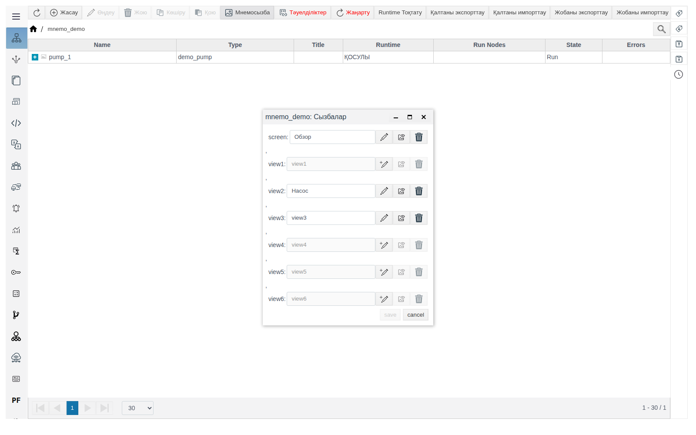

Әр жол — мазмұны бөлек сызба: `screen` ішінде салынған элементтер `view1` ішінде пайда болмайды және керісінше.

Сызба сақталғанша оның жолы сұр түсті болады, алдын ала қарау мен жою қолжетімсіз. Алғаш рет сақтағаннан кейін атау өрісін өңдеуге болады: түсінікті атау енгізіңіз (мысалда — `Обзор`) және **save** батырмасын басыңыз. Атау «Сызбалар» терезесінде және редактор тақырыбында көрсетіледі; жолдың қызметтік атауы (`screen`, `view1`…) өзгермейді.

## Сызбалардың мақсаты

| Сызба | Қай жерде көрсетіледі |
|---|---|
| `screen` | Буманың негізгі сызбасы. Оператор **Мнемосхемалар** мәзірінде буманы таңдағанда Runtime ортасында ашылады (төмендегі [Runtime ортасындағы сызба](#runtime-ортасындағы-сызба) бөлімін қараңыз) |
| `view1`…`view15` | Буманың қосымша сызбалары. Олар Runtime мәзірінде жоқ: басқа сызбалардың ішінде **Folder Screen** элементі арқылы көрсетіледі |
| `settings` | Studio ортасындағы бума қасиеттері формасының **Пайдаланушы** қойындысы |

Прототип мазмұнында да дәл осындай 17 орын бар. Оның сызбалары жоба мнемосызбаларына «Прототип» элементімен орналастырылады, ал прототиптің `settings` сызбасы әр дананың формасында көрсетіледі.

Кез келген сақталған сызбаны, соның ішінде `settings` сызбасын да, **Folder Screen** ішінде және прототипті кірістіру терезесінде таңдауға болады: екеуі де сызбаларды атауы бойынша тізімдейді.

## Сызба ішіндегі сызба: Folder Screen

**Folder Screen** элементі (**Controls** палитрасы) кез келген буманың сызбасын басқа сызбаның ішінде көрсетеді. Осылайша бір кескінді (торапты, агрегатты, шартты белгілерді) бір рет салып, бірнеше экранда көрсетуге болады.

1. Кірістірілетін сызбаны — кез келген буманың `view1`…`view15` сызбаларының бірін — салып, сақтаңыз және «Сызбалар» терезесінде оған атау беріңіз. Мысалда бұл — `mnemo_demo` бумасының `Насос` атты `view2` сызбасы.
2. Сызба кірістірілетін сызбаны ашып, кенепке **Folder Screen** элементін сүйреп апарыңыз. Сызба таңдалғанша элементте «Screen folder is undefined» және «View is undefined» жазулары көрсетіледі.
3. **Properties** панелінде **settings** тобын ашыңыз. `folder_list` қасиетінде үлкейткіш әйнек белгішесін басып, жоба ағашынан буманы таңдаңыз (**OK**), содан кейін **View** тізімінен сызбаны таңдаңыз. Тізімде осы буманың сақталған сызбалары атауы бойынша көрсетіледі; қазір өңдеп отырған сызба тізімге кірмейді.
4. **geometry** тобында элементтің орны мен өлшемін беріп, сақтаңыз.

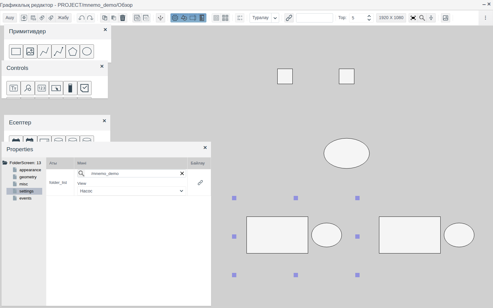

Кірістірілген сызба элемент өлшеміне дейін тұтастай созылады немесе кішірейеді. Оны 1:1 масштабында көрсету үшін кірістірілетін сызбаның өлшемін элемент өлшемімен бірдей етіп беріңіз: оның қасиеттерінде `Screen: 0` → **geometry** → `width` және `height` (мысалда `view2` сызбасының да, элементтің де өлшемі — 400 × 250).

## Прототип сызбалары

Прототипте де дәл сол 17 сызба бар: **Прототиптер** → прототипті таңдаңыз → **Контент** → мазмұн түбіріндегі **Мнемосызба**. Олармен редакторда жұмыс істеу бума сызбаларымен жұмыс істеуден ерекшеленбейді.

Прототип сызбасын жоба мнемосызбасына орналастыру үшін жобада осы прототиптің данасы болуы керек (мысалда — `mnemo_demo` бумасындағы `pump_1`).

1. Редактордың құралдар тақтасындағы **Прототиптер** батырмасын басыңыз. Прототиптер тізімі бар «Select Prototype view» терезесі ашылады; прототипті жайып, сызбаны таңдаңыз — оң жақта оның көрінісі пайда болады.
2. **Таңдау** батырмасын басып, жоба ағашынан дананы таңдаңыз да, **OK** батырмасын басыңыз.
3. Кенепте элемент орналасуы керек жерді шертіңіз.

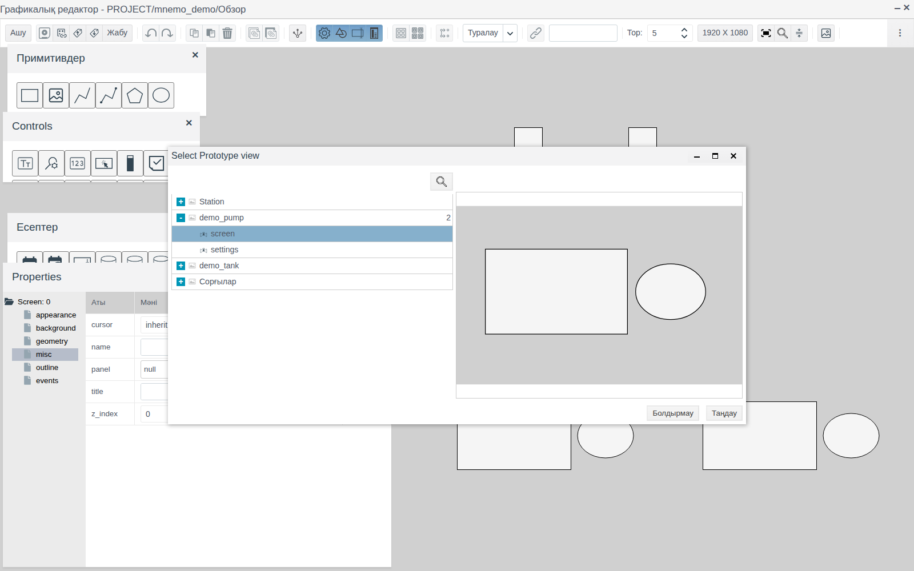

Сызбада прототип сызбасының өлшеміне тең `Prototype` элементі пайда болады. **settings** тобында: `instance` — дана, `prototype` және `view` — прототип пен сызба, тек оқуға арналған.

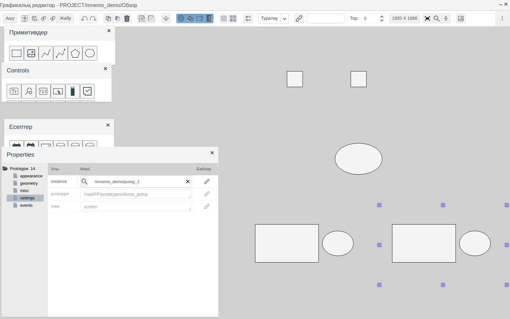

Прототип сызбасы бір рет салынады; әр дана үшін `instance` қасиетінде сол дана көрсетілген жеке «Прототип» элементі орналастырылады.

## Пайдаланушы қойындысы: settings сызбасы

Бума қасиеттерінің формасы (бума → **Өңдеу**) екі тік қойындыдан тұрады: **Жүйе** — бума өрістері, **Пайдаланушы** — осы буманың `settings` сызбасы. `settings` сақталғанша **Пайдаланушы** қойындысы белсенді емес.

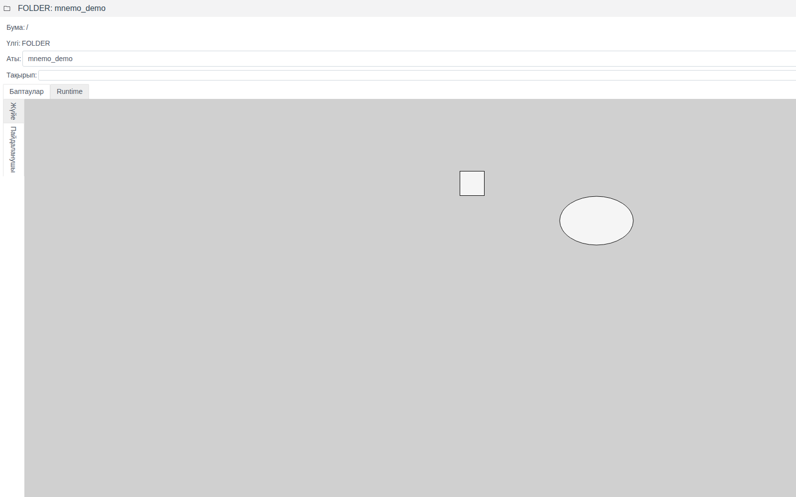

Прототиптің `settings` сызбасы оның әр данасының формасындағы **Пайдаланушы** қойындысында көрсетіледі.

## Редактор терезесі

Редактор толық экранға ашылады. Тақырыбында «Графикалық редактор - PROJECT/<бума>/<сызба атауы>» жазуы, оң жақта кішірейту және жабу батырмалары бар.

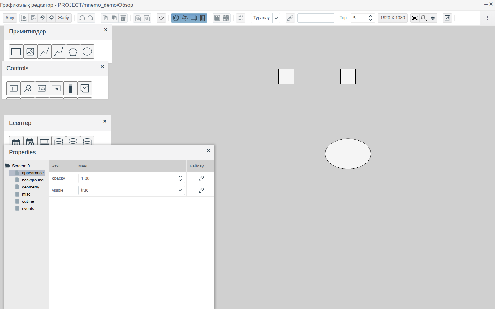

Тақырыптың астында құралдар тақтасы орналасқан. Жазуы жоқ батырмалардың мақсаты қалқымалы кеңесте көрсетіледі. Әр батырма өзі қолданылатын бөлімде сипатталған.

Кенептің үстінде төрт панель бар. Оларды тақырыбынан ұстап сүйреуге, айқыш белгісімен жабуға және құралдар тақтасындағы батырмалармен қайта ашуға болады:

| Панель | Батырма | Мазмұны |
|---|---|---|
| **Примитивдер** | **Сурет салу** | Пішіндер: тіктөртбұрыш, кескін, сынық сызық, жалғаушы сызық, полигон, эллипс ([Графикалық элементтер](graphics.md) құжатын қараңыз) |
| **Controls** | **Басқару элементтері** | [Енгізу өрістері, батырмалар](controls.md), [тізімдер](lists.md), [индикаторлар](gauges.md), [дабылдар мен трендтер](alarms_trends.md) және басқа элементтер |
| **Есептер** | **Есеп элементтері** | Күнді таңдау өрістері, дереккөздер, кесте, [бағанды диаграмма](gauges.md#бағандық-диаграмма) |
| **Қасиеттері** | **Properties** | Белгіленген элементтің қасиеттері |

Панельдердің орны мен көріну күйі пайдаланушы үшін есте сақталады және редактор келесі рет ашылғанда қалпына келтіріледі.

Құралдар тақтасының оң жағындағы **Суреттер кітапханасы** батырмасы жоба суреттерінің қоймасын ашады: жүктеу, бумалар, басқа жобаға көшіру ([Суреттер кітапханасы](images.md) құжатын қараңыз).

## Кенеп

Кенеп — сызбаның сұр аймағы. Жаңа сызбаның өлшемі құралдар тақтасындағы экран өлшемі көрсетілген батырмамен беріледі (әдепкі мәні — **1920 X 1080**). Ол мәндері 400-ден 30000-ға дейінгі **Width (px)** және **Height (px)** өрістері бар «Клиенттің экран өлшемін орнату» терезесін ашады. Бұл мән бүкіл жобаға ортақ және өзгерістен кейін жасалған сызбаларға қолданылады. Бұрыннан бар сызбаның өлшемі оның қасиеттерінде өзгертіледі, [Қасиеттер панелі](#қасиеттер-панелі) бөлімін қараңыз.

**Масштаб.** Ctrl + тінтуір дөңгелегі кенепті үлкейтеді және кішірейтеді. **Zoom** батырмасы (үлкейткіш әйнек) ағымдағы масштаб пайызбен көрсетілген, **−**, **+** және **Ысыру** (100 %-ға қайтару) батырмалары бар панельді ашады.

**Басына қайту.** **Reset position** батырмасы кенепті сызбаның сол жақ жоғарғы бұрышына қайта айналдырады. Масштаб пен сызбаның өзі өзгермейді.

**Мазмұн бойынша өлшем.** **Min position** батырмасы барлық элементті солға және жоғары жылжытады: ең сол жақтағысы сызбаның сол жиегіне, ең жоғарғысы жоғарғы жиегіне тұрады. Сызба элементтер алатын тіктөртбұрышқа дейін кішірейеді. Элементтер арасындағы қашықтық сақталады. Бұл — сызбаның өзгерісі: одан кейін **Сақтау** белсенді болады, Ctrl + Z бұрынғы орны мен өлшемін қайтарады. Батырма басқа сызбаларға қойылатын сызбаларға керек: «Прототип» элементі прототип сызбасының өлшемін алады ([Прототип сызбалары](#прототип-сызбалары) бөлімін қараңыз), ал суреттің айналасындағы бос орын негізгі сызбада артық орын алар еді.

**Тор.** **Тор** өрісі тор қадамын пиксельмен береді (1-ден 100-ге дейін, әдепкі мәні — 5). Сүйрегенде және өлшемін өзгерткенде координаталар торға байланады; бағыттауыш пернелер элементті тордың бір қадамына жылжытады.

## Элементтерді қосу

Палитрадан белгішені кенепке сүйреп апарыңыз. Элемент тінтуірді жіберген жерде пайда болып, белгіленеді, ал **Properties** панелінде оның қасиеттері ашылады. Элемент атауы белгішенің қалқымалы кеңесінде көрсетіледі.

Әр элементке сызба шегінде бірегей нөмір беріледі. Нөмір қасиеттер ағашының түбірінде элемент түрімен бірге көрсетіледі: `<түр>: <нөмір>`, мысалы, `Rectangle: 1`.

## Белгілеу

| Әрекет | Нәтиже |
|---|---|
| Элементті шерту | Элементті белгілейді, қалғандарының белгіленуін алып тастайды |
| Ctrl + шерту | Элементті белгіленгендерге қосады |
| Жақтау: кенептің бос жерін басып, сүйреу | Жақтауға толық кірген элементтерді белгілейді. Жақтау ішінара ғана қамтыған элементтер белгіленбейді |
| Ctrl + A | Сызбаның барлық элементін белгілейді |
| Бос жерді шерту | Белгілеуді алып тастайды |

Белгіленген элемент маркерлері бар жиекпен қоршалады. Бірнеше элемент белгіленгенде қасиеттер ағашының түбірі `Selection:` деп аталады; онда ортақ қасиеттер топтары мен белгіленген элементтер тізімі бар **subitems** түйіні көрсетіледі. Қасиеттер кестесіне енгізілген мән барлық белгіленген элементке қолданылады.

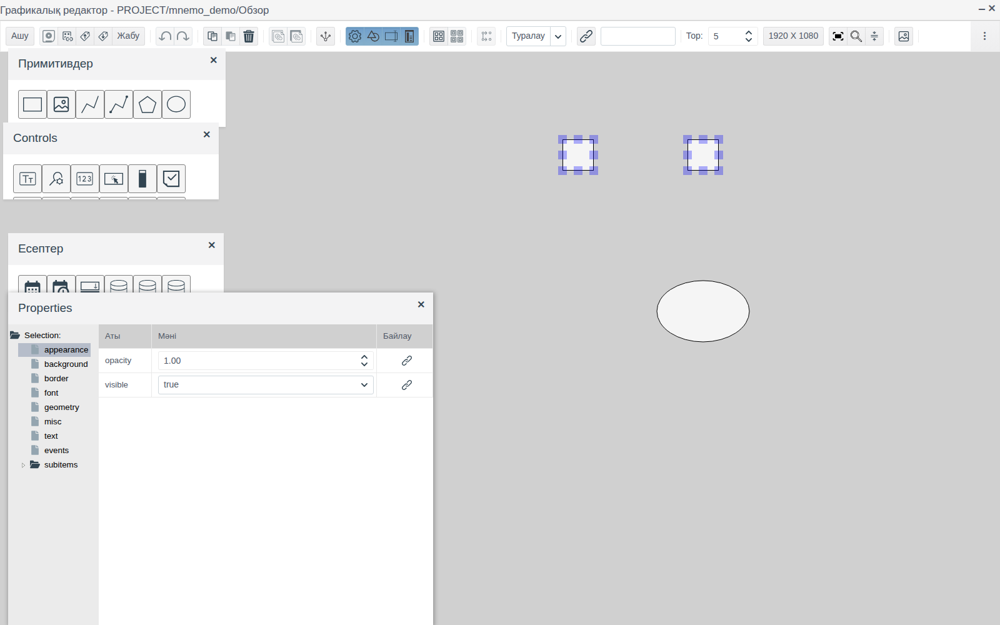

## Жылжыту және өлшемін өзгерту

- **Сүйреу** белгіленген элементтерді жылжытады; координаталар торға байланады.
- **Бағыттауыш пернелер** белгіленген элементтерді тордың бір қадамына жылжытады.
- Белгіленген аймақтың бұрыштары мен қабырғаларындағы **маркерлер** өлшемді өзгертеді; өлшем де торға байланады.
- Орын мен өлшем **дәл** мәндермен **Properties** панелінің **geometry** тобында беріледі: `left`, `top`, `width`, `height`, сызбаның жоғарғы сол жақ бұрышынан пиксельмен есептеледі.

## Қасиеттер панелі

**Properties** панелінің сол жағында белгіленген элементтің қасиеттер топтарының ағашы, оң жағында таңдалған топтың **Аты**, **Мәні** және **Байлау** бағандары бар кестесі орналасқан. Топтар жиыны элементке байланысты, мысалы, тіктөртбұрышта: **appearance**, **background**, **border**, **font**, **geometry**, **misc**, **text**, **events**.

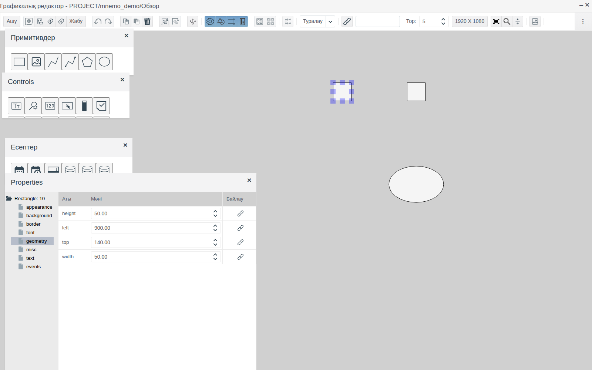

Кенептің бос жерін шертсеңіз, панель сызбаның өз қасиеттерін — `Screen: 0` — көрсетеді. Сызбаның өз топтары бар: **appearance**, **background**, **geometry**, **misc**, **outline**, **events**. **geometry** тобында сызбаның өлшемі (`width`, `height`) беріледі.

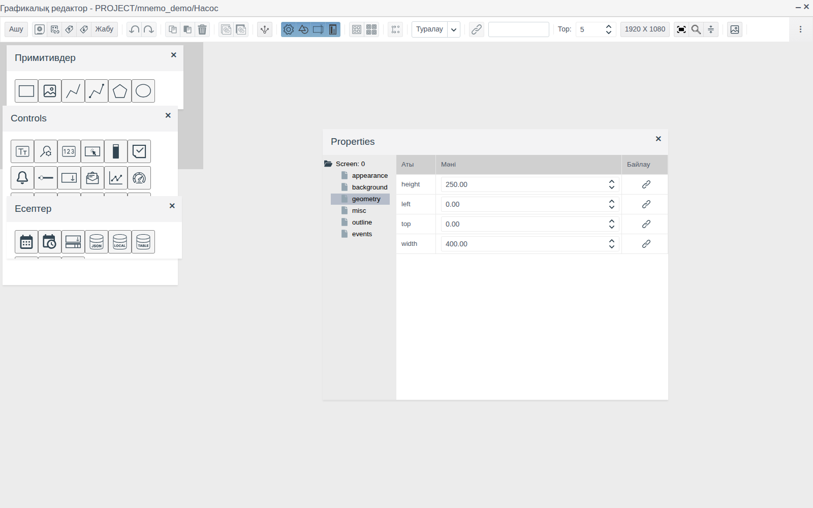

Мән тікелей ұяшықта өзгертіледі: сан теру немесе бағыттауыштар арқылы, ал нұсқа тізімнен таңдау арқылы беріледі. Өзгеріс кенепте бірден көрінеді. **Байлау** бағанындағы батырма қасиетті жоба деректерімен байланыстырады, ал **events** тобы оқиғаларға реакцияны береді; екеуінің де мысалы [Батырмалар және мәндерді енгізу](controls.md) құжатының [Элементті тегке байланыстыру](controls.md#элементті-тегке-байланыстыру) және [Батырма](controls.md#батырма) бөлімдерінде берілген. Байланыстырудың барлық режимі [Байланыстыру және анимация](bindings.md) құжатында, оқиғалар мен скрипттер [Скрипттер мен оқиғалар](events.md) құжатында сипатталған.

## Көшіру, қою, жою

| Әрекет | Пернелер | Батырма |
|---|---|---|
| Белгіленгендерді көшіру | Ctrl + C | **Көшіруге** |
| Қою | Ctrl + V | **Кірістіру** |
| Белгіленгендерді жою | Delete | **Өшіру** |

Көшірме түпнұсқадан оңға және төмен қарай 10 px ығысумен пайда болып, белгіленеді. Қайта қою келесі ығысумен тағы бір көшірме жасайды.

**Безендіруді көшіру.** Үлгіні белгілеп, **Сипаттарды көшіру** батырмасын басыңыз, содан кейін бір немесе бірнеше элементті белгілеп, **Сипаттар ендіру** батырмасын басыңыз. Безендіру қасиеттері — фон мен мәтін түстері, жақтау, қаріп — көшіріледі; орын, өлшем және мөлдірлік өзгермейді.

## Байланыстардағы тегті ауыстыру

Бір тегке байланған сызба бөлігі әр байланысты түзетпей-ақ бірден басқа тегке ауыстырылады. Бір агрегаттың элементтерін дәл сондай екінші агрегатқа көшіргенде осылай істейді.

**Қайта байлау** батырмасы **Properties** панелінің **Байлау** бағанында емес, редактордың құралдар панелінде, **Тор** алдындағы өрістің сол жағында орналасқан, белгішесі бірдей болса да. **Байлау** бағаны бір қасиеттің байланысын жасайды: онда тег пен өріс таңдалады. **Қайта байлау** белгіленген элементтердің барлық байланысындағы тегті ғана ауыстырады, өрістерді өзгертпейді.

1. Элементтерді белгілеңіз. Оларды тег бойынша табу үшін **Қайта байлау** батырмасының оң жағындағы өріске тег жолының бір бөлігін енгізіп, Enter басыңыз: байланыстарында осындай тег бар барлық элемент белгіленеді. Әріп регистрі маңызды емес, өрістер мен элементтердің атаулары ізделмейді. Сәйкестік болмаса, белгілеу өзгермейді.
2. **Қайта байлау** батырмасын басыңыз. Бірдеңе белгіленгенде батырма белсенді. «Байланыстыруды өзгерту» терезесі ашылады: белгіленген элементтердің байланыстарындағы әр тегке бір жол, жолдың оң жағында — үлкейткіш әйнегі бар өріс.
3. Керекті жолдарда үлкейткіш әйнекпен жаңа тегті таңдап, **OK** басыңыз.

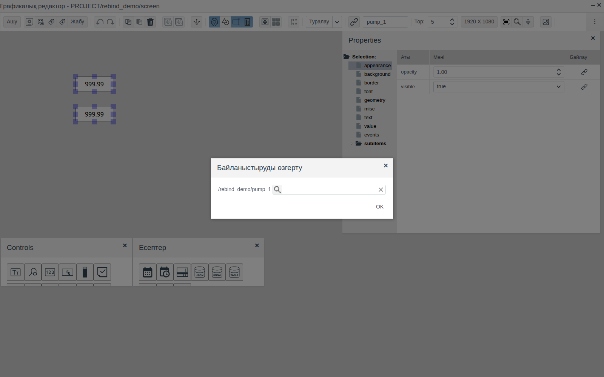

Байланыстар жаңа тегке өтеді, өрістер сол күйінде қалады: `/<бума>/<тег_1> :level` мәні `/<бума>/<тег_2> :level` болады. Ауыстыру Ctrl + Z арқылы болдырмалады.

## Болдырмау және қайталау

Ctrl + Z (**Әрекетті болдырмау** батырмасы) соңғы әрекеттің күшін жояды, Ctrl + Shift + Z (**Әрекетті қайтару** батырмасы) күші жойылған әрекетті қайта орындайды. Әр әрекет бір қадам болып есептеледі: қосу, жылжыту, бағыттауыш пернемен ығыстыру, қасиетті өзгерту, жою, туралау, топтау.

## Туралау

Екі немесе одан көп элементті белгілеп, құралдар тақтасындағы **Туралау** тізімінен режимді таңдаңыз.

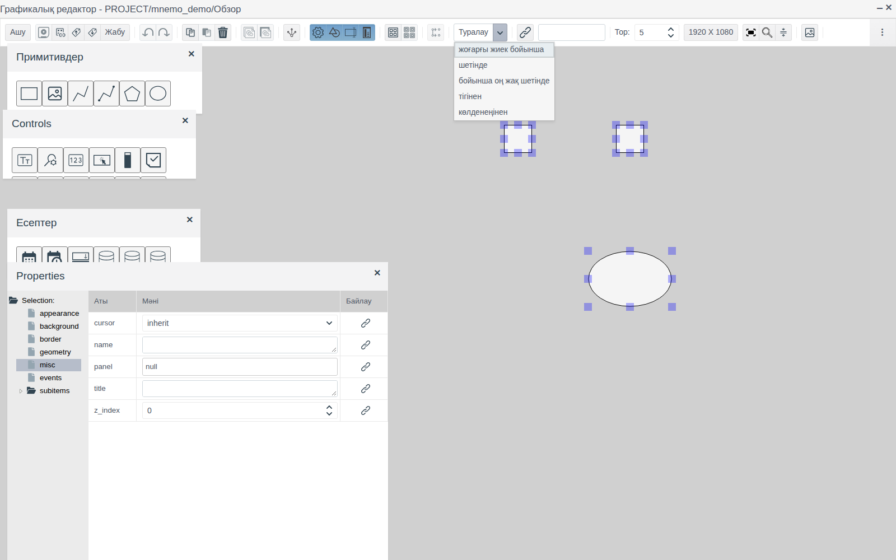

| Режим | Әрекеті |
|---|---|
| **жоғарғы жиек бойынша** | Жоғарғы жиектерді ең жоғары орналасқан элемент бойынша туралайды |
| **шетінде** | Төменгі жиектерді ең төмен орналасқан элемент бойынша туралайды |
| **бойынша оң жақ шетінде** | Оң жақ жиектерді ең оң жақта орналасқан элемент бойынша туралайды |
| **тігінен** | Орталықтарды ең сол жақтағы орталық арқылы өтетін бір тік сызық бойына орналастырады |
| **көлденеңінен** | Орталықтарды ең жоғарыдағы орталық арқылы өтетін бір көлденең сызық бойына орналастырады |

Ctrl + Z пернелерін бір рет басып, туралауды болдырмауға болады.

## Топтау

Элементтерді белгілеп, **Топтастыру** батырмасын басыңыз. Топқа жеке нөмір (`Group: <нөмір>`) және **appearance**, **background**, **border**, **geometry**, **misc**, **events** қасиеттері беріледі; **subitems** түйінінде топқа кіретін элементтер орналасады. Топтың кез келген элементін шерту бүкіл топты белгілейді, сүйреу оны тұтастай жылжытады.

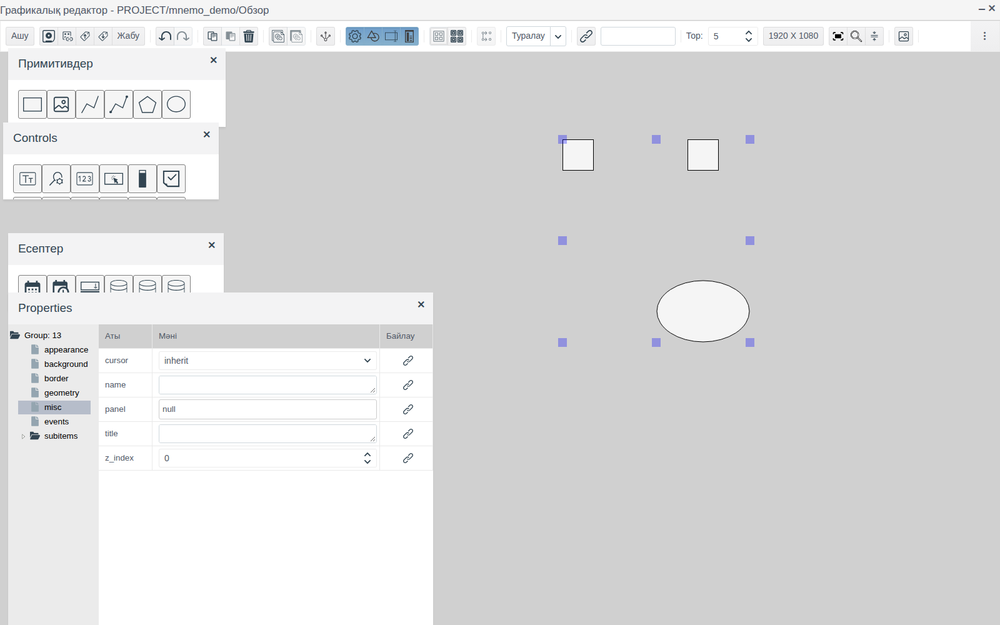

**Топтастыру** элементтерді сызбаға жеке-жеке қайтарады. Батырма топ белгіленгенде белсенді болады.

## Сақтау және жабу

Сызбаны Ctrl + S пернелерімен немесе **Сақтау** батырмасымен сақтаңыз. Сақтағаннан кейін батырма келесі өзгеріске дейін белсенді болмайды.

**Проверить зависимости** батырмасы сызба элементтері сілтейтін жоба нысандарының бар-жоғын тексереді. Жарамсыз сілтемелер болмаса, бұл туралы хабарлама пайда болады.

**Жабу.** Құралдар тақтасындағы **Жабу** сызбаны, ал тақырыптағы айқыш белгісі бүкіл редакторды жабады. Сақталмаған өзгерістер болса, редактор «<жол> - Өзгерістерді сақтау?» деп сұрайды: **yes** сақтап жабады, **no** сақтамай жабуды растауды сұрайды.

**Автоматты сақтау.** Редактор минутына бір рет ағымдағы пайдаланушы үшін өзгертілген сызбаның көшірмесін сақтайды. Жұмыс сақталмай үзілсе (қойынды жабылса, сеанс үзілсе), сызба келесі рет ашылғанда редактор сақталмаған көшірмені қалпына келтіруді ұсынады. **yes** көшірмені, **no** соңғы сақталған нұсқаны ашады. Қалпына келтірілген көшірмені әдеттегідей сақтаңыз.

## Сызбаны экспорттау және импорттау

**Файлға экспорттау** ағымдағы сызбаны `.scn` файлына сақтайды. Файл атауы сызба жолынан құралады: `PROJECT_<бума>_<сызба>.scn`. Мысалда — `PROJECT_mnemo_demo_screen.scn`.

**Файлдан импорттау** «Файлды таңдау» терезесін ашады. **Select files...** арқылы `.scn` файлын таңдап, **OK** батырмасын басыңыз: ашық сызбаның мазмұны файл мазмұнымен ауыстырылады. Нәтижені бекіту үшін сызбаны сақтаңыз.

Сызба файлында суреттердің жолдары ғана сақталады, суреттердің өзі емес. Сызба басқа жобаға көшірілсе, оның суреттерін де көшіріңіз ([Суреттер кітапханасы, Басқа жобаға көшіру бөлімін](images.md#басқа-жобаға-көшіру) қараңыз).

## Бір мезгілде өңдеу

Сызбаны бір мезгілде тек бір сеанс өңдейді. Сызба редакторда ашық болса, басқа пайдаланушыға (немесе сол пайдаланушыға басқа браузерде) «Растау» терезесі көрсетіледі: «Көрініс қазір өңдеуде: <пайдаланушы>. Тек шолу режимі қолжетімді. Сіз ашқыңыз келе ме?». **Иә** сызбаны алдын ала қарау режимінде ашады.

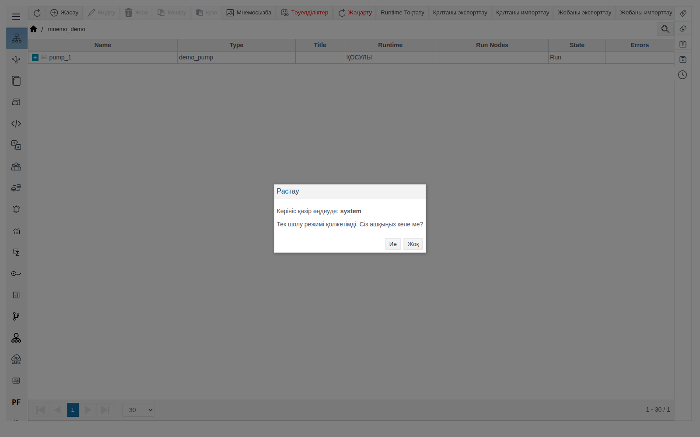

Сызба редакторда жабылғанда немесе ол ашылған браузер қойындысы жабылғанда босатылады.

## Runtime ортасындағы сызба

Runtime ортасында (`http://<сервер>:9000/fp/runtime`) мәзірді, содан кейін **Мнемосхемалар** тармағын ашыңыз. Тізімде `screen` сызбасы сақталған жоба бумалары көрсетіледі. Буманы шерту осы сызбаны ашады; бума жолы жоғарғы жолда көрсетіледі. Кірістірілген сызбалар (Folder Screen) мен «Прототип» элементтері оның ішінде көрінеді: суреттің төменгі қатарында сол жақта — `view2` «Насос», оң жақта — `demo_pump` прототипінің сызбасы.

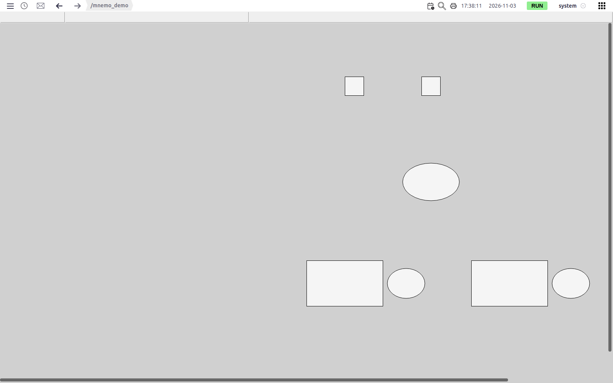

Studio ортасынан шықпай сызбаны қарау үшін «Сызбалар» терезесіндегі алдын ала қарау батырмасын пайдаланыңыз. Экран қасиеттері, бекітілген экран және экрандар арасында ауысу [Экрандар және олардың арасында ауысу](screens.md) құжатында сипатталған.

# Қорытынды

Сызбамен жұмыс істеу реті:

1. Буманы екі рет шертіп ашыңыз, **Мнемосызба** батырмасын басып, сызба жасаңыз: `screen` — Runtime экраны, `view1`…`view15` — **Folder Screen** арқылы кірістірілетін бөліктер, `settings` — бума формасының **Пайдаланушы** қойындысы.
2. Палитралардан элементтерді кенепке сүйреп апарыңыз.
3. Оларды орналастырыңыз: торға байлап сүйреу және бағыттауыш пернелер арқылы, дәл мәндермен — **geometry** тобында; туралаңыз және топтаңыз.
4. **Properties** панелінде безендіруді реттеңіз; бірдей безендіруді **Сипаттарды көшіру** / **Сипаттар ендіру** батырмаларымен көшіріңіз.
5. Сақтаңыз (Ctrl + S) және қажет болса, «Сызбалар» терезесінде сызбаға атау беріңіз.
6. Қайталанатын бөліктерді бір рет салыңыз: буманың `viewN` сызбасында (**Folder Screen** арқылы кірістіру) немесе прототип сызбасында (әр данаға «Прототип» элементі).
7. Нәтижені «Сызбалар» терезесіндегі алдын ала қарау батырмасымен немесе Runtime → **Мнемосхемалар** арқылы тексеріңіз.
