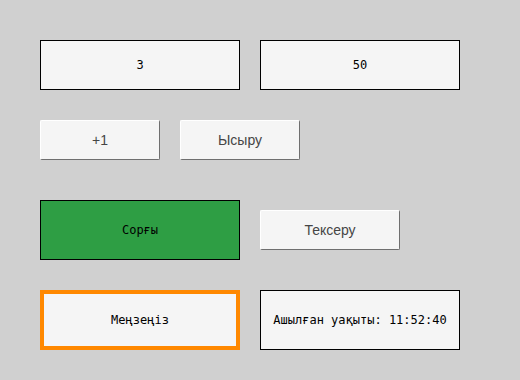
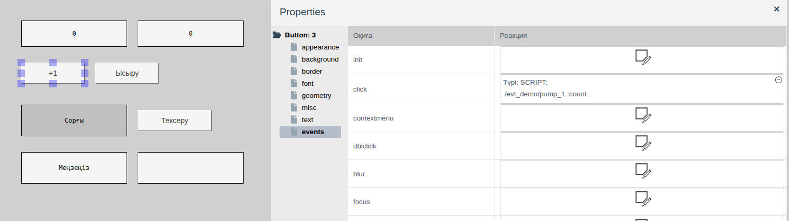
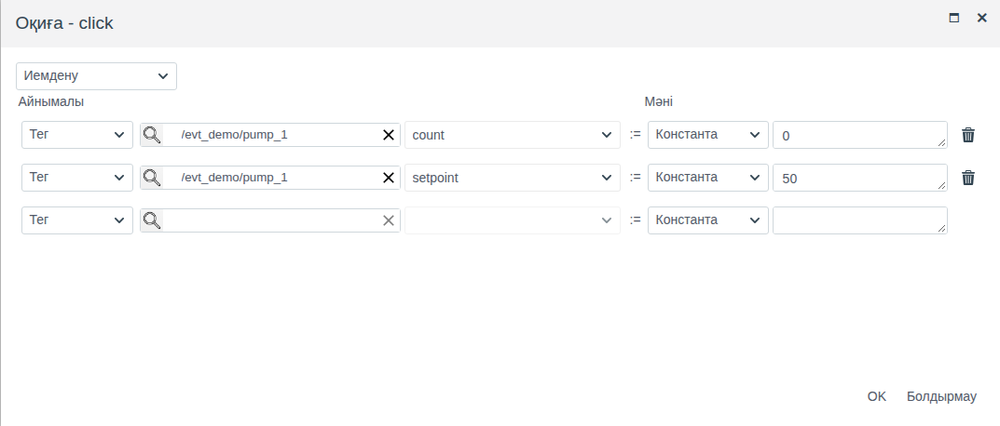
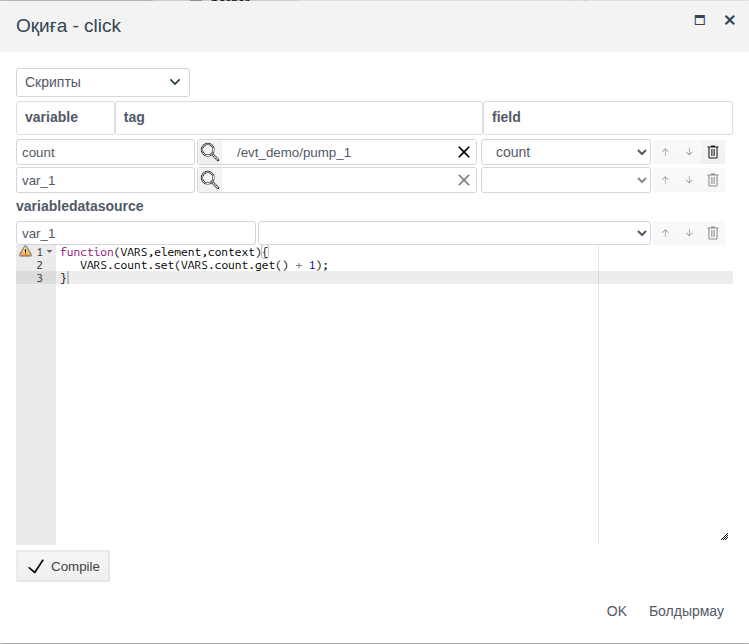
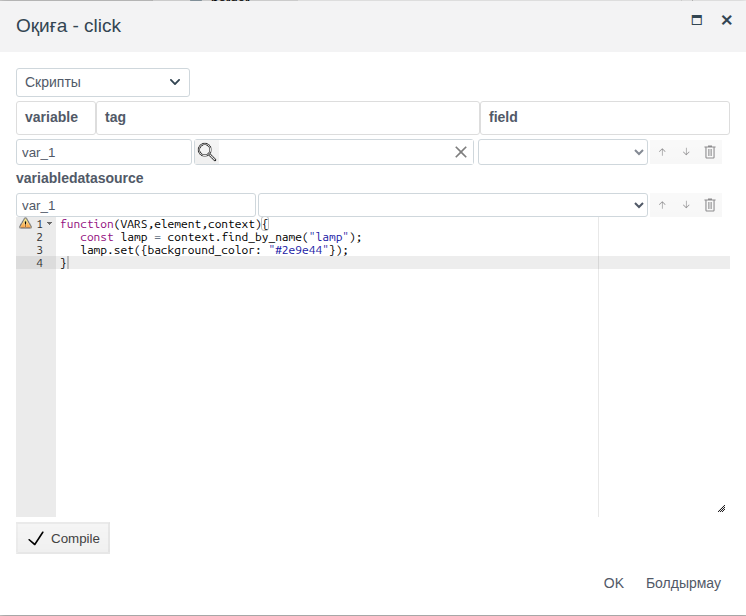

# Скрипттер мен оқиғалар

Бұл құжат мнемосызбаның оператор әрекеттеріне қалай жауап беретінін баптайтын интегратор инженерге арналған: батырма тегтерге мәндер жазады, шерту басқа элементтің көрінісін өзгертеді, меңзерді апару элементті ерекшелейді, сызба ашылғанда скрипт орындалады.

# Мазмұны

- [Терминдер сөздігі](#терминдер-сөздігі)
- [Кіріспе](#кіріспе)
- [Негізгі бөлім](#негізгі-бөлім)
    - [events тобы](#events-тобы)
    - [Оқиғалар](#оқиғалар)
    - [Оқиға терезесі](#оқиға-терезесі)
    - [Меншіктеу](#меншіктеу)
    - [Оқиға скрипті](#оқиға-скрипті)
    - [Скриптте не қолжетімді](#скриптте-не-қолжетімді)
    - [Оқиға және байланыстыру](#оқиға-және-байланыстыру)
- [Қорытынды](#қорытынды)

# Терминдер сөздігі

| Термин | Мағынасы |
|---|---|
| Оқиға | Элемент жауап бере алатын оператор әрекеті немесе сызбадағы өзгеріс: шерту, меңзерді апару, пернені басу, сызбаның ашылуы |
| Реакция | Оқиға кезінде орындалатын әрекет: меншіктеу немесе скрипт. **events** тобының **Реакция** бағанында беріледі |
| Меншіктеу | Скриптсіз реакция: тег өрісіне тұрақты мәнді немесе басқа өрістің мәнін жазу |
| Элемент атауы | **misc** тобының `name` қасиеті. Скрипт сызбадағы элементті осы атауы арқылы табады |

«Тег», «Байланыстыру» терминдері — [Батырмалар және мәндерді енгізу](controls.md#терминдер-сөздігі) құжатында, «Айнымалы» — [Байланыстыру және анимация](bindings.md#терминдер-сөздігі) құжатында, «Сызба», «Элемент», «Палитра» — [Мнемосызбалар редакторы](editor.md#терминдер-сөздігі) құжатында түсіндірілген.

# Кіріспе

Байланыстыру ([Байланыстыру және анимация](bindings.md) құжатын қараңыз) деректерді сызбаға жеткізеді: элемент қасиеті тег өрісінің мәніне сай өзгереді. Оқиға кері бағытта жұмыс істейді: оператор әрекеті реакцияны іске қосады, ал реакция тегтерге мәндер жазады немесе элементтердің қасиеттерін өзгертеді. Реакция бағдарламалауды қажет етпейтін меншіктеу немесе JavaScript скрипті болуы мүмкін.

Құжатта оқиғалар тізімі, оқиға терезесі, меншіктеу, оқиға скрипті және скриптте не қолжетімді екені сипатталған. Редактордағы жұмыс (элементтер қосу, қасиеттер панелі, сақтау) — [Мнемосызбалар редакторы](editor.md) құжатында, батырма мен енгізу өрістері — [Батырмалар және мәндерді енгізу](controls.md) құжатында сипатталған.

Құжат бойындағы мысал — `evt_demo` бумасының `screen` сызбасы. Бумада `demo_evt` атты жеке примитивтің `pump_1` нысаны бар:

| Өріс | Түрі | Мағынасы |
|---|---|---|
| `count` | integer | Басу санауышы |
| `setpoint` | float | Тағайындалған мән |

Сызбада:

| Элемент | Оқиға | Реакция |
|---|---|---|
| Жоғарыдағы екі тіктөртбұрыш | — | `count` және `setpoint` мәндерін көрсетеді (`text` қасиетін байланыстыру) |
| «+1» батырмасы | `click` | Скрипт: `count` мәнін 1-ге арттыру |
| «Ысыру» батырмасы | `click` | Меншіктеу: `count` := 0, `setpoint` := 50 |
| «Сорғы» тіктөртбұрышы, `name` = `lamp` | — | — |
| «Тексеру» батырмасы | `click` | Скрипт: «Сорғы» элементін жасыл түске бояу |
| «Меңзеңіз» тіктөртбұрышы | `mouseenter`, `mouseleave` | Скрипт: меңзерді апарғанда жақтау қызғылт сары болады, меңзер кеткенде қалыпты күйіне қайтады |
| Төменгі оң жақтағы тіктөртбұрыш | `init` | Скрипт: сызбаның ашылған уақытын көрсету |



Жобаны өзгерту құқығы бар тіркелгімен Studio ортасына (`http://<сервер>:9000/fp/studio`) кіру мүмкіндігі қажет. Нәтиже Runtime ортасында (`http://<сервер>:9000/fp/runtime`) тексеріледі.

# Негізгі бөлім

## events тобы

Сызбаның әр элементінде және сызбаның өзінде (кенептің бос жерін басыңыз, панельде `Screen: 0` көрсетіледі) **Properties** панелінің **events** тобы бар. Ондағы кестенің **Оқиға** бағанында оқиға атауы, **Реакция** бағанында бапталған реакция көрсетіледі.

Бос **Реакция** ұяшығы — «Оқиға - <атау>» терезесін ашатын батырма. **OK** басылғаннан кейін ұяшықта реакцияның сипаттамасы пайда болады:

- `Type: SCRIPT:` және әр скрипт айнымалысына бір жол: `/<бума>/<нысан> :<өріс>`;
- меншіктеу үшін әр меншіктеуге бір жол: `/<бума>/<нысан>-><өріс> := <мән>`.

Мысалда «+1» батырмасының ұяшығында `/evt_demo/pump_1 :count`, «Ысыру» батырмасының ұяшығында `/evt_demo/pump_1->count := 0` және `/evt_demo/pump_1->setpoint := 50` көрсетілген.

Сипаттаманы басқанда реакцияны өзгерту терезесі ашылады. Ұяшық бұрышындағы ⊖ белгішесі растаудан кейін реакцияны жояды → **yes**.



Реакциялар тек Runtime ортасында жұмыс істейді: редакторда шерту элементті белгілейді. Реакциялар сызбамен бірге сақталады: оларды баптағаннан кейін сызбаны сақтаңыз.

## Оқиғалар

Оқиғалар тізімі барлық элементте бірдей. Енгізу элементтерінде — енгізу өрістерінде, жалаушада, жүгірткіде, тізімдерде, нысанды таңдау және каталогтан таңдау элементтерінде — қосымша `input` оқиғасы бар.

| Оқиға | Қашан орындалады |
|---|---|
| `init` | Сызба Runtime ортасында жүктелді ([Сызбаға қайту](screens.md#сызбаға-қайту) бөлімін қараңыз). Бастапқы көріністі баптауға қолайлы |
| `click` | Тінтуірдің сол жақ батырмасымен шерту |
| `dblclick` | Екі рет шерту. Оның алдында екі `click` орындалады |
| `contextmenu` | Тінтуірдің оң жақ батырмасымен шерту |
| `mousedown`, `mouseup` | Тінтуір батырмасы элементтің үстінде басылды, босатылды |
| `mouseenter`, `mouseleave` | Меңзер элементке кірді, одан шықты |
| `focus`, `focusin` | Элемент фокус алды: енгізу өрісін шерту, Tab арқылы өту |
| `blur`, `focusout` | Элемент фокусты жоғалтты |
| `keydown` | Элемент фокуста тұрғанда перне басылды |
| `keypress` | Таңба енгізетін перне немесе Enter басылды |
| `input` | Элемент мәні өзгерді: сызба ашылғанда немесе өріс өзгергенде тегтен келді не оператор енгізді |

Фокус пен перне оқиғаларын оператор пернетақтамен жұмыс істейтін элементтер алады: батырма және `type` = `direct` болатын енгізу өрісі. Тінтуір оқиғалары, `init` және `input` өзінде осы оқиғалар бар кез келген элементке жарайды.

Енгізу өрісін шерткендегі оқиғалардың реті: `mousedown`, `focusin`, `focus`, `mouseup`, `click`.

## Оқиға терезесі

Терезенің жоғарғы жағындағы тізімнен реакция түрі таңдалады:

| Түрі | Не істейді |
|---|---|
| **Иемдену** | Тег өрістеріне мәндер жазады. [Меншіктеу](#меншіктеу) бөлімін қараңыз |
| **Скрипты** | JavaScript функциясын орындайды. [Оқиға скрипті](#оқиға-скрипті) бөлімін қараңыз |

Реакция толтырылғанда **OK** қолжетімді болады. **Болдырмау** терезені өзгеріссіз жабады.

## Меншіктеу

Меншіктеу — «**Айнымалы** := **Мәні**» жолдарынан тұратын кесте. Әр жол бір өріске бір мән жазады.

| Баған | Не таңдау керек |
|---|---|
| **Айнымалы** | **Тег**, лупа → нысан → **OK**, содан кейін оң жақта мән жазылатын өріс |
| **Мәні** | **Константа** және мән немесе **Тег**, нысан және мәні жазылатын өріс |

Тұрақты мән өріс талап ететіндей енгізіледі: сан — сандық өріске, `true`/`false` — тізімнен таңдау арқылы, жол — мәтін түрінде. Жол толтырылғаннан кейін астында келесі меншіктеуге арналған бос жол пайда болады. Себет белгішесі жолды жояды. Оқиға кезінде жолдар жоғарыдан төмен қарай ретімен орындалады.

Мысалда «Ысыру» батырмасы `click` кезінде `pump_1` нысанының екі өрісіне жазады: `count` := 0, `setpoint` := 50.



Меншіктеу «Іске қосу», «Тоқтату», «Ысыру», «Тапсырманы 50 қою» батырмаларына қолайлы: мәндер алдын ала белгілі. «Іске қосу» және «Тоқтату» батырмаларының мысалы Buttons and value input құжатының [Батырма](controls.md#батырма) бөлімінде берілген. Мәнді есептеу керек болса, скриптті пайдаланыңыз.

## Оқиға скрипті

Скрипт — оқиға кезінде орындалатын JavaScript функциясы. Терезе script байланыстыру терезесі сияқты құрылған ([script байланыстыруы](bindings.md#script-байланыстыруы) бөлімін қараңыз):

1. **Скрипты** түрін таңдаңыз.
2. **variable** / **tag** / **field** кестесінде айнымалыларды беріңіз: айнымалы атауы, нысан (лупа) және өріс. Төменгі бос жол айнымалы қосады. Тек сызба элементтерін өзгертетін скриптке айнымалылар қажет емес. Скрипт дереккөз жазбаларын **variabledatasource** бөлімі арқылы алады ([Сызбадағы дереккөздер, «Скрипттегі дереккөз» бөлімі](datasources.md#скрипттегі-дереккөз) құжатын қараңыз).
3. Редакторда функция денесін жазып, **Compile** басыңыз.
4. **OK** басыңыз.

Байланыстырудан айырмашылығы: функция ештеңе қайтармайды. Ол әрекеттерді орындайды — тег өрістеріне жазады, элементтердің қасиеттерін өзгертеді. Скрипт іске қосылар алдында барлық айнымалының мәні қайта оқылады, сондықтан скрипт оқиға сәтіндегі өрістердің ағымдағы мәндерін көреді.

Мысалда «+1» батырмасы санауышты арттырады. `count` айнымалысы — `pump_1.count` өрісі:

```javascript
function(VARS,element,context){
   VARS.count.set(VARS.count.get() + 1);
}
```



## Скриптте не қолжетімді

Функция үш аргумент алады.

| Аргумент | Не береді |
|---|---|
| `VARS` | Терезе кестесіндегі айнымалылар. `VARS.<атау>.get()` — өріс мәні, `VARS.<атау>.set(value)` — тег өрісіне жазу |
| `element` | Оқиға болған элемент. `element.get("<қасиет>")` — қасиет мәні, `element.set({<қасиет>: value, …})` — бір немесе бірнеше қасиетті өзгерту |
| `context` | Runtime ортасында ашылған сызба. `context.find_by_name("<атау>")` — `name` мәні осындай сызба элементі; онда да сол `get` және `set` бар |

Қасиет атаулары **Properties** панеліндегідей: `text`, `background_color`, `border_width`, `visible` және басқалары. Скрипт өзгерткен қасиеттер сызба қайта жүктелгенше сақталады: оған қайтқанда элементтер скрипт қалдырған күйінде болады, жаңадан жүктелгеннен кейін редактордағы күйіне келеді ([Сызбаға қайту](screens.md#сызбаға-қайту) бөлімін қараңыз).

Элементтің өзін өзгерту — меңзерді апарғанда ерекшелеу. Мысалда «Меңзеңіз» тіктөртбұрышы, `mouseenter` оқиғасы:

```javascript
function(VARS,element,context){
   element.set({border_color: "#ff8800", border_width: 4});
}
```

`mouseleave` оқиғасы жақтауды бастапқы күйіне қайтарады: `element.set({border_color: "#000000", border_width: 1});`.

Басқа элементті атауы арқылы өзгерту: элементке `name` беріп, оны `context.find_by_name` арқылы табыңыз. Мысалда «Сорғы» тіктөртбұрышының `name` = `lamp` (**misc** тобы). «Тексеру» батырмасы, `click` оқиғасы:

```javascript
function(VARS,element,context){
   const lamp = context.find_by_name("lamp");
   lamp.set({background_color: "#2e9e44"});
}
```



Сызба ашылғанда көріністі баптау — `init` оқиғасы. Мысалда төменгі оң жақтағы тіктөртбұрыш ашылған уақытты көрсетеді:

```javascript
function(VARS,element,context){
   element.set({text: "Ашылған уақыты: " + new Date().toLocaleTimeString()});
}
```

## Оқиға және байланыстыру

| | Байланыстыру | Оқиға |
|---|---|---|
| Бағыты | Деректер → элемент қасиеті | Оператор әрекеті → тегтерге жазу, қасиеттерді өзгерту |
| Қашан орындалады | Сызба ашылғанда және өріс өзгерген сайын | Оқиға кезінде |
| Қайда беріледі | Қасиеттің **Байлау** бағаны | **events** тобының **Реакция** бағаны |
| Бағдарламалаусыз | Тег, маскалау, мәндер картасы, жыпылықтау | Меншіктеу |
| Скрипт | Қасиет мәнін `return` арқылы қайтарады | Әрекеттерді орындайды, ештеңе қайтармайды |

Оператор байланыстыру көрсететін мәнді өзгертуі үшін оқиға тег өрісіне жазады, ал байланыстыру жаңа мәнді сызбаға шығарады. Мысалдағы «+1» және «Ысыру» осылай жұмыс істейді.

# Қорытынды

| Міндет | Қалай орындау керек |
|---|---|
| Батырмамен тегке алдын ала белгілі мәнді жазу | `click` оқиғасында тұрақты мәнмен меншіктеу |
| Бір өрістің мәнін екіншісіне көшіру | Меншіктеу: **Мәні** = **Тег** |
| Есептелген мәнді жазу | Скрипт: `VARS.<атау>.set(…)` |
| Меңзерді апарғанда элемент көрінісін өзгерту | `mouseenter` және `mouseleave` оқиғаларындағы `element.set` бар скрипт |
| Басқа элементті өзгерту | Элементтің `name` қасиеті және скрипттегі `context.find_by_name` |
| Сызба ашылғанда әрекет орындау | `init` оқиғасы |
| Енгізу өрісінің мәні өзгергенде әрекет ету | `input` оқиғасы |

Жұмыс реті:

1. Реакция не істейтінін шешіңіз: алдын ала белгілі мәндерді жаза ма (меншіктеу), әлде оларды есептеп, элементтерді өзгерте ме (скрипт).
2. Скрипт өзгертетін элементтерге `name` беріңіз.
3. Элементті белгілеңіз, **events** тобында қажетті оқиғаның **Реакция** ұяшығын басып, реакцияны баптаңыз.
4. Сызбаны сақтап, Runtime ортасында тексеріңіз. Жазылған мәндер Studio ортасындағы нысан пішінінде көрінеді.
