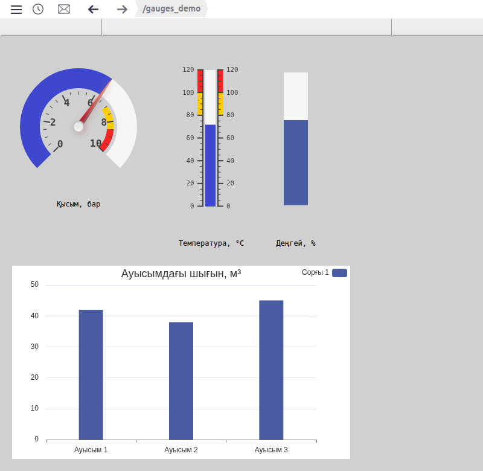
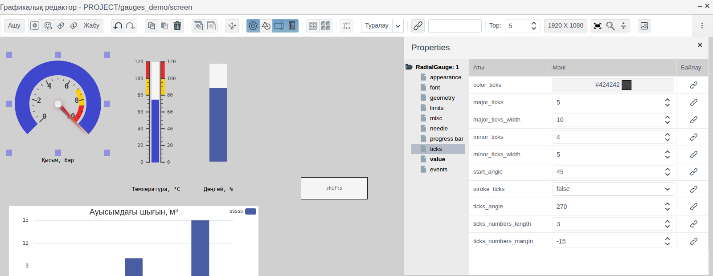
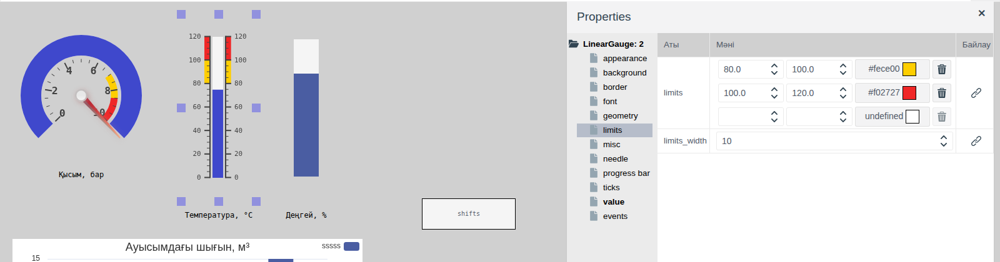
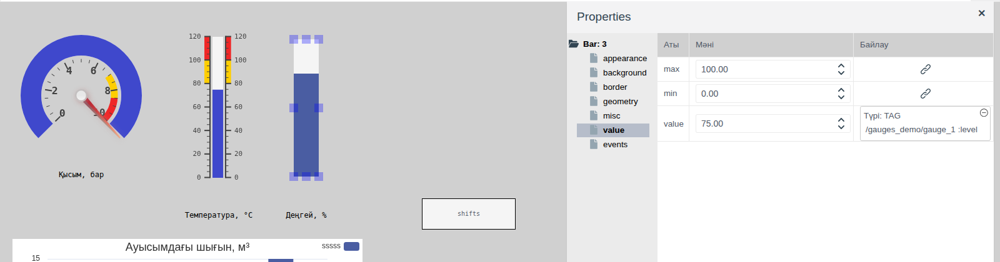
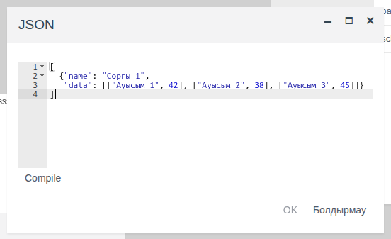
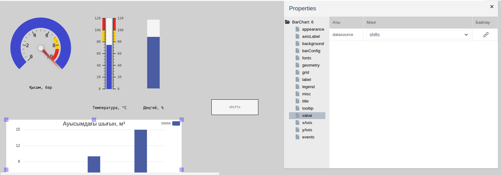

# Көрсеткілі және сызықтық индикаторлар

Бұл құжат мнемосызбада операторға өлшенетін шамаларды көрсететін интегратор инженерге арналған: қысымды дөңгелек шкалада, температураны сызықтық шкалада, деңгейді баған түрінде және жиынтық сандарды бағандық диаграммада.

# Мазмұны

- [Терминдер сөздігі](#терминдер-сөздігі)
- [Кіріспе](#кіріспе)
- [Негізгі бөлім](#негізгі-бөлім)
    - [Палитралардағы элементтер](#палитралардағы-элементтер)
    - [Шкала және мән](#шкала-және-мән)
    - [Дөңгелек индикатор](#дөңгелек-индикатор)
    - [Сызықтық индикатор](#сызықтық-индикатор)
    - [Түрлі түсті аймақтар](#түрлі-түсті-аймақтар)
    - [Бар](#бар)
    - [Бағандық диаграмма](#бағандық-диаграмма)
- [Қорытынды](#қорытынды)

# Терминдер сөздігі

| Термин | Мағынасы |
|---|---|
| Индикатор | Тег өрісіндегі санды шкалада доға, баған немесе көрсеткі түрінде көрсететін сызба элементі. Оператор мәнді өзгертпейді |
| Түрлі түсті аймақ | Индикатор шкаласының өз түсімен боялған бөлігі: ескерту немесе апат диапазоны |
| Дереккөз | Басқа элементтерге арналған деректер жиынын сақтайтын, Runtime ортасында көрінбейтін сызба элементі. Мұнда — **Есептер** палитрасындағы **Local Datasource** |
| Қатар | Ортақ атауы бар диаграмма бағандарының жиыны, әр санатқа бір бағаннан келеді |

«Тег», «Байланыстыру» терминдері — [Батырмалар және мәндерді енгізу](controls.md#терминдер-сөздігі) құжатында, «Сызба», «Палитра», «Элемент» — [Мнемосызбалар редакторы](editor.md#терминдер-сөздігі) құжатында түсіндірілген.

# Кіріспе

Индикаторлар тег өрісінің ағымдағы мәнін шкалада көрсетіп, онымен бірге жаңарады. Шкала, бөлік сызықтары және түрлі түсті аймақтар операторға сандарды оқымай-ақ шаманың қалыпты шекте тұрған-тұрмағанын анықтауға мүмкіндік береді.

Құжатта үш индикатор (дөңгелек, сызықтық және Bar) мен бағандық диаграмма сипатталған: олардың қасиеттері, тегке байланыстырылуы және Runtime ортасындағы көрінісі. Редактордағы жұмыс (қосу, белгілеу, қасиеттер, сақтау) — [Мнемосызбалар редакторы](editor.md) құжатында, қасиетті тег өрісіне байланыстыру — [Батырмалар және мәндерді енгізу, «Элементті тегке байланыстыру» бөлімі](controls.md#элементті-тегке-байланыстыру) құжатында сипатталған; жазулар [Графикалық элементтер](graphics.md#тіктөртбұрыш) құжатындағы тіктөртбұрыштар арқылы жасалған.

Құжат бойындағы мысал — `gauges_demo` бумасының `screen` сызбасы. Деректер `pressure`, `temp` және `level` өрістері бар (барлығы float) `demo_gauge` меншікті примитивінің `gauge_1` нысанында сақталады. Сызбада 0–10 бар қысым дөңгелек индикаторда, 0–120 °C температура сызықтық индикаторда, 0–100 % деңгей Bar арқылы және ауысымдар бойынша шығын диаграммасы көрсетілген.



Жобаны өзгерту құқығы бар тіркелгімен Studio ортасына (`http://<сервер>:9000/fp/studio`) кіру мүмкіндігі қажет. Нәтиже Runtime ортасында (`http://<сервер>:9000/fp/runtime`) тексеріледі.

# Негізгі бөлім

## Палитралардағы элементтер

Элемент атауы палитра белгішесінің қалқымалы кеңесінде, ал түрі қасиеттер ағашының түбірінде көрсетіледі.

| Палитра | Белгішенің кеңесі | Қасиеттер ағашының түбірі | Не көрсетеді |
|---|---|---|---|
| **Controls** | RadialGauge | `RadialGauge` | Дөңгелек шкаладағы сан: доға және көрсеткі түрінде |
| **Controls** | LinearGauge | `LinearGauge` | Термометрдегідей бөлік сызықтары бар түзу шкаладағы сан |
| **Controls** | Bar | `Bar` | Шкаласыз баған түріндегі сан: `min` мен `max` арасындағы толтыру үлесі |
| **Есептер** | Bar Chart | `BarChart` | Дереккөзден алынған сандар жиыны, санаттар бойынша бағандар түрінде |

**appearance**, **geometry** және **misc** топтары сызбаның басқа элементтеріндегідей ([Графикалық элементтер, «Ортақ қасиеттер» бөлімі](graphics.md#ортақ-қасиеттер) құжатын қараңыз).

## Шкала және мән

Үш индикаторда да мән мен шкала диапазоны **value** тобында беріледі:

| Қасиет (**value** тобы) | Мақсаты |
|---|---|
| `min` | Шкаланың басы |
| `max` | Шкаланың соңы |
| `value` | Көрсетілетін мән. Оны `integer` немесе `float` түріндегі тег өрісіне байланыстырыңыз |

Байланыстыру `value` жолының **Байлау** бағанындағы батырма арқылы беріледі ([Батырмалар және мәндерді енгізу, «Элементті тегке байланыстыру» бөлімі](controls.md#элементті-тегке-байланыстыру) құжатын қараңыз). Редакторда индикатор **Мәні** бағанындағы санды, Runtime ортасында тег өрісінің мәнін көрсетеді.

Дөңгелек және сызықтық индикатор шкаласының бөлік сызықтары мен жазулары **ticks** тобында бапталады:

| Қасиет (**ticks** тобы) | Мақсаты |
|---|---|
| `major_ticks` | Шкала неше тең бөлікке бөлінеді. Бөліктердің шекараларында жазулары бар ірі бөлік сызықтары орналасады. Мысалда шкала 0–10 бар және `major_ticks` = 5: жазулар 0, 2, 4, 6, 8, 10 |
| `minor_ticks` | Көршілес ірі бөлік сызықтарының арасындағы ұсақ бөлік сызықтарының саны |
| `major_ticks_width`, `minor_ticks_width` | Ірі және ұсақ бөлік сызықтарының ұзындығы |
| `color_ticks` | Бөлік сызықтары мен жазулардың түсі |
| `stroke_ticks` | `true` — бөлік сызықтарының бойымен шкала сызығы жүргізіледі |
| `ticks_numbers_length` | Жазудағы цифрлардың ең көп саны. 3 болғанда 33,333 жазуы 33.3 түрінде көрсетіледі |
| `ticks_numbers_margin` | Жазулардың бөлік сызықтарына қатысты ығысуы |

Жазулардың қарпі **font** тобында беріледі: `font_numbers` (қаріптер тобы), `font_numbers_size` (өлшемі), `font_numbers_weight` (`normal` немесе `bold`).

Индикаторларда атау мен өлшем бірліктеріне арналған қасиет жоқ. Мысалдағыдай, шама атауын индикатордың жанына мәтіні бар тіктөртбұрышпен орналастырыңыз.

## Дөңгелек индикатор

**RadialGauge** элементі — бөлік сызықтары бар шкала доғасы. Мән шкаланың басынан басталатын түрлі түсті доғамен және қосылған болса, көрсеткімен көрсетіледі.



Доғаның пішіні **ticks** тобының қасиеттерімен беріледі:

| Қасиет (**ticks** тобы) | Мақсаты |
|---|---|
| `ticks_angle` | Шкала доғасының градуспен берілген ұзындығы, 30-дан 360-қа дейін. 180 — жарты шеңбер |
| `start_angle` | Шкаланың басталу орны: шеңбердің төменгі нүктесінен сағат тілінің бағытымен есептелетін градуспен берілген бұрыш. `ticks_angle` = 180 және `start_angle` = 90 болғанда шкала — жоғарғы жарты шеңбер |

Мысалда `ticks_angle` = 270 және `start_angle` = 45: төменгі жағында үзілісі бар доға, 0 сол жақта, 10 оң жақта.

Мән доғасы **progress bar** тобында бапталады:

| Қасиет (**progress bar** тобы) | Мақсаты |
|---|---|
| `bar_progress` | `true` — доға шкаланың басынан мәнге дейін боялады |
| `bar_width` | Доғаның қалыңдығы |
| `bar_color` | Боялған бөліктің түсі |
| `bar_color_background` | Боялмаған бөліктің түсі |
| `bar_color_stroke` | Доға жиегінің түсі |
| `bar_shadow` | Доға көлеңкесінің өлшемі, 0 — көлеңкесіз |

Көрсеткі **needle** тобында бапталады:

| Қасиет (**needle** тобы) | Мақсаты |
|---|---|
| `needle` | `true` — көрсеткі көрсетіледі |
| `needle_type` | Көрсеткі пішіні: `arrow` — ұшты, `line` — сызық |
| `needle_start`, `needle_end` | Көрсеткінің басталу және аяқталу орны, орталықтан есептелетін радиустың пайызымен |
| `needle_width` | Көрсеткінің қалыңдығы |
| `needle_color` | Көрсеткінің түсі |
| `needle_circle_size`, `needle_circle_color` | Орталықтағы дөңгелектің өлшемі мен түсі |

Мысалда `min` = 0, `max` = 10, `value` қасиеті `gauge_1.pressure` өрісіне байланыстырылған, `needle` = `true`.

## Сызықтық индикатор

**LinearGauge** элементі — термометрдегідей шкаласы бар баған. Жаңа элементтің өлшемі — 120 × 300 пиксель, шкаласы тік орналасқан.

Бөлік сызықтары мен жазулар бағанның бір немесе екі жағында орналасуы мүмкін:

| Қасиет (**ticks** тобы) | Мақсаты |
|---|---|
| `tick_side` | Бөлік сызықтарының орналасатын жағы: `left`, `right`, `both` |
| `number_side` | Жазулардың орналасатын жағы: `left`, `right`, `both` |
| `ticks_padding` | Бөлік сызықтарының бағаннан арақашықтығы |

Баған **progress bar** тобында бапталады. Дөңгелек индикатор қасиеттерінен бөлек, онда мыналар бар:

| Қасиет (**progress bar** тобы) | Мақсаты |
|---|---|
| `bar_length` | Бағанның ұзындығы, элемент ұзындығының пайызымен, 0-ден 100-ге дейін |
| `bar_begin_circle` | Термометрдегідей бағанның басындағы колба: өлшемі баған енінің пайызымен беріледі. 0 — колбасыз |

Көрсеткі де солай, **needle** тобының `needle` қасиетімен қосылады. `needle_side` қасиеті көрсеткінің жағын береді: `left`, `right`, `both`.

Дөңгелек индикатордан айырмашылығы, сызықтық индикатордың жақтауы мен фоны бар:

| Топ | Қасиет | Мақсаты |
|---|---|---|
| **border** | `border_width`, `border_color` | Жақтаудың қалыңдығы мен түсі |
| | `border_style` | Жақтау сызығының түрі. Түрі таңдалмайынша, жақтау болмайды |
| | `border_radius` | Жақтау мен фон бұрыштарын дөңгелектеу |
| **background** | `transparent` | `true` — фон мөлдір. Жаңа элементте әдепкі мәні осындай |
| | `background_color` | `transparent` = `false` болғандағы фон түсі |
| | `texture` | [Кескіндер кітапханасынан](images.md) алынған фон суреті; әдепкіде `textures` бумасы ашылады. Фон түсін жауып тұрады |

Мысалда `min` = 0, `max` = 120, `major_ticks` = 6, `value` қасиеті `gauge_1.temp` өрісіне байланыстырылған.

## Түрлі түсті аймақтар

Дөңгелек және сызықтық индикаторларда шкала бөліктерін өз түсімен бояуға болады: мысалы, ескерту диапазонын сары, апат диапазонын қызыл түспен. Аймақтар **limits** тобында беріледі.



Әр `limits` жолы — бір аймақ: басы, соңы және түсі. Басталу және аяқталу мәндері пайызбен емес, шкала бірліктерімен беріледі. Төменгі бос жолға енгізу аймақ қосады, себет оны жояды. Түс өрісін басып, түс таңдалады ([Графикалық элементтер, «Түс таңдау» бөлімі](graphics.md#түс-таңдау) құжатын қараңыз). `limits_width` қасиеті аймақ жолағының қалыңдығын береді.

Жаңа индикатор екі аймақпен жасалады: 60–80 — сары, 80–100 — қызыл. Шкалаңыз басқа болса, оларды өз диапазоныңызға сәйкестендіріңіз.

Мысалда:

| Индикатор | Сары аймақ | Қызыл аймақ |
|---|---|---|
| Қысым, 0–10 бар | 7–8,5 | 8,5–10 |
| Температура, 0–120 °C | 80–100 | 100–120 |

Аймақтар — шкаланың қозғалмайтын белгіленуі. Көрсеткіден немесе доғаның соңынан (сызықтық индикаторда — бағанның соңынан) мәннің қай аймаққа түскені көрінеді, бірақ олардың түсі аймаққа қарай өзгермейді.

## Бар

**Бар** элементі — `min` мен `max` арасындағы үлеске сәйкес боялатын тіктөртбұрыш. Шкаласы мен жазулары жоқ. Ыдыстағы деңгейді, жүктемені, ашылу пайызын көрсетуге жарайды.

| Топ | Қасиет | Мақсаты |
|---|---|---|
| **appearance** | `orientation` | `vertical` — төменнен жоғары, `horizontal` — солдан оңға толтыру |
| | `bar_color` | Толтырылған бөліктің түсі |
| **background** | `background_color` | Толтырылмаған бөліктің түсі |
| | `transparent` | `true` — толтырылмаған бөлігі мөлдір |
| **border** | `border_width`, `border_color`, `border_style` | Жақтау. `border_style` таңдалмайынша, жақтау болмайды |

`min` мәнінен төмен мән бос бағанмен, `max` мәнінен жоғары мән толық бағанмен көрсетіледі.



Мысалда Bar өлшемі 40 × 220 пиксель, `min` = 0, `max` = 100, `value` қасиеті `gauge_1.level` өрісіне байланыстырылған. Редакторда баған 75 % толтырылған — бұл **Мәні** бағанындағы сан. Runtime ортасында деңгей 64 % болғанда биіктіктің 64 % толтырылады ([Кіріспедегі скриншотты](#кіріспе) қараңыз).

## Бағандық диаграмма

**Есептер** палитрасындағы **Bar Chart** элементі санаттар бойынша бағандар салады: ауысымдар бойынша шығын, агрегаттар бойынша өндірім, себептер бойынша тоқтап тұру уақыты. Диаграмма деректерді тегтен емес, сол сызбадағы **Local Datasource** дереккөзінен алады.

### Дереккөз

Дереккөз — **Есептер** палитрасындағы **Local Datasource** элементі. Редакторда дереккөз өз атауы бар тіктөртбұрыш түрінде көрінеді, Runtime ортасында көрінбейді. Дереккөздердің ортақ қасиеттері [Сызбадағы дереккөздер](datasources.md) құжатында сипатталған.

| Топ | Қасиет | Мақсаты |
|---|---|---|
| **misc** | `name` | Дереккөз атауы. Диаграмма дереккөзді осы атаумен табады. Мысалда — `shifts` |
| **value** | `schema` | Деректер жиыны өрістерінің сипаттамасы |
| | `data` | Деректер жиыны |

`schema` және `data` **JSON** терезесінде өңделеді: мән өрісін басып, мәтінді енгізіңіз, **Compile**, содан кейін **OK** батырмасын басыңыз.

Диаграмма үшін `schema` мәнін беріңіз:

```
{
  "name": {type: fp.item.types.primitives.String},
  "data": {type: fp.item.types.primitives.Any}
}
```

`data` ішінде қатарлар массиві сақталады. Қатарда екі өріс бар: `name` — қатар атауы, `data` — «санат, мән» жұптарының тізімі. Мысалда `shifts` дереккөзінде бір қатар бар:

```
[
  {"name": "Сорғы 1",
   "data": [["Ауысым 1", 42], ["Ауысым 2", 38], ["Ауысым 3", 45]]}
]
```



Санаттар бағандардың астындағы жазуларға, мәндер бағандардың биіктігіне айналады. Қатар бірнешеу болса, әр санатта қатарлардың бағандары бір-бірінің қасында орналасады.

### Диаграмма қасиеттері

Дереккөз сызбаға қосылғаннан кейін **Bar Chart** элементін сүйреп әкеліп, оны белгілеңіз де, **value** тобындағы `datasource` қасиетінде дереккөз атауын таңдаңыз.



| Топ | Қасиет | Мақсаты |
|---|---|---|
| **value** | `datasource` | Сызба дереккөздерінің тізімінен таңдалатын дереккөз |
| **title** | `title` | Диаграмманың үстіндегі тақырып |
| | `align` | Тақырып орны: `left`, `center`, `right` |
| | `titleColor`, `titleFamily`, `titleSize`, `titleWeight` | Тақырып қарпі: түсі, қаріптер тобы, өлшемі, қалыңдығы (`normal` немесе `bold`) |
| **background** | `background_color` | Диаграмма фоны |
| **grid** | `gridTop`, `gridLeft`, `gridBottom`, `gridRight` | Бағандар аймағының элемент шеттерінен шегіністері, мысалы, `10%` |
| | `isGridBackground` | `true` — бағандар аймағы `gridBackground` түсімен боялады |
| | `gridBackground` | Бағандар аймағының түсі |
| **barConfig** | `barColor` | Бағандардың түсі. Барлық қатарға ортақ |
| | `barWidth` | Баған ені, пиксельмен |
| **xAxis** | `xAxisName` | Санаттар осінің жазуы |
| | `xAxisNameLocation` | Жазу орны: `start` — осьтің басында, `center` — ортасында, `end` — соңында |
| **yAxis** | `yAxisName` | Мәндер осінің жазуы, мысалы, өлшем бірліктері |
| | `yAxisNameLocation` | Жазу орны: `start`, `center`, `end`. `end` болғанда жазу осьтің үстінде орналасады |
| **axisLabel** | `xLabelRotate`, `yLabelRotate` | Санаттар мен мәндер жазуларының көлбеу бұрышы, градуспен, −90-нан 90-ға дейін |
| | `xLabelMargin`, `yLabelMargin` | Санаттар мен мәндер жазуларының осьтен шегінісі |
| **fonts** | `labelColor`, `labelFamily`, `labelSize`, `labelWeight` | Санаттар мен мәндер жазуларының қарпі |
| | `globalColor`, `globalFamily`, `globalSize`, `globalWeight` | `xAxisName` және `yAxisName` ось жазуларының қарпі |
| **legend** | `isLegend` | `true` — қатар атаулары көрсетіледі |
| | `legendAlign` | Шартты белгілердің орны: `left`, `center`, `right` |
| | `legendOrient` | `horizontal` — атаулар бір жолға, `vertical` — бағанға орналасады |
| | `legendOrder` | `left` — түрлі түсті белгі атаудың сол жағында, `right` — оң жағында |
| | `legendColor`, `legendFamily`, `legendSize`, `legendWeight` | Шартты белгілердің қарпі |
| **tooltip** | `isTooltip` | `true` — меңзерді бағанға апарғанда кеңес пайда болады |
| | `tooltipTrigger` | `item` — бір бағанға арналған кеңес: қатар, санат және мән. `axis` — санаттағы барлық қатардың мәндері |

Қаріптер тобы тізімнен таңдалады: `serif`, `sans-serif`, `monospace`, `cursive`, `fantasy`, `system-ui`.

Мәндер осі жазуының мысалы: `yAxisName` = `м³`, `yAxisNameLocation` = `end`, `gridTop` = `20%`. Жазу осьтің үстінде орналасады.

Тақырып пен шартты белгілер диаграмманың жоғарғы жағында орналасады. `align` және `legendAlign` қасиеттерінде оларға әртүрлі орын беріңіз, әйтпесе олар бір-бірін жабады.

Редакторда диаграмма `ttt`, `aaaa`, `wwww` санаттары бар үлгіні көрсетеді. Дереккөз деректері тек Runtime ортасында көрінеді.

Мысалда диаграмма өлшемі 560 × 320 пиксель, `datasource` = `shifts`, `title` = «Ауысымдағы шығын, м³», `barColor` = `#4a5da2`, `barWidth` = 40.

# Қорытынды

Элементті таңдау:

| Не көрсету керек | Элемент |
|---|---|
| Қысым, жылдамдық, жүктеме — операторға көрсеткілі аспаптан таныс шама | RadialGauge |
| Температура, бөлік сызықтары бар шкаладағы деңгей | LinearGauge |
| Деңгей немесе пайыз, ықшам түрде, шкаласыз | Bar |
| Бірнеше санды санаттар бойынша салыстыру | Bar Chart |

Жұмыс тәртібі:

1. `integer` немесе `float` түріндегі өрістері бар тегті дайындаңыз.
2. **Controls** палитрасынан индикаторды сүйреп әкеліп, `min` және `max` мәндерін, **ticks** тобында бөлік сызықтарын, **limits** тобында түрлі түсті аймақтарды беріңіз.
3. `value` қасиетін тег өрісіне байланыстырыңыз.
4. Индикаторға шама атауы мен өлшем бірліктері бар тіктөртбұрышпен жазу қосыңыз.
5. Диаграмма үшін алдымен атауы, `schema` және `data` қасиеттері бар **Local Datasource**, содан кейін **Bar Chart** қосып, `datasource` қасиетінде дереккөзді таңдаңыз.
6. Сызбаны сақтап, Runtime ортасындағы көрсеткіштерді тексеріңіз.
