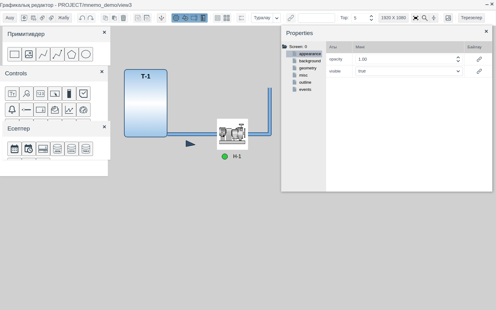
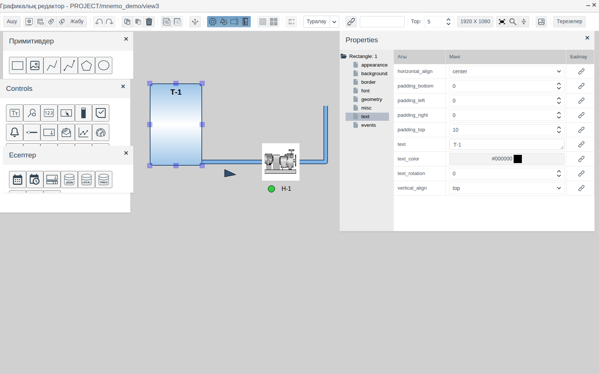
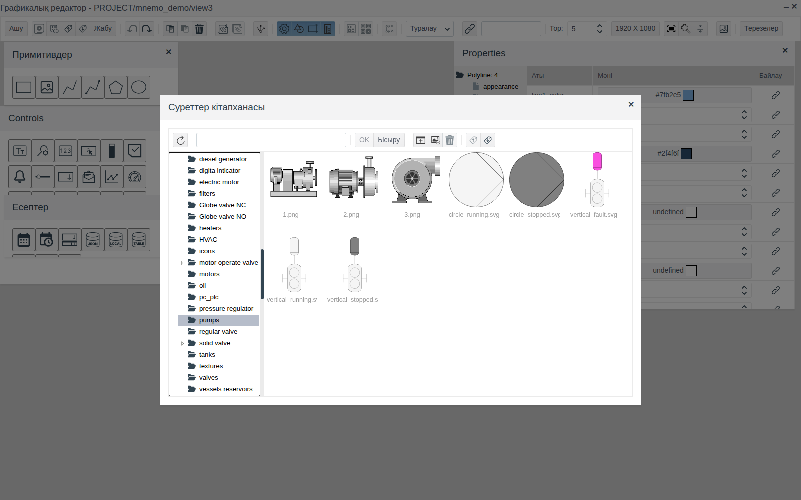
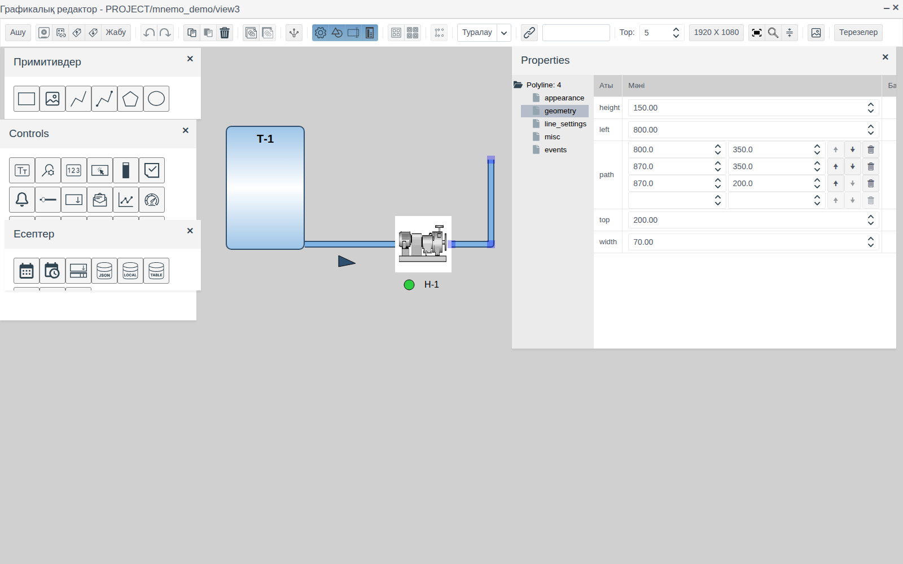
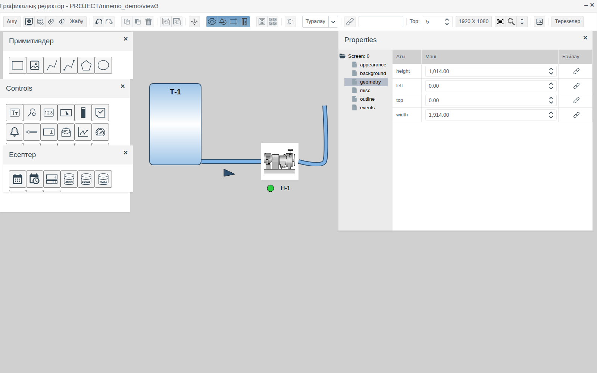
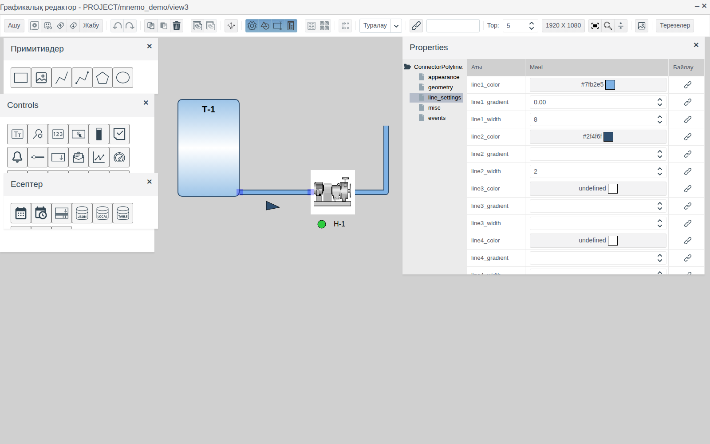
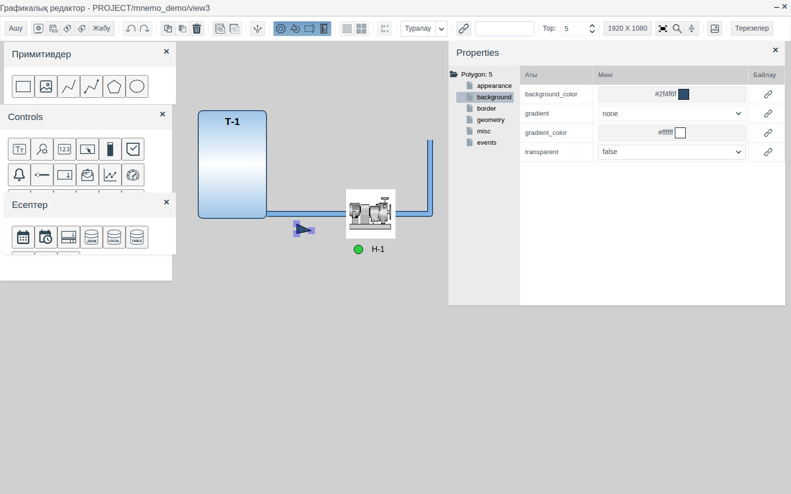
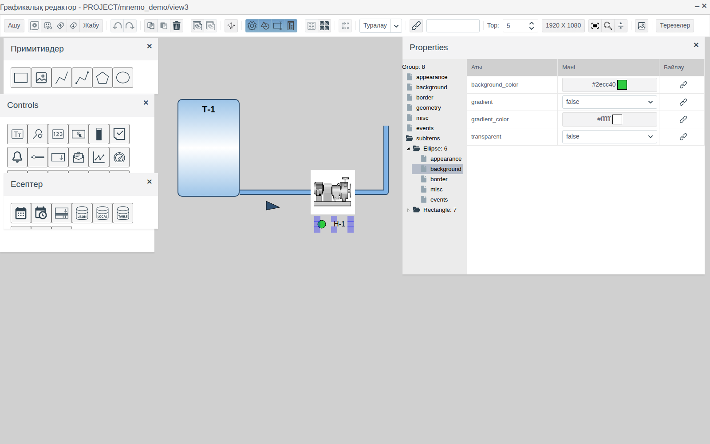
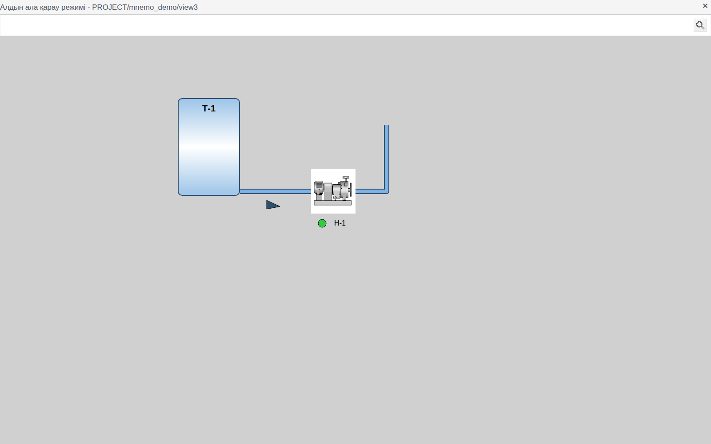

# Графикалық элементтер

Бұл құжат мнемосызбаның статикалық бөлігін: жабдықты, құбырларды, жазулар мен көрсеткіштерді сызатын интегратор инженерге арналған.

# Мазмұны

- [Терминдер сөздігі](#терминдер-сөздігі)
- [Кіріспе](#кіріспе)
- [Негізгі бөлім](#негізгі-бөлім)
    - [Примитивтер палитрасы](#примитивтер-палитрасы)
    - [Ортақ қасиеттер](#ортақ-қасиеттер)
    - [Түс таңдау](#түс-таңдау)
    - [Тіктөртбұрыш](#тіктөртбұрыш)
    - [Кескін](#кескін)
    - [Сынық сызық](#сынық-сызық)
    - [Жалғаушы сызық](#жалғаушы-сызық)
    - [Полигон](#полигон)
    - [Эллипс](#эллипс)
    - [Топ](#топ)
- [Қорытынды](#қорытынды)

# Терминдер сөздігі

| Термин | Мағынасы |
|---|---|
| Нүкте | Сынық сызықтың, жалғаушы сызықтың немесе полигонның төбесі. Нүктелер тізімі `path` қасиетінде сақталады |
| Маркер | Белгіленген элементтегі шаршы. Тіктөртбұрышта, кескінде, эллипсте және топта маркерлер жақтаудың бұрыштары мен қабырғаларында, ал сызықтар мен полигонда нүктелерде орналасады |
| Кескіндер кітапханасы | Барлық сызбаларға ортақ жоба суреттерінің қоймасы. Элемент қасиеттерінен және редактордың құралдар тақтасындағы **Суреттер кітапханасы** батырмасымен ашылады. Толығырақ — [Суреттер кітапханасы](images.md) құжатында |

«Сызба», «Элемент», «Палитра», «Топ» терминдері [Мнемосызбалар редакторы](editor.md) құжатында түсіндірілген.

# Кіріспе

Графикалық элементтер — технологиялық нысанның кескінін құрайтын пішіндер: резервуарлар мен аппараттар, құбырлар, ағын бағытын көрсететін бағыттауыштар, жазулар, күй шамдары. Олар графикалық редактордың **Примитивтер** палитрасында орналасқан.

Құжатта палитраның әр элементі сипатталған: не үшін қолданылады, қандай қасиеттері бар және оны қалай сызу керек. Редактордағы жұмыс — қосу, белгілеу, жылжыту, туралау, топтау, сақтау — [Мнемосызбалар редакторы](editor.md) құжатында сипатталған. Қасиеттерді жоба деректеріне байланыстыру және анимация [Байланыстыру және анимация](bindings.md) құжатында сипатталған.

Құжат бойындағы мысал — `mnemo_demo` бумасының `view3` сызбасы: `Т-1` резервуары (тіктөртбұрыш), сорғы суреті (кескін), оның астындағы күй шамы (эллипс) мен «Н-1» жазуы (фоны мен жақтауы жоқ тіктөртбұрыш), резервуардан сорғыға дейінгі ағын бағытын көрсететін бағыттауышы бар құбыр және сорғыдан жоғары қарай кететін тармақ.

Жобаны өзгерту құқығы бар тіркелгімен Studio ортасына (`http://<сервер>:9000/fp/studio`) кіру мүмкіндігі қажет.

# Негізгі бөлім

## Примитивтер палитрасы

Палитраны редактордың құралдар тақтасындағы **Сурет салу** батырмасы ашады. Элемент белгішесін кенепке сүйреп апару арқылы қосылады. Элемент атауы белгішенің қалқымалы кеңесінде көрсетіледі.

| Белгіше (солдан оңға қарай) | Элемент | Қасиеттер ағашының түбірі | Мақсаты |
|---|---|---|---|
| Тіктөртбұрыш | **Төртбұрыш** | `Rectangle` | Аппараттар, резервуарлар, қалқандар, жақтаулар, жазулар |
| Сурет | **Сурет** | `Image` | Кескіндер кітапханасынан алынған жабдықтың дайын суреті |
| Кесінді | **Ломаная** | `Polyline` | Құбырлар, кабельдер, шиналар, шығарма сызықтар |
| Нүктелері бар сынық сызық | **Жалғанатын сызық** | `ConnectorPolyline` | Ұштары элементтерге бекітіліп, олармен бірге қозғалатын сызық |
| Бесбұрыш | **Полигон** | `Polygon` | Еркін пішіндер: бағыттауыштар, клапандар, үшбұрыштар |
| Сопақ | **Эллипс** | `Ellipse` | Күй шамдары, дөңгелек аппараттар, қозғалтқыштар |

## Ортақ қасиеттер

Әр графикалық элементте мына топтар бар:

| Топ | Қасиет | Мақсаты |
|---|---|---|
| **appearance** | `visible` | `true` — элемент көрінеді, `false` — жасырылған |
| | `opacity` | Мөлдір еместік: 0-ден (көрінбейді) 1-ге дейін (мөлдір емес) |
| **geometry** | `left`, `top` | Жоғарғы сол жақ бұрыштың сызбаның жоғарғы сол жақ бұрышынан пиксельмен берілген орны |
| | `width`, `height` | Ені мен биіктігі, пиксельмен |
| **misc** | `z_index` | Қабаттасу реті: мәні үлкен элемент мәні кіші элементтердің үстіне салынады |
| | `title` | Қалқымалы кеңес: Runtime ортасында оператор тінтуірді элементтің үстіне апарғанда пайда болады |
| | `cursor` | Runtime ортасында элемент үстіндегі тінтуір меңзерінің түрі: `inherit`, `default`, `crosshair`, `pointer`, `text`, `help` |

**events** тобы мен **Байлау** бағанындағы батырмалар элементті деректермен және скрипттермен байланыстырады; мысал [Батырмалар және мәндерді енгізу](controls.md) құжатының [Элементті тегке байланыстыру](controls.md#элементті-тегке-байланыстыру) және [Батырма](controls.md#батырма) бөлімдерінде берілген. Байланыстырудың барлық режимі [Байланыстыру және анимация](bindings.md) құжатында, оқиғалар мен скрипттер [Скрипттер мен оқиғалар](events.md) құжатында сипатталған.

## Түс таңдау

Түс қасиеттері (`background_color`, `border_color`, `text_color`, `line1_color` және т. б.) түс кодын және үлгісін көрсетеді. Ұяшықты басқанда «Түсті таңдау» терезесі ашылады: сол жақта дайын түстер, оң жақта `#rrggbb` код өрісі мен реңктер палитрасы, сондай-ақ **Мөлдір** жалаушасы бар. Түсті таңдап, **OK** басыңыз.

## Тіктөртбұрыш

Ең әмбебап элемент: фоны, жақтауы және ішкі мәтіні бар пішін. Мысалда бұл — бұрыштары дөңгеленген, градиентпен толтырылған және жоғарғы жағында жазуы бар `Т-1` резервуары, сондай-ақ сорғы суретінің астындағы «Н-1» жазуы.

| Топ | Қасиет | Мақсаты |
|---|---|---|
| **background** | `background_color` | Фон түсі |
| | `gradient` | Градиентпен толтыру. Бос болса — біртұтас түс. `horizontal` — көлденең жолақтар: жоғарғы және төменгі жиектерде `background_color`, ортасында `gradient_color`. `vertical` — солдан оңға қарай дәл солай |
| | `gradient_color` | Градиенттің екінші түсі |
| | `texture` | [Кескіндер кітапханасынан](images.md) алынған толтыру суреті. Берілсе, түс пен градиентті алмастырады |
| | `transparent` | `true` — фон мөлдір, тек жақтау мен мәтін көрінеді |
| **border** | `border_width` | Жақтау қалыңдығы, пиксельмен; 0 — жақтау жоқ |
| | `border_color` | Жақтау түсі |
| | `border_style` | Жақтау сызығының түрі: `solid`, `dashed`, `dotted`, `double` және т. б. |
| | `border_radius` | Бұрыштарды дөңгелектеу радиусы, пиксельмен |
| **text** | `text` | Тіктөртбұрыш ішіндегі мәтін. Enter жаңа жолға көшіреді |
| | `text_color` | Мәтін түсі |
| | `horizontal_align` | Көлденең туралау: `left`, `center`, `right` |
| | `vertical_align` | Тік туралау: `top`, `middle`, `bottom` |
| | `padding_left`, `padding_right`, `padding_top`, `padding_bottom` | Мәтіннің жиектерден шегіністері, пиксельмен |
| | `text_rotation` | Мәтінді −90-нан 90 градусқа дейін бұру |
| **font** | `font_family` | Қаріп: `serif`, `sans-serif`, `monospace`, `cursive`, `fantasy`, `system-ui` |
| | `font_size` | Қаріп өлшемі, пиксельмен |
| | `bold`, `italic` | Жартылай қалың, курсив |

**Жазу.** Пішінсіз мәтін алу үшін тіктөртбұрыштың `transparent` қасиетін `true`, ал `border_width` қасиетін 0 етіп беріңіз. Мысалдағы сорғы суретінің астындағы «Н-1» жазуы осылай жасалған.

## Кескін

[Кескіндер кітапханасындағы](images.md) суретті көрсетеді: сорғы, ысырма, қозғалтқыш және т. б.

1. **Сурет** элементін кенепке сүйреп апарыңыз. Бірден «Суреттер кітапханасы» терезесі ашылады.
2. Сол жақтан буманы, оң жақтан суретті таңдап, **OK** басыңыз.

Сурет элемент өлшеміне қарай масштабталады (әдепкіде 150 × 150). Оны **misc** тобының `image` қасиетінде ауыстыруға болады: ұяшықты басқанда кітапхана қайта ашылады.

**border** тобы тіктөртбұрыштағыдай: `border_width`, `border_color`, `border_style`, `border_radius`. Мысалда сорғының `border_width` = 0.

## Сынық сызық

Бірнеше нүктеден тұратын сызық. Құбырларға, кабельдерге, шығарма сызықтарға қолайлы.

Жаңа сынық сызық — екі нүктеден тұратын кесінді. Белгіленген сынық сызықтың әр нүктесінде маркер бар:

| Әрекет | Нәтиже |
|---|---|
| Маркерді сүйреу | Нүкте жылжиды |
| Shift + маркерді басу | Осы нүктеден кейін оңға және төмен қарай 30 px ығысқан жаңа нүкте қосылады |
| Ctrl + маркерді басу | Нүкте жойылады |
| Сызықты сүйреу | Сынық сызық толығымен жылжиды |

Нүктелердің нақты координаттары **geometry** тобының `path` қасиетінде беріледі: әр жол — бір нүкте (`left`, `top` — сызбаның жоғарғы сол жақ бұрышынан пиксельмен). Соңына нүкте қосу үшін төменгі бос жолдың екі өрісін де толтырып, Enter немесе Tab басыңыз. Жолдағы бағыттауыштар нүктені бір орын жоғары немесе төмен жылжытады, себет оны жояды. Сынық сызықтың `left`, `top`, `width`, `height` қасиеттері нүктелер бойынша есептеледі.

Безендіру **line_settings** тобында беріледі:

| Қасиет | Мақсаты |
|---|---|
| `line1_width`, `line1_color` | Негізгі сызықтың қалыңдығы мен түсі |
| `line2_width`…`line5_width`, `line2_color`…`line5_color` | Сызықтың қосымша қабаттары. Әр қабат алдыңғысының астына салынып, екі жағынан өз қалыңдығына тең шамаға шығып тұрады. Қалыңдығы немесе түсі бос болса, қабат болмайды |
| `line1_gradient`…`line5_gradient` | Сызыққа көлем беретін, қабат осінің бойындағы ашық жолақ: 0-ден (жоқ) 0.5-ке дейін (ең кең) |
| `line_type` | Сызық түрі: `solid`, `dashed`, `dotted` |
| `round_corner` | `true` — иілімдер дөңгеленеді |
| `round_end` | `true` — ұштар дөңгеленеді |
| `tension` | Тегістеу: 1 — нүктелер арасындағы түзу кесінділер, кіші мәндер — нүктелер арқылы өтетін жатық қисық |

**Құбыр.** Мысалдағы құбырдың екі қабаты бар: көгілдір түсті `line1_width` = 8 және қою көк түсті `line2_width` = 2. Нәтижесінде контуры бар құбыр шығады. Тік бұрышты иілімдер үшін `round_corner` қосыңыз.

## Жалғаушы сызық

Ұштары басқа элементтердің жиектеріне бекітілетін сынық сызық. Элемент жылжытылғанда немесе өлшемі өзгергенде, сызықтың ұшы онымен бірге қозғалады.

1. Жалғау керек элементтерді орналастырыңыз — мысалда `Т-1` резервуары мен сорғы.
2. **Жалғанатын сызық** элементін кенепке сүйреп апарыңыз.
3. Бастапқы маркерді бірінші элементке сүйреп апарыңыз: маркер элементтің ең жақын қабырғасына тартылады.
4. Соңғы маркерді де екінші элементке дәл солай сүйреп апарыңыз.

Ұшы тіктөртбұрышқа, кескінге немесе эллипске бекітіледі; сызықтар мен полигонға бекітілмейді. Ұшты ажырату үшін оның маркерін кенептің бос жеріне сүйреп апарыңыз: бұдан кейін ол элементпен бірге қозғалмайды.

Аралық нүктелер, `path` қасиеті және **line_settings** тобы сынық сызықтағыдай. Байланыс сызбамен бірге сақталады.

## Полигон

Нүктелерден тұратын, толтыруы мен жақтауы бар тұйық пішін. Жаңа полигон — үшбұрыш. Нүктелер сынық сызықтағыдай қосылады, жойылады және жылжытылады: маркерлермен (Shift + басу, Ctrl + басу) немесе `path` қасиетінде.

Мысалда полигон — құбыр астындағы ағын бағытын көрсететін бағыттауыш: қою түспен толтырылған 30 × 20 үшбұрыш.

| Топ | Қасиет | Мақсаты |
|---|---|---|
| **background** | `background_color`, `transparent` | Толтыру түсі, мөлдір толтыру |
| | `gradient` | `none` — біртұтас толтыру; `horizontal`, `vertical` — ортасында `gradient_color` түсі бар градиент |
| | `gradient_color` | Градиенттің екінші түсі |
| **border** | `border_width`, `border_color`, `border_style` | Контур қалыңдығы, түсі және сызық түрі (`solid`, `dashed`, `dotted`) |
| **appearance** | `tension` | Контурды сынық сызықтағыдай тегістеу |
| | `round_corner` | `true` — төбелер дөңгеленеді |

## Эллипс

`width` × `height` жақтауының ішіне сызылған эллипс; қабырғалары тең болса — шеңбер. Мысалда — сорғының 20 × 20 өлшемді жасыл күй шамы.

| Топ | Қасиет | Мақсаты |
|---|---|---|
| **background** | `background_color`, `transparent` | Толтыру түсі, мөлдір толтыру |
| | `gradient` | `true` — радиалды градиент: ортасында `gradient_color`, жиегінде `background_color` |
| | `gradient_color` | Ортасындағы түс |
| **border** | `border_width`, `border_color`, `border_style` | Контур: қалыңдығы, түсі, сызық түрі (`solid`, `dashed`, `dotted`) |

## Топ

Топ бірнеше элементті бір элементке біріктіреді. Топ құру және оны тарқату [Мнемосызбалар редакторы, «Топтау» бөлімі](editor.md#топтау) құжатында сипатталған. Мысалда шам мен «Н-1» жазуы топқа біріктірілген.

Топтың өз қасиеттері:

| Топ | Қасиет | Мақсаты |
|---|---|---|
| **background** | `background_color` | Топ элементтерінің астындағы фон |
| **border** | `border_width`, `border_color`, `border_style`, `border_radius` | Топты қоршайтын жақтау |
| **geometry** | `left`, `top` | Топтың орны; элементтер онымен бірге жылжиды |

Топтың өлшемі — оған кіретін элементтерді қоршайтын жақтау.

**Топ ішіндегі элементтердің қасиеттері.** Топтың қасиеттер ағашындағы **subitems** түйінін, содан кейін қажетті элементтің түйінін ашып, қасиеттер тобын таңдаңыз. Өзгерістер топты тарқатпай, сол элементке қолданылады. Топ ішіндегі элементтің орны мен өлшемі мұнда берілмейді: ол үшін топты тарқатып, өзгертіп, қайта топтаңыз.

# Қорытынды

Графикалық элементтермен жұмыс істеу реті:

1. Жабдықты сызыңыз: аппараттар мен резервуарларға тіктөртбұрыштар, үлгілік жабдыққа кітапхана кескіндері, шамдар мен дөңгелек аппараттарға эллипстер қолданыңыз.
2. Жазуларды фоны мөлдір және жақтауы жоқ тіктөртбұрыштармен жасаңыз.
3. Құбырларды сызыңыз: аппараттар арасында жалғаушы сызықпен, тармақтар мен еркін сызықтар үшін сынық сызықпен. Құбырға `line2`…`line5` қабаттары көлем береді.
4. Бағыттауыштар мен басқа пішіндерді полигонмен қосып сызыңыз.
5. Бір аппараттың элементтерін топқа біріктіріңіз; топ ішіндегі элементтердің безендірілуін **subitems** арқылы өңдеңіз.
6. Сызбаны сақтап, оны «Сызбалар» терезесіндегі алдын ала қарау батырмасымен тексеріңіз.

