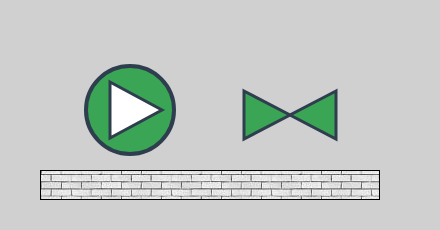
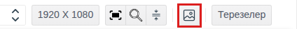
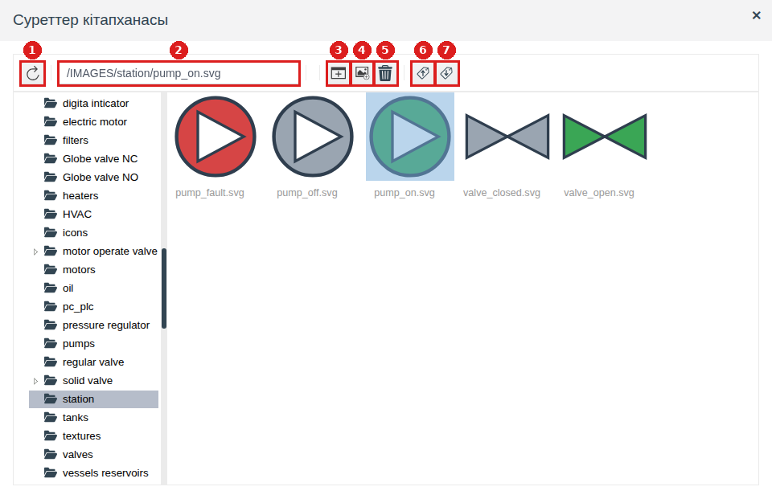
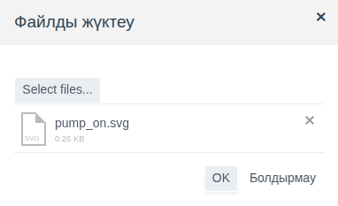
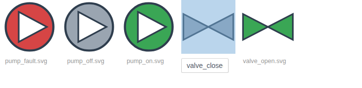
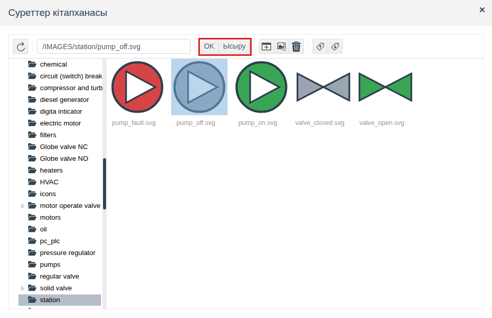
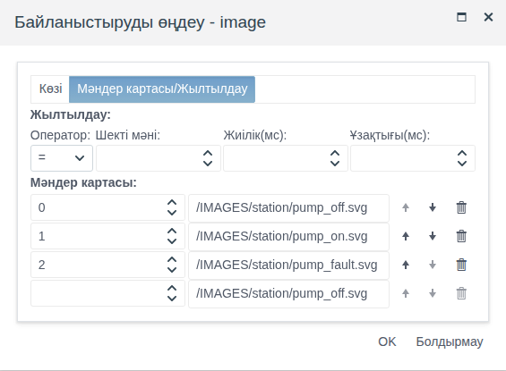

# Суреттер кітапханасы

Бұл құжат мнемосызбаларды сызатын және олар үшін жабдық суреттерін, белгішелер мен текстураларды сақтайтын интегратор инженерге арналған.

# Мазмұны

- [Терминдер сөздігі](#терминдер-сөздігі)
- [Кіріспе](#кіріспе)
- [Негізгі бөлім](#негізгі-бөлім)
    - [Кітапхана қайдан ашылады](#кітапхана-қайдан-ашылады)
    - [Кітапхана терезесі](#кітапхана-терезесі)
    - [Бумалар](#бумалар)
    - [Суреттерді жүктеу](#суреттерді-жүктеу)
    - [Атауын өзгерту және өшіру](#атауын-өзгерту-және-өшіру)
    - [Элементке сурет таңдау](#элементке-сурет-таңдау)
    - [Күйге қарай сурет](#күйге-қарай-сурет)
    - [Басқа жобаға көшіру](#басқа-жобаға-көшіру)
- [Қорытынды](#қорытынды)

# Терминдер сөздігі

| Термин | Мағынасы |
|---|---|
| Суреттер кітапханасы | Барлық сызбаларға ортақ жоба суреттерінің қоймасы. Суреттер бумаларға бөлінген, түбір бума — `IMAGES` |
| Сурет жолы | `/IMAGES/<бума>/<файл>` түріндегі жол. Оны `image` және `texture` қасиеттері сақтайды, элемент суретті сол бойынша табады |
| `.iex` файлы | Кітапханадағы таңдалған суреттер мен бумалардың экспорт файлы. Кітапхана терезесіндегі **Импорт** батырмасымен қайта жүктеледі |

«Сызба», «Элемент», «Палитра» терминдері [Мнемосызбалар редакторы](editor.md#терминдер-сөздігі) құжатында түсіндірілген.

# Кіріспе

Мнемосызбадағы сурет сызбаға файл ретінде енгізілмейді. Ол жоба кітапханасына жүктеледі, ал элемент тек оған апаратын жолды сақтайды. Сондықтан:

- бір суретті кез келген сызбалар қолдана алады, жобада ол бір рет сақталады;
- суретті бір жерде ауыстыруға болады, және осы жолы бар барлық сызбалар жаңасын көрсетеді;
- суреттер басқа жобаға онымен бірге немесе бөлек файлмен көшіріледі.

Кітапхана суреттерін үш қасиет көрсетеді:

| Қасиет | Элементтер | Не көрсетеді |
|---|---|---|
| `image` (**misc** тобы) | **Сурет** ([Графикалық элементтер, Кескін бөлімін](graphics.md#кескін) қараңыз) | Элемент өлшеміне созылған бүкіл суретті |
| `texture` (**background** тобы) | [**Төртбұрыш**](graphics.md#тіктөртбұрыш), [**LinearGauge**](gauges.md#сызықтық-индикатор), [**Timeline**](tables.md#уақыт-шкаласы-ось-жақтау-және-фон) | Түстің орнына қайталанатын суретпен фонды толтыруды |

Жеткізілімдегі кітапханада типтік жабдығы бар бумалар бар: сорғылар, ысырмалар, қозғалтқыштар, резервуарлар, текстуралар. Өз суреттеріңіз солардың жанына қосылады.

Өтпелі мысал — кітапханадағы `station` бумасы, онда бес SVG-сурет бар: жұмыстағы, тоқтаған және апаттағы сорғы, ашық және жабық ысырма. `img_demo` жоба бумасының сызбасында сорғы `pump_1` нысанының `state` өрісіне қарай суретін ауыстырады, жанында ашық ысырма тұр, олардың астында `grey_brick.jpg` текстурасы бар алаң.

Жобаны өзгерту құқығы бар тіркелгімен Studio ортасына (`http://<сервер>:9000/fp/studio`) кіру мүмкіндігі қажет. Нәтиже Runtime ортасында (`http://<сервер>:9000/fp/runtime`) тексеріледі.

# Негізгі бөлім

## Кітапхана қайдан ашылады

Кітапхана тек мнемосызбалардың графикалық редакторынан ашылады. Онда не істеуге болатыны оны қайдан ашқаныңызға байланысты:

| Қайдан | Не істеуге болады | **OK** және **Ысыру** батырмалары |
|---|---|---|
| Редактордың құралдар тақтасындағы **Суреттер кітапханасы** батырмасы | Суреттерді жүктеу, атауын өзгерту, өшіру, бума жасау, экспорттау және импорттау | Жоқ |
| **Properties** панеліндегі `image` немесе `texture` қасиетінің **Мәні** ұяшығы | Сол әрекеттер, қосымша элементке сурет таңдау | Бар |
| `image` немесе `texture` байланыстыруының мәндер картасындағы мән өрісі | Сол әрекеттер, қосымша карта жолына сурет таңдау | Бар |
| **Сурет** элементін палитрадан кенепке сүйреп апару | Сол әрекеттер, қосымша жаңа элементке сурет таңдау | Бар |

**Суреттер кітапханасы** батырмасы — құралдар тақтасының оң жағындағы сурет белгішесі. Тақта браузер терезесіне сыймаса, батырма тақтаның соңындағы **⋮** мәзіріне ауысады.

Кітапханадағы өзгерістер сызбаны сақтау батырмасынсыз бірден сақталады және жобаның барлық сызбаларында көрінеді.

## Кітапхана терезесі

Сол жақта — бумалар ағашы, оң жақта — ашық буманың мазмұны: алдымен ішкі бумалар, содан кейін суреттер. Оң жақтағы буманы екі рет шерту оны ашады.

| № | Батырма | Не істейді |
|---|---|---|
| 1 | Жаңарту | Ағаш пен буманы қайта оқиды. Терезе ашық тұрғанда суреттерді басқа пайдаланушы өзгерткен болса қажет |
| 2 | Жол өрісі | Белгіленген суреттің жолын көрсетеді. Жолды енгізіп, Enter басыңыз — оның бумасы ашылады, сурет белгіленеді |
| 3 | **Буманы жасау** | Ашық буманың ішінде бума жасайды |
| 4 | **Суретті қосу** | Файлдан суретті ашық бумаға жүктейді |
| 5 | **Өшіру** | Белгіленген суреттер мен бумаларды өшіреді |
| 6 | **Экспорт** | Белгіленген суреттер мен бумаларды `.iex` файлына сақтайды |
| 7 | **Импорт** | `.iex` файлынан суреттерді жүктейді |

Суретті шерту оны белгілейді, Ctrl + шерту белгілеуге келесілерін қосады. **Өшіру** және **Экспорт** батырмалары белгіленгендермен жұмыс істейді.

## Бумалар

Бумалар өз суреттеріңіз жеткізілім суреттерімен араласпауы және оларды көшіру ыңғайлы болуы үшін қажет: буманы экспорттау оны толығымен алады.

1. Ағаштан жаңа бума ішінде болатын буманы ашыңыз, мысалы `IMAGES`.
2. **Буманы жасау** басыңыз. `New folder` бумасы пайда болады (келесілері — `New folder_0`, `New folder_1` және т. б.).
3. Белгішенің астындағы атауын шертіп, өз атауыңызды енгізіңіз де, Enter басыңыз.

Мысалда `IMAGES` түбірінде `station` бумасы жасалған.

Бумалар бір-бірінің ішіне кез келген тереңдікке салынады. Сурет жолы осы салынуды қайталайды: `/IMAGES/station/pumps/pump_on.svg`.

## Суреттерді жүктеу

1. Суретті жүктейтін буманы ашыңыз.
2. **Суретті қосу** басыңыз. «Файлды жүктеу» терезесінде **Select files...** басып, файлды таңдаңыз.
3. **OK** басыңыз. Сурет бумада пайда болады және бірден белгіленеді.

Бір рет бір файл жүктеледі. Кітапханадағы сурет атауы — кеңейтімімен қоса файл атауы, мысалы `pump_on.svg`. Атауда кирилл әріптері мен бос орындар болуы мүмкін.

Бір бума ішіндегі атаулар қайталанбайды. Бумада осындай атауы бар сурет немесе бума бұрыннан болса, жүктеу орындалмайды және `{not_unique,<<"<атау>">>}` мәтіні бар **ERROR!** терезесі шығады. Файлдың атауын өзгертіңіз немесе оны басқа бумаға жүктеңіз.

Суретті браузер көрсетеді, сондықтан ол көрсете алатын кез келген формат жарайды. SVG, PNG, JPG, GIF, BMP, WEBP және ICO тексерілді: осы форматтардағы суреттер редакторда да, Runtime ортасында да бірдей көрсетіледі. Браузерлер көрсетпейтін форматтар (мысалы, TIFF) жүктеледі, бірақ сызбада көрінбейді.

**Қай форматты таңдау керек.** Элемент суретті өз өлшеміне созады. SVG сапасын жоғалтпай масштабталады, сондықтан әр сызбада әр түрлі өлшемде сызылатын жабдық үшін SVG ыңғайлы. Растрлық форматтар (PNG, JPG) фотосуреттер мен текстураларға жарайды; оларды сызбада болатын өлшемде жүктеңіз, әйтпесе үлкейткенде сурет бұлыңғыр болады.

**Суретті ауыстыру.** Сызбаларға тиіспей суретті ауыстыру үшін ескісін өшіріп, сол бумаға кеңейтімін қоса сол атаумен жаңасын жүктеңіз. Жол өзгермейді, және осы жолы бар сызбалар келесі ашылғанда жаңа суретті көрсетеді. Басқа форматтағы жаңа сурет — бұл басқа атау және басқа жол (мысалы, `pump_on.png` орнына `pump_on.svg`): оны ескісі тұрған әр элементтің қасиеттерінде және байланыстырулардың мәндер карталарында қайта таңдау керек ([Атауын өзгерту және өшіру](#атауын-өзгерту-және-өшіру) бөлімін қараңыз).

## Атауын өзгерту және өшіру

**Атауын өзгерту.** Белгішенің астындағы сурет немесе бума атауын шертіп, жаңасын енгізіңіз де, Enter басыңыз. Кеңейтім атаудың бөлігі: суреттің атауын өзгерткенде оны сақтаңыз. Бумада бос емес атау қабылданбайды: сол **ERROR!** терезесі шығады, атау бұрынғысынша қалады.

**Өшіру.** Суреттер мен бумаларды белгілеп, **Өшіру** басыңыз және «Элементтерді өшіру? (N)» сұрағын растаңыз, мұнда N — белгіленгендер саны. Бума бүкіл мазмұнымен бірге өшіріледі.

Суретті басқа бумаға көшіретін жеке команда жоқ: оны жаңа бумаға жүктеп, ескісінен өшіріңіз.

Сызба суреттің өзін емес, оның жолын сақтайды. Суреттің атауы өзгертілгеннен, ол өшірілгеннен немесе көшірілгеннен кейін, сондай-ақ буманың атауы өзгертілгеннен кейін ескі жолы бар элементтер суретсіз қалады. Сондықтан алдымен сурет қайда жататынын және қалай аталатынын шешіп, содан кейін ғана оны сызбаларға орналастырыңыз. Жол бәрібір өзгерсе, суретті оны қолданған әр элементтің қасиеттерінде қайта таңдаңыз.

## Элементке сурет таңдау

1. Элементті белгілеп, `image` (**misc** тобы) немесе `texture` (**background** тобы) қасиетінің **Мәні** ұяшығын шертіңіз. Жаңа **Сурет** элементі үшін терезе палитрадан сүйреп апарғанда өзі ашылады.
2. Ағаштан буманы, оң жақтан суретті таңдаңыз. Оның жолы жол өрісінде пайда болады.
3. **OK** басыңыз.

Терезе элементтің ағымдағы суретінде ашылады. Сурет әлі таңдалмаса, әдепкі бума ашылады: `image` үшін — `active elements`, `texture` үшін — `textures`.

| Батырма | Нәтиже |
|---|---|
| **OK** | Қасиет белгіленген суреттің жолын алады |
| **Ысыру** | Қасиет тазартылады. `texture` үшін бұл фон қайтадан `background_color` түсімен толтырылатынын білдіреді |
| Тақырыптағы айқыш | Терезе жабылады, қасиет өзгермейді |

Таңдағаннан кейін қасиет ұяшығында жол көрінеді, мысалы `/IMAGES/station/pump_off.svg`. Сызбаны сақтаңыз: жол басқа қасиеттер сияқты сызбаға сақтау кезінде жазылады.

## Күйге қарай сурет

Жиі кездесетін міндет — жабдықтың күйін суретпен көрсету: жұмыстағы сорғы жасыл, тоқтағаны сұр, апаттағысы қызыл. Ол үшін `image` қасиетін күй өрісіне байланыстырып, мәндер картасын береді, онда өрістің әр мәніне кітапханадағы сурет сәйкес келеді. Байланыстыру мен мәндер картасы [Байланыстырулар және анимация құжатының Мәндер картасы бөлімінде](bindings.md#мәндер-картасы) толық сипатталған.

1. Барлық күйлердің суреттерін кітапхананың бір бумасына жүктеңіз. Мысалда — `station` бумасындағы `pump_off.svg`, `pump_on.svg`, `pump_fault.svg`.
2. Сызбаға **Сурет** қосып, әдепкі күйдің суретін таңдаңыз. Мысалда — `pump_off.svg`.
3. `image` қасиетінің **Байлау** бағанындағы белгішені шертіп, **Көзі** қойындысында тег пен өрісті таңдаңыз. Мысалда — `pump_1`, `state` өрісі (0 — тоқтаған, 1 — жұмыста, 2 — апат).
4. **Мәндер картасы/Жылтылдау** қойындысында карта жолдарын толтырыңыз: шек және сурет. Сурет өрісін шерту кітапхананы ашады, таңдау **OK** батырмасымен расталады.
5. Байланыстыру терезесінде **OK** басып, сызбаны сақтаңыз.

Мысалда `state` = 1 болғанда оператор жасыл сорғыны көреді ([Кіріспедегі](#кіріспе) суретті қараңыз), 0 болғанда — сұр, 2 болғанда — қызыл.

Текстура да солай ауыстырылады: `texture` байланыстырылады және мәндер картасында текстуралар таңдалады.

## Басқа жобаға көшіру

Суреттер `.iex` файлымен көшіріледі.

1. Суреттерді немесе бумаларды белгілеп (бірнешеуі үшін Ctrl + шерту), **Экспорт** басыңыз. Браузер `fp_image_export.iex` файлын сақтайды.
2. Басқа жобада кітапхананы ашып, **Импорт** басыңыз, «Суреттерді импорттау» терезесінде файлды таңдап, **OK** басыңыз. «Суреттерді импорттау сәтті аяқталды» хабары шығады.

Импорт суреттерді терезеде қай бума ашық екеніне қарамастан экспорт кезіндегі жолдар бойынша орналастырады. Жетіспейтін бумалар жасалады. Жолы бірдей сурет файлдағы суретпен ауыстырылады. Кітапхананың басқа суреттері өзгермейді. Сондықтан өз суреттеріңізді өз бумаңызда ұстаған ыңғайлы: оны экспорттау мен импорттау жеткізілім суреттеріне әсер етпейді.

`.scn` сызба файлы (редактордың **Файлға экспорттау** батырмасы, [Мнемосызбалар редакторы, Сызбаны экспорттау және импорттау бөлімін](editor.md#сызбаны-экспорттау-және-импорттау) қараңыз) тек суреттердің жолдарын сақтайды. Сызбаны оның суреттерінің `.iex` файлымен бірге көшіріңіз; жеткізілім суреттерін көшірудің қажеті жоқ, олар әр жобада бар.

Бүкіл жоба көшірілсе, кітапхананы бөлек экспорттаудың қажеті жоқ: ол жобаны экспорттауға кіреді.

# Қорытынды

| Міндет | Қалай орындау керек |
|---|---|
| Суреттерді басқару үшін кітапхананы ашу | Редактордың құралдар тақтасындағы **Суреттер кітапханасы** батырмасы (немесе **⋮** мәзірінде) |
| Өз суреттеріңізді қосу | Бума жасап, файлдарды **Суретті қосу** батырмасымен жүктеу |
| Сызбада суретті көрсету | **Сурет** элементі, `image` қасиеті |
| Фонды суретпен толтыру | Төртбұрыштың, LinearGauge немесе Timeline элементінің `texture` қасиеті |
| Суретті күйге қарай ауыстыру | `image` қасиетін мәндер картасымен күй өрісіне байланыстыру |
| Суретті барлық сызбаларда ауыстыру | Ескісін өшіріп, сол бумаға сол атаумен және кеңейтіммен жаңасын жүктеу |
| Суреттерді басқа жобаға көшіру | Кітапхана терезесінде **Экспорт** → басқа жобада **Импорт** |

Жұмыс реті:

1. Жоба суреттері үшін `IMAGES` ішінде өз бумаңызды, қажет болса жабдық түрлері бойынша ішкі бумалар жасаңыз.
2. Суреттерді жүктеңіз; жабдық үшін SVG қолайлы. Оларға бірден түпкілікті атау беріңіз.
3. Суреттерді сызбаларға `image` және `texture` арқылы, күй суреттерін мәндер картасы бар байланыстыру арқылы орналастырыңыз.
4. Сызбаларды сақтап, оларды Runtime ортасында тексеріңіз.
5. Басқа жобаға көшіру үшін өз бумаңызды `.iex` файлына экспорттаңыз.
