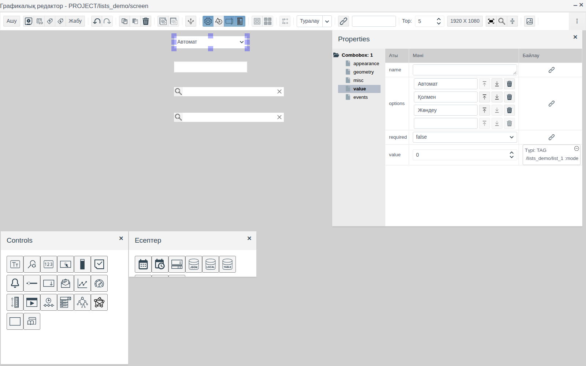
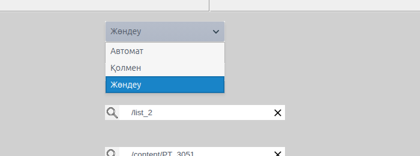
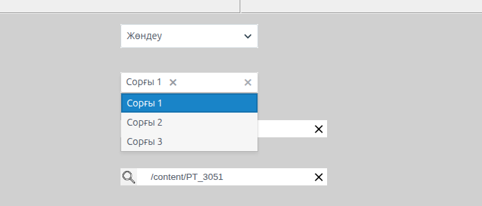
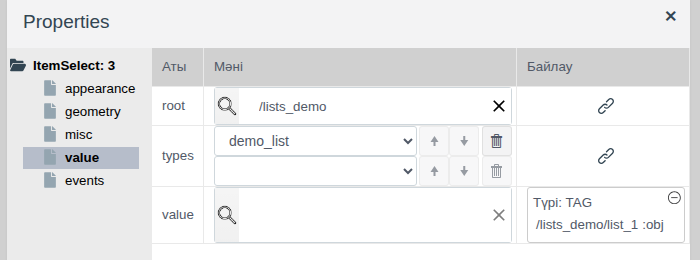
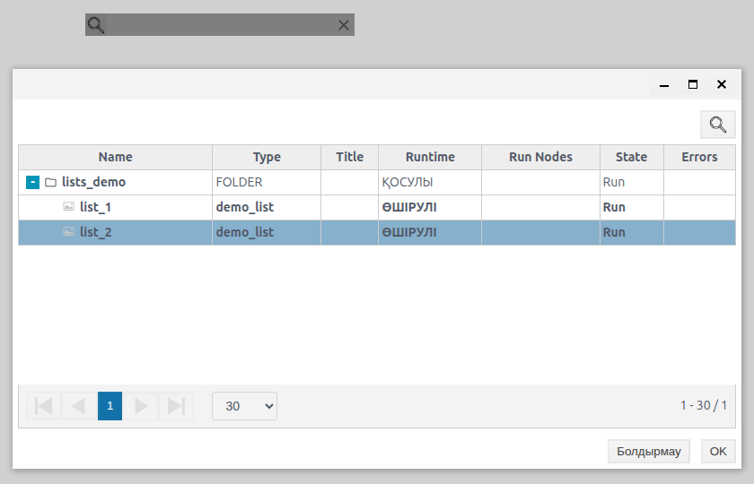
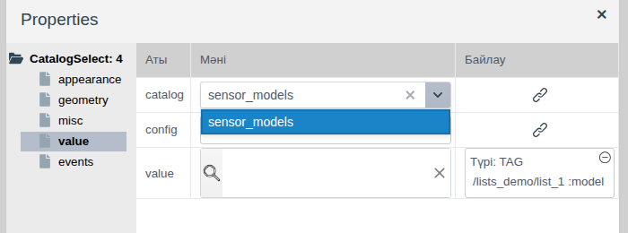
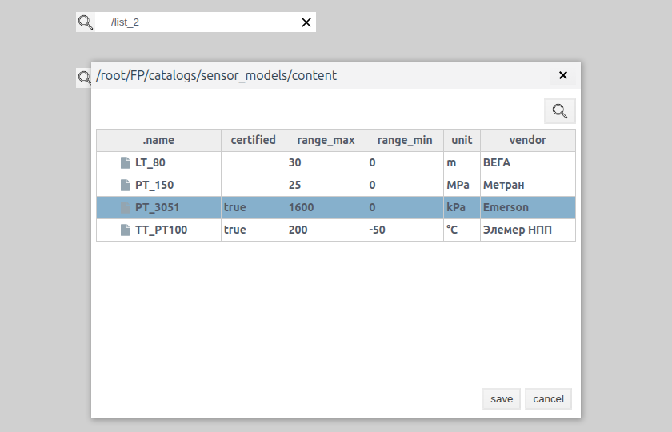
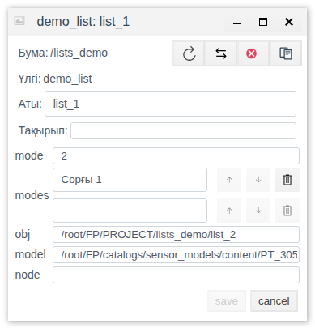
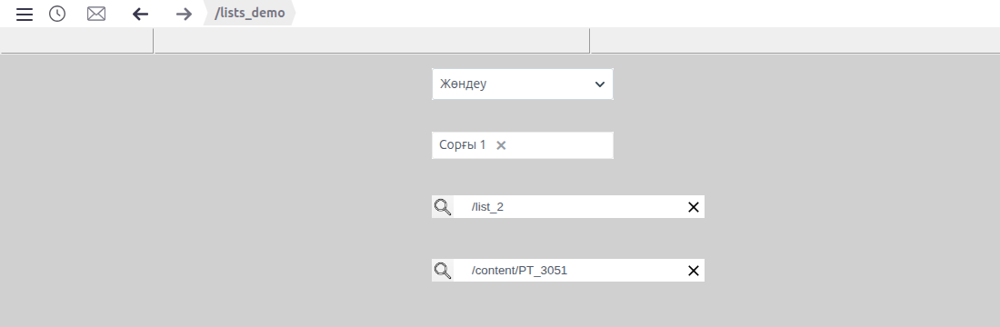

# Тізімдерден таңдау

Бұл құжат мнемосызбада операторға дайын тізімнен жұмыс режимін, агрегаттар жиынын, жоба нысанын немесе каталог жазбасын таңдауға мүмкіндік беретін интегратор инженерге арналған.

# Мазмұны

- [Терминдер сөздігі](#терминдер-сөздігі)
- [Кіріспе](#кіріспе)
- [Негізгі бөлім](#негізгі-бөлім)
    - [Палитралардағы элементтер](#палитралардағы-элементтер)
    - [Ашылмалы тізім](#ашылмалы-тізім)
    - [Бірнеше тармақты таңдау](#бірнеше-тармақты-таңдау)
    - [Жоба нысанын таңдау](#жоба-нысанын-таңдау)
    - [Каталог жазбасын таңдау](#каталог-жазбасын-таңдау)
- [Қорытынды](#қорытынды)

# Терминдер сөздігі

| Термин | Мағынасы |
|---|---|
| Толық жол | Faceplate дерекқорындағы нысан мекенжайы. Жоба нысандары `/root/FP/PROJECT`, каталог жазбалары `/root/FP/catalogs/<каталог>/content` ішінде орналасқан. Мысалы: `/root/FP/PROJECT/lists_demo/list_2` |
| Каталог жазбасы | **Каталогтар** бөліміндегі каталогтың жолы ([Catalogs](../../en/catalogs/catalogs.md) құжатын қараңыз) |

«Тег», «Байланыстыру» терминдері — [Батырмалар және мәндерді енгізу](controls.md#терминдер-сөздігі) құжатында, «Сызба», «Палитра», «Элемент» — [Мнемосызбалар редакторы](editor.md#терминдер-сөздігі) құжатында түсіндірілген.

# Кіріспе

Таңдау элементтері операторды қолмен енгізуден босатады: ол тізімнен мәнді таңдайды, ал элемент таңдалған мәнді тег өрісіне жазады. Тізім әртүрлі тәсілмен беріледі: элемент қасиеттеріндегі жолдар тізімі, жоба нысандары немесе каталог жазбалары арқылы.

Құжатта төрт таңдау элементі, олардың қасиеттері, мәнді тегке жазу тәсілі және Runtime ортасындағы әрекеті сипатталған. Редактордағы жұмыс (қосу, белгілеу, қасиеттер, сақтау) [Мнемосызбалар редакторы](editor.md) құжатында, қасиетті тег өрісіне байланыстыру [Батырмалар және мәндерді енгізу, «Элементті тегке байланыстыру» бөлімі](controls.md#элементті-тегке-байланыстыру) құжатында сипатталған.

Құжат бойындағы мысал — `lists_demo` бумасының `screen` сызбасы. Деректер `mode` (integer), `modes` (list, ішкі түрі string), `obj` (string) және `model` (string) өрістері бар `demo_list` меншікті примитивінің `list_1` нысанында орналасқан. Оның жанында сол түрдегі екінші нысан — `list_2` бар. Датчик модельдері бар `sensor_models` каталогы [Catalogs](../../en/catalogs/catalogs.md) құжаты бойынша жасалған.

Мысал сызбасында жоғарыдан төмен қарай: жұмыс режимі («Автомат», «Қолмен», «Жөндеу»), жұмыс істеп тұрған сорғылар («Сорғы 1», «Сорғы 2», «Сорғы 3»), `demo_list` нысанын таңдау және каталогтан датчик моделін таңдау орналасқан.

Жобаны өзгерту құқығы бар тіркелгімен Studio ортасына (`http://<сервер>:9000/fp/studio`) кіру мүмкіндігі қажет. Нәтиже Runtime ортасында (`http://<сервер>:9000/fp/runtime`) тексеріледі.

# Негізгі бөлім

## Палитралардағы элементтер

Элемент атауы палитра белгішесінің қалқымалы кеңесінде, ал түрі қасиеттер ағашының түбірінде көрсетіледі.

| Палитра | Белгішенің кеңесі | Қасиеттер ағашының түбірі | Оператор нені таңдайды | Тегке не жазылады | Тег өрісінің түрі |
|---|---|---|---|---|---|
| **Controls** | Dropdown list | `Combobox` | Тізімнен бір тармақ | 0-ден басталатын тармақ нөмірі | `integer` |
| **Есептер** | multiselect | `MultiSelect` | Тізімнен бірнеше тармақ | Таңдалған тармақтардың мәтіндері | Ішкі түрі `string` болатын `list` |
| **Controls** | Itemselect | `ItemSelect` | Жоба нысаны | Нысанның толық жолы | `string` |
| **Controls** | CatalogSelect | `CatalogSelect` | Каталог жазбасы | Жазбаның толық жолы | `string` |

Төрт элементтің барлығында мән **value** тобының `value` қасиетінде сақталады. Оператордың таңдауы тегке жазылуы үшін `value` қасиетін тег өрісіне байланыстырыңыз ([Батырмалар және мәндерді енгізу, «Элементті тегке байланыстыру» бөлімі](controls.md#элементті-тегке-байланыстыру) құжатын қараңыз). Байланыстыру екі бағытта да жұмыс істейді: элемент өрістің ағымдағы мәнін көрсетеді. Өрісте мән болмаған кезде Runtime ортасында ашылмалы тізім мен үлкейткіш әйнек белгішесі бар өрістер сұр түспен көрсетіледі.

**appearance**, **geometry**, **misc** және **events** топтары сызбаның басқа элементтеріндегідей ([Графикалық элементтер, «Ортақ қасиеттер» бөлімі](graphics.md#ортақ-қасиеттер) құжатын қараңыз).

## Ашылмалы тізім

Бағыттауышы бар өріс. Басқанда тармақтар тізімі ашылады, таңдалған тармақ өрісте көрсетіледі.

| Қасиет (**value** тобы) | Мақсаты |
|---|---|
| `options` | Тізім тармақтары. Әр тармақ — жеке жол. Төменгі бос жолға мәтін енгізу тармақ қосады, бағыттауыштар ретін өзгертеді, себет жояды |
| `value` | Таңдалған тармақ нөмірі: бірінші тармақ — `0`, екіншісі — `1` және әрі қарай |

Тегке тармақтың мәтіні емес, нөмірі жазылады. Сондықтан тармақтар реті маңызды: олардың орнын ауыстырсаңыз, өрістің бұрынғы мәні басқа тармақты көрсетеді.

Мысалда `options` = «Автомат», «Қолмен», «Жөндеу», ал `value` қасиеті `list_1.mode` өрісіне байланыстырылған. «Жөндеу» таңдалғанда `mode` өрісіне `2` мәні жазылады.

## Бірнеше тармақты таңдау

**Есептер** палитрасындағы **multiselect** элементі. Өрісті басқанда тізім ашылады, таңдалған тармақ өрісте тақташаға айналады. Тақташадағы айқыш белгі тармақты таңдаудан алып тастайды.

| Қасиет (**value** тобы) | Мақсаты |
|---|---|
| `options` | Тізім тармақтары, ашылмалы тізімдегідей өңделеді |
| `value` | Таңдалған тармақтар |

Тегке таңдалған тармақтар мәтіндерінің тізімі жазылады, сондықтан тег өрісі ішкі түрі `string` болатын `list` түрінде болуы керек. Ештеңе таңдалмаса, бос тізім жазылады.

Мысалда `options` = «Сорғы 1», «Сорғы 2», «Сорғы 3», ал `value` қасиеті `list_1.modes` өрісіне байланыстырылған.

## Жоба нысанын таңдау

**Itemselect** элементі — үлкейткіш әйнек белгішесі бар өріс. Оператор берілген буманың ішінен берілген түрлерге жататын жоба нысанын таңдайды.

| Қасиет (**value** тобы) | Мақсаты |
|---|---|
| `root` | Оператор нысан таңдайтын бума. Үлкейткіш әйнек белгішесі арқылы беріледі: жоба ағашы бар терезеде буманы белгілеп, **OK** батырмасын басыңыз |
| `types` | Таңдауға болатын нысан түрлері. Түр таңдалғаннан кейін төменде келесі түрге арналған бос жол пайда болады; бағыттауыштар ретін өзгертеді, себет жояды |
| `value` | Таңдалған нысан |

Runtime ортасында үлкейткіш әйнек белгішесі `root` бумасының ағашы бар терезені ашады. Сәйкес түрлерге жататын нысандар қалың қаріппен көрсетіледі. Нысанды белгілеп, **OK** батырмасын басыңыз. Элемент өрісінде нысанның `root` бумасына қатысты жолы көрсетіледі, ал тегке толық жол жазылады. Өрістегі айқыш белгі таңдауды тазартады, тегке бос мән жазылады.

Мысалда `root` = `/lists_demo`, `types` = `demo_list`, ал `value` қасиеті `list_1.obj` өрісіне байланыстырылған. `list_2` таңдалғаннан кейін өрісте `/list_2` көрсетіледі, ал `obj` өрісіне `/root/FP/PROJECT/lists_demo/list_2` жазылады.

## Каталог жазбасын таңдау

**CatalogSelect** элементі — каталог жазбасын таңдауға арналған, үлкейткіш әйнек белгішесі бар өріс.

| Қасиет (**value** тобы) | Мақсаты |
|---|---|
| `catalog` | **Каталогтар** бөліміндегі каталог, тізімнен таңдалады |
| `value` | Таңдалған жазба |
| `config` | Әдепкі `{}` мәнін қалдырыңыз |

Runtime ортасында үлкейткіш әйнек белгішесі тақырыбында каталог жазбаларына апаратын жол көрсетілген терезені ашады. Кестеде `.name` бағаны мен каталог өрістері бар. Жазбаны белгілеп, **save** батырмасын басыңыз; **cancel** терезені ештеңе таңдамай жабады. Элемент өрісінде `/content/<жазба атауы>` көрсетіледі, ал тегке жазбаның толық жолы жазылады.

Мысалда `catalog` = `sensor_models`, ал `value` қасиеті `list_1.model` өрісіне байланыстырылған. `PT_3051` таңдалғаннан кейін `model` өрісіне `/root/FP/catalogs/sensor_models/content/PT_3051` жазылады.

Мысалда төрт элементтің барлығында таңдау жасалғаннан кейінгі `list_1` өрістерінің мәндері:

# Қорытынды

Элементті таңдау:

| Оператор нені таңдайды | Элемент |
|---|---|
| Қысқа тұрақты тізімнен бір тармақ | Ашылмалы тізім |
| Тұрақты тізімнен бірнеше тармақ | multiselect |
| Жоба нысанын: агрегатты, желіні, қондырғыны | Itemselect |
| Анықтамалық жазбаны: модельді, түрді, кодты | CatalogSelect |

Жұмыс реті:

1. Қажетті түрдегі өрістері бар тегті дайындаңыз: ашылмалы тізім үшін `integer`, бірнеше тармақты таңдау үшін ішкі түрі `string` болатын `list`, нысан мен каталог жазбасын таңдау үшін `string`.
2. **Controls** және **Есептер** палитраларынан элементтерді сүйреп апарыңыз.
3. Тізімді беріңіз: тізімдер үшін `options`, нысанды таңдау үшін `root` пен `types`, жазбаны таңдау үшін `catalog`.
4. Әр элементтің `value` қасиетін тег өрісіне байланыстырыңыз.
5. Сызбаны сақтап, Runtime ортасында таңдауды тексеріңіз.

