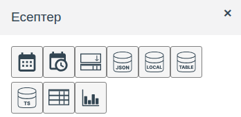
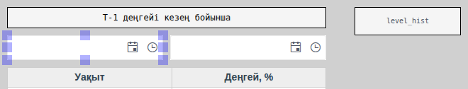
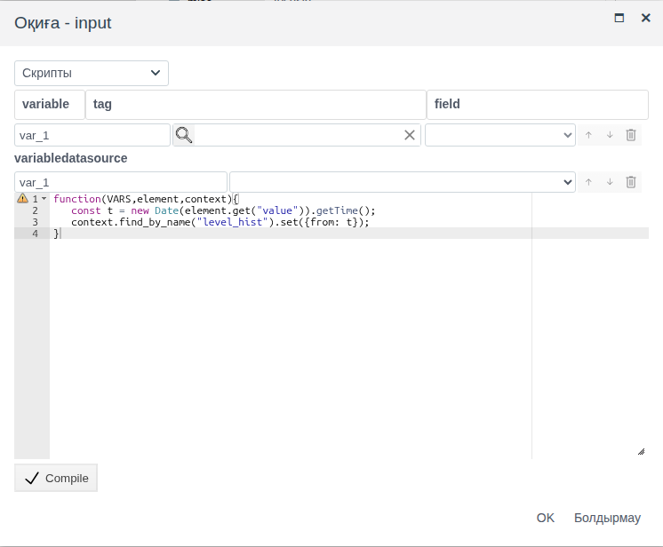
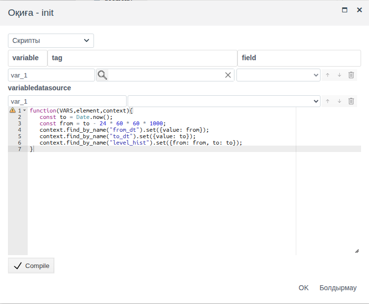
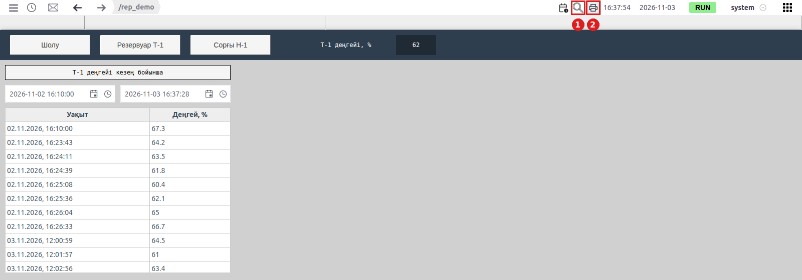
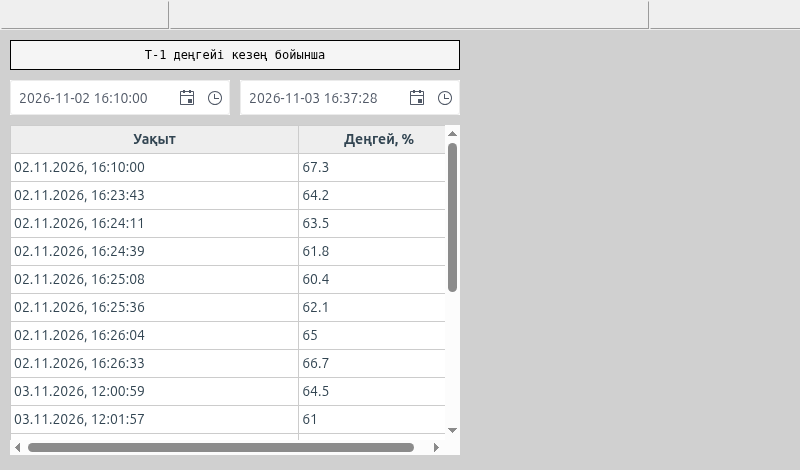
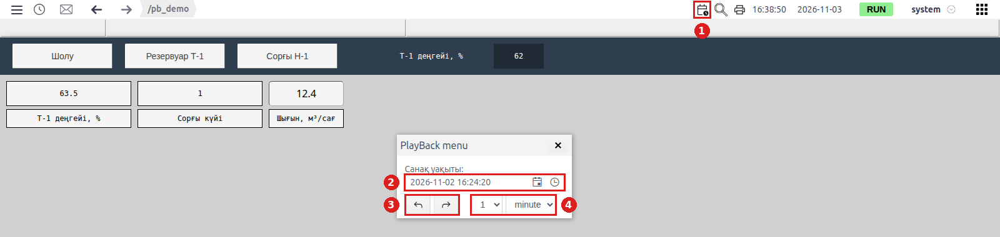

# Есептер және экранды басып шығару

Бұл құжат операторға өзі таңдаған кезеңдегі мәндер кестесін беріп, оны Runtime ортасынан тікелей басып шығаруға немесе PDF файлына сақтауға мүмкіндік жасайтын интегратор инженерге арналған.

# Мазмұны

- [Терминдер сөздігі](#терминдер-сөздігі)
- [Кіріспе](#кіріспе)
- [Негізгі бөлім](#негізгі-бөлім)
    - [«Есептер» палитрасы](#есептер-палитрасы)
    - [Есеп экраны: кезең, дереккөз, кесте](#есеп-экраны-кезең-дереккөз-кесте)
    - [Әдепкі кезең: init оқиғасы](#әдепкі-кезең-init-оқиғасы)
    - [Runtime ортасындағы есеп](#runtime-ортасындағы-есеп)
    - [Экранды басып шығару](#экранды-басып-шығару)
    - [Сызбаның өткен күйі: мұрағатты ойнату](#сызбаның-өткен-күйі-мұрағатты-ойнату)
- [Қорытынды](#қорытынды)

# Терминдер сөздігі

| Термин | Мағынасы |
|---|---|
| Есеп экраны | Оператор кезеңді өзі белгілейтін, ал кесте сол кезеңдегі мұрағат мәндерін көрсететін мнемосызба. Нысанның жеке түрі жоқ: бұл **Есептер** палитрасының элементтерінен құрастырылған қарапайым сызба |
| Дабыл жолағы | Runtime жоғарғы панелінің астындағы, сызбаның үстіндегі жол. Онда белсенді дабылдар пайда болады |
| Жұмыс аймағы | Runtime терезесінің дабыл жолағынан төменгі, сызба көрсетілетін бөлігі. Оны масштабтауға және айналдыруға болады |
| Мұрағатты ойнату | Сызба таңдалған өткен сәттегі мұрағат мәндерін көрсететін Runtime режимі. Жоғарғы панельдегі сағаты бар күнтізбе белгішесімен қосылады, «PlayBack menu» терезесінде басқарылады |
| Экранды басып шығару | Runtime жоғарғы панеліндегі принтер белгішесі және Ctrl + P пернелер тіркесімі. Браузерге дабыл жолағы мен жұмыс аймағының көрінетін бөлігінің суретін береді |

«Сызба», «Палитра», «Элемент» терминдері — [Мнемосызбалар редакторы](editor.md#терминдер-сөздігі) құжатында, «Оқиға» — [Скрипттер мен оқиғалар](events.md#терминдер-сөздігі) құжатында, «Дереккөз», «Жазба» — [Сызбадағы дереккөздер](datasources.md#терминдер-сөздігі) құжатында, «Мұрағат» — [Кестелер және уақыт шкаласы](tables.md#терминдер-сөздігі) құжатында түсіндірілген.

# Кіріспе

Жедел сызба ағымдағы мәндерді көрсетеді. Ауысымды талдау, журналды тапсыру немесе «түнде деңгейге не болды» деген сұраққа жауап беру үшін есеп қажет: оператордың өзі таңдаған кезеңдегі мәндер, қағазда немесе PDF түрінде. FACEPLATE жүйесінде есеп **Есептер** палитрасының элементтерінен қарапайым сызбада құрастырылады, ал Runtime батырмасымен басып шығарылады.

Құжатта **Есептер** палитрасында не бар екені, кезең таңдау өрістерін мұрағатпен және кестемен қалай байланыстыру керектігі, әдепкі кезеңді қалай орнату керектігі, оператор не көретіні және басып шығарғанда параққа не түсетіні сипатталған. Элементтердің қасиеттері өз құжаттарында сипатталған, мұнда тек есепке қажеттісі ғана берілген:

- күн өрістері — [Батырмалар және мәндерді енгізу, «Күнді және күн мен уақытты таңдау» бөлімі](controls.md#күнді-және-күн-мен-уақытты-таңдау);
- дереккөздер — [Сызбадағы дереккөздер](datasources.md);
- кесте — [Кестелер және уақыт шкаласы, «Кесте: бағандар мен тақырыптар» бөлімі](tables.md#кесте-бағандар-мен-тақырыптар);
- оқиға скрипттері — [Скрипттер мен оқиғалар, «Оқиға скрипті» бөлімі](events.md#оқиға-скрипті).

Құжат бойындағы мысал — `rep_demo` бумасының `screen` сызбасы: оператор екі өріспен белгілейтін кезеңдегі резервуар деңгейінің тарихы. Деректер `ds_demo` бумасындағы `tank_1_level` мұрағатынан алынады (оны жасау [Сызбадағы дереккөздер](datasources.md#time-series-datasource-мұрағаттардағы-тарих) құжатында сипатталған).

Жобаны өзгерту құқығы бар тіркелгімен Studio ортасына (`http://<сервер>:9000/fp/studio`) кіру мүмкіндігі және қажетті шаманың тарихын жазатын мұрағат қажет. Нәтиже Runtime ортасында (`http://<сервер>:9000/fp/runtime`) тексеріледі.

# Негізгі бөлім

## «Есептер» палитрасы

**Есептер** палитрасы мнемосызба редакторында құралдар панеліндегі **Есеп элементтері** батырмасымен ашылады ([Мнемосызбалар редакторы, «Редактор терезесі» бөлімі](editor.md#редактор-терезесі) құжатын қараңыз). Онда жазбалар жиынымен және кезеңдермен жұмыс істеуге арналған элементтер бар:



| Белгіше (кеңес) | Мақсаты | Қай жерде сипатталған |
|---|---|---|
| Date | Күн таңдау өрісі | [Батырмалар және мәндерді енгізу](controls.md#күнді-және-күн-мен-уақытты-таңдау) |
| Date - Time | Күн мен уақыт таңдау өрісі | [Батырмалар және мәндерді енгізу](controls.md#күнді-және-күн-мен-уақытты-таңдау) |
| multiselect | Тізімнің бірнеше тармағын таңдау | [Тізімдерден таңдау](lists.md) |
| Local Datasource | Дереккөз: сызбада берілген жазбалар | [Сызбадағы дереккөздер](datasources.md#local-datasource-сызбадағы-жазбалар) |
| Table Datasource | Дереккөз: бір түрдегі жоба нысандары | [Сызбадағы дереккөздер](datasources.md#table-datasource-жоба-нысандары) |
| Time-series datasource | Дереккөз: кезеңдегі мұрағаттар тарихы | [Сызбадағы дереккөздер](datasources.md#time-series-datasource-мұрағаттардағы-тарих) |
| Grid | Дереккөз жазбаларының кестесі | [Кестелер және уақыт шкаласы](tables.md#кесте-бағандар-мен-тақырыптар) |
| Bar Chart | Дереккөз жазбалары бойынша бағанды диаграмма | [Көрсеткілі және сызықтық индикаторлар](gauges.md#бағандық-диаграмма) |

Кезеңдік есеп үшін олардың үшеуі қажет: **Date - Time** (кезеңнің басы мен соңы), **Time-series datasource** (мұрағат тарихы) және **Grid** (кесте).

## Есеп экраны: кезең, дереккөз, кесте

**Time-series datasource** элементінде кезеңді `from` және `to` қасиеттері анықтайды: миллисекундпен берілген уақыт сәті. `from` немесе `to` өзгерген сайын дереккөз мұрағатты қайта оқиды. **Date - Time** өрісі таңдалған сәтті `value` қасиетінде сақтайды. Өріс пен дереккөзді өрістің `input` оқиғасындағы скрипт байланыстырады: бұл оқиға оператор күнтізбеден күнді, тізімнен уақытты таңдағанда немесе өріске мәнді тергенде орындалады. Скрипт таңдалған сәтті миллисекундқа айналдырып, дереккөзге жазады.

Бұл тәсілдің `from`/`to` қасиеттерін тегке байланыстырудан артықшылығы: кезең тек оператордың сызбасында сақталады. Екі оператор бір мезгілде әр түрлі кезеңдегі есепті көре алады, жобада ештеңе өзгермейді.



Жұмыс реті:

1. **Time-series datasource** қосыңыз, **misc** → `name` ішінде атауын беріңіз, **value** → `data` ішінде мұрағатты таңдап, бүркеншік атын беріңіз ([Сызбадағы дереккөздер](datasources.md#time-series-datasource-мұрағаттардағы-тарих) құжатын қараңыз). `from` және `to` бос қалсын, оларды скрипттер толтырады. Мысалда — `level_hist`, `tank_1_level` мұрағаты, `level` бүркеншік аты.
2. Екі **Date - Time** өрісін қосыңыз. **value** → `name` тобында кезең басы мен соңы өрістерінің атауларын беріңіз. Мысалда — `from_dt` және `to_dt`.
3. Дереккөзден кейін **Grid** қосып, **value** → `datasource` ішінде дереккөзді таңдаңыз. Тақырыптар (`header`) мен бағандарды (`columns`) кез келген тарих кестесіндегідей беріңіз: жазба уақыты — `ts` өрісі, мән — мұрағаттың бүркеншік аты. Мысалда:

    ```
    ["Уақыт", "Деңгей, %"]
    ```

    ```
    [{fields: ["ts"], handler: ({ts}) => new Date(ts).toLocaleString()}, "level"]
    ```

4. Кезең басының өрісін белгілеп, **events** тобы → `input` → **Скрипты** таңдаңыз, скриптті енгізіңіз, **Compile** → **OK**:

    ```javascript
    function(VARS,element,context){
       const t = new Date(element.get("value")).getTime();
       context.find_by_name("<дереккөз>").set({from: t});
    }
    ```

5. Кезең соңының өрісі үшін де солай, соңғы жолда `{to: t}`.
6. Сызбаны сақтаңыз.

Мысалда `<дереккөз>` — `level_hist`.



Редакторда кесте үлгі ұяшықтармен толтырылған, мұрағат жазбалары тек Runtime ортасында пайда болады.

## Әдепкі кезең: init оқиғасы

`from` немесе `to` бос болғанша дереккөз жазба бермейді, сондықтан сызба ашылғанда кесте бос болады. Оператор есепті типтік кезең үшін бірден көруі үшін кезеңді сызбаның `init` оқиғасының скриптімен беріңіз: бұл оқиға сызба Runtime ортасында ашылғанда орындалады.

Кенептің бос жерін басыңыз (сызба белгіленеді), **events** тобы → `init` → **Скрипты**:

```javascript
function(VARS,element,context){
   const to = Date.now();
   const from = to - 24 * 60 * 60 * 1000;
   context.find_by_name("<бас өрісі>").set({value: from});
   context.find_by_name("<соң өрісі>").set({value: to});
   context.find_by_name("<дереккөз>").set({from: from, to: to});
}
```

Скрипт өрістерге соңғы тәулікті қояды және сол кезеңді дереккөзге береді. Басқа кезең үшін `from` жолындағы санды өзгертіңіз: 8 сағат — `8 * 60 * 60 * 1000`. Мысалда өрістер — `from_dt` және `to_dt`, дереккөз — `level_hist`.



## Runtime ортасындағы есеп

Оператор сызбаны **Мнемосхемалар** мәзірі арқылы ашады ([Экрандар және олардың арасында ауысу](screens.md#оператор-экрандарды-қалай-табады) құжатын қараңыз). Мысалда сызба ашылғанда өрістер соңғы тәулікті, ал кесте осы уақыттағы барлық деңгей мәндерін көрсетеді.

Кезеңді өзгерту үшін оператор өрістегі күнтізбе белгішесін басып, күнді таңдайды, сағат белгішесін басып, тізімнен уақытты таңдайды (тізім қадамы — `interval` қасиеті) немесе күнді өріске тереді. Таңдаудан кейін кесте жаңа кезең бойынша мұрағатты қайта оқиды. Кестенің бірінші жолы — кезең басталған сәттегі мұрағат мәні, одан кейін шаманың әр өзгерісі.



Оператор есепті қарап отырғанда кесте өздігінен толықтырылмайды: жаңа мәндер кезеңді келесі рет таңдағаннан кейін пайда болады.

## Экранды басып шығару

Басып шығару тек есеп экранында емес, Runtime ортасының кез келген сызбасында қолжетімді. Ол екі тәсілмен іске қосылады:

- Runtime жоғарғы панеліндегі принтер белгішесі, оң жақта, лупа мен сағаттың арасында (жоғарыдағы суретте — **2**);
- Runtime ашық тұрғанда Ctrl + P.

Runtime сурет жасап, браузердің басып шығару терезесін ашады. Онда принтерді немесе PDF файлына сақтауды таңдайды.

Параққа оператор жұмыс аймағында көріп тұрғаны және оның үстіндегі дабыл жолағы түседі:

| Runtime терезесінің бөлігі | Парақта |
|---|---|
| Дабыл жолағы | Иә |
| Сызбаның көрінетін бөлігі | Иә |
| Сызбаның терезе шетінен тыс бөлігі | Жоқ |
| Кестенің айналдыру шегінен тыс жолдары | Жоқ |
| Жоғарғы панель (мәзір, жол, сағат, пайдаланушы) | Жоқ |
| Бекітілген экран ([Экрандар және олардың арасында ауысу](screens.md#бекітілген-экран) құжатын қараңыз) | Жоқ |



Мысалда суретте жоғарыдағы Runtime суретінде көрінетін жоғарғы панель мен ауысу батырмалары бар бекітілген экран жоқ; жоғарыда — бос дабыл жолағы.

Осыдан есеп экраны үшін екі ереже шығады:

1. **Сызба терезеде толық көрінеді.** Сызба терезеден үлкен болса, оператор басып шығарар алдында масштабты кішірейтеді: жоғарғы панельдегі лупа белгішесі (жоғарыдағы суретте — **1**) ағымдағы масштабты пайызбен және **−**, **+**, **Ысыру** батырмаларын көрсететін панельді ашады. **−** батырмасы масштабты екі есе кішірейтеді. Ctrl пернесімен тінтуір дөңгелегі де масштабты өзгертеді, Ctrl-сыз дөңгелек сызбаны айналдырады. **Ысыру** 100 % мәнін қайтарады.
2. **Кестенің барлық жолдары көрінеді.** **Grid** биіктігі есеп типтік кезеңде беретін жолдар санына қарай таңдалады. Жолдар анық көбірек болса, `init` ішіндегі әдепкі кезеңді қысқартыңыз немесе кестені сызбаның бүкіл биіктігіне орналастырыңыз.

## Сызбаның өткен күйі: мұрағатты ойнату

Есеп кестесі бір шаманы кезең бойынша көрсетеді. Оқиғаларды талдау үшін көбіне басқа нәрсе керек: бүкіл сызба бір өткен сәтте — қорғаныс іске қосылғанда деңгейлер мен күйлер қандай болды. Ол үшін Runtime ортасында мұрағатты ойнату режимі бар. Оған жеке сызба қажет емес: ол кез келген ашық сызбада жұмыс істейді.

Жоғарғы панельдегі лупаның сол жағындағы сағаты бар күнтізбе белгішесі (суретте — **1**) ағымдағы сызбаның үстінде «PlayBack menu» терезесін ашады:

| № | Терезе элементі | Мақсаты |
|---|---|---|
| 2 | **Санақ уақыты** | Сызба мәндерді көрсететін сәт. Күн мен уақытты өріске теріп, Enter пернесін басыңыз |
| 3 | «Артқа» және «алға» батырмалары | Сәтті бір қадам ертерек немесе кейінірек жылжытады |
| 4 | Қадам | Сан (1, 5, 10, 15, 30, 60) және бірлік: `second`, `minute`, `hour` |



Сызба не көрсетеді:

- сәт берілгенше — әдеттегідей ағымдағы мәндер;
- мұрағаты бар өріске байланыстырылған элемент — берілген сәттегі мұрағат мәні;
- мұрағаты жоқ өріске байланыстырылған элемент — ағымдағы мән;
- бұл режимде сызбадан мәндер жобаға жазылмайды.

Мысалда (`pb_demo` сызбасы) `tank_1.level` деңгейін мұрағат жазады, сорғы күйін — жоқ. 16:24:20 сәтінде деңгей 63.5 көрсетеді — мұрағат мәні, ал күй — ағымдағы мән. Қадамы 1 `minute` болатын «алға» батырмасы сызбаны 16:25:20 сәтіне ауыстырады, деңгей 60.4 мәніне өзгереді. Терезені айқышпен жапқанда сызба ағымдағы мәндерге оралады.

Демек, тек мұрағат жазатын нәрсе ғана ойнатылады: өткен шақта көру керек өрістің мұрағаты болуы тиіс ([Archives: configuring sources and recording data](../../en/data_storage/archives/archives.md) құжатын қараңыз).

Бұл режимде басып шығару берілген сәттегі сызбаны береді. «PlayBack menu» терезесі параққа түспейді, сондықтан басылған парақта сәт көрсетілмейді: қажет болса, парақты қолмен белгілеңіз.

| | Есеп кестесі | Мұрағатты ойнату |
|---|---|---|
| Парақта не бар | Бір шама, кезеңдегі барлық өзгерістер | Бүкіл сызба бір сәтте |
| Интегратор не дайындайды | Жеке сызба: кезең өрістері, дереккөз, кесте | Қажетті өрістердің мұрағаттарынан басқа ештеңе |
| Оператор уақытты қалай таңдайды | Сызба өрістеріндегі кезеңнің басы мен соңы | «PlayBack menu» терезесіндегі сәт пен қадам |

# Қорытынды

| Міндет | Не қолдану керек |
|---|---|
| Оператор таңдаған кезеңдегі мұрағат мәндері | Екі **Date - Time** өрісі, әр өрістің `input` оқиғасындағы скрипт → **Time-series datasource** элементінің `from`/`to` қасиеттері, **Grid** |
| Ашылғанда бірден есеп | Сызбаның `init` оқиғасындағы скрипт өрістер мен дереккөз кезеңін береді |
| Сол парақта жоба нысандарының жиынтығы немесе анықтамалық | **Table Datasource** немесе **Local Datasource** және тағы бір **Grid** ([Сызбадағы дереккөздер](datasources.md) құжатын қараңыз) |
| Бүкіл сызба өткен сәтте | Сағаты бар күнтізбе белгішесі → «PlayBack menu»; қажетті өрістердің мұрағаты бар |
| Қағаз көшірме немесе PDF | Runtime жоғарғы панеліндегі принтер белгішесі немесе Ctrl + P → браузердің басып шығару терезесі |

Жұмыс реті:

1. **Time-series datasource** қосып, мұрағатты таңдаңыз, атауын беріңіз.
2. Атаулары бар екі **Date - Time** өрісін және дереккөзі, тақырыптары мен бағандары берілген **Grid** қосыңыз.
3. Әр өрістің `input` оқиғасына дереккөздің `from` немесе `to` қасиетін жазатын скрипт тағайындаңыз.
4. Сызбаның `init` оқиғасына әдепкі кезең скриптін тағайындаңыз.
5. Есеп Runtime терезесіне толық сыятындай сызба мен кестенің өлшемдерін таңдаңыз. Сызбаны сақтаңыз.
6. Runtime ортасында кезеңді таңдап, кестені тексеріп, экранды басып шығарыңыз.
