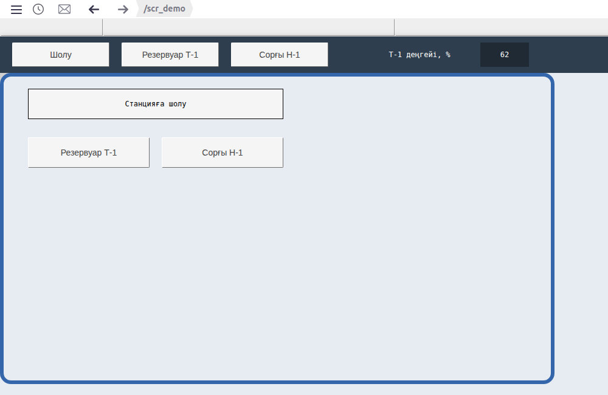
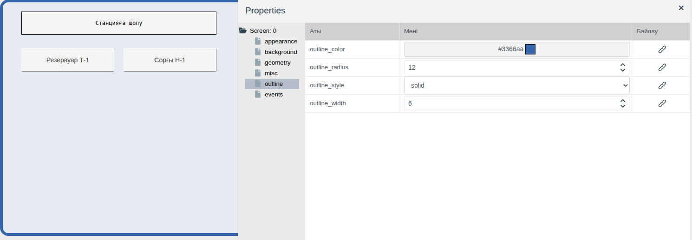
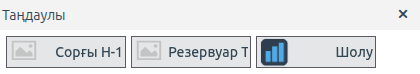
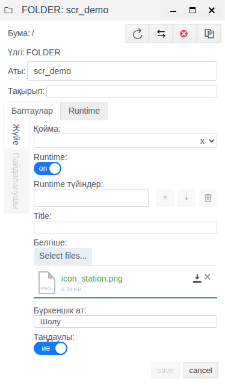
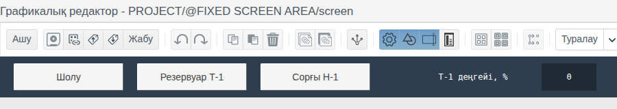
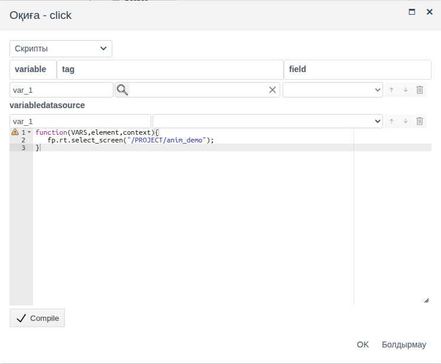

# Экрандар және олардың арасында ауысу

Бұл құжат мнемосызбалардан оператордың жұмыс орнын құрастыратын интегратор инженерге арналған: оператор Runtime ортасында қандай сызбаларды ашады, олардың арасында қалай ауысады және кез келген сызбаның үстінде қандай панель көрінеді.

# Мазмұны

- [Терминдер сөздігі](#терминдер-сөздігі)
- [Кіріспе](#кіріспе)
- [Негізгі бөлім](#негізгі-бөлім)
    - [Экран және бума](#экран-және-бума)
    - [Сызба қасиеттері](#сызба-қасиеттері)
    - [Runtime ортасындағы бума: бүркеншік ат, белгіше, таңдаулылар](#runtime-ортасындағы-бума-бүркеншік-ат-белгіше-таңдаулылар)
    - [Бекітілген экран](#бекітілген-экран)
    - [Басқа экранға ауысу](#басқа-экранға-ауысу)
    - [Сызбаға қайту](#сызбаға-қайту)
- [Қорытынды](#қорытынды)

# Терминдер сөздігі

| Термин | Мағынасы |
|---|---|
| Экран | Runtime жұмыс аймағында ашылған буманың `screen` сызбасы. Бір бума — бір экран |
| Жұмыс аймағы | Runtime терезесінің оператор таңдаған экран көрсетілетін бөлігі. Экрандар арасында ауысқанда тек осы бөлік өзгереді |
| Бекітілген экран | `@FIXED SCREEN AREA` жүйелік бумасының `screen` сызбасы. Қай экран ашық болса да, Runtime оны жұмыс аймағының үстінде үнемі көрсетеді |
| Бүркеншік ат | Бума өрісі: Runtime ортасының «Таңдаулы» және «Тарих» терезелерінде көрсетілетін, операторға түсінікті экран атауы |
| «Таңдаулы» | Интегратор буманың **Таңдаулы** өрісімен белгілеген экрандар тізімі бар Runtime терезесі. Жоғарғы жолдың оң жақ бұрышындағы батырмамен ашылады |
| «Тарих» | Осы тіркелгімен бұрын ашылған экрандар тізімі бар Runtime терезесі. Жоғарғы жолдағы сағат белгісі бар батырмамен ашылады |

«Сызба», «Элемент», «Палитра» терминдері — [Мнемосызбалар редакторы](editor.md#терминдер-сөздігі) құжатында, «Оқиға», «Реакция» — [Скрипттер мен оқиғалар](events.md#терминдер-сөздігі) құжатында түсіндірілген.

# Кіріспе

Жобаның әр бумасында 17 сызба бар, бірақ олардың тек біреуі — `screen` — Runtime экранына айналады. Қалғандары басқа сызбаларға кірістіріледі ([Мнемосызбалар редакторы, «Сызбалардың мақсаты» бөлімі](editor.md#сызбалардың-мақсаты) құжатын қараңыз). Құжатта экрандар жиынынан жұмыс орнын жасау үшін тағы не қажет екені сипатталған:

- экранның Runtime ортасындағы көрінісі: өлшемі, фоны, жақтауы;
- оператор экранды қандай атаумен көреді және оны қалай тез табады;
- барлық экранда бірдей көрінетін панель;
- экрандар арасында ауысу батырмалары;
- бұрын ашылған экранға қайтқанда оператор не көреді.

Құжат бойындағы мысал — үш экран: `scr_demo` шолу экраны (бүркеншік аты «Шолу») және `anim_demo`, `controls_demo` бумаларының экрандары (бүркеншік аттары «Резервуар Т-1», «Сорғы Н-1»). Олардың үстінде бекітілген экран орналасқан: «Шолу», «Резервуар Т-1», «Сорғы Н-1» батырмалары және резервуардың ағымдағы деңгейі бар күңгірт жолақ.



Жобаны өзгерту құқығы бар тіркелгімен Studio ортасына (`http://<сервер>:9000/fp/studio`) кіру мүмкіндігі қажет. Нәтиже Runtime ортасында (`http://<сервер>:9000/fp/runtime`) тексеріледі.

# Негізгі бөлім

## Экран және бума

Буманың `screen` сызбасы кемінде бір рет сақталғаннан кейін бума экранға айналады. Осыдан кейін:

- бума Runtime ортасының **Мнемосхемалар** мәзірінде пайда болады. Мәзір тармағы — жобаның түбірінен басталатын бума жолы, `/<бума>`;
- Studio жоба ағашында бума атауы қалың қаріппен көрсетіледі: осылайша қай бумаларда экран бар екенін көруге болады.

`view1`…`view15` сызбалары экранға айналмайды және мәзірге кірмейді. Оларды басқа сызбаның ішінде **Folder Screen** элементі көрсетеді ([Сызба ішіндегі сызба: Folder Screen](editor.md#сызба-ішіндегі-сызба-folder-screen) бөлімін қараңыз). Осыдан орналастыру ережесі шығады: оператор жеке экран ретінде ашатынның бәрі — жеке буманың `screen` сызбасы; бірнеше экранда қайталанатынның бәрі — олардың әрқайсысына кірістірілген `viewN` сызбасы.

Сақталған сызба осы экранды Runtime ортасында ашып отырған барлық операторда бірден жаңарады: бет қайта жүктелмейді, ескі нұсқаның орнына жаңасы көрсетіледі. Өзгерістер аяқталғаннан кейін сақтаңыз: аралық нұсқалар да жұмыс орындарына жіберіледі.

## Сызба қасиеттері

Сызбаның өз қасиеттері экранның жұмыс аймағына қалай орналасатынын анықтайды. Оларды көру үшін кенептің бос жерін басыңыз: **Properties** панелінде `Screen: 0` көрсетіледі.

| Топ | Қасиет | Runtime ортасында нені өзгертеді |
|---|---|---|
| **geometry** | `width`, `height` | Экранның пиксельмен берілген өлшемі. Экран жұмыс аймағының жоғарғы сол жақ бұрышынан бастап салынады |
| **background** | `background_color` | Экран түсі. Экран ашық тұрғанда оның айналасындағы жұмыс аймағы да осы түспен толтырылады, сондықтан терезеден кіші экран сұр фонда жеке «арал» болып көрінбейді |
| **outline** | `outline_width` | Экран айналасындағы жақтау, қалыңдығы пиксельмен беріледі. 0 — жақтаусыз |
| | `outline_color` | Жақтау түсі |
| | `outline_style` | Сызық түрі: `solid` — тұтас, `dashed` — үзік, `dotted` — нүктелі және басқалары |
| | `outline_radius` | Жақтау бұрыштарын дөңгелектеу |

Жаңа сызбаның өлшемі — 1914 × 1014. Экран терезенің бір бөлігін ғана алуы керек болса, `width` және `height` мәндерін кішірейтіңіз: мысалда `scr_demo` өлшемі — 900 × 500, фоны — `#e6ecf2`, жақтауы — 6 px, `#3366aa`, `solid`, бұрыштарын дөңгелектеу мәні — 12. Кіріспедегі суретте жақтаудың оң жағындағы және астындағы жұмыс аймағының түсі экран түсімен бірдей екені көрінеді.



Сызбаның **events** тобы элементтердегідей: `init` экран жүктелгенде, `click` сызбаның бос жерін басқанда орындалады ([Скрипттер мен оқиғалар](events.md) құжатын қараңыз).

## Runtime ортасындағы бума: бүркеншік ат, белгіше, таңдаулылар

### Оператор экрандарды қалай табады

Оператор экрандар арасында ауысу үшін қолданатынның бәрі Runtime жоғарғы жолында орналасқан:


| № | Батырма (кеңес) | Не істейді |
|---|---|---|
| 1 | **Мәзір** | Бүйірлік мәзірді ашады. **Мнемосхемалар** тармағы — жобаның барлық экрандарының тізімі. Ондағы экрандар бума жолдарымен аталады, мысалы, `/<бума>`: бұлар — интегратор жоба ағашындағы бумаларға берген атаулар |
| 2 | **Тарих** | «Тарих» терезесі: осы тіркелгімен бұрын ашылған экрандар. Тізім серверде тіркелгімен бірге сақталады, сондықтан оператор өз атымен кірген кез келген браузерде бірдей болады |
| 3, 4 | **Артқа өту**, **Көшу алға** | Браузердегідей ашылған экрандар бойынша бір қадам артқа және алға ауысу |
| 5 | — | Ағымдағы экранның жолы |
| 6 | **Таңдаулы** | «Таңдаулы» терезесі: интегратор буманың **Таңдаулы** өрісімен белгілеген экрандар. Тізім барлығына ортақ; оператор одан экрандарды ашады, бірақ тізімді өзгертпейді |

«Тарих» және «Таңдаулы» терезелерінде экран буманың белгішесі мен бүркеншік аты бар батырма түрінде көрсетіледі. Батырманы басу экранды жұмыс аймағында ашады, терезе айқыш батырмасымен жабылады.



Мысалда «Таңдаулы» ішінде үш экран бар; `scr_demo` экранының өз белгішесі бар, қалған екеуінде белгіше берілмеген, оның орнында бос сурет көрсетіледі.

### Бума өрістері

Экранның осы терезелердегі көрінісін бума пішінінің үш өрісі анықтайды (бума → **Өңдеу**, **Баптаулар** қойындысы, **Жүйе**):

| Өріс | Не береді |
|---|---|
| **Таңдаулы** | **Иә** — экран «Таңдаулы» терезесіне қосылады |
| **Бүркеншік ат** | «Таңдаулы» және «Тарих» терезелерінде бума атауының орнына көрсетілетін экран атауы. Бос болса, бума атауы көрсетіледі |
| **Белгіше** | Осы терезелерде және Studio жоба ағашында атаудың жанындағы сурет. **Select files...** файл жүктейді |

Өзгерткеннен кейін **save** батырмасын басыңыз.



Бүркеншік ат тек «Таңдаулы» және «Тарих» терезелерінде қолданылады. **Мнемосхемалар** мәзірінде, ағымдағы экран жолында және ауысу скриптінде экран бума жолымен аталады. Сызбаларда да бүркеншік ат пайда болмайды: ауысу батырмасындағы жазу — оның жеке `text` қасиеті. Мысалда `scr_demo` бүркеншік аты мен бекітілген экран батырмасының жазуы бірдей («Шолу»), бірақ олар бөлек берілген: бүркеншік атты өзгерту жазуды өзгертпейді.

## Бекітілген экран

**Не үшін қажет.** Қай экранда отырса да, операторға кейбір ақпарат үнемі қажет: негізгі экрандарға ауысу батырмалары, нысан атауы, бір-екі басты көрсеткіш. Мұны әр сызбада салсаңыз, кез келген өзгеріс — жаңа батырма, басқа көрсеткіш — барлық сызбаны өзгертуді талап етеді. Бекітілген экран бір рет салынады, ал Runtime оны өзі ағымдағы ашық экранның үстінде көрсетеді.

**Оператор не көреді.** Мысалда бекітілген экран — хабарламалар жолының дәл астында, терезенің бүкіл еніне созылған биіктігі 60 px жолақ. Жұмыс аймағы жолақтың астынан басталады. Оператор «Резервуар Т-1» экранын ашады — жолақ орнында; «Сорғы Н-1» экранына ауысады — сол батырмалары бар сол жолақ қалады, тек жұмыс аймағы өзгереді. Жолақтағы «Т-1 деңгейі, %» мәні кез келген экранда, соның ішінде резервуар жоқ сорғы экранында да `tank_1.level` өрісімен бірге өзгереді. Жолақ батырмалары кез келген экраннан өз экрандарына ауыстырады.

**Қарапайым экраннан және Folder Screen элементінен айырмашылығы:**

| | Қарапайым экран | Бекітілген экран |
|---|---|---|
| Қайда көрінеді | Оператор таңдағанда жұмыс аймағында | Жұмыс аймағының үстінде, үнемі |
| Жобада қанша болады | Әр бумада біреу | Біреу |
| Оператор оған қалай өтеді | Мәзір, «Таңдаулы», «Тарих», ауысу батырмалары | Өтудің қажеті жоқ: өзі көрсетіледі, мәзірде жоқ |
| Операторлар өзгерістерді қашан көреді | Сақтағаннан кейін бірден | Runtime бетін қайта жүктегеннен кейін |

Folder Screen де бір сызбаны бірнеше экранда көрсетеді, бірақ оны әр сызбаға қолмен орналастырады және ол тек орналастырылған жерде ғана көрінеді. Бекітілген экран ешбір сызбаға орналастырылмайды. Ортақ бөлік барлық экранда қажет болса, бекітілген экранды, бірнеше экранда қажет болса, Folder Screen қолданыңыз.

**Қалай жасау керек.** Бекітілген экран — `@FIXED SCREEN AREA` жүйелік бумасының `screen` сызбасы. Бума жоба ағашының түбірінде әрқашан бар. Оның сызбасы сақталғанша жолақ болмайды, жұмыс аймағы хабарламалар жолының дәл астынан басталады.

1. Studio ортасында **Жалпы құрылым** бөлімін ашыңыз, `@FIXED SCREEN AREA` бумасына екі рет шертіп кіріңіз де, **Мнемосхема** батырмасын басыңыз.
2. `screen` сызбасын жасаңыз. Сызбаның өзін белгілеп, **geometry** тобындағы `height` мәнін — жолақ биіктігін беріңіз, мысалда — 60. Runtime бекітілген экранға сызба биіктігіне дәл тең орын бөледі: әдепкі 1014 биіктігімен ол бүкіл терезені алады да, қарапайым экрандар көрінбейді.
3. `background_color` мәнін беріңіз, мысалда — `#2f3e4e`. Терезенің бүкіл еніне созылған жолақ осы түспен толтырылады.
4. Элементтерді салыңыз. Байланыстырулар мен оқиғалар қарапайым сызбадағыдай жұмыс істейді: мысалда ауысу скрипті бар үш батырма ([Басқа экранға ауысу](screens.md#басқа-экранға-ауысу) бөлімін қараңыз) және `text` қасиеті `anim_demo/tank_1` нысанының `level` өрісіне байланыстырылған тіктөртбұрыш бар.
5. Сызбаны сақтап, нәтижені көру үшін Runtime бетін қайта жүктеңіз.



## Басқа экранға ауысу

Оператор экрандар арасында **Мнемосхемалар** мәзірі, «Таңдаулы» және «Тарих» терезелері, жоғарғы жолдағы «артқа» және «алға» батырмалары арқылы ауысады. Сызбадағы ауысу батырмасы ауысу мүмкіндігін оператор қарап тұрған жерге орналастыру үшін қажет: шолу сызбасынан егжей-тегжейлі сызбаға, бекітілген экран жолағынан кез келген экранға өту.

Меншіктеу экранды ашпайды, сондықтан ауысу батырмасы оқиға скриптімен жасалады ([Оқиға скрипті](events.md#оқиға-скрипті) бөлімін қараңыз). Батырманы белгілеңіз, **events** тобында `click` оқиғасының **Реакция** ұяшығын басыңыз, **Скрипты** таңдап, мынаны жазыңыз:

```javascript
function(VARS,element,context){
   fp.rt.select_screen("/PROJECT/<бума>");
}
```

`fp.rt.select_screen` жұмыс аймағында буманың экранын ашады. Аргумент — `/PROJECT` префиксі қосылған, жобаның түбірінен басталатын бума жолы, яғни **Мнемосхемалар** мәзіріндегі жолдың алдына `/PROJECT` қосылады. Скриптке айнымалылар қажет емес.

Мысалда «Резервуар Т-1» батырмасында — `fp.rt.select_screen("/PROJECT/anim_demo");`.



Runtime үшін скриптпен ауысу мәзірден ауысумен бірдей: жоғарғы жолдағы жол өзгереді, «артқа» батырмасы батырма басылған экранға қайтарады, «алға» батырмасы сол батырмамен ашылған экранға қайта өткізеді.

Мысалда ауысу скрипті `scr_demo` экранының «Резервуар Т-1» және «Сорғы Н-1» батырмаларына және бекітілген экранның үш батырмасына қойылған. `scr_demo` батырмалары тек шолу экранында, жолақ батырмалары барлық жерде көрінеді.

## Сызбаға қайту

Runtime сеанс кезінде ашылған экрандарды жадта сақтайды. Бұл оператор «артқа» батырмасымен немесе **Мнемосхемалар** мәзірінен экранға қайтқанда не көретінін анықтайды:

| Экранда не бар | Қайтқанда |
|---|---|
| Байланыстырулардан алынған мәндер | Ағымдағы мәндер: оператор басқа экранда болғанда тег өрісі өзгерсе, ол жаңа мәнді бірден көреді |
| Оқиға скрипттері өзгерткен қасиеттер (`element.set`) | Скрипт қалдырған күйінде |
| `init` оқиғасы | Қайта орындалмайды |

[Скрипттер мен оқиғалар](events.md#скриптте-не-қолжетімді) құжатындағы мысал: `evt_demo` экранында «Тексеру» батырмасы скриптпен «Сорғы» тіктөртбұрышын жасыл түске бояйды. Оператор оны басып, басқа экранға ауысып, қайтып келді — тіктөртбұрыш жасыл. Бұл ретте байланыстырулардан алынған мәндер ағымдағы күйде болады: `anim_demo` экранын тексергенде оператор болмаған уақытта өзгерген деңгей жаңа мәнімен көрсетілді.

Сондықтан деректерге сәйкес болуы тиіс нәрсенің бәрін байланыстыру арқылы беріңіз: ол әрқашан ағымдағы мәнді көрсетеді. Оқиға скриптімен оператордың осы экрандағы әрекеттеріне қатысты нәрселерді өзгертіңіз.

**Мнемосхемалар** мәзірінде қазір ашық тұрған экранды таңдасаңыз немесе Runtime бетін қайта жүктесеңіз, экран жаңадан жүктеледі: редакторда сақталған күйінде ашылып, `init` орындалады.

# Қорытынды

| Міндет | Қалай орындау керек |
|---|---|
| Сызбаны Runtime экранына айналдыру | Буманың `screen` сызбасын сақтау |
| Экранды терезеге сәйкестендіру, фон мен жақтауды беру | Сызбаның өз қасиеттері: **geometry**, **background**, **outline** |
| Операторға негізгі экрандарды тез ашуға мүмкіндік беру | Буманың **Таңдаулы** өрісі, оған қоса **Бүркеншік ат** және **Белгіше** |
| Батырмалар мен көрсеткіштерді барлық экранда көрсету | Бекітілген экран: `@FIXED SCREEN AREA` бумасының `height` мәні шағын `screen` сызбасы |
| Ортақ бөлікті бірнеше экранда көрсету | Буманың `viewN` сызбасы және әр сызбадағы **Folder Screen** |
| Ауысу батырмасын жасау | `click` оқиғасының скрипті: `fp.rt.select_screen("/PROJECT/<бума>")` |
| Қайтқанда экранның деректерге сәйкес болуын қамтамасыз ету | Оқиға скрипттері емес, байланыстырулар |

Жұмыс реті:

1. Экрандарды бумаларға орналастырыңыз: бір бума — бір `screen` экраны. Қайталанатын бөліктерді `view1`…`view15` сызбаларына шығарыңыз.
2. Сызбалардың өлшемін, фонын және жақтауын беріңіз.
3. Негізгі экрандарда **Таңдаулы** қосып, **Бүркеншік ат** және **Белгіше** мәндерін беріңіз.
4. Бекітілген экранды салыңыз: алдымен `height` мәнін, содан кейін ортақ ауысу батырмаларын және басты көрсеткіштерді беріңіз.
5. Шолу сызбаларына ауысу батырмаларын қосыңыз.
6. Runtime ортасында тексеріңіз: ауысулар, «артқа», «Таңдаулы», экранға қайту. Бекітілген экрандағы өзгерістерді бетті қайта жүктегеннен кейін тексеріңіз.
