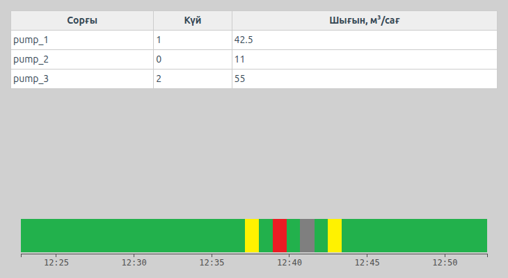
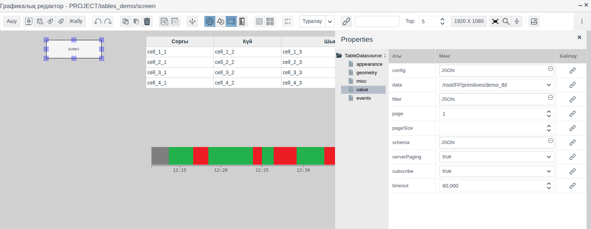
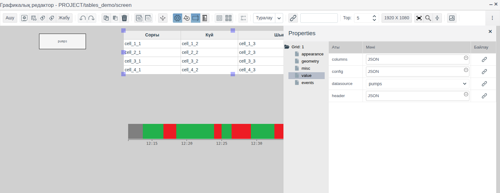
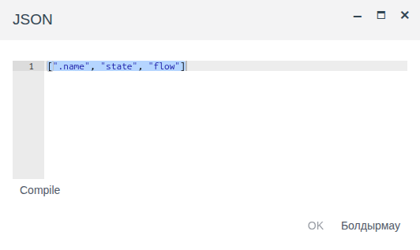
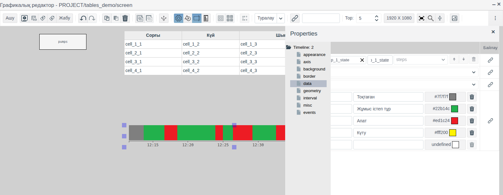
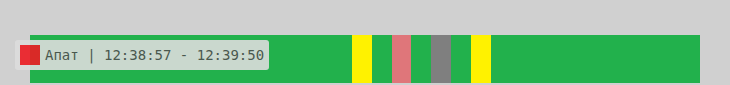

# Кестелер және уақыт шкаласы

Бұл құжат мнемосызбада операторға нысандар тобы бойынша жиынтықты (сорғылардың күйі мен шығыны көрсетілген кестені) және агрегаттың соңғы минуттардағы немесе сағаттардағы күй тарихын көрсетуі қажет интегратор инженерге арналған.

# Мазмұны

- [Терминдер сөздігі](#терминдер-сөздігі)
- [Кіріспе](#кіріспе)
- [Негізгі бөлім](#негізгі-бөлім)
    - [Палитралардағы элементтер](#палитралардағы-элементтер)
    - [Кесте: жолдар дереккөзі](#кесте-жолдар-дереккөзі)
    - [Кесте: бағандар мен тақырыптар](#кесте-бағандар-мен-тақырыптар)
    - [Кесте: түстер](#кесте-түстер)
    - [Уақыт шкаласы: мұрағат](#уақыт-шкаласы-мұрағат)
    - [Уақыт шкаласы: күйлер](#уақыт-шкаласы-күйлер)
    - [Уақыт шкаласы: аралық](#уақыт-шкаласы-аралық)
    - [Уақыт шкаласы: ось, жақтау және фон](#уақыт-шкаласы-ось-жақтау-және-фон)
- [Қорытынды](#қорытынды)

# Терминдер сөздігі

| Термин | Мағынасы |
|---|---|
| Кесте | **Grid** элементі: жолдар — дереккөз жазбалары, бағандар — олардың өрістері |
| Дереккөз | Басқа элементтерге арналған жазбалар жиынын сақтайтын, Runtime ортасында көрінбейтін сызба элементі. Кесте үшін — **Table Datasource** (жоба нысандары) немесе **Local Datasource** (сызбада берілген жазбалар) |
| Уақыт шкаласы | **Timeline** элементі: әр уақыт бөлігі агрегат күйінің түсімен боялатын жолақ |
| Мұрағат | Тег өрісінің мәндер тарихын жазатын `ARCHIVE` түріндегі жоба нысаны. Мұрағат жасау [Archives: configuring sources and recording data](../../en/data_storage/archives/archives_en.md) құжатында сипатталған |
| Күй | Агрегат режимін білдіретін тег өрісіндегі бүтін сан: 0 — тоқтаған, 1 — жұмыс істеп тұр және т. б. |

«Тег», «Байланыстыру», «Меншіктеу» терминдері — [Батырмалар және мәндерді енгізу](controls.md#терминдер-сөздігі) құжатында, «Сызба», «Палитра», «Элемент» — [Мнемосызбалар редакторы](editor.md#терминдер-сөздігі) құжатында түсіндірілген.

# Кіріспе

Кесте бір түрдегі көптеген нысанды бірден көрсетеді: әр нысанға бір жол, әр өріске бір баған. Ол нысандарды түрі мен бумасы бойынша өзі табады, сондықтан бумаға жаңа сорғы қосылғанда сызбаны өзгерту қажет емес. Уақыт шкаласы агрегаттың қашан жұмыс істегенін, тоқтап тұрғанын немесе апат күйінде болғанын көрсетеді: оператор трендтерді ашпай-ақ, түрлі түсті жолақтан ауысымдағы тоқтап тұру уақытын көреді.

Құжатта екі элемент те сипатталған: қасиеттері, деректерді дайындау және Runtime ортасындағы көрінісі. Редактордағы жұмыс (қосу, белгілеу, қасиеттер, сақтау) [Мнемосызбалар редакторы](editor.md) құжатында сипатталған.

Құжат бойындағы мысал — `tables_demo` бумасының `screen` сызбасы. Бумада `state` (integer, сорғы күйі) және `flow` (float, шығын) өрістері бар `demo_tbl` меншікті примитивінің үш нысаны — `pump_1`…`pump_3` орналасқан. Кесте буманың барлық сорғыларын, уақыт шкаласы `pump_1_state` мұрағатынан алынған `pump_1` сорғысының соңғы 30 минуттағы күй тарихын көрсетеді.



Жобаны өзгерту құқығы бар тіркелгімен Studio ортасына (`http://<сервер>:9000/fp/studio`) кіру мүмкіндігі қажет. Нәтиже Runtime ортасында (`http://<сервер>:9000/fp/runtime`) тексеріледі.

# Негізгі бөлім

## Палитралардағы элементтер

| Палитра | Белгішенің кеңесі | Қасиеттер ағашының түбірі | Мақсаты |
|---|---|---|---|
| **Есептер** | Grid | `Grid` | Дереккөз жазбаларының кестесі |
| **Есептер** | Table Datasource | `TableDatasource` | Дереккөз: бір түрдегі жоба нысандары |
| **Есептер** | Local Datasource | `LocalDatasource` | Дереккөз: сызбада берілген жазбалар |
| **Controls** | Timeline | `Timeline` | Мұрағат бойынша күйлердің уақыт шкаласы |

**appearance**, **geometry**, **misc** және **events** топтары сызбаның басқа элементтеріндегідей ([Графикалық элементтер, «Ортақ қасиеттер» бөлімі](graphics.md#ортақ-қасиеттер) құжатын қараңыз). Кесте мен шкаланың `click` оқиғасына батырмадағыдай **Меншіктеу** орнатуға болады ([Батырмалар және мәндерді енгізу, «Батырма» бөлімі](controls.md#батырма) құжатын қараңыз).

Кестенің `header`, `columns` және дереккөздердің `schema`, `data`, `filter` қасиеттері **JSON** терезесінде өңделеді: мән өрісін басып, мәтінді енгізіңіз, **Compile**, содан кейін **OK** батырмасын басыңыз.

## Кесте: жолдар дереккөзі

Кесте тегке байланыстырылмайды: жолдарды сол сызбадағы дереккөзден алады. Алдымен дереккөзді, содан кейін кестені қосыңыз.

### Жоба нысандары: Table Datasource

**Table Datasource** бір түрдегі жоба нысандарын, мысалы, бумадағы примитивтің барлық даналарын іріктейді. Редакторда дереккөз өз атауы бар тіктөртбұрыш түрінде көрінеді, Runtime ортасында көрінбейді.



| Топ | Қасиет | Мақсаты |
|---|---|---|
| **misc** | `name` | Дереккөз атауы. Кесте дереккөзді осы атаумен табады. Мысалда — `pumps` |
| **value** | `data` | Нысандар түрі. Меншікті примитивтер тізімнің соңында орналасқан: `/root/FP/primitives/<атау>`. Мысалда — `/root/FP/primitives/demo_tbl` |
| | `filter` | Нысандарды іріктеу шарты |
| | `schema` | Кестеге түсетін нысан өрістері |
| | `subscribe` | `true` — Runtime ортасындағы кесте нысан өрістері өзгергенде жаңартылады. `false` — мәндер сызба ашылғанда бір рет оқылады |

Бір буманың нысандарын іріктеу:

```
[".folder", "=", "$oid('/root/FP/PROJECT/<бума>')"]
```

Жол `/root/FP/PROJECT/` бөлігінен басталады, одан кейін жоба ағашындағы бума жолы беріледі. Мысалда — `$oid('/root/FP/PROJECT/tables_demo')`.

`schema` ішінде жаңа дереккөз үлгісіндегідей өрістер мен олардың түрлерін тізіп шығыңыз. Қызметтік `.name` өрісі — нысан атауы. `float` түріндегі өрісті `String` ретінде сипаттаңыз: мән сол күйінде көрсетіледі (`42.5`), ал `Integer` оны бүтін санға дөңгелектейді. Мысалда:

```
{
  ".name": {type: fp.item.types.primitives.String},
  "state": {type: fp.item.types.primitives.Integer},
  "flow": {type: fp.item.types.primitives.String}
}
```

### Сызбадағы жазбалар: Local Datasource

**Local Datasource** жазбаларды тікелей сызбада сақтайды: анықтамалық кесте, режимдер тізімі, кесте көрінісін тексеруге арналған деректер. **value** тобының қасиеттері:

| Қасиет | Мақсаты |
|---|---|
| `schema` | Table Datasource дереккөзіндегідей жазба өрістері мен олардың түрлері |
| `data` | Жазбалар массиві, мысалы, `[{"column1": "r1", "column2": 10}, …]` |

### Дереккөзді таңдау

Кестені белгілеп, **value** тобындағы `datasource` қасиетінде дереккөз атауын таңдаңыз. Тізімде сызбаның барлық дереккөздері бар.

Редакторда кесте үлгі көрсетеді: баған санына сәйкес `cell_1_1`, `cell_1_2`… ұяшықтары бар төрт жол. Дереккөз жазбалары тек Runtime ортасында көрінеді.

Кесте **Time-series datasource** дереккөзін де оқиды — ол мұрағаттардың белгілі бір кезеңдегі тарихын береді. Барлық дереккөздер, олардың жазылымы, беттерге бөліп шығару және `change` оқиғасы [Сызбадағы дереккөздер](datasources.md) құжатында сипатталған.

## Кесте: бағандар мен тақырыптар

Бағандарды `columns`, тақырыптарды `header` қасиеті анықтайды. Екеуі де — әр бағанға бір элементтен келетін, реті бірдей массивтер.



`columns` элементінің үш түрі бар:

| Түрі | Мысал | Ұяшықтағы мазмұн |
|---|---|---|
| Өріс атауы | `"flow"` | Өріс мәні |
| Өрістер мен функция | `{fields: ["flow"], handler: ({flow}) => flow + " м³/сағ"}` | Функция қайтарған мәтін. Функция `fields` тізіміндегі өрістері бар нысанды алады |
| Жазу элементі | `{view: fp.item.view.primitives.Label, options: {links: {text: "flow"}}}` | Жазу түріндегі өріс мәні |

`header` элементі — жол, жол қайтаратын аргументсіз функция немесе `{view: fp.item.view.primitives.Html, options: {html: "<div>Шығын</div>"}}` элементі.

Жаңа кесте барлық түрі көрсетілген үлгімен жасалады: өз бағандарыңызды осы үлгіден бастаған ыңғайлы.

Мысалда:

```
header:  ["Сорғы", "Күй", "Шығын, м³/сағ"]
columns: [".name", "state", "flow"]
```



Кодты мәтінге айналдыру үшін функцияны қолданған ыңғайлы. Мысалда `{fields: ["state"], handler: ({state}) => state === 1 ? "жұмыс істеп тұр" : "тоқтаған"}` бағаны `state` = 1 болатын сорғы үшін «жұмыс істеп тұр», қалғандары үшін «тоқтаған» мәтінін көрсетеді.

## Кесте: түстер

| Қасиет (**appearance** тобы) | Мақсаты |
|---|---|
| `grid_text_color` | Ұяшық мәтінінің түсі |
| `grid_header_text_color` | Тақырып мәтінінің түсі |

Түс өрісті басу арқылы таңдалады ([Графикалық элементтер, «Түс таңдау» бөлімі](graphics.md#түс-таңдау) құжатын қараңыз).

## Уақыт шкаласы: мұрағат

**Timeline** мұрағаттағы бүтін санды өрістің тарихын көрсетеді. Мыналарды дайындаңыз:

1. Тегтегі `integer` түріндегі күй өрісі. Мысалда — `pump_1.state`.
2. Осы өріске арналған **тег** дереккөзі бар `ARCHIVE` нысаны ([Archives, «Archiving pressure from a tag» бөлімі](../../en/data_storage/archives/archives_en.md#archiving-pressure-from-a-tag) құжатын қараңыз). Мысалда — `tables_demo/pump_1_state`.

**Timeline** элементін **Controls** палитрасынан сүйреп әкеліңіз, **data** тобын ашыңыз, `archive` жолындағы үлкейткішті басып, мұрағатты таңдаңыз да, **OK** батырмасын басыңыз.



Редакторда шкала кездейсоқ күйлері бар үлгіні көрсетеді. Мұрағат тарихы Runtime ортасында көрінеді.

## Уақыт шкаласы: күйлер

**data** тобының `states` қасиеті — күйлер картасы: қай мәнді қандай түспен бояу және оған қандай жазу беру керек. Картаның бір жолы мәннен, жазудан және түстен тұрады. Төменгі бос жолға енгізу күйді қосады, себет белгішесі жояды. Түсті түс өрісіндегі батырмамен таңдаңыз.

Жаңа шкала мына картамен жасалады:

| Мән | Жазу | Түс |
|---|---|---|
| 0 | stop | сұр |
| 1 | run | жасыл |
| 2 | error | қызыл |
| 3 | wait | сары |

Жазулар мен түстерді жобада қабылданғандарға ауыстырыңыз. Мысалда жазулар — «Тоқтаған», «Жұмыс істеп тұр», «Апат», «Күту».

Картада жоқ мән және мұрағатта тарихы жоқ уақыт қара түспен боялады.

Runtime ортасында тінтуірді уақыт бөлігіне апарғанда кеңес пайда болады: күй жазуы және осы бөліктің басталу және аяқталу уақыты.



## Уақыт шкаласы: аралық

Шкала ағымдағы уақытпен бірге жылжитын соңғы уақыт аралығын көрсетеді. Аралық ұзақтығы мен жаңарту жиілігін **interval** тобы анықтайды:

| Қасиет | Мақсаты |
|---|---|
| `time_step` | Ұзақтық бірлігі: `second`, `minute`, `hour` |
| `time_factor` | Осы бірліктермен берілген ұзақтық. `time_step` = `minute` және `time_factor` = 30 — соңғы 30 минут |
| `update_cycle` | Runtime ортасында жаңа бөліктердің қаншалықты жиі салынатыны, секундпен беріледі |

Өрістің жаңа мәні шкалада мұрағатты сұрау аралығы мен `update_cycle` қосындысына тең уақыттан кешікпей пайда болады. Мысалда `time_step` = `minute`, `time_factor` = 30, `update_cycle` = 1.

## Уақыт шкаласы: ось, жақтау және фон

Жазулары бар уақыт осі **axis** тобында бапталады:

| Қасиет | Мақсаты |
|---|---|
| `axis` | Ось орны: `bottom` — жолақтың астында, `top` — үстінде, `hide` — осьсіз |
| `axis_margin` | Жолақ пен ось арасындағы шегініс |
| `ticks_count` | Осьтегі жазулардың шамамен алынған саны |
| `ticks_length`, `ticks_width` | Бөлік сызықшаларының ұзындығы мен қалыңдығы |
| `ticks_color` | Бөлік сызықшалары мен жазулардың түсі |
| `ticks_font`, `ticks_font_size` | Жазулардың қарпі мен өлшемі |

Қалған безендіру:

| Топ | Қасиет | Мақсаты |
|---|---|---|
| **geometry** | `margin` | Жолақ пен осьтің элементтің сол және оң жақ шеттерінен шегінісі |
| **border** | `border_width`, `border_color`, `border_style`, `border_radius` | Жақтау: қалыңдығы, түсі, сызық түрі, бұрыштарын дөңгелектеу. Сызық түрі таңдалмайынша жақтау болмайды |
| **background** | `transparent` | `true` — фон мөлдір. Жаңа элементте әдепкі мәні осындай |
| | `background_color` | `transparent` = `false` болғандағы фон түсі. `margin` аймағында көрінеді |
| | `texture` | Кескіндер кітапханасынан алынған фон суреті |

Мысалда шкала өлшемі — 700 × 70 пиксель, `axis` = `bottom`, қалған қасиеттердің мәндері әдепкі күйде.

# Қорытынды

Элементті қалай таңдау керек:

| Нені көрсету керек | Элемент |
|---|---|
| Бір түрдегі көптеген нысан өрістерінің ағымдағы мәндері | Grid + Table Datasource |
| Сызбада берілген анықтамалық деректер | Grid + Local Datasource |
| Агрегат режимдерінің соңғы уақыт аралығындағы тарихы | Timeline + күй өрісінің мұрағаты |

Кестемен жұмыс істеу реті:

1. Бумада бір түрдегі нысандарды дайындаңыз.
2. **Table Datasource** қосыңыз: `name`, `data`, `filter`, `schema`; ағымдағы мәндер жаңарып отыруы үшін `subscribe` = `true` орнатыңыз.
3. **Grid** қосып, `datasource` қасиетінде дереккөзді таңдаңыз, `header` және `columns` қасиеттерін беріңіз.
4. Сызбаны сақтап, жолдарды Runtime ортасында тексеріңіз.

Уақыт шкаласымен жұмыс істеу реті:

1. Бүтін санды күй өрісінің мұрағатын жасаңыз.
2. **Timeline** қосып, `archive` қасиетінде мұрағатты таңдаңыз, `states` қасиетінде жазулар мен түстерді беріңіз.
3. `time_step` және `time_factor` қасиеттерінде уақыт аралығының ұзақтығын беріңіз.
4. Сызбаны сақтап, шкаланы Runtime ортасында тексеріңіз.
