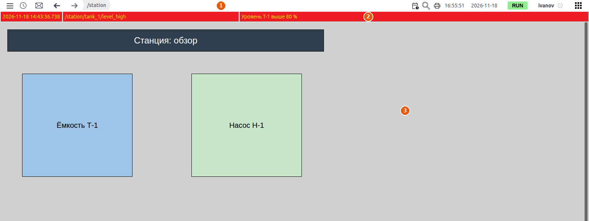
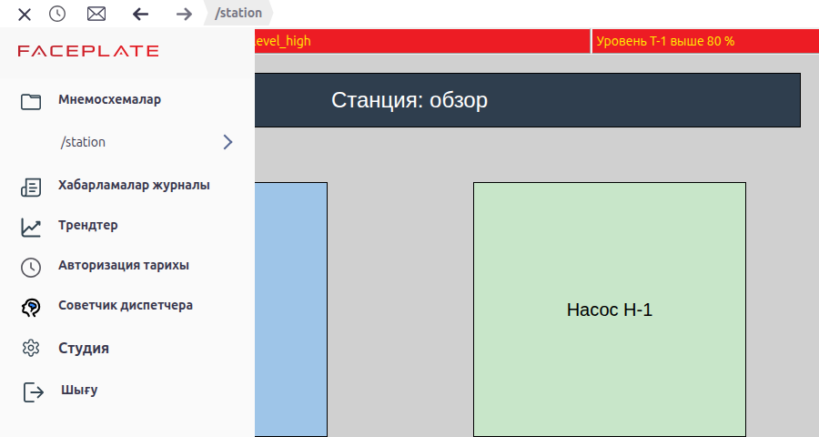
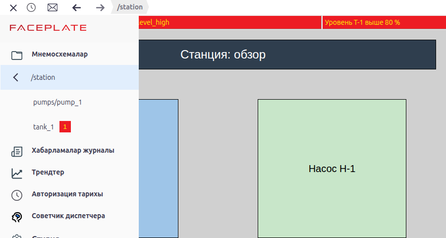
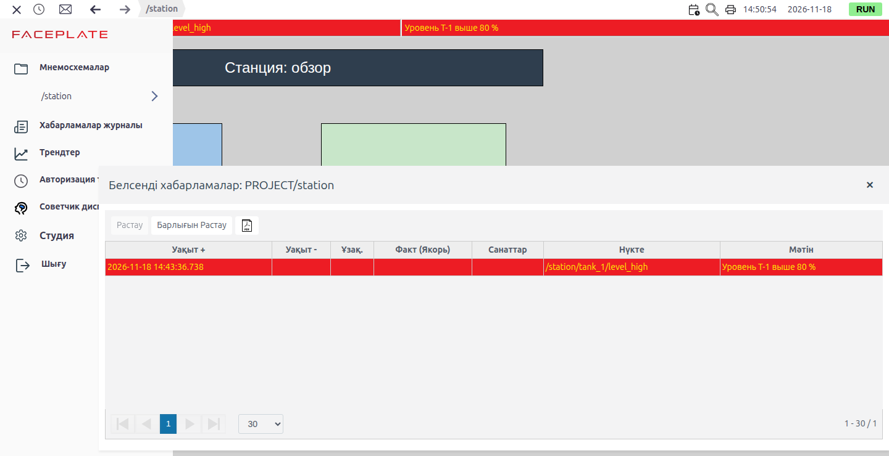
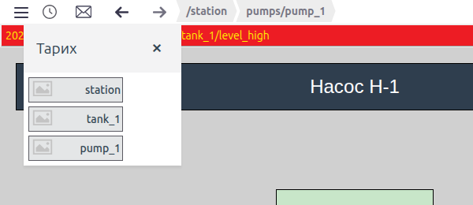
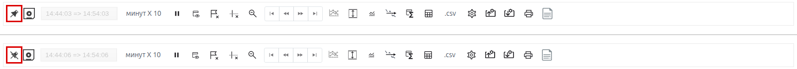

# Жұмыс үстелі және навигатор

Құжат жобаны оператордың жұмысына дайындайтын интегратор инженерге арналған: Runtime терезесі неден тұрады, Studio бумалар ағашы экрандар навигаторына қалай айналады, оператор онда нені көреді және Runtime оператордың қай жерде болғанын қалай есте сақтайды.

# Мазмұны

- [Терминдер сөздігі](#терминдер-сөздігі)
- [Кіріспе](#кіріспе)
- [Негізгі бөлім](#негізгі-бөлім)
    - [Runtime терезесі](#runtime-терезесі)
    - [Жоғарғы жол](#жоғарғы-жол)
    - [Бүйірлік мәзір](#бүйірлік-мәзір)
    - [Экрандар навигаторы](#экрандар-навигаторы)
    - [Навигатордағы дабыл индикаторы](#навигатордағы-дабыл-индикаторы)
    - [Ағымдағы экранның жолы](#ағымдағы-экранның-жолы)
    - [Артқа, алға және «Тарих»](#артқа-алға-және-тарих)
    - [Кіргеннен кейінгі соңғы экран](#кіргеннен-кейінгі-соңғы-экран)
    - [Ауысқанда және қайта кіргенде не сақталады](#ауысқанда-және-қайта-кіргенде-не-сақталады)
    - [Экран үстіндегі терезелер](#экран-үстіндегі-терезелер)
- [Қорытынды](#қорытынды)

# Терминдер сөздігі

| Термин | Мағынасы |
|---|---|
| Экран | Runtime жұмыс аймағында ашылған жоба бумасының `screen` сызбасы. Бір бума — бір экран |
| Жұмыс аймағы | Runtime терезесінің жоғарғы жол мен дабыл жолағының астындағы, таңдалған экран көрсетілетін бөлігі |
| Навигатор | Runtime бүйірлік мәзіріндегі жоба экрандарының тізімі, **Мнемосхемалар** тармағы. Studio бумалар ағашын қайталайды, бірақ тек экраны бар бумаларды |
| Дабыл жолағы | Runtime жоғарғы жолының астындағы жол: ең соңғы расталмаған хабарлама — уақыты, дабыл үлгісінің жолы, мәтіні. Жолақты шерту осы хабарламаны растайды |
| Ауысулар тарихы | Оператор ашқан экрандардың реттілігі. «Артқа» және «алға» батырмалары осы бойынша жұмыс істейді. Браузерге емес, тіркелгіге байланысты |
| Экранға бекітілген терезе | **Экранға бекіту** батырмасымен экранға байланыстырылған тренд терезесі. Экранмен бірге ашылады және оператор экраннан кеткенде жабылады |

«Сызба» және «Элемент» терминдері — [«Мнемосызбалар редакторы»](../mnemo/editor.md#терминдер-сөздігі) құжатында, «Бүркеншік ат», «Бекітілген экран», «Таңдаулы» — [«Экрандар және олардың арасында ауысу»](../mnemo/screens.md#терминдер-сөздігі) құжатында.

# Кіріспе

Оператор Runtime ортасында жұмыс істейді және интегратор Studio ортасында салған экрандар арасында ауысады. Навигаторға қандай экрандар кіретінін, олардың қалай аталатынын және қалай кірістірілетінін жеке баптау емес, жоба бумаларының құрылымы анықтайды: навигатор соның бойынша автоматты түрде құрылады. Сондықтан бумалардың орналасуын сызбаларды салмас бұрын ойластырған жөн.

Құжатта сипатталған:

- Runtime терезесі қандай бөліктерден тұрады және мәзірдің әр батырмасы нені ашады;
- Studio бумалар ағашы навигаторда қалай көрсетіледі және қандай бумалар онда көрінбейді;
- навигатордағы экранның жанындағы дабыл индикаторы;
- ағымдағы экранның жолы, «артқа», «алға» батырмалары, «Тарих» терезесі;
- кіргеннен кейін оператор қандай экранды көреді;
- экранмен бірге ашылатын тренд терезелері.

Экранға өлшемді, бүркеншік атты, белгішені қалай беру, оны «Таңдаулыға» қалай белгілеу, бекітілген экранды және ауысу батырмаларын қалай салу — [«Экрандар және олардың арасында ауысу»](../mnemo/screens.md) құжатында.

Құжат бойындағы мысал — «Станция: обзор» экраны бар `station` бумасы. Оның ішінде резервуар экраны, `tank` нысаны және `level_high` дабыл үлгісі (деңгей 80 %-дан жоғары) бар `tank_1` бумасы, сондай-ақ экраны жоқ `pumps` бумасы, ал оның ішінде сорғы экраны бар `pump_1` бумасы орналасқан.

Жобаны өзгерту құқығы бар тіркелгімен Studio ортасына (`http://<сервер>:9000/fp/studio`) кіру мүмкіндігі қажет. Нәтиже Runtime ортасында (`http://<сервер>:9000/fp/runtime`) тексеріледі.

# Негізгі бөлім

## Runtime терезесі



| № | Бөлік | Онда не бар |
|---|---|---|
| 1 | Жоғарғы жол | Мәзір және навигация батырмалары, ағымдағы экранның жолы, қарау режимдері, сервер уақыты, жоба күйі, тіркелгі |
| 2 | Дабыл жолағы | `error`, `alarm` немесе `warning` түріндегі ең соңғы расталмаған хабарлама: уақыты, үлгі жолы, мәтіні. Түсі — хабарлама түрі бойынша. Жолақты шерту (кеңес «Хабарламаны растау») көрсетілген хабарламаны сұраусыз растайды, және жолақ келесі расталмаған хабарламаға ауысады. Расталмаған хабарламалар жоқ болса, дабылдар әлі белсенді болса да, жолақ бос. Жолаққа тек тіркелгі растай алатын хабарламалар түседі: ол жазу құқығы бар бумаларда пайда болғандар |
| 3 | Жұмыс аймағы | Оператор таңдаған экран. Ауысқанда тек осы бөлік өзгереді |

Жобада бекітілген экран салынған болса, Runtime оны дабыл жолағы мен жұмыс аймағының арасында көрсетеді ([«Экрандар және олардың арасында ауысу», «Бекітілген экран» бөлімін](../mnemo/screens.md#бекітілген-экран) қараңыз).

## Жоғарғы жол


Солдан оңға қарай:

| Батырма (кеңес) | Не істейді | Толығырақ |
|---|---|---|
| **Мәзір** | Бүйірлік мәзірді ашады және жабады | [Бүйірлік мәзір](#бүйірлік-мәзір) |
| **Тарих** | Осы тіркелгімен ашылған экрандар тізімі бар терезе | [Артқа, алға және «Тарих»](#артқа-алға-және-тарих) |
| **Белсенді хабарламалар** | `error`, `alarm` және `warning` түріндегі расталмаған хабарламалар терезесі — белсенділері де, алынғандары да — растау мүмкіндігімен. Расталған хабарлама дабыл әлі белсенді болса да терезеден кетеді. Дабыл жолағы бос болғанша батырма қолжетімсіз | [Messages and alarms in Faceplate, «Operator actions» бөлімі](../../en/alarms/alarm/alarm.md#3-operator-actions) |
| **Артқа өту**, **Көшу алға** | Ауысулар тарихы бойынша бір қадам | [Артқа, алға және «Тарих»](#артқа-алға-және-тарих) |
| Жол | Ағымдағы экранның жолы; әр бөлігі — өз экранына сілтеме | [Ағымдағы экранның жолы](#ағымдағы-экранның-жолы) |
| Сағаты бар күнтізбе белгішесі | Ағымдағы экранда мұрағатты ойнату | [«Есептер және экранды басып шығару», «Сызбаның өткен күйі: мұрағатты ойнату» бөлімі](../mnemo/reports.md#сызбаның-өткен-күйі-мұрағатты-ойнату) |
| Лупа | Жұмыс аймағының масштабы | [«Есептер және экранды басып шығару», «Экранды басып шығару» бөлімі](../mnemo/reports.md#экранды-басып-шығару) |
| Принтер | Жұмыс аймағы мен дабыл жолағын басып шығару | [«Есептер және экранды басып шығару», «Экранды басып шығару» бөлімі](../mnemo/reports.md#экранды-басып-шығару) |
| **Таңдаулы** (ең оң жақта) | Studio ортасында бума **Таңдаулы** өрісімен белгіленген экрандар терезесі. Ондай экрандар жоқ болса — «Таңдаулы мнемосхемалар анықталмаған» хабарламасы | [«Экрандар және олардың арасында ауысу», «Runtime ортасындағы бума» бөлімі](../mnemo/screens.md#runtime-ортасындағы-бума-бүркеншік-ат-белгіше-таңдаулылар) |

Принтер мен **Таңдаулы** арасында — сервердің уақыты мен күні, жоба күйінің индикаторы және тіркелгі атауы ([«Күй жолы»](status.md#күй-жолы) қараңыз).

## Бүйірлік мәзір

**Мәзір** батырмасы сол жақтан панельді шығарады. Панель ашық тұрғанда батырма айқышты көрсетеді.



| Тармақ | Нені ашады |
|---|---|
| **Мнемосхемалар** | Тармақтың астындағы экрандар навигаторы ([Экрандар навигаторы](#экрандар-навигаторы) қараңыз). Мәзір ашылғанда навигатор бірден көрсетіледі; тармақты шерту оны жасырады, қайта шерту қайтадан көрсетеді |
| **Хабарламалар журналы** | «Хаттар мұрағаты» терезесі: сүзгілері және экспорты бар барлық хабарламалар ([Messages and alarms in Faceplate, «Archive and export» бөлімін](../../en/alarms/alarm/alarm.md#5-archive-and-export) қараңыз) |
| **Трендтер** | «Трендтерді таңдау» терезесі: мұрағаттар бойынша графиктер, тренд топтары, баптаулар файлдары ([Trends: viewing and exporting history](../../en/data_storage/archives/trends.md) қараңыз) |
| **Авторизация тарихы** | Осы тіркелгімен соңғы сәтті және соңғы сәтсіз кіру күні бар терезе |
| **Советчик диспетчера** | Дабылдар бойынша кеңесші терезесі. Тармақ серверде кеңесші модулі орнатылған жағдайда ғана болады ([Dispatcher Support in Faceplate](../../en/alarms/dsf/dsf.md) қараңыз) |
| **Студия** | Браузердің жаңа қойындысындағы Studio. Studio атауды және құпиясөзді сұрайды; кіру — өз құқықтарымен: Studio ортасына қолжетімі жоқ тіркелгіге бас тарту беті ашылады |
| **Шығу** | «Шығуыңызға сенімдісізбе?» растауынан кейін — сеансты аяқтау және кіру пішіні |

Панельдің төменгі жағында — түйін мен лицензия туралы мәліметтер, **Қараңғы тақырып** ауыстырғышы. Қараңғы тақырып жоғарғы жол мен бүйірлік мәзірдің түсін өзгертеді; сызба түстері мен жұмыс аймағының фоны сызбада беріледі және өзгермейді. Навигаторда экранды таңдағаннан кейін мәзір өзі жабылады.

## Экрандар навигаторы

### Studio ағашы навигаторға қалай айналады

Навигатор жоба бумаларының ағашын қайталайды, оны бөлек баптаудың қажеті жоқ. Studio ортасындағы түзету Runtime ортасында бетті қайта жүктемей көрінеді — мәзірді қайта ашу жеткілікті.

Ережелер:

| Studio ортасында | Навигаторда |
|---|---|
| Сақталған `screen` сызбасы бар бума | Навигатор тармағы. Атауды шерту экранды ашады |
| `screen` сызбасы жоқ бума | Өз тармағы жоқ. Оның атауы кірістірілген экранның атауына кіреді: `pumps/pump_1` |
| Экраны бар бума ішіндегі экран | Кірістірілген тармақ: ата-анада `>` көрсеткісі пайда болады |
| Жоғарғы деңгейдегі экрандар | Алдында қиғаш сызығы бар атау: `/station` |
| Жобаның түбірлік сызбасы (`PROJECT` бумасының өз `screen` сызбасы) | `/` тармағы |
| `@FIXED SCREEN AREA`, прототиптер бумасы | Навигаторға кірмейді |

Мысалда Studio ортасында экраны бар үш бума және экраны жоқ бір бума бар:

```text
PROJECT
└── station          «Станция: обзор» экраны
    ├── tank_1       резервуар экраны
    └── pumps        экраны жоқ
        └── pump_1   сорғы экраны
```

Навигатордың жоғарғы деңгейінде — көрсеткісі бар бір `/station` тармағы. Ішінде — `pumps/pump_1` және `tank_1`: `pumps` бумасы өз тармағын алған жоқ, оның атауы сорғы экраны атауының бөлігі болды.



Навигатордағы атаулар — бүркеншік аттар емес, жоба ағашындағы бума атаулары. Бумаларды оператор түсініктемесіз түсінетіндей атаңыз: бума өрісіндегі бүркеншік ат тек «Таңдаулы» және «Тарих» терезелерінде көрінеді.

### Навигатормен жұмыс

- Атауды шерту экранды жұмыс аймағында ашады және мәзірді жабады.
- Атаудың оң жағындағы `>` көрсеткісі — кірістірілген экрандар деңгейіне өту. Экранның өзі бұл кезде ашылмайды.
- Деңгейдің жоғарғы жолы — `<` көрсеткісі бар ата-ана экран: шерту бір деңгей жоғары қайтарады.
- Навигатор ағымдағы экран орналасқан деңгейде ашылады. Жоғарыдағы суретте `tank_1` ашық (`/station › tank_1` жолы), және мәзір бірден `/station` ішіндегісін көрсетеді.

Навигатор — оператор экранды таңдайтын үш орынның бірі. Қалған екеуі — «Таңдаулы» және «Тарих» терезелері: оларда экрандар буманың бүркеншік атымен және белгішесімен көрсетіледі және кірістірусіз бір тізімге жиналады. Навигатор жобаның барлық экрандарын және олардың иерархиясын көрсетеді, «Таңдаулы» — тек интегратор іріктегендерді, «Тарих» — оператор бұрын болғандарды.

## Навигатордағы дабыл индикаторы

Навигатордағы экран атауының жанында — индикатор: осы бумада және барлық кірістірілген бумаларда пайда болған хабарламалар саны. Оператор бірде-бір экранды ашпай-ақ себепті қай экраннан іздеу керегін көреді.

Мысалда `level_high` үлгісі `tank_1` бумасында жатыр. Деңгей 80 %-дан асқанда 1 саны бар индикатор `tank_1` жанында да, резервуар кірістірілген жоғарғы деңгейдегі `/station` жанында да пайда болды: `tank_1` жанындағысы — жоғарыдағы суретте, `/station` жанындағысы — төмендегі суретте.

Индикатор нені көрсетеді:

| Күйі | Көрінісі |
|---|---|
| Расталмаған хабарламалар бар | Жыпылықтайды |
| Барлық хабарламалар расталған, бірақ әлі белсенді | Үздіксіз жанады |
| Белсенді және расталмаған хабарламалар жоқ | Көрінбейді |

Сан — белсенді немесе расталмаған `error`, `alarm` және `warning` түріндегі барлық хабарламалар. Түсі — ең маңызды түр бойынша: `error` — сары саны бар қара, `alarm` — сарысы бар қызыл, `warning` — қарасы бар сары. Расталмаған хабарламалар бар кезде түс солар бойынша таңдалады.

`info` және `dsf` түріндегі хабарламаларды индикатор есепке алмайды: олар белсенді және расталмаған болса да, санға кірмейді және индикаторды жақпайды. Экранда мұндай хабарламаларды көру маңызды болса, үлгіге `warning` немесе одан жоғары түр беріңіз, ал `info` және `dsf` хабарламаларын оператор «Хабарламалар журналы» терезесінен табады.

Индикатор санын шерту «Белсенді хабарламалар: PROJECT/<бума>» терезесін ашады. Онда индикаторда саналған хабарламалар: осы бумадан және кірістірілгендерден. Экран бұл кезде ашылмайды, мәзір орнында қалады. Терезеде **Растау** (белгіленген хабарлама), **Барлығын Растау** батырмалары және PDF-ке экспорт бар — оператор учаскенің хабарламаларын оның экранын ашпай растайды ([Messages and alarms in Faceplate, «Operator actions» бөлімін](../../en/alarms/alarm/alarm.md#3-operator-actions) қараңыз).

Индикатор мен хабарламалар терезесі бумаға тек оқу құқығы бар тіркелгіге де көрінеді. Буманың хабарламаларын оған жазу құқығы бар тіркелгі раста алады.



Сан қай жерде жанатыны тек дабыл үлгісінің жоба ағашының қай бумасында жатқанына байланысты: сан осы бумада және одан жоғары барлық бумаларда пайда болады. Жабдық қай сызбада салынғанын индикатор есепке алмайды. Мысалда `level_high` үлгісі `station/tank_1` ішінде жатыр, сондықтан сан `tank_1` жанында жанады: оператор осы экранды ашады және дабыл қатысты Т-1 резервуарын бірден көреді. Егер үлгі басқа экранның бумасында жатса, сан сол экранның жанында жанар еді, және оператор резервуарды басқа жерден іздер еді.

Сондықтан дабыл үлгісін — Studio жоба ағашындағы `alarm_template` түріндегі нысанды ([Messages and alarms in Faceplate, «A template and an individual message»](../../en/alarms/alarm/alarm.md#a-template-and-an-individual-message) және [«Create an initial working configuration»](../../en/alarms/alarm/alarm.md#create-an-initial-working-configuration) бөлімдерін қараңыз) — осы жабдық салынған экранның бумасында (`<экран бумасы>/<үлгі>`) немесе оның ішіне кірістірілген бумада жасаңыз.

## Ағымдағы экранның жолы

Жоғарғы жолда көрсеткілерден кейін — ашық экранның жолы, навигатордағыдай бөліктерге бөлінген: `/station` › `pumps/pump_1`. Әр бөлігі — сілтеме: `/station` шерту станция шолуын ашады. Осылайша оператор мәзірді ашпай бір деңгей жоғары көтеріледі.

Жол бөлігі бойынша ауысу навигатордан ауысу сияқты ауысулар тарихына қосылады.

## Артқа, алға және «Тарих»

Әр ауысу — навигатордан, «Таңдаулыдан», «Тарихтан», жол бөлігі бойынша немесе сызбадағы ауысу батырмасымен — экранды ауысулар тарихына қосады. **Артқа өту** және **Көшу алға** ол бойынша браузер батырмалары сияқты қадам жасайды. Қадам жасайтын жер болмаса, батырма қолжетімсіз. Артқа қайтып басқа экранды ашса, осы жерден «алға» қадамдары жоғалады. Ауысулар тарихы соңғы 100 экранды сақтайды: **Артқа өту** 99 қадамнан әрі қайтармайды.

Ауысулар тарихы браузерге емес, тіркелгіге байланысты. Қайта кіргеннен кейін, оның ішінде басқа браузерде, **Артқа өту** батырмасы өткен сеанстың экрандары бойынша жүреді.

«Тарих» терезесі (сағаты бар батырма) ауысулар тарихындағы экрандарды тізіммен көрсетеді: әр экран бір рет, буманың белгішесімен және бүркеншік атымен. Шерту экранды ашады және терезені жабады.



Мысалда бумалардың бүркеншік аттары жоқ, сондықтан терезеде `station`, `tank_1`, `pump_1` бума атаулары, ал белгішелер берілмеген.

## Кіргеннен кейінгі соңғы экран

Runtime тіркелгіде соңғы ашылған экранды есте сақтайды және кіргеннен кейін оны ашады. Браузерді сорғы экранында жапқан оператор кіргеннен кейін қайтадан сорғы экранын көреді.

Әлі бірде-бір экранды ашпаған тіркелгіде кіргеннен кейін жұмыс аймағы бос: оператор экранды навигатордан немесе «Таңдаулыдан» таңдайды. Бастапқы экранның жеке баптауы жоқ: кіргеннен кейін оператор өткен сеансты аяқтаған экран ашылады. Жаңа оператор негізгі экрандарды бірден табуы үшін оларды «Таңдаулыға» белгілеңіз.

## Ауысқанда және қайта кіргенде не сақталады

| | Басқа экранға ауысу | Навигаторда ашық экранды қайта таңдау | Бетті жаңарту (F5) | Шығу және жаңадан кіру |
|---|---|---|---|---|
| Жұмыс аймағындағы экран | Таңдалғаны | Сол экран, қайтадан жүктеледі | Сол экран | Сол экран |
| Ауысулар тарихы | Толықтырылады | Сақталады | Сақталады | Сақталады |
| Масштаб | 100 % | 100 % | 100 % | 100 % |
| Қараңғы тақырып | Қалады | Қалады | Өшіріледі | Өшіріледі |

Бетті жаңартқаннан кейін Runtime атауды және құпиясөзді сұрайды. Сызбаға қайтқанда онымен не болатыны — [«Экрандар және олардың арасында ауысу», «Сызбаға қайту» бөлімінде](../mnemo/screens.md#сызбаға-қайту).

## Экран үстіндегі терезелер

Runtime терезелері жұмыс аймағының үстінде ашылады және оны бұғаттамайды: олардың астындағы экран жаңара береді, ал навигатор экрандарды ауыстырады.

| Терезе | Қалай ашу | Ашылғандағы өлшемі |
|---|---|---|
| «Белсенді хабарламалар» | Жоғарғы жолдағы **Белсенді хабарламалар** батырмасы (конверт) | Экранның ортасындағы терезе, оның айналасындағы сызба көрінеді |
| «Хаттар мұрағаты» | **Мәзір** → **Хабарламалар журналы** | Бүкіл экран |
| «Трендтерді таңдау» | **Мәзір** → **Трендтер** | Бүкіл экран |
| Тренд терезесі | «Трендтерді таңдау» терезесіндегі **OK** батырмасы | Бүкіл экран |

Бүкіл экранға ашылған терезенің тақырыбының оң жақ бұрышында жазуы жоқ екі батырма бар: ❐ (бір-біріне қабаттасқан екі шаршы) және × (жабу). ❐ батырмасы терезені қалыпты өлшемге ауыстырады: «Хаттар мұрағаты» оң жақ төменгі бұрышқа, «Трендтерді таңдау» экранның ортасына орналасады, және олардың жанындағы сызба қайтадан көрінеді. Қалыпты өлшемде тақырыпта ❐ орнына □ батырмасы болады — ол терезені қайтадан бүкіл экранға жаяды. «Трендтерді таңдау» терезесінде және тренд терезесінде қалыпты өлшемде тағы «_» батырмасы бар — ол терезені тақырыпқа дейін жиырады: «Трендтерді таңдау» терезесінің тақырыбы бұрынғы орнында қалады, тренд терезесі Runtime терезесінің сол жақ жоғарғы бұрышына тақташа болып кетеді. Жиырылған тақырыптағы ❐ батырмасы терезені қайтарады.

Тренд терезесін экранға бекітуге болады ([Trends: viewing and exporting history, «Pinning a chart to a process screen» бөлімін](../../en/data_storage/archives/trends.md#pinning-a-chart-to-a-process-screen) қараңыз). **Экранға бекіту** батырмасы — тренд терезесі панеліндегі сол жақтан бірінші, кеңсе түйреуіші түріндегі белгіше-батырма; жазуы тек қалқымалы кеңесте көрінеді. Қажетті экранда тұрып, трендті **Мәзір** → **Трендтер** арқылы ашыңыз және оны басыңыз. Бекітілген терезеде батырма бөлектелген, ал белгіше сызылған: енді бұл — **Открепить**.



Экранға бекітілген терезе:

| Оқиға | Тереземен не болады |
|---|---|
| Оператор экраннан кетеді | Жабылады |
| Оператор терезені айқышпен жабады | Жабылады, бірақ бекіту сақталады |
| Оператор экранға қайтады, бетті жаңартады (F5) немесе онда қайта кіреді | Сол сериялармен қайтадан ашылады, тіпті алдында айқышпен жабылса да |
| Басқа пайдаланушы осы экранды ашады | Пайда болмайды: бекіту тек оны жасаған тіркелгі үшін әрекет етеді |

Интегратор сызбада тренд қарастырмаған жағдайда бекіту операторға кірістірілген трендті алмастырады: оператор қажетті графиктерді өзі жинап, оларды экранға байланыстырады. Кірістірілген трендті (сызбадағы **Трендтер** элементі, [«Экрандағы дабылдар мен трендтер»](../mnemo/alarms_trends.md) қараңыз) интегратор барлық пайдаланушыларға бірден қояды.

Тренд панеліндегі **Открепить** бекітуді алып тастайды.

# Қорытынды

| Міндет | Қалай жасау керек |
|---|---|
| Экранды навигаторда көрсету | Буманың `screen` сызбасын сақтау |
| Экрандарды кірістірілген ету | Экраны бар бумаларды бірін-біріне кірістіру |
| Экрандарды артық деңгейсіз топтау | Экраны жоқ аралық бума: оның атауы экран атауының бөлігі болады |
| Навигаторда операторға түсінікті атаулар беру | Түсінікті бума атаулары; бүркеншік аттар тек «Таңдаулы» және «Тарих» ішінде көрінеді |
| Дабыл қай экранда екенін көрсету | `error`, `alarm` немесе `warning` түріндегі дабыл үлгілері — осы экранның бумасында немесе кірістірілген бумада |
| Жаңа операторға негізгі экрандарды табуға көмектесу | Оларды «Таңдаулыға» белгілеу: бастапқы экран жоқ, кіргеннен кейін тіркелгінің соңғы экраны ашылады |
| Операторға экранда өз графиктерін беру | Тренд терезесі → **Экранға бекіту** |

Жұмыс реті:

1. Жоба бумаларын оператор экрандарды навигаторда көруге тиіс етіп орналастырыңыз. Өз экраны жоқ топтарды `screen` сызбасы жоқ бумалар етіп жасаңыз.
2. Қажетті бумалардың `screen` сызбаларын сақтаңыз.
3. `error`, `alarm` және `warning` түріндегі дабыл үлгілерін оператор осы дабылдарды талдайтын экрандардың бумаларына салыңыз.
4. Негізгі экрандарды «Таңдаулыға» белгілеңіз және оларға бүркеншік аттар беріңіз ([«Экрандар және олардың арасында ауысу»](../mnemo/screens.md) қараңыз).
5. Оператордың тіркелгісімен кіріп, навигаторды, дабыл индикаторын, дабыл жолағын және «артқа», «алға» батырмаларын тексеріңіз.
