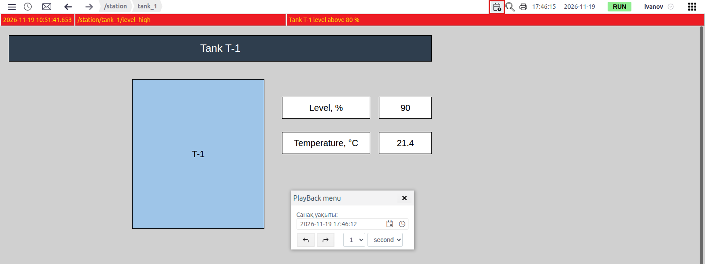
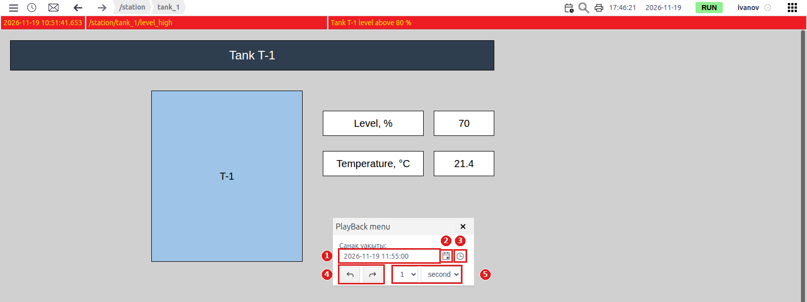

# Мұрағатты ойнату

Құжат Runtime ортасында экранды өткен сәттің мәндерімен қалай қарау керектігі туралы: ойнату режимін ашу, сәтті таңдау, уақыт бойынша қадаммен жылжу және экрандағы өткен мәндерді ағымдағы мәндерден ажырату.

# Мазмұны

- [Терминдер сөздігі](#терминдер-сөздігі)
- [Кіріспе](#кіріспе)
- [Негізгі бөлім](#негізгі-бөлім)
    - [Режимді ашу және жабу](#режимді-ашу-және-жабу)
    - [«PlayBack menu» терезесі](#playback-menu-терезесі)
    - [Экран не көрсетеді](#экран-не-көрсетеді)
    - [Ойнату режиміндегі басқа экран](#ойнату-режиміндегі-басқа-экран)
    - [Режимдегі басқару және басып шығару](#режимдегі-басқару-және-басып-шығару)
    - [Мысал: 11:55 кезіндегі резервуар деңгейі](#мысал-1155-кезіндегі-резервуар-деңгейі)
- [Қорытынды](#қорытынды)

# Терминдер сөздігі

| Термин | Мағынасы |
|---|---|
| Мұрағатты ойнату | Экран таңдалған өткен сәттегі мұрағат мәндерін көрсететін Runtime режимі. Жоғарғы жолдағы сағаты бар күнтізбе белгішесімен қосылады |
| Сәт | «PlayBack menu» терезесінің **Санақ уақыты** өрісіндегі күн мен уақыт: экран мәндерді осы сәтке көрсетеді |
| Қадам | Терезенің «артқа» және «алға» батырмалары сәтті қаншаға жылжытады: сан және бірлік (`second`, `minute`, `hour`) |
| Мұрағаты бар өріс | Мәндерін жобаның мұрағаты жазатын нысан өрісі: мұрағаттың көзі — осы өріс. Өткен мәндер тек осындай өрістерде болады |

«Экран», «Жұмыс аймағы», «Навигатор» терминдері — [«Жұмыс үстелі және навигатор»](desktop.md#терминдер-сөздігі) құжатында, «Бекітілген экран» — [«Экрандар және олардың арасында ауысу»](../mnemo/screens.md#терминдер-сөздігі) құжатында.

# Кіріспе

Оқиғаны талдау үшін — қорғаныс іске қосылды, дабыл келді, оператор ауысымды қабылдайды — экранда бұрын не болғанын білу керек: деңгей қандай болды, ауытқу қашан басталды. Ойнату режимі сол экранды таңдалған сәттегі мұрағат мәндерімен көрсетеді. Бұл үшін жеке экран қажет емес: режим кез келген экранда қосылады.

Құжатта сипатталған:

- режимді қалай ашу және жабу;
- сәтті қалай таңдау және уақыт бойынша қадаммен жылжу;
- экрандағы қай мәндер өткен, қайсысы емес;
- басқа экранға ауысқанда не болады;
- режимде не жұмыс істемейді және басып шығару не береді.

Құжат бойындағы мысал — `station/tank_1` резервуар экраны: деңгейді мұрағат жазады, температураны — жоқ. Деңгей мұрағатында жазбалар бар: 11:40 — 62 %, 11:50 — 70 %, 12:00 — 78 %. Қазір деңгей 90 %, температура 21.4 °C.

Runtime ортасына (`http://<сервер>:9000/fp/runtime`) кіру мүмкіндігі қажет. Өткен мәндер тек мұрағат жазатын өрістерде болады ([Archives: configuring sources and recording data](../../en/data_storage/archives/archives.md) құжатын қараңыз).

# Негізгі бөлім

## Режимді ашу және жабу

Экранды ашып, жоғарғы жолда лупадан сол жақтағы сағаты бар күнтізбе белгішесін басыңыз. Экранның үстінде «PlayBack menu» терезесі ашылады.

Сәт таңдалмайынша экран ағымдағы мәндерді көрсетеді, ал **Санақ уақыты** өрісінде терезе ашылған уақыт тұрады. Терезе қажетті мәндерді жаппауы үшін оны тақырыбынан сүйреп жылжытуға болады.

Режимнен шығу үшін терезе тақырыбындағы × басыңыз. Runtime режим ашылған экранды ағымдағы мәндерімен қайтарады. Бетті жаңарту (F5) да режимді өшіреді; одан кейін Runtime пайдаланушы аты мен құпиясөзді сұрайды. Runtime кластердің басқа түйініне ауысқанда да ([«Кластер түйіндері»](../administration/nodes/nodes.md#runtime-үшін-түйін-мекенжайы) қараңыз) режим өшеді: Runtime сол экранды ағымдағы мәндерімен ашады.

Терезе ашылғанда және режимнен шыққанда экран қайта жүктеледі.

## «PlayBack menu» терезесі

| № | Элемент | Мақсаты |
|---|---|---|
| 1 | **Санақ уақыты** өрісі | `жжжж-АА-кк СС:мм:сс` түріндегі сәт. Бөлігін (жыл, ай, күн, сағат, минут, секунд) шертіп, оны теріңіз. Терілген сәт Enter, Tab басқанда немесе өрістен тыс шерткенде қолданылады |
| 2 | Күнтізбе белгішесі | Күнді таңдау. Таңдалған күн бірден қолданылады, өрістегі уақыт өзгермейді. Күнтізбе бүгіннен кейінгі күндерді ұсынбайды |
| 3 | Сағат белгішесі | Бір минут қадаммен уақыт тізімі. Таңдалған уақыт бірден қолданылады |
| 4 | «Артқа» және «алға» батырмалары | Сәтті бір қадам ертерек немесе кейінірек жылжытады |
| 5 | Қадам | Сан (1, 5, 10, 15, 30, 60) және бірлік: `second`, `minute`, `hour`. Терезе ашылғанда — 1 `second`. Қадамды өзгерту сәтті жылжытпайды |

Сәт тек қолмен өзгереді — өріспен, күнтізбемен, уақыт тізімімен немесе «артқа» және «алға» батырмаларымен; ол өздігінен жылжымайды. Күнтізбе мен уақыт тізімі мұрағаттың қашан жазба жасағанын көрсетпейді: жазбасы жоқ сәтті де таңдауға болады.

Өрістегі уақыт, жоғарғы жолдағы және дабыл жолағындағы уақыт сияқты, Runtime ашылған компьютердің уақыт белдеуінде көрсетіледі.

Ойнату мұрағат жазып қойған мәндерді көрсетеді, сондықтан сәт ағымдағы уақыттан кейін бола алмайды.

## Экран не көрсетеді

Экран қазіргі түрінде көрсетіледі: егер оны өзгерткен болса, өткен мәндер қазіргі элементтерге қойылады. Сәт таңдалғаннан кейін бір экранда өткен мәндер де, ағымдағы мәндер де болады. Ереже элементтің түріне де, нысанның түріне де емес, элементтің деректерді қайдан алатынына байланысты:

| Экрандағы элемент | Не көрсетеді |
|---|---|
| Мұрағаты бар өріске байланыстырылған (тіктөртбұрыш, шкала, енгізу өрісі және нысан өрісіне байланыстырылған кез келген басқа элемент) | Таңдалған сәттен кеш емес мұрағат жазған соңғы мән. Жазбалар арасында мән келесі жазбаға дейін сақталады, соңғы жазбадан кейін — соңғы мән |
| Мұрағаты бар өріске байланыстырылған, сәт мұрағаттың бірінші жазбасынан ерте | Мән жоқ |
| Мұрағаты бар өріске байланыстырылған, мұрағат тоқтаған (мысалы, сервер тоқтаған уақытта) | Мән жоқ — тоқтау алдындағы соңғы жазбадан іске қосылғаннан кейінгі бірінші жазбаға дейін. Мұрағат мәнді ол өзгергенде жазады, сондықтан соңғы жазба тоқтаудан әлдеқайда бұрын болуы мүмкін |
| Мұрағаты жоқ өріске байланыстырылған | Өріс режимде экранда алғаш пайда болған кездегі мәні. Терезе жабылғанша өзгермейді: сәт өзгергенде де, өріс жобада өзгергенде де |
| Тренд, кезең бойынша мәндер кестесі | Режимнен тыс кездегідей өз кезеңі: таңдалған сәтке ауыспайды |
| Хаттар тізімі, хабар көрсеткіші | Ағымдағы хабарламалар, оның ішінде таңдалған сәттен кейін пайда болғандары |
| Нысандардың ағымдағы мәндер кестесі | Ағымдағы мәндер |
| Жұмыс аймағының үстіндегі бекітілген экран | Ағымдағы мәндер |

Жоғарғы жолдың астындағы дабыл жолағы да ағымдағы хабарламаларды көрсетеді.

Мұрағат скриптте оқитын өріс мұрағаты бар өріс болып саналмайды: мұндай мұрағат өрістің мәнін емес, скрипттің нәтижесін жазады. Скрипттің таңдалған сәттегі нәтижесін мұрағаттың өзіне байланыстырылған элемент көрсетеді.

Мұрағат өріс мәндерін сан түрінде жазады. Сондықтан сандық және логикалық өрістер режимде режимнен тыс кездегідей көрінеді, ал саны бар жолдық өріс сол санды көрсетеді. Мәтіні бар жолдық өрісте мән жоқ: мұрағат мәтінді жазбайды. Егер жолдық өрісте біраз уақыт сан орнына мәтін болса, сол аралықтағы сәттерде де мән жоқ.

Мұрағаты бар өріс өткен мәндерді тек тіркелгі сол мұрағатты оқи алса ғана көрсетеді. Әйтпесе өріс мұрағаты жоқ өріс сияқты болады.

Таңдалған сәтке тек мұрағаты бар өрістердің мәндері жатады, экрандағы басқа мәндер — жатпайды.

## Ойнату режиміндегі басқа экран

«PlayBack menu» терезесі басқа экранға ауысқанда ашық қалады — навигатордан, жолдың бөлігі бойынша немесе жоғарғы жолдың «артқа» және «алға» батырмаларымен ([«Жұмыс үстелі және навигатор»](desktop.md#экрандар-навигаторы) қараңыз). Жаңа экран сол сәттегі мәндерді көрсетеді, терезе батырмалары онда да сәтті жылжытады. Осылайша қондырғының бірнеше бөлігін бір сәтте қарауға болады.

Терезенің айқышы режим ашылған экранды ағымдағы мәндерімен қайтарады.

## Режимдегі басқару және басып шығару

Режим тек қарауға арналған: экрандағы батырмалар мен енгізу өрістері әдеттегідей көрінеді, бірақ жобаға мән жазбайды. Жабдықты басқару терезе жабылғаннан кейін жұмыс істейді.

Режим тек осы Runtime көрсететінді өзгертеді: жоба жұмысын жалғастырады, мұрағаттар ағымдағы мәндерді жазады, дабылдар әдеттегідей пайда болады.

Режимде басып шығару (жоғарғы жолдағы принтер белгішесі) таңдалған сәттегі экранды береді. «PlayBack menu» терезесі параққа түспейді. Басып шығару толығырақ — [«Есептер және экранды басып шығару», «Экранды басып шығару» бөлімі](../mnemo/reports.md#экранды-басып-шығару).

## Мысал: 11:55 кезіндегі резервуар деңгейі

1. `tank_1` экранын ашыңыз (**Мәзір** → **Мнемосхемалар** → `/station` → `tank_1`). Деңгей 90 %, температура 21.4 °C.
2. Сағаты бар күнтізбе белгішесін басыңыз. «PlayBack menu» терезесі ашылады, экран әзірге сол 90 және 21.4 мәндерін көрсетеді ([«Режимді ашу және жабу»](#режимді-ашу-және-жабу) бөліміндегі сурет).
3. **Санақ уақыты** өрісінде `2026-11-19 11:55:00` теріп, Enter басыңыз. Деңгей — 70: бұл 11:50 мұрағат жазбасы, келесісі 12:00-де. Температура 21.4 болып қалды: оның мұрағаты жоқ, бұл терезе ашылған кездегі мәні ([«PlayBack menu» терезесі](#playback-menu-терезесі) бөліміндегі сурет).
4. **5** қадамын және `minute` таңдап, «алға» басыңыз. Сәт — 12:00:00, деңгей — 78, 12:00 жазбасы.

5. Терезе тақырыбындағы × басыңыз. Экран қайтадан ағымдағы мәндерді көрсетеді: 90 және 21.4.

# Қорытынды

| Міндет | Қалай орындау керек |
|---|---|
| Экранды өткен сәтте көру | Сағаты бар күнтізбе белгішесі → **Санақ уақыты** өрісіндегі сәт → Enter |
| Мәннің қалай өзгергенін бақылау | Қадамды таңдап, «артқа» немесе «алға» басу |
| Қай мәндер өткен екенін түсіну | Өткен мәндер — тек мұрағаты бар өрістерде; мұрағаты жоқ өріс терезе жабылғанша экранда алғаш пайда болған кездегі мәнін көрсетеді |
| Басқа экранды сол сәтте қарау | Терезені жаппай, оған ауысу |
| Ағымдағы мәндерге оралу | Терезе тақырыбындағы × |
| Экранды өткен сәтте басып шығару | Ойнату режимінде принтер белгішесі |
