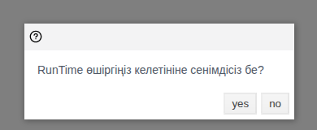
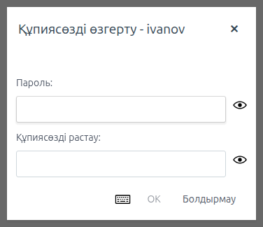
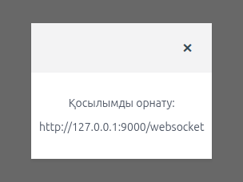

# Күй жолы және байланыс

Құжат операторлардың жұмыс орындарын тапсыратын интегратор инженерге арналған: Runtime жоғарғы жолының оң жақ бөлігі нені көрсетеді, RUN/STOP жоба күйі Studio батырмаларымен қалай байланысты және сервермен байланыс үзіліп, қалпына келгенде оператор нені көреді.

# Мазмұны

- [Терминдер сөздігі](#терминдер-сөздігі)
- [Кіріспе](#кіріспе)
- [Негізгі бөлім](#негізгі-бөлім)
    - [Күй жолы](#күй-жолы)
    - [Жоба күйі: RUN және STOP](#жоба-күйі-run-және-stop)
    - [Тіркелгі және құпиясөзді өзгерту](#тіркелгі-және-құпиясөзді-өзгерту)
    - [Runtime мәзіріндегі түйін](#runtime-мәзіріндегі-түйін)
    - [Сервермен байланыстың үзілуі](#сервермен-байланыстың-үзілуі)
    - [Басқа түйінге ауысу](#басқа-түйінге-ауысу)
    - [Байланыс үзілгенде Studio](#байланыс-үзілгенде-studio)
- [Қорытынды](#қорытынды)

# Терминдер сөздігі

| Термин | Мағынасы |
|---|---|
| Күй жолы | Runtime жоғарғы жолының оң жақ бөлігі: сервердің уақыты мен күні, жоба күйінің индикаторы, тіркелгі атауы |
| Жоба күйі | Жоба нысандары жұмыс істей ме: скрипттер, есептеулер, қосылымдар, мұрағаттар, дабыл үлгілері. `RUN` — жұмыс істейді, `STOP` — тоқтатылған. Studio ортасында **Runtime Іске Қосу** және **Runtime Тоқтату** батырмаларымен ауыстырылады |
| Түйін | `fp@<хост>` түріндегі атауы бар бір FACEPLATE сервері, [«Кластер түйіндері»](../administration/nodes/nodes.md) қараңыз |
| Қайта қосылу | Байланыс үзілгеннен кейін Runtime сервермен байланысуға қайта-қайта әрекет етуі. Оператордың қатысуынсыз жүреді |

Жоғарғы жол мен мәзірдің қалған бөліктері [«Жұмыс үстелі және навигатор»](desktop.md#жоғарғы-жол) құжатында сипатталған.

# Кіріспе

Оператор экрандарға қарайды және серверді көрмейді. Күй жолы — Runtime сервер мен жобада бәрі дұрыс екенін көрсететін жалғыз орын: сағат жүріп тұр, индикатор жасыл. Сағат тұрып қалса немесе индикатор қызыл болса, сызба әдеттегідей көрінсе де, экрандағы деректер жаңармайды.

Құжат мына сұрақтарға жауап береді:

- күй жолының әр элементі нені білдіреді;
- жобаны қалай тоқтатып, іске қосуға болады және бұл Runtime ортасында қалай көрінеді;
- оператор өз құпиясөзін қалай өзгертеді;
- бір серверде және кластерде байланыс үзілгенде не болады және бұл үшін нені баптау керек.

Жобаны өзгерту құқығы бар тіркелгімен Studio ортасына (`http://<сервер>:9000/fp/studio`) кіру мүмкіндігі қажет. Нәтиже Runtime ортасында (`http://<сервер>:9000/fp/runtime`) тексеріледі.

# Негізгі бөлім

## Күй жолы

| Элемент | Нені көрсетеді |
|---|---|
| Уақыт, күн | Оператор компьютерінің уақыт белдеуіне қайта есептелген сервер уақыты. Сервермен байланыс бар кезде әр секунд сайын жаңарады. Кеңестер **Ағымдағы уақыт**, **Ағымдағы күн** |
| `RUN` / `STOP` | Жоба күйі: жасыл `RUN` — жоба нысандары жұмыс істейді, қызыл `STOP` — тоқтатылған. [Жоба күйі](#жоба-күйі-run-және-stop) қараңыз |
| Тіркелгі атауы | Кім ретінде кіру орындалған. Шерту құпиясөзді өзгерту терезесін ашады (кеңес **Құпиясөзді өзгерту**), [Тіркелгі және құпиясөзді өзгерту](#тіркелгі-және-құпиясөзді-өзгерту) қараңыз |

Сағат уақытты оператордың компьютерінен емес, серверден алады. Сондықтан ол бойынша сервер сағатының ауытқуы да, байланыстың үзілуі де көрінеді: үзілгенде сағат соңғы алынған мәнде тоқтайды. Сервердің уақыт белдеуі сағатқа әсер етпейді: тек сервер сағатындағы уақыт маңызды.

## Жоба күйі: RUN және STOP

Жоба Studio ортасында тұтастай іске қосылады және тоқтатылады: **Жалпы құрылым**, жобаның түбірі, құралдар панеліндегі батырма. Батырма біреу және жазуын өзгертеді: жұмыс істеп тұрған жобада — **Runtime Тоқтату**, тоқтатылғанда — **Runtime Іске Қосу**. Әрекет алдында Studio «RunTime өшіргіңіз келетініне сенімдісіз бе?» (немесе «RunTime қосқыңыз келетініне сенімдісіз бе?») растауын сұрайды, әрекет **yes** басылғаннан кейін орындалады.

Барлық ашық Runtime терезелеріндегі индикатор 1–2 секунд ішінде өзгереді, Runtime ортасын қайта жүктеудің қажеті жоқ.

| | `RUN` | `STOP` |
|---|---|---|
| Жоба нысандары (скрипттер, есептеулер, қосылымдар, мұрағаттар, дабыл үлгілері) | Кластер түйіндерінде жұмыс істейді | Тоқтатылған, Studio ортасында **State** `Stop` |
| Экрандардағы мәндер | Түскен сайын жаңарады | Жаңармайды: жаңа деректер жоқ |
| Runtime және Studio | Ашылады және жұмыс істейді | Ашылады және жұмыс істейді |

Жаңа жоба тоқтатылған күйде жасалады: FACEPLATE орнатылғаннан кейін Studio ортасында **Runtime Іске Қосу** басылмағанша индикатор `STOP` көрсетеді. Бұл — жаңа серверде экрандарды тексерер алдында бірінші істеу керек нәрсе.

Жобаның бір бөлігін де — кірістірілгендерімен бірге бір буманы — тоқтатуға болады: бума пішініндегі **Runtime** ауыстырғышы ([«Кластер түйіндері», «Нысандар қай жерде орындалады» бөлімін](../administration/nodes/nodes.md#нысандар-қай-жерде-орындалады) қараңыз). Күй жолындағы индикатор тек тұтас жобаға қатысты: жеке буманы тоқтату оны өзгертпейді.

## Тіркелгі және құпиясөзді өзгерту

Тіркелгі атауын шерту **Құпиясөзді өзгерту - <тіркелгі>** терезесін ашады. Өз құпиясөзін Runtime ортасының кез келген пайдаланушысы, оның ішінде Studio ортасына қолжетімі жоқ оператор өзгерте алады.

Жаңа құпиясөзді екі өріске де енгізіп, **OK** басыңыз (оған дейін батырма қолжетімсіз). Өрістің оң жағындағы көз белгісі енгізілген таңбаларды көрсетеді, пернетақтасы бар батырма сенсорлық панельдерге арналған экрандық пернетақтаны ашады.

Құпиясөз Studio пайдаланушы карточкасындағы талаптарға сай болуы керек ([«Пайдаланушылар», «Пароль» бөлімін](../access/users.md#пароль) қараңыз). Өрістердегі құпиясөздер әртүрлі болса немесе талаптарға сай келмесе, Runtime хабарлама көрсетеді, терезе ашық қалады және құпиясөз өзгермейді. Өзгерткеннен кейін — құпиясөздің сәтті өзгергені туралы хабарлама. Ағымдағы сеанс жалғасады, жаңа құпиясөз келесі кіру кезінде және байланыс үзілгеннен кейін қажет ([Сервермен байланыстың үзілуі](#сервермен-байланыстың-үзілуі) қараңыз).

## Runtime мәзіріндегі түйін

Бүйірлік мәзірдің төменгі жағындағы `server` жолы Runtime қосылған түйінді көрсетеді, мысалы `fp@server1.fp`. [Басқа түйінге ауысқаннан](#басқа-түйінге-ауысу) кейін мұнда жаңа түйіннің атауы пайда болады. `master license` жолы — осы түйіннің лицензиясы, [«Лицензиялау», «Лицензия қай жерде көрінеді» бөлімін](../administration/license/license.md#лицензия-қай-жерде-көрінеді) қараңыз.

## Сервермен байланыстың үзілуі

Runtime түйінмен тұрақты қосылымды ұстап тұрады. Түйін тоқтатылса, қайта жүктелсе немесе оған дейінгі желі қолжетімсіз болса, Runtime:

1. Экранды күңгірттеп, қосылатын мекенжайы бар **Қосылымды орнату** терезесін көрсетеді.
2. Сервер жауап бергенше әрекетті шамамен секундына бір рет қайталайды. Операторға ештеңе істеудің қажеті жоқ.

Терезе экранда тұрғанда күй жолы жаңармайды: сағат тұрады, индикатор соңғы алынған күйді көрсетеді. Терезенің астындағы экрандағы мәндер — үзілгенге дейін соңғы алынғандары.

Сервер қайта жауап бергенде терезе жабылады, Runtime сол тіркелгімен өзі кіреді, жұмыс үстелін қайта құрады және үзілгенге дейін ашық болған экранды ашады. Құпиясөзді енгізудің қажеті жоқ. Сағат қайта жүреді.

Runtime оператор сеанс басында кірген сол атаумен және құпиясөзбен қайта кіреді. Байланыстың қанша уақыт үзілгені маңызды емес. Егер сеанс кезінде тіркелгі құпиясөзі өзгертілсе — оператордың өзі құпиясөзді өзгерту терезесінде немесе әкімші Studio ортасында — немесе тіркелгі жойылса, байланыс қалпына келгеннен кейін Runtime кіре алмайды: **ERROR!** «Пайдаланушы аты немесе құпия сөз дұрыс емес» терезесі пайда болады, навигатор мен экрандар бос қалады. Бетті жаңартыңыз (F5) және жаңа құпиясөзбен кіріңіз.

## Басқа түйінге ауысу

Кластерде байланыс үзілгенде Runtime тек өз түйінін ғана емес, жұмыс істеп тұрған барлық түйіндердің мекенжайларын кезекпен тексереді. Мекенжайлар тізімін Runtime қосылған кезде серверден алады және минутына бір рет жаңартады. Бірінші жауап берген түйінмен Runtime оның мекенжайынан Runtime бетін жүктейді, сол тіркелгімен кіреді және сол экранды ашады. Мәзірдегі `server` жолы жаңа түйінді көрсетеді. Екі түйінді тексеру кластерінде бірінші түйін тоқтатылғаннан кейін ауысу 3–4 секундқа созылды.

Ауысу жұмыс істеуі үшін екі баптау қажет:

| Не | Не үшін | Қай жерде бапталады |
|---|---|---|
| Оператордың жұмыс орнынан ашылатын түйін мекенжайы | Runtime түйінге осы мекенжай бойынша қосылады. Түйін хостының атауы жұмыс орнынан ашылмаса, ауысу болмайды | [«Кластер түйіндері», «Runtime үшін түйін мекенжайы» бөлімі](../administration/nodes/nodes.md#runtime-үшін-түйін-мекенжайы) |
| Түйіндегі жоба базасының көшірмесі | Көшірмесіз бірінші түйін тоқтатылғанда түйін жоба деректерін бере алмайды: Runtime жүктеу заставкасында қалады | [«Қоймалар», «Резервтеу: екінші сервердегі база көшірмесі» бөлімі](../data_storage/storage/storage.md#резервтеу-екінші-сервердегі-база-көшірмесі) |

Жүйені тапсырар алдында ауысуды серверді тоқтатпай-ақ тексеруге болады — **Серверлер** панелінде Runtime сеансын үзу арқылы ([«Кластер түйіндері», «Runtime үшін түйін мекенжайы» бөлімін](../administration/nodes/nodes.md#runtime-үшін-түйін-мекенжайы) қараңыз).

## Байланыс үзілгенде Studio

Байланыс үзілгенде Studio **Біріктіру...** терезесін көрсетеді және сол түйінге әрекетті қайталайды. Studio басқа түйінге ауыспайды. Түйін қайта жауап бергенде Studio кіру пішінін көрсетеді: қайта кіріңіз.

| | Runtime | Studio |
|---|---|---|
| Үзілген кездегі терезе | Түйін мекенжайы бар **Қосылымды орнату** | **Біріктіру...** |
| Қайда қосылады | Өз түйіні және кластердің басқа түйіндері | Тек өз түйіні |
| Қалпына келгеннен кейін | Құпиясөзсіз кіру, сол экран | Кіру пішіні |

# Қорытынды

Күй жолы операторға сервер уақытын, жоба күйін және тіркелгіні көрсетеді. Жүріп тұрған сағат пен жасыл `RUN` байланыс бар екенін және жоба нысандары жұмыс істейтінін білдіреді; тоқтап қалған сағат — байланыс жоқ екенін. Жоба Studio ортасындағы **Runtime Іске Қосу** және **Runtime Тоқтату** батырмаларымен тұтастай іске қосылады және тоқтатылады; жаңа жоба тоқтатылған күйде жасалады. Оператор өз құпиясөзін тіркелгі атауын шерту арқылы өзгертеді. Байланыс үзілгенде Runtime өзі қайта қосылады және операторды құпиясөзсіз сол экранға қайтарады, ал кластерде, егер түйіндердің мекенжайлары берілген және жоба базасының көшірмесі бар болса, басқа түйінге ауысады. Studio байланыс үзілгенде тек өз түйініне қайта қосылады және қайта кіруді талап етеді.
