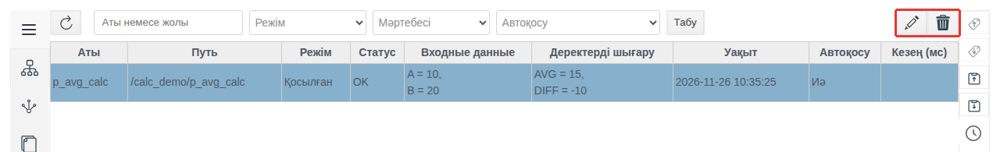
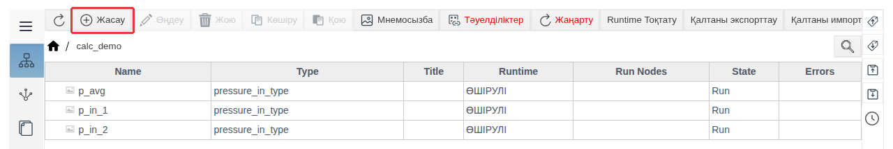
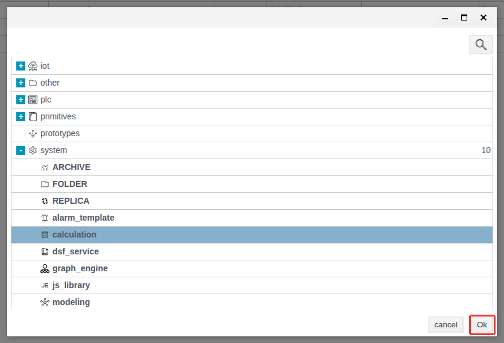
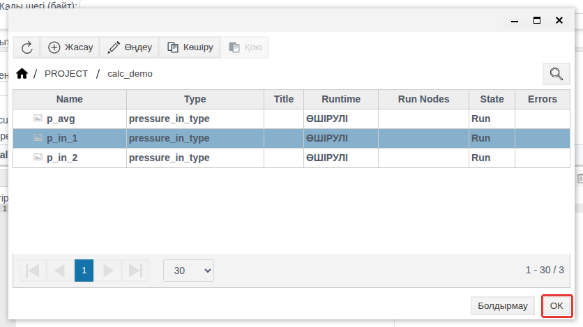
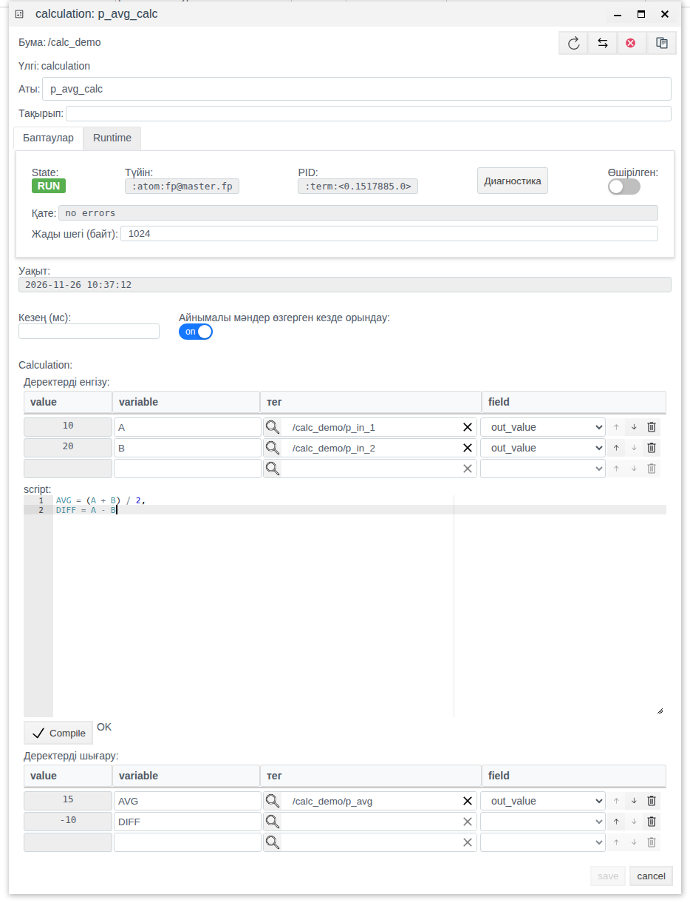
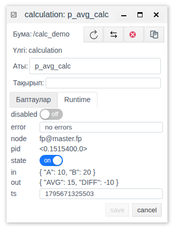
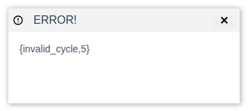
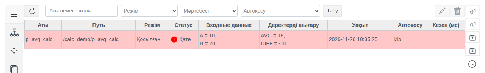
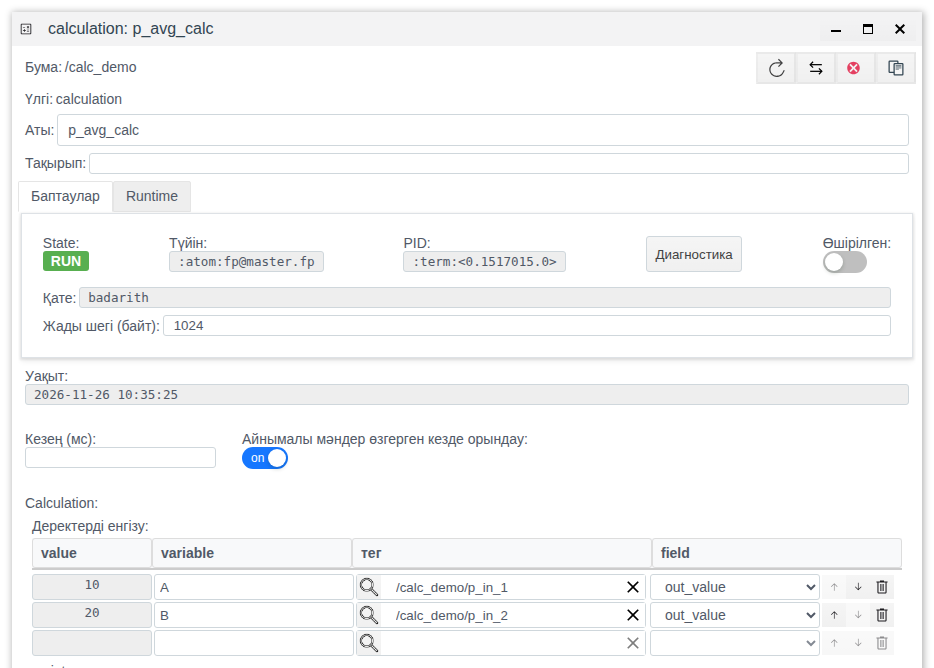

# Есептеулер

Бұл құжат Faceplate жобасында тег мәндері бойынша есептеулерді баптайтын интегратор инженерге арналған.

# Мазмұны

- [Терминдер сөздігі](#терминдер-сөздігі)
- [Кіріспе](#кіріспе)
- [Негізгі бөлім](#негізгі-бөлім)
    - [Есептеулер тізімі](#есептеулер-тізімі)
    - [Есептеу жасау](#есептеу-жасау)
    - [Айнымалылар](#айнымалылар)
    - [Скрипт](#скрипт)
    - [Іске қосу шарттары](#іске-қосу-шарттары)
    - [Қателер](#қателер)
    - [Өзгерту және жою](#өзгерту-және-жою)
- [Қорытынды](#қорытынды)

# Терминдер сөздігі

| Термин | Мағынасы |
|---|---|
| Есептеу | `calculation` түріндегі жоба нысаны. Тег өрістерінің ағымдағы мәндерін оқиды, Erlang тіліндегі формуланы есептейді және нәтижені тег өрістеріне жазады |
| Есептеудің Runtime деректері | Есептеу пішініндегі **Runtime** қойындысы. `in` өрісі — кіріс айнымалыларының мәндері, `out` өрісі — соңғы сәтті орындалудағы барлық шығыс айнымалыларының мәндері |
| Calculation | Studio негізгі мәзірінің бөлімі: жобаның барлық есептеулерінің тізімі |
| Жалпы құрылым | Жоба нысандарының ағашы бар Studio негізгі мәзірінің бөлімі ([«Project structure»](../../../en/general/project_structure/FACEPLATE-start.md) құжатын қараңыз). Есептеулер осы жерде жасалады |
| Тег | Өрісі мәннің көзі немесе қабылдағышы болатын жоба нысаны |
| Кіріс айнымалысы | **Деректерді енгізу** кестесінің жолы: скрипт айнымалысының атауы және мән алынатын тег өрісі |
| Шығыс айнымалысы | **Деректерді шығару** кестесінің жолы: скрипт айнымалысының атауы және, міндетті емес, нәтиже жазылатын тег өрісі |
| Автоқосу | Кез келген кіріс өрісі өзгергенде есептеуді іске қосу. Пішінде — **Айнымалы мәндер өзгерген кезде орындау** ауыстырғышы |
| Кезең | Есептеуді таймер бойынша іске қосу аралығы, миллисекундпен |

# Кіріспе

Есептеу тег өрістерінің ағымдағы мәндерін алады, формула бойынша жаңа мәндерді есептейді және қажет болса, оларды басқа тегтердің өрістеріне жазады.

| Calculation үшін қолайлы | [User Script](../user_script/user_script.md) арқылы орындаңыз |
|---|---|
| Өлшем бірліктерін қайта есептеу, масштабтау | Тарих бойынша және уақыт терезесі бойынша есептеу, өзгеру жылдамдығы |
| Бірнеше кіріс бойынша формулалар: қосынды, айырма, қатынас, пайыз, қуат, ПӘК | Жинақтау және сумматорлар, іске қосулар арасындағы күй |
| Шекті белгілер мен күйлер | Дабылдар, SQL, интерфейспен жұмыс |
| Қарапайым шарттар: ауқымды шектеу, қосалқы мән, нөлге бөлуден қорғау | Күрделі логика және орындалу барысын басқару |
| Сөзден битті бөліп алу, күйлердің бүтін кодтарын сәйкестендіру | Протоколдарды талдау, формула кітапханалары |

Есептеу кірістердің тек ағымдағы мәндерін көреді: алдыңғы іске қосулар есте сақталмайды.

Есептеу үш бөліктен тұрады:

| Бөлік | Нені береді |
|---|---|
| Кіріс айнымалылары | Қай тегтердің қай өрістерін оқу керек және олар скриптте қандай атаулармен қолжетімді |
| Скрипт | Шығыс айнымалыларын есептейтін Erlang өрнектері |
| Шығыс айнымалылары | Есептелген мәндерді қайда жазу керек |

Есептеу кірістер өзгергенде, таймер бойынша немесе екі шарт бойынша да іске қосылады.

Құжат бойындағы мысал — `p_in_1`, `p_in_2`, `p_avg` тегтері бар `calc_demo` бумасы. Бұлар `out_value` сандық өрісі бар примитивтің даналары; мұндай түрді жасау жолы [«Примитивтер»](../../project_objects/primitives/primitives.md) құжатында сипатталған. `p_avg_calc` есептеуі екі қысымның орташа мәнін `p_avg` тегіне жазады және қосымша олардың `DIFF` айырмасын есептейді.

Жобаны өзгерту құқығы бар тіркелгімен Studio ортасына (`http://<сервер>:9000/fp/studio`) кіру мүмкіндігі қажет.

# Негізгі бөлім

## Есептеулер тізімі

Studio негізгі мәзірінен **Calculation** бөлімін ашыңыз.


Кестеде бумасына қарамастан жобаның барлық есептеулері жиналған. Жолды таңдаңыз: жоғарғы оң жақ бұрышта өңдеу (қарындаш) және жою (себет) батырмалары қолжетімді болады, суретте олар қызыл жақтаумен белгіленген. Жолды екі рет шерту де есептеуді ашады. Есептеуді өзгерту және жою [«Өзгерту және жою»](#өзгерту-және-жою) бөлімінде сипатталған. Бұл бөлімде есептеу жасауға болмайды.



| Баған | Мазмұны |
|---|---|
| **Аты**, **Путь** | Есептеудің атауы және жобаның түбірінен басталатын жолы |
| **Режім** | `Қосылған` немесе `Өшірулі` (пішіндегі **Өшірілген** ауыстырғышы) |
| **Статус** | `OK` немесе `Қате`. Қатесі бар жол қызыл түспен белгіленеді, себебі есептеу пішінінде көрінеді |
| **Входные данные**, **Деректерді шығару** | Соңғы сәтті орындалудағы айнымалылардың мәндері |
| **Уақыт** | Соңғы сәтті орындалу уақыты |
| **Автоқосу** | `Иә` — есептеу кірістер өзгергенде іске қосылады |
| **Кезең (мс)** | Таймер бойынша іске қосу аралығы, бос болса — таймер берілмеген |

Кестенің үстіндегі сүзгілер: жолдың бөлігі, **Режім**, **Мәртебесі**, **Автоқосу**. Олар **Табу** батырмасымен қолданылады.

## Есептеу жасау

1. **Жалпы құрылым** бөлімінде есептеу бумасына (мысалда — `calc_demo`) екі рет шерту арқылы өтіп, **Жасау** батырмасын басыңыз.

   

2. **system** тармағын ашып, **calculation** түрін таңдаңыз да, **Ok** батырмасын басыңыз.

   

3. **Аты** өрісін толтырыңыз: `p_avg_calc`.
4. Іске қосу шарттарын беріңіз ([«Іске қосу шарттары»](#іске-қосу-шарттары) бөлімін қараңыз). Мысал үшін **Кезең (мс)** өрісін бос, ал **Айнымалы мәндер өзгерген кезде орындау** ауыстырғышын қосулы қалдырыңыз — бұл әдепкі мән.
5. **Деректерді енгізу** кестесін, скриптті және **Деректерді шығару** кестесін толтырыңыз (төменде қараңыз).
6. **Compile** батырмасын басып, `OK` шыққанын күтіңіз де, сақтаңыз.

## Айнымалылар

**Деректерді енгізу** және **Деректерді шығару** кестелеріндегі жолдар бірдей толтырылады:

| Баған | Не көрсету керек |
|---|---|
| **value** | Тек оқу үшін: соңғы сәтті орындалудағы айнымалының мәні |
| **variable** | Скрипттегі айнымалының атауы. Бірінші әріп автоматты түрде бас әріпке айналады (`diff` → `Diff`) |
| **тег** | Тег. Үлкейткіш әйнек белгісін басып, бумаларға екі рет шерту арқылы өтіңіз, тегті таңдаңыз да, **OK** батырмасын басыңыз |
| **field** | Таңдалған тегтің өрісі. Тізімде жүйелік өрістерді қоса алғанда, тегтің барлық өрісі бар; мән үшін әдетте `out_value` қажет |



Жол толтырылғаннан кейін төменде бос жол пайда болады. Көрсеткілер жолдардың ретін өзгертеді, себет жолды жояды.

Кіріс айнымалысы үшін тег пен өріс міндетті. Шығыс айнымалысы үшін міндетті емес:

| Шығыс айнымалысы | Мән қайда түседі |
|---|---|
| Тегі мен өрісі бар | Тегтің көрсетілген өрісіне және есептеудің Runtime деректеріне |
| Тегсіз | Тек есептеудің Runtime деректеріне (`out` өрісі). Пішіннің **value** бағанында және тізімнің **Деректерді шығару** бағанында да көрінеді |

Тегсіз шығыстар аралық шамалар мен жөндеуге ыңғайлы. Шығысқа тегті мән жобаның басқа нысандарына — [мнемосызбаға](../../mnemo/bindings.md#тегке-байланыстыру), [мұрағатқа](../../../en/data_storage/archives/archives.md), басқа есептеуге — қажет болғанда ғана көрсетіңіз.

Шығысты дәл осы есептеу кіріс ретінде оқитын өріске жазбаңыз. Әйтпесе кері байланыс пайда болады: есептеу өз кірісін өзгертеді.

Мысал:

| Кесте | variable | тег | field |
|---|---|---|---|
| Деректерді енгізу | `A` | `/calc_demo/p_in_1` | `out_value` |
| Деректерді енгізу | `B` | `/calc_demo/p_in_2` | `out_value` |
| Деректерді шығару | `AVG` | `/calc_demo/p_avg` | `out_value` |
| Деректерді шығару | `DIFF` | — | — |



Есептеу сақталғаннан кейін бірден орындалады. Нәтиже **Calculation** бөлімінде және `p_avg` тегінің `out_value` өрісінде көрінеді.

**Runtime** қойындысындағы `out` өрісінде екі шығыс айнымалысы да көрінеді: `AVG` мәні `p_avg` тегіне де жазылған, `DIFF` — тек осында.



## Скрипт

Скрипт — үтірмен бөлінген Erlang формулалары. Кіріс айнымалыларында өрістердің мәндері дайын тұрады. Әр шығыс айнымалысына мән меншіктеңіз.

```erlang
AVG = (A + B) / 2,
DIFF = A - B
```

Ережелер:

- Соңына нүкте қоймаңыз. Қатесі: `{invalid_expression,{<нөмір>,erl_parse,["syntax error before: ","'.'"]}}`.
- Айнымалылардың атаулары **variable** бағанындағыдай бас әріптен басталады. Шығыс айнымалысына мән меншіктелмесе немесе ол кіші әріппен жазылса, **Compile** `{unbound_var,'АТАУ'}` қатесін қайтарады.
- Амалдар: `+`, `-`, `*`, `/` (бөлшек нәтиже), `div` (бүтін бөлу), `rem` (қалдық), `band`, `bsr` (биттік), жақшалар, `min`, `max`, `math` модулінің функциялары, мысалы `math:sqrt(A * B)`.
- `div`, `rem`, `band` және `bsr` тек бүтін сандармен жұмыс істейді. Бөлшек мәнді алдымен бүтінге келтіріңіз: `trunc(X)` бөлшек бөлігін алып тастайды, `round(X)` дөңгелектейді.

Үлгі формулалар (`X`, `Y`, `Word` — кірістер, `R` — шығыс):

| Міндет | Формула |
|---|---|
| Нөлге бөлуден қорғау | `R = if Y == 0 -> 0; true -> X / Y end` |
| 0…100 ауқымымен шектеу | `R = min(max(X, 0), 100)` |
| Шектер бойынша күй | `R = if X > 80 -> 2; X > 50 -> 1; true -> 0 end` |
| Сөздің 3-биті | `R = (Word bsr 3) band 1` |

Шектерді, коэффициенттерді және күй кодтарын жобадан алыңыз: формулада олар санмен жазылады.

**Compile** скриптті айнымалылар тізімдерімен бірге серверде тексереді. Батырманың жанында `OK` немесе қате мәтіні пайда болады. `OK` шыққаннан кейін ғана сақтаңыз: скрипт немесе айнымалылар өзгертілген сайын **Compile** батырмасын қайта басыңыз.

## Іске қосу шарттары

| Кезең (мс) | Айнымалы мәндер өзгерген кезде орындау | Есептеу қашан орындалады |
|---|---|---|
| бос | қосулы | Кез келген кіріс өрісі өзгергенде |
| `N` | өшірулі | Әр `N` мс сайын |
| `N` | қосулы | Әр `N` мс сайын және кез келген кіріс өрісі өзгергенде |
| бос | өшірулі | Сақталмайды: `no_trigger_defined` |

Кезең 10 мс-тан үлкен болуы керек. Мән одан кіші болса, сақтау `{invalid_cycle,N}` қатесімен қабылданбайды.

Бұдан бөлек, есептеу іске қосылғанда бір рет орындалады: сақталғаннан кейін және **Өшірілген** белгісі алынғаннан кейін.

**Өшірілген** қосулы тұрғанда есептеу орындалмайды (State — `STOP`), шығыс тегтерінің мәндері өзгермейді.

## Қателер

### Сақтау кезінде

Сервер есептеуді сақтау кезінде тексереді. Қате болса, **ERROR!** терезесі шығады, есептеу терезесі жабылады, өзгерістер сақталмайды. Есептеуді қайта ашып, түзетулерді қайталаңыз.



| Мәтін | Себебі |
|---|---|
| `{invalid_cycle,N}` | **Кезең (мс)** 10-нан аспайды |
| `no_trigger_defined` | Кезең бос және **Айнымалы мәндер өзгерген кезде орындау** өшірулі |

### Орындалу кезінде

Скрипт орындалу кезінде қатеге ұшыраса (мысалы, нөлге бөлу):

- пішіндегі **Қате** өрісінде себебі шығады, мысалы `badarith`;
- **Calculation** бөліміндегі жол қызыл түспен белгіленеді, **Статус** — `Қате`;
- **Жалпы құрылым** бөлімінде себебі **Errors** бағанында көрінеді;
- шығыс тегтері өзгермейді, **Входные данные**, **Деректерді шығару** және **Уақыт** соңғы сәтті орындалудан қалады.





Қате келесі сәтті орындалуда алынады.

## Өзгерту және жою

Есептеуді **Calculation** немесе **Жалпы құрылым** бөлімінде екі рет шерту арқылы ашып, түзетулер енгізіңіз, **Compile** батырмасын басыңыз да, сақтаңыз. Есептеу жаңа баптаулармен қайта іске қосылады.

Жою үшін **Calculation** бөлімінде жолды таңдап (бірнеше жолды — Ctrl басылған күйде шертіп), себет батырмасын басыңыз. Растау терезесі тек жолдар санын көрсетеді (`delete items: 1`). **yes** батырмасымен растаңыз. **Жалпы құрылым** бөлімінде есептеу кез келген нысан сияқты **Жою** батырмасымен жойылады.

# Қорытынды

Есептеуді баптау реті:

1. **Жалпы құрылым** бөлімінде есептеу бумасында **system → calculation** жасаңыз.
2. Кезеңді, автоқосуды немесе екеуін де беріңіз.
3. Кіріс айнымалыларын тегімен және өрісімен, шығыс айнымалыларын тегпен немесе тегсіз қосыңыз.
4. Формулаларды **script** өрісіне жазыңыз.
5. **Compile** батырмасын басып, `OK` шыққанын күтіңіз де, сақтаңыз.
6. Нәтижені **Calculation** бөлімінде тексеріңіз.
