# JS-кітапханалар

Бұл құжат JavaScript тіліндегі ортақ кодты жобаның жеке нысанына шығарып, оны пайдаланушы скрипттерінен қосатын интегратор инженерге арналған.

# Мазмұны

- [Терминдер сөздігі](#терминдер-сөздігі)
- [Кіріспе](#кіріспе)
- [Негізгі бөлім](#негізгі-бөлім)
    - [Кітапхана жасау](#кітапхана-жасау)
    - [Кітапхана коды](#кітапхана-коды)
    - [Compile және сақтау](#compile-және-сақтау)
    - [Скриптке қосу](#скриптке-қосу)
    - [Басқа кітапхананы пайдаланатын кітапхана](#басқа-кітапхананы-пайдаланатын-кітапхана)
    - [Кітапхананы өзгерту](#кітапхананы-өзгерту)
    - [Жолдағы қате](#жолдағы-қате)
- [Қорытынды](#қорытынды)

# Терминдер сөздігі

| Термин | Мағынасы |
|---|---|
| JS-кітапхана | `js_library` түріндегі жоба нысаны. Нәтижесін скрипт `require` шақыруымен алатын JavaScript кодын сақтайды |
| `require` | JavaScript кодында қолжетімді функция. Нысанның жолы бойынша JS-кітапхана кодының нәтижесін қайтарады |

# Кіріспе

JS-кітапхана — бүкіл жобаға ортақ JavaScript коды: бірнеше скриптке қажет функциялар, тұрақтылар, анықтамалық кестелер. Код `js_library` нысанында бір рет жазылады, ал скрипттер оны `await require('/бума/атау')` арқылы алады.

Кітапхана — **Жалпы құрылым** бөліміндегі жоба бумасының кәдімгі нысаны. Кітапхана өздігінен орындалмайды: оның кодын скрипт `require` шақырғанда іске қосады.

Кітапхананы жасау және қосу жолын құжат бір мысалмен көрсетеді. Мысалда бірнеше скриптке температураны Цельсий градустарынан Фаренгейт градустарына аудару қажет, сондықтан аудару функциясы `js_units` кітапханасына шығарылған. `js_lib_demo` скрипті осы кітапхананы қосып, нәтижені тегке жазады. Содан кейін `js_units` негізінде екінші кітапхана — `js_limits` жасалады. Құжаттың соңында кітапхананы өзгерту жолы және оған жол қате көрсетілгенде не көрінетіні сипатталған.

Мысалдың барлық нысандары `js_demo` бумасында:

| Нысан | Түрі | Мақсаты |
|---|---|---|
| `js_in`, `js_out` | `float` түріндегі `value` өрісі бар примитив | Мысалдың кірісі мен шығысы. Алдын ала жасалады |
| `js_units` | `js_library` | `c_to_f` (Цельсий градустарын Фаренгейт градустарына) және `clamp` (ауқыммен шектеу) функциялары |
| `js_lib_demo` | `user_script` | `js_in` мәнін оқып, `c_to_f` нәтижесін `js_out` нысанына жазады |
| `js_limits` | `js_library` | `js_units` кітапханасын пайдаланатын `f_limited` функциясы |

Примитив жасау жолы [«Примитивтер»](../../project_objects/primitives/primitives.md) құжатында, пайдаланушы скрипті [«Пайдаланушы скрипттері»](../user_script/user_script.md) құжатында сипатталған.

Жобаны өзгерту құқығы бар тіркелгімен Studio ортасына (`http://<сервер>:9000/fp/studio`) кіру мүмкіндігі қажет.

# Негізгі бөлім

## Кітапхана жасау

Мысалдың бірінші кітапханасы — `js_units`.

1. Studio бас мәзірінде **Жалпы құрылым** бөлімін ашыңыз.

   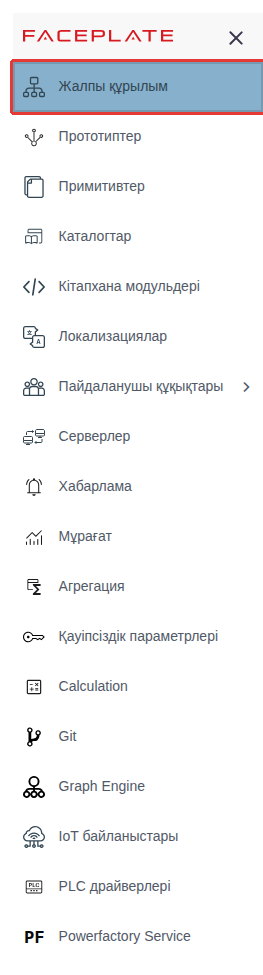

2. `js_demo` бумасына екі рет шерту арқылы кіріп, **Жасау** батырмасын басыңыз.

   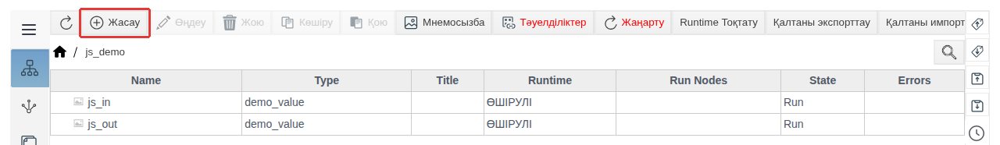

3. **system** тобын ашып, **js_library** түрін таңдаңыз да, **Ok** батырмасын басыңыз.

   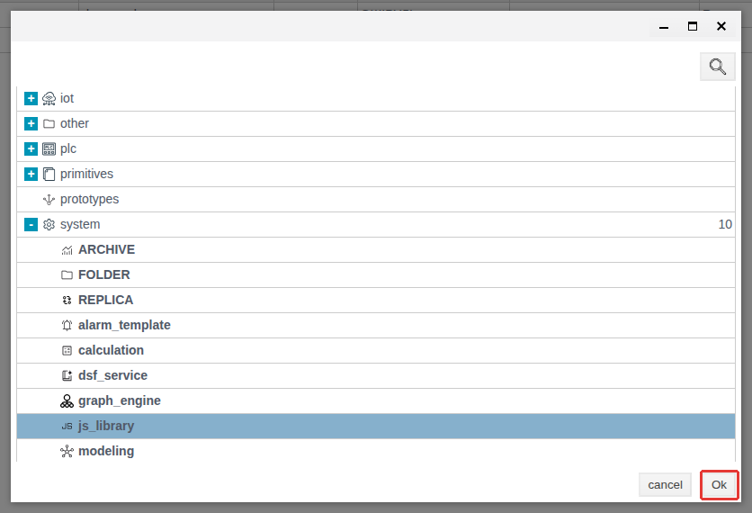

4. Жаңа кітапхананың пішіні ашылады. **Аты** өрісіне `js_units` енгізіңіз.

   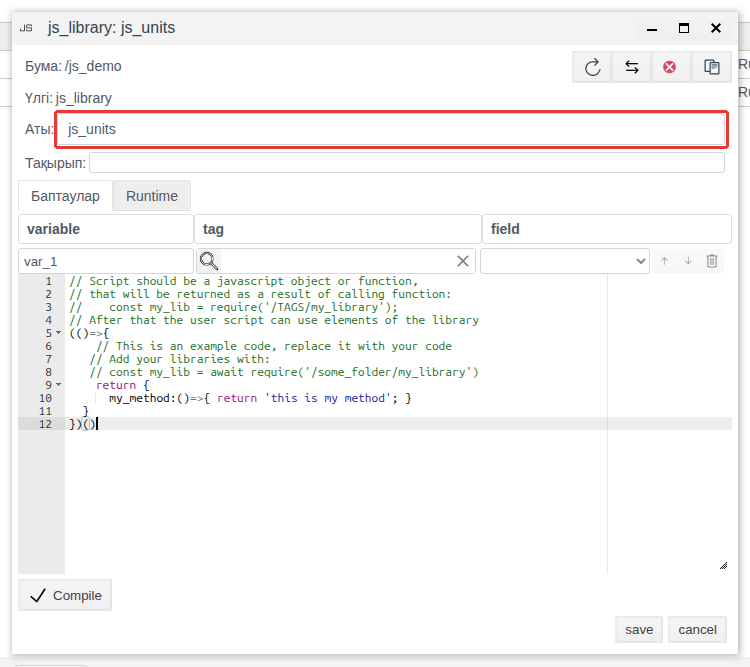

Пішіннің редакторында код үлгісі тұр. Оны кітапхана кодымен ауыстыру керек.

## Кітапхана коды

Кітапхана коды — JavaScript тіліндегі бір өрнек. `require` оның мәнін қайтарады. Ең ыңғайлысы — үлгідегідей, бірден шақырылатын және функциялары бар нысанды қайтаратын функция жазу. Үлгіні `js_units` кодымен ауыстырыңыз:

```javascript
(() => {
    const K = 9 / 5;
    return {
        c_to_f: (c) => { return c * K + 32; },
        clamp: (v, min, max) => { return Math.min(Math.max(v, min), max); }
    };
})()
```

Бірінші `return` кітапхана нысанын, әр функцияның ішіндегі `return` оның нәтижесін қайтарады. `K` тұрақтысы тек кітапхана ішінде көрінеді, скриптке `c_to_f` және `clamp` қолжетімді болады.

Кітапхананың мәні нысанның өзі, мысалы `({ k: 1.8 })`, немесе функция, мысалы `(x) => x * 2`, болуы да мүмкін. Онда `require` сол нысанды немесе сол функцияны қайтарады.

Редактордың үстіндегі **variable / tag / field** кестесі кітапханада пайдаланылмайды: кітапхана кодында `VARS` айнымалысы жоқ. Тег мәндерін кітапхана скрипттен өз функцияларының параметрлері арқылы алады, мысалы `c_to_f` ішіндегі `c`. **Runtime** қойындысы бос.

## Compile және сақтау

Код енгізілді, енді оны тексеру керек. **Compile** батырмасын басыңыз: батырманың жанында `OK` шығады.

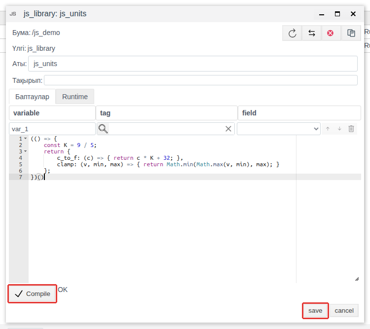

Кодта қате болса, `OK` орнына қатенің мәтіні шығады, мысалы жабылмаған жақша үшін `SyntaxError: Unexpected end of input`. Кодты түзетіп, **Compile** батырмасын қайта басыңыз.

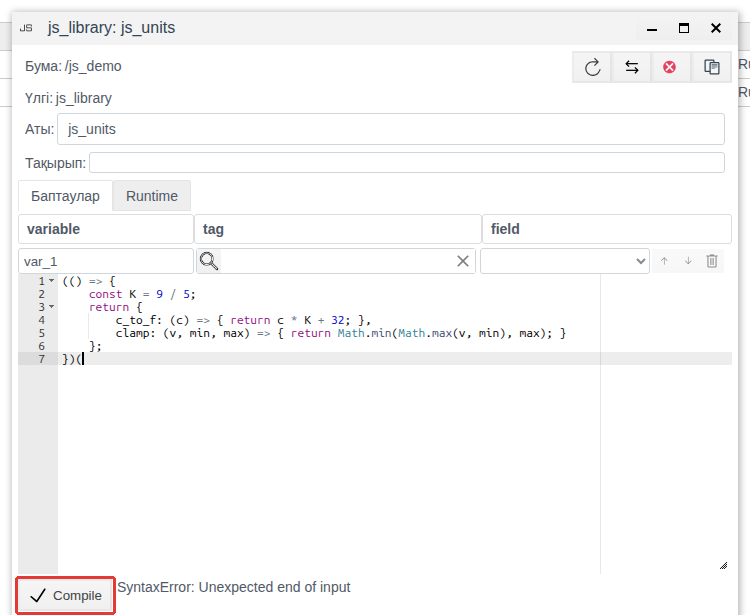

`OK` шыққаннан кейін **save** батырмасын басыңыз. Реті әрқашан бірдей: **Compile** → `OK` → **save**.

`js_units` кітапханасы сақталды, бірақ оны скрипт қоспайынша ол өздігінен ештеңе істемейді.

## Скриптке қосу

`js_units` кітапханасын `js_lib_demo` скриптіне қосайық. Скрипт температураны `js_in` нысанынан алып, `c_to_f` функциясымен аударады да, `js_out` нысанына жазады.

`js_demo` бумасында `js_lib_demo` пайдаланушы скриптін жасаңыз. **javascript** қойындысында `t` айнымалысын орнатыңыз: тег `/js_demo/js_in`, өріс `value`. **Айнымалы мәндер өзгерген кезде орындау** ауыстырғышын қосып, кодты енгізіңіз:

```javascript
async function(VARS, State) {
    const units = await require('/js_demo/js_units');
    await fp.api.set_value('/root/FP/PROJECT/js_demo/js_out', 'value', units.c_to_f(VARS.t));
    return { state: State };
}
```

`await require('/js_demo/js_units')` шақыруы кітапхана нысанын қайтарады, ал оның функциялары `units.c_to_f(...)` түрінде шақырылады. `require` ішіндегі жол **Жалпы құрылым** бөліміндегідей жобаның түбірінен беріледі. `fp.api.set_value(жол, өріс, мән)` мәнді нысанның өрісіне жазады, мұнда жол толық, `/root/FP/PROJECT` префиксімен беріледі.

**Compile** батырмасын басып, `OK` шыққанын күтіңіз де, сақтаңыз.

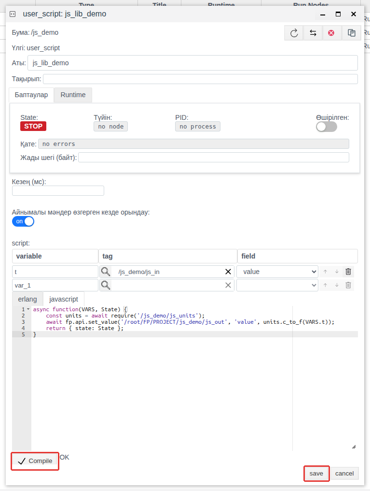

Енді `js_in` = `25` болғанда скрипт `js_out` нысанына `77` мәнін жазады.

## Басқа кітапхананы пайдаланатын кітапхана

`js_units` функцияларын скрипттерге ғана емес, басқа кітапханаларға да қосуға болады. Мысалға `js_limits` кітапханасын қосайық: ол температураны `c_to_f` функциясымен аударып, нәтижені `clamp` функциясымен `-40`-тан `212`-ге дейінгі ауқыммен шектейді.

`js_limits` кітапханасын `js_units` сияқты жасаңыз, коды:

```javascript
(async () => {
    const units = await require('/js_demo/js_units');
    return {
        f_limited: (c) => { return units.clamp(units.c_to_f(c), -40, 212); }
    };
})()
```

`require` шақыратын функция асинхронды (`async`) етіп жарияланған: кітапхана ішінде де `require` скрипттегідей `await` арқылы шақырылады.

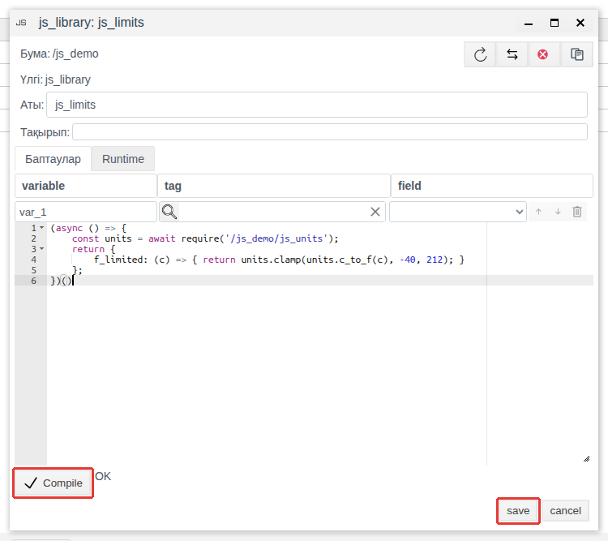

Скрипт `js_limits` кітапханасын `js_units` сияқты қосады: `const limits = await require('/js_demo/js_limits');`. `js_in` = `150` болғанда `limits.f_limited(VARS.t)` шақыруы `212`, `js_in` = `-100` болғанда `-40` береді.

Енді мысалдың бумасында екі кітапхана бар. **Жалпы құрылым** бөлімінде олар **JS** белгісімен белгіленген, **Runtime** бағанында олардың мәні `ӨШІРУЛІ`. Суретте кітапхана жолдары қызыл жақтаумен белгіленген.

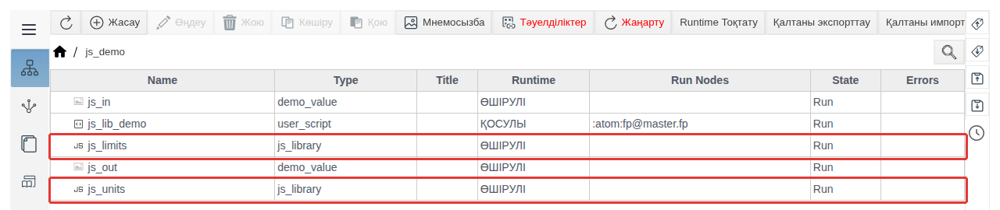

## Кітапхананы өзгерту

Кітапхананы скрипттер пайдаланып жатқанда да өзгертуге болады. Іске қосылған скрипт кітапхананы бірінші `require` шақыруында жүктейді және одан әрі осы нұсқамен жұмыс істейді. Жаңа нұсқа скриптке ол қайта іске қосылғаннан кейін түседі. Кітапхананы өзгерткеннен кейін оны пайдаланатын әр скриптті қайта іске қосыңыз:

- **Өшірілген** ауыстырғышын қосып, сақтаңыз, сосын оны өшіріп, сақтаңыз;
- немесе скрипт кодын өзгертіп, **Compile** батырмасын басыңыз да, сақтаңыз.

Мысал: `js_units` кітапханасында `c_to_f` нәтижесіне `+ 1000` қосылған. Қайта іске қосылғанға дейін `js_lib_demo` `js_in` = `30` болғанда `86` жазады, қайта іске қосылғаннан кейін `js_in` = `31` болғанда `1087.8` жазады.

## Жолдағы қате

`require` ішіндегі жол **Жалпы құрылым** бөліміндегі кітапхана жолымен сәйкес келуі керек. `require` жолы бойынша нысан болмаса, скрипт тоқтайды және мәндерді жазбайды. Суреттерде — `js_path_demo` скрипті: бұл `js_lib_demo` сияқты скрипт, бірақ `require` ішінде `/js_demo/js_units` орнына `/js_demo/no_such_lib` жолы көрсетілген.

**Жалпы құрылым** бөлімінде скрипт жолы қызылмен белгіленеді, **State** бағанында — `Stop`, **Errors** бағанында — `{badmatch,{error,{invalid_path,<<"/root/FP/PROJECT/js_demo/no_such_lib">>}}}`.

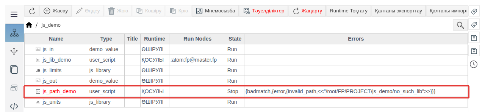

Скрипт пішінінде **State** — `STOP`, **Қате** өрісінде де сол мәтін.

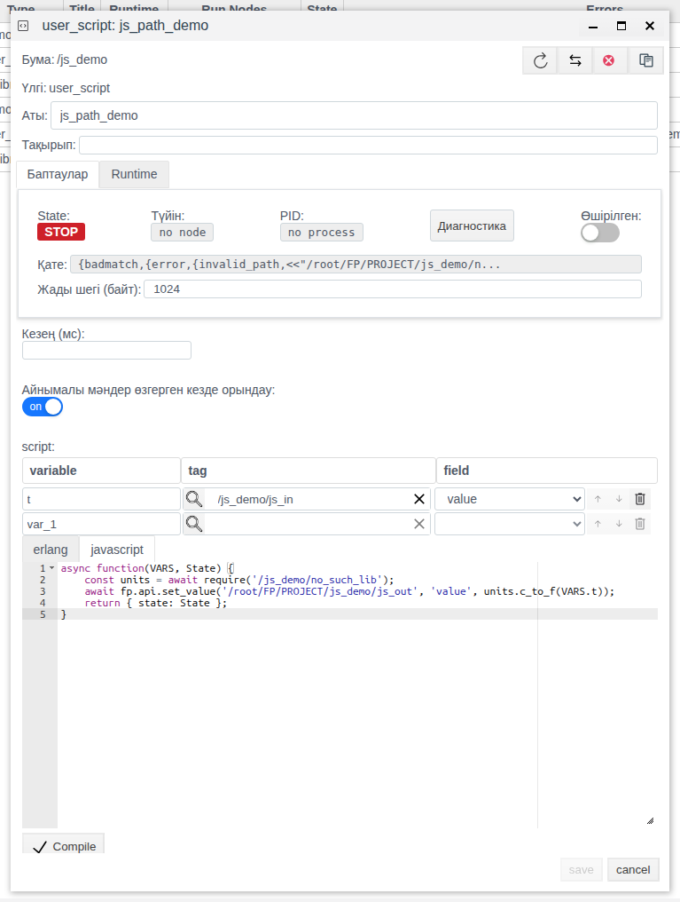

# Қорытынды

Жұмыс реті:

1. Жоба бумасында **system** → **js_library** нысанын жасаңыз.
2. Функциялары бар нысанды қайтаратын өрнекті жазыңыз; кітапхана басқа кітапханаларды қосса, функцияны `async` етіңіз.
3. **Compile** → `OK` → сақтаңыз.
4. Скриптте кітапхананы қосыңыз: `const lib = await require('/бума/атау');`.
5. Кітапхана өзгертілгеннен кейін оны пайдаланатын скрипттерді қайта іске қосыңыз.
