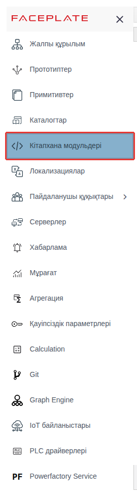
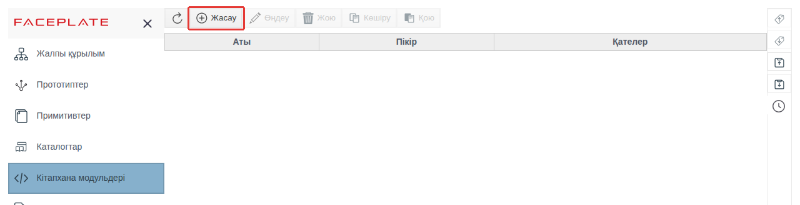
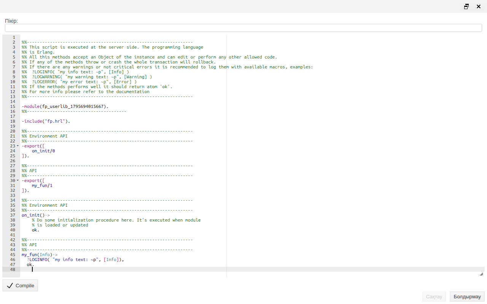
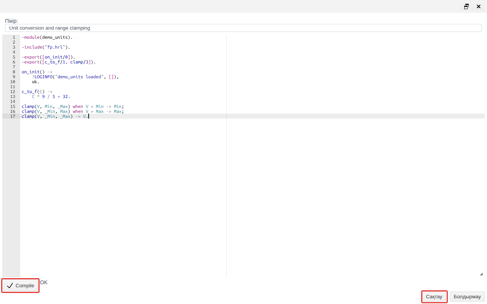
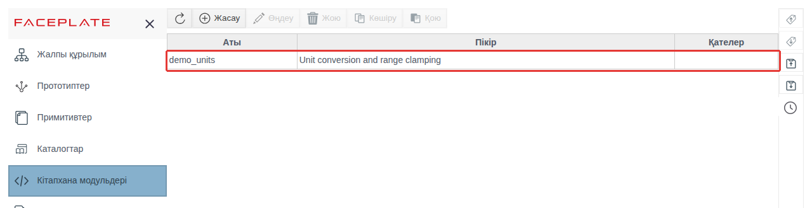
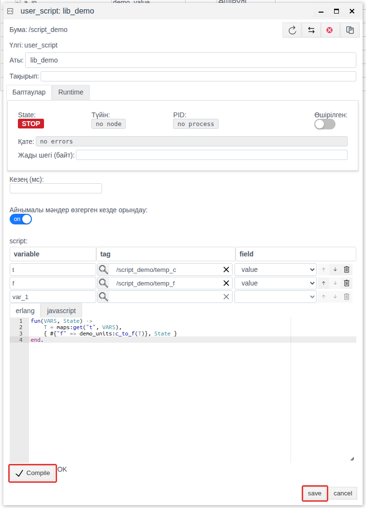
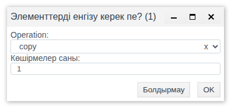
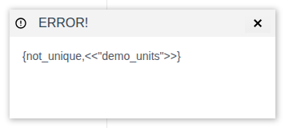

# Кітапхана модульдері

Бұл құжат Erlang тіліндегі ортақ кодты жеке модульге шығарып, оны жобаның пайдаланушы скрипттерінен шақыратын интегратор инженерге арналған.

# Мазмұны

- [Терминдер сөздігі](#терминдер-сөздігі)
- [Кіріспе](#кіріспе)
- [Негізгі бөлім](#негізгі-бөлім)
    - [«Кітапхана модульдері» бөлімі](#кітапхана-модульдері-бөлімі)
    - [Модуль жасау](#модуль-жасау)
    - [Compile және сақтау](#compile-және-сақтау)
    - [Пайдаланушы скриптінен шақыру](#пайдаланушы-скриптінен-шақыру)
    - [Модульді өзгерту](#модульді-өзгерту)
    - [Көшіру](#көшіру)
    - [Жою](#жою)
- [Қорытынды](#қорытынды)

# Терминдер сөздігі

| Термин | Мағынасы |
|---|---|
| Кітапхана модулі | Жобада сақталатын және FACEPLATE серверіне жүктелетін Erlang модулі. Модульдің экспортталған функциялары жоба кодынан `модуль:функция(...)` түрінде қолжетімді |
| **Кітапхана модульдері** бөлімі | Studio негізгі мәзірінің тармағы: жобаның кітапхана модульдерінің тізімі және олардың редакторы |

# Кіріспе

Кітапхана модулі — бүкіл жобаға ортақ Erlang коды: бірнеше скриптке қажет функциялар. Код бір рет жазылады, ал пайдаланушы скрипттері оны модуль атауы бойынша шақырады.

Модульдер жоба бумаларында емес, Studio-ның жеке бөлімінде — **Кітапхана модульдері** бөлімінде сақталады. Сақталғаннан кейін сервер модульді өзі жүктейді, және оның функциялары жобаның барлық скрипттеріне бірден қолжетімді болады.

Модульді жасау және оны скрипттен шақыру жолын құжат бір мысалмен көрсетеді. Мысалда бірнеше скриптке температураны Цельсий градустарынан Фаренгейт градустарына аудару қажет, сондықтан аудару функциясы `demo_units` модуліне шығарылған. `lib_demo` скрипті модуль функциясын шақырып, нәтижені тегке жазады. Содан кейін модуль өзгертіледі, көшіріледі, ал көшірме жойылады.

| Нысан | Орны | Мақсаты |
|---|---|---|
| `temp_c`, `temp_f` | `script_demo` бумасы, `float` түріндегі `value` өрісі бар примитив | Мысалдың кірісі мен шығысы. Алдын ала жасалады |
| `demo_units` | **Кітапхана модульдері** бөлімі | `c_to_f/1` (Цельсий градустарын Фаренгейт градустарына) және `clamp/3` (мәнді ауқыммен шектеу) функциялары |
| `lib_demo` | `script_demo` бумасы, `user_script` | `temp_c` мәнін оқып, `demo_units:c_to_f/1` нәтижесін `temp_f` нысанына жазады |

Примитив жасау жолы [«Примитивтер»](../../project_objects/primitives/primitives.md) құжатында, пайдаланушы скрипті [«Пайдаланушы скрипттері»](../user_script/user_script.md) құжатында сипатталған.

Жобаны өзгерту құқығы бар тіркелгімен Studio ортасына (`http://<сервер>:9000/fp/studio`) кіру мүмкіндігі қажет.

# Негізгі бөлім

## «Кітапхана модульдері» бөлімі

1. Studio негізгі мәзірінен **Кітапхана модульдері** бөлімін ашыңыз.

   

2. Жоба модульдерінің тізімі ашылады. Мысалда ол әзірге бос. **Жасау** батырмасын басыңыз.

   

Тізімнің үстіндегі басқа батырмалар — **Өңдеу**, **Жою**, **Көшіру**, **Қою** — таңдалған жолмен жұмыс істейді. Модульді жолды екі рет шертіп те ашуға болады.

## Модуль жасау

**Жасау** батырмасынан кейін жаңа модульдің үлгісі бар редакторы ашылады: `fp_userlib_<сан>` түріндегі атау, қосылған `fp.hrl`, `on_init/0` және `my_fun/1` функциялары.



Үлгіні `demo_units` кодымен ауыстырып, **Пікір** өрісін толтырыңыз, мысалы `Unit conversion and range clamping`:

```erlang
-module(demo_units).

-include("fp.hrl").

-export([on_init/0]).
-export([c_to_f/1, clamp/3]).

on_init() ->
    ?LOGINFO("demo_units loaded", []),
    ok.

c_to_f(C) ->
    C * 9 / 5 + 32.

clamp(V, Min, _Max) when V < Min -> Min;
clamp(V, _Min, Max) when V > Max -> Max;
clamp(V, _Min, _Max) -> V.
```

| Элемент | Ереже |
|---|---|
| `-module(атау).` | Міндетті. Тізімдегі модуль атауын және шақыруға арналған атауды береді. Кіші латын әріптері, цифрлар, `_` рұқсат етіледі |
| `-export([...])` | Скрипттерге тек экспортталған функциялар қолжетімді |
| `on_init/0` | Модульді инициализациялау функциясы: онда модульдің жұмысына қажетті дайындық орындалады. Модуль компиляцияланып, жүктелгеннен кейін шақырылады: сервер іске қосылғанда және өзгертілген код сақталғаннан кейін бір секунд ішінде. Сақтау кезінде код өзгермесе, мысалы тек **Пікір** өзгертілсе, `on_init/0` шақырылмайды. Мысалда `on_init/0` сервер журналына `demo_units loaded` жолын жазады. `on_init/0` ішіндегі қате сервер журналына жазылады және модульді жүктеуге кедергі болмайды. |
| `-include("fp.hrl").` | Платформаның ортақ макростары бар FACEPLATE-тің негізгі тақырып файлы, олардың ішінде `?LOGINFO`, `?LOGWARNING`, `?LOGERROR` журнал макростары бар. Жаңа модульдің үлгісінде қосылған |

Модуль атауы бірегей: жобада атауы бірдей екі модуль сақталмайды. Атау Erlang пен FACEPLATE модульдерінің атауларымен сәйкес келмеуі керек.

## Compile және сақтау

Код енгізілді, енді оны тексеру керек. **Compile** батырмасын басыңыз: батырманың жанында `OK` шығады, және **Сақтау** батырмасы қолжетімді болады.



Кодта қате болса, `OK` орнына компилятор қатесінің мәтіні шығады, ал **Сақтау** қолжетімсіз күйде қалады. Мәтіннен `{жол,баған}` жұбын және сипаттаманы іздеңіз. Мысалы, `C * 9 / 5 + 32` кейін нүкте қойылмаса, мәтінде `{15,1}` және `syntax error before: clamp` болады — қате 15-жолдың алдында. Кодты түзетіп, **Compile** батырмасын қайта басыңыз.

`OK` шыққаннан кейін **Сақтау** батырмасын басыңыз. Реті әрқашан бірдей: **Compile** → `OK` → **Сақтау**.

Сақталғаннан кейін пішін ашық қалады, ал **Сақтау** келесі **Compile** басылғанша қайтадан қолжетімсіз. Модуль сақталып, тізімде пайда болды. Пішінді **Болдырмау** батырмасымен немесе тақырыптағы айқышпен жабыңыз: сақталған өзгерістер бұл кезде жойылмайды.



| Баған | Мағынасы |
|---|---|
| **Аты** | `-module(...)` жолындағы модуль атауы. Сақтау кезінде беріледі, қолмен өңделмейді |
| **Пікір** | **Пікір** өрісіндегі мәтін |

`demo_units` модулі серверге жүктелді, бірақ оның функцияларын әзірге ешкім шақырмайды.

## Пайдаланушы скриптінен шақыру

`demo_units` модулін `lib_demo` скриптінен шақырайық. Скрипт температураны `temp_c` нысанынан алып, оны `c_to_f/1` функциясымен аударады да, `temp_f` нысанына жазады.

`script_demo` бумасында `lib_demo` пайдаланушы скриптін жасаңыз. **erlang** қойындысында `t` (`/script_demo/temp_c` тегі, `value` өрісі) және `f` (`/script_demo/temp_f` тегі, `value` өрісі) айнымалыларын беріңіз. **Айнымалы мәндер өзгерген кезде орындау** ауыстырғышын қосып, кодты енгізіңіз:

```erlang
fun(VARS, State) ->
    T = maps:get("t", VARS),
    { #{"f" => demo_units:c_to_f(T)}, State }
end.
```

Модуль функциясы `модуль:функция(аргументтер)` толық атауымен шақырылады, модульді скриптке қосудың қажеті жоқ.

**Compile** батырмасын басып, `OK` шыққанын күтіңіз де, сақтаңыз.



Енді `temp_c` = `25` болғанда скрипт `temp_f` нысанына `77` мәнін жазады.

## Модульді өзгерту

Модульді скрипттер шақырып жатқанда да өзгертуге болады. Модульді ашып, кодты түзетіңіз, **Compile** батырмасын басыңыз да, сақтаңыз. Сервер жаңа нұсқаны бірнеше секунд ішінде жүктейді, скрипттердің келесі шақырулары соған жіберіледі. Скрипттерді қайта іске қосудың қажеті жоқ.

Мысал: `demo_units` модулінде `c_to_f` нәтижесіне `+ 1000` қосылды. `lib_demo` скрипті қайта іске қосылмайды, және `temp_c` = `26` болғанда ол `temp_f` нысанына бірден `1078.8` мәнін жазады.

`-module(...)` жолындағы атауды өзгертсеңіз, сақталғаннан кейін тізімдегі **Аты** өзгереді. Скрипттер модульді атауы бойынша шақырады, сондықтан олардағы шақыруларды жаңа атауға түзету керек.

## Көшіру

Көшірме — жаңа модульді дайын кодтан бастаудың жылдам жолы. `demo_units` модулін көшірейік.

1. `demo_units` таңдап, **Көшіру**, содан кейін **Қою** батырмасын басыңыз.
2. **Элементтерді енгізу керек пе?** терезесінде **Operation** = `copy` мәнін қалдырып, **Көшірмелер саны** өрісін толтырыңыз да, **OK** батырмасын басыңыз.

   

Көшірме тізімде `demo_units_1` атауымен пайда болады, бірақ оның коды бұрынғыдай, сол `-module(demo_units)` жолымен. Көшірмені ашып, `-module(...)` ішіндегі атауды ауыстырыңыз, мысалы `demo_units_copy` атауына, **Compile** батырмасын басыңыз да, сақтаңыз. Сақталғаннан кейін тізімдегі **Аты** `demo_units_copy` болады.

Көшірмеде бұрынғы атау тұрғанда оны сақтау мүмкін емес: `{not_unique,<<"demo_units">>}` мәтіні бар **ERROR!** терезесі шығады.



## Жою

`demo_units_copy` көшірмесі енді қажет емес. Оны таңдап, **Жою** батырмасын басыңыз да, **yes** батырмасымен растаңыз. Растау терезесінде жойылатын модульдердің саны көрсетіледі: `delete items: 1`.

Бірнеше модульді бірден жою үшін оларды Ctrl+шертумен таңдаңыз.

# Қорытынды

Жұмыс реті:

1. **Кітапхана модульдері** бөлімінде **Жасау** батырмасын басыңыз.
2. `-module(...)` ішінде бірегей атау беріп, қажетті функцияларды экспорттаңыз.
3. **Compile** → `OK` → **Сақтау**.
4. Функцияларды скрипттерден `модуль:функция(...)` түрінде шақырыңыз.
5. Модульдің көшірмесінде `-module(...)` ішіндегі атауды ауыстырыңыз.
