# Пайдаланушы скрипттері

Бұл құжат жобаның серверлік логикасын Erlang немесе JavaScript тілінде жазатын интегратор инженерге арналған: мәндерді есептеу, есептегіштер, нысандар арасында деректерді тасымалдау.

# Мазмұны

- [Терминдер сөздігі](#терминдер-сөздігі)
- [Кіріспе](#кіріспе)
- [Негізгі бөлім](#негізгі-бөлім)
    - [Скрипт жасау](#скрипт-жасау)
    - [Айнымалылар](#айнымалылар)
    - [Іске қосу шарттары](#іске-қосу-шарттары)
    - [Erlang коды](#erlang-коды)
    - [Compile және сақтау](#compile-және-сақтау)
    - [Жұмыс істеп тұрған скрипт](#жұмыс-істеп-тұрған-скрипт)
    - [Қолмен іске қосу](#қолмен-іске-қосу)
    - [«Скрипт» бөлімі](#скрипт-бөлімі)
    - [Орындалу қателері](#орындалу-қателері)
    - [JavaScript коды](#javascript-коды)
    - [Скриптті жою](#скриптті-жою)
- [Қорытынды](#қорытынды)

# Терминдер сөздігі

| Термин | Мағынасы |
|---|---|
| Пайдаланушы скрипті | `user_script` түріндегі жоба нысаны. Erlang немесе JavaScript функциясын және оны іске қосу шарттарын сақтайды. Серверде орындалады |
| Айнымалы | Функция жоба нысанының өрісін көретін атау. «Атау — нысан (tag) — өріс (field)» үштігімен беріледі |
| `VARS` | Функцияның бірінші аргументі: іске қосу сәтіндегі барлық айнымалылардың мәндері |
| `State` | Функцияның екінші аргументі: функция өткен жолы қайтарған мән. Скрипт қайта іске қосылғанда тасталады |
| Автоқосу | **Айнымалы мәндер өзгерген кезде орындау** режимі: скрипт өз айнымалыларының кез келгені өзгергенде іске қосылады |
| **Скрипт** бөлімі | Studio негізгі мәзірінің тармағы: жобаның барлық пайдаланушы скрипттерінің жиынтық кестесі |

# Кіріспе

Пайдаланушы скрипті жоба нысандарының өрістерін оқиды, жаңа мәндерді есептейді және оларды нысандардың өрістеріне жазады. Скрипт — жоба нысаны: ол **Жалпы құрылым** бөлімінде, өзі жұмыс істейтін нысандардың қасындағы бумада жасалады және қосулы тұрғанда серверде орындалады.

Қарапайым формулаларды [Calculation](../calculation/calculation.md) арқылы беру ыңғайлырақ: онда функция коды емес, тек өрнек жазылады. Есептеуге одан көбі қажет болғанда скрипт керек:

| Calculation үшін қолайлы | User Script арқылы орындаңыз |
|---|---|
| Өлшем бірліктерін қайта есептеу, масштабтау | Тарих бойынша және уақыт терезесі бойынша есептеу, өзгеру жылдамдығы |
| Бірнеше кіріс бойынша формулалар: қосынды, айырма, қатынас, пайыз, қуат, ПӘК | Жинақтау және сумматорлар, іске қосулар арасындағы күй |
| Шекті белгілер мен күйлер | Дабылдар, SQL, интерфейспен жұмыс |
| Қарапайым шарттар: ауқымды шектеу, қосалқы мән, нөлге бөлуден қорғау | Күрделі логика және орындалу барысын басқару |
| Сөзден битті бөліп алу, күйлердің бүтін кодтарын сәйкестендіру | Протоколдарды талдау, формула кітапханалары |

Скриптті қалай жазу, іске қосу және тексеру керектігі құжат бойы жалғасатын бір мысалда көрсетіледі. Мысалда `us_demo` бумасындағы `sum_script` скрипті `a_in` және `b_in` нысандарының мәндерін қосып, қосындыны `sum_out` нысанына, ал өзінің іске қосылу санын `runs_out` нысанына жазады. Төрт нысанның бәрінде `float` түріндегі `value` сандық өрісі бар; мұндай нысандарды жасау жолы [«Примитивтер»](../../project_objects/primitives/primitives.md) құжатында сипатталған.

Алдымен скрипт Erlang тілінде жазылады: ол жасалады, айнымалылар мен іске қосу шарттарын алады, тексеруден өтеді және сақталады. Содан кейін ол қолмен іске қосылады, **Скрипт** бөлімінде табылады және орындалу қатесінің қалай көрінетінін көрсетеді. Соңында сол есептеу JavaScript тілінде жазылады, ал артық скрипт жойылады.

Жобаны өзгерту құқығы бар тіркелгімен Studio ортасына (`http://<сервер>:9000/fp/studio`) кіру мүмкіндігі қажет.

# Негізгі бөлім

## Скрипт жасау

1. **Жалпы құрылым** бөлімінде `us_demo` бумасын ашып, **Жасау** батырмасын басыңыз.

    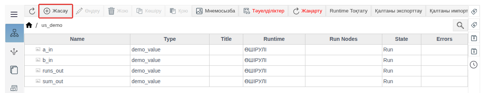

2. `system` тобын ашып, `user_script` түрін таңдаңыз да, **Ok** батырмасын басыңыз.

    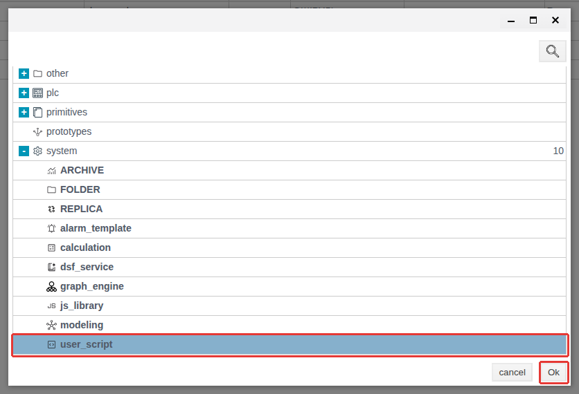

3. Ашылған пішінде **Аты** өрісіне `sum_script` енгізіңіз.

Скрипт пішіні үш бөліктен тұрады. Жоғарыда — күй панелі: скрипт жұмыс істеп тұр ма және қайда. Оның астында — іске қосу шарттары: **Кезең (мс)** және **Айнымалы мәндер өзгерген кезде орындау**. Төменде — **script** айнымалылар кестесі және **erlang**, **javascript** қойындылары бар код редакторы. Жаңа скрипт әлі жұмыс істемейді: **State** `STOP`, редакторда функцияның қалай құрылатыны туралы түсініктемесі бар үлгі тұр. Толтыру айнымалылардан басталады.

## Айнымалылар

Скрипт функциясы жоба нысандарына тікелей жүгінбейді: мәндерді айнымалылар арқылы алады және жазады. Айнымалы кодтағы атауды нысан өрісімен байланыстырады. **script** тақырыбының астындағы кесте **variable** — кодтағы айнымалының атауы, **tag** — жоба нысаны және **field** — оның өрісі бағандарынан тұрады.

Мысалдағы скриптке төрт айнымалы керек: екі кіріс және екі шығыс.

1. **variable** бағанына `a` атауын енгізіңіз.
2. **tag** бағанындағы үлкейткіш әйнек белгісін басып, `us_demo` бумасын ашыңыз, `a_in` нысанын таңдаңыз да, **OK** батырмасын басыңыз. Тек жоба ағашындағы нысанды таңдауға болады.

    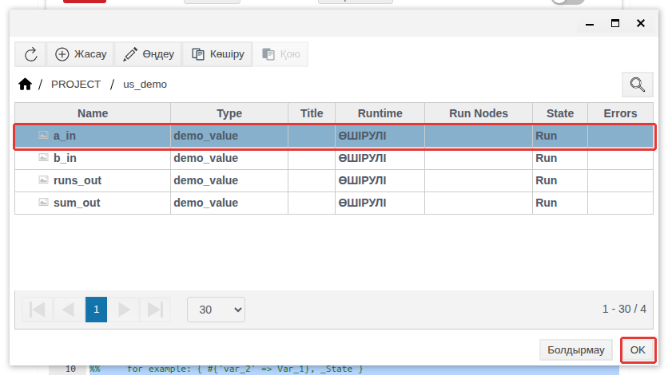

3. **field** бағанында `value` өрісін таңдаңыз. Тізімде жүйелік өрістерді қоса алғанда, нысанның барлық өрісі бар.
4. Қалған жолдарды да осылай қосыңыз:

| variable | tag | field |
|---|---|---|
| `a` | `/us_demo/a_in` | `value` |
| `b` | `/us_demo/b_in` | `value` |
| `sum` | `/us_demo/sum_out` | `value` |
| `runs` | `/us_demo/runs_out` | `value` |

Жол толтырылғаннан кейін төменде бос `var_1` жолы пайда болады; толтырылмаған жол сақтауға кедергі келтірмейді. Оң жақтағы көрсеткілер жолдардың ретін өзгертеді, себет жолды жояды.

Бір айнымалы оқуға да, жазуға да қызмет етеді: скрипт `a` мен `b` айнымалыларын оқиды, ал `sum` пен `runs` айнымалыларына жазады.

## Іске қосу шарттары

Айнымалылар берілді; енді скрипттің қашан орындалатынын шешу керек.

| Өріс | Әрекеті |
|---|---|
| **Кезең (мс)** | Скрипт іске қосылған бойда және одан әрі осы кезеңмен орындалады. Бос болса — таймер қолданылмайды |
| **Айнымалы мәндер өзгерген кезде орындау** | Скрипт іске қосылғаннан кейін бір рет, содан кейін өз айнымалыларының кез келгенінің мәні өзгерген сайын орындалады |

Режимдерді бірге қосуға болады. Екеуі де өшірулі болса, скрипт жұмыс істейді (**State** `RUN`), бірақ қолмен іске қосылғанша орындалмайды ([«Қолмен іске қосу»](#қолмен-іске-қосу) бөлімін қараңыз).

Скрипттің өз айнымалыларына жазған мәндері оны қайта іске қоспайды: автоқосу кезінде скрипт тұйықталмайды.

Қосынды `a_in` немесе `b_in` өзгерген бойда қайта есептелуі керек, сондықтан мысалда **Кезең (мс)** бос қалады, ал **Айнымалы мәндер өзгерген кезде орындау** қосылады.

## Erlang коды

Айнымалылардың мәндері бойынша жаңа мәндерді есептейтін функция қалды. **erlang** қойындысы әдепкі бойынша ашық. Редактордағы үлгіні мысалдың кодымен ауыстырыңыз:

```erlang
fun(VARS, State) ->
    A = maps:get("a", VARS),
    B = maps:get("b", VARS),
    Runs = case State of
        N when is_integer(N) -> N + 1;
        _ -> 1
    end,
    { #{"sum" => A + B, "runs" => Runs}, Runs }
end.
```

Функция екі аргумент — `VARS` пен `State` — қабылдайды және `{ ЖазылатынМәндер, ЖаңаState }` кортежін қайтарады:

| Элемент | Ереже |
|---|---|
| `VARS` | Map, кілттері — айнымалылардың атаулары жол түрінде: `a` емес, `"a"` |
| Жазылатын мәндер | «Айнымалының атауы — мән» map құрылымы. Тек айнымалы ретінде жарияланған өріске жазуға болады: айнымалылар кестесінде жоқ кілттер еленбейді. Бос map `#{}` — ештеңе жазбау |
| `State` | Өткен шақыру нәтижесінің екінші элементі. Мысал онда іске қосулар санын сақтайды: бүтін сан 1-ге артады, кез келген басқа мән бірінші іске қосуды білдіреді |
| Соңындағы нүкте | Код `end.` деп аяқталады |

`VARS` ішіндегі мәннің түрі өрістің түрімен анықталады: `float` өрісінен сан, `string` өрісінен жол келеді. Жол өрістерін қосу `badarith` қатесін береді.

## Compile және сақтау

Код енгізілді. Сақтар алдында оны редактордың астындағы **Compile** батырмасы тексереді: батырманың жанында `OK` немесе қате мәтіні шығады. Мысалы, `B = maps:get("b", VARS)` жолынан кейінгі үтір түсіп қалса, **Compile** былай хабарлайды:

`{invalid_expression,{4,erl_parse,["syntax error before: ","Runs"]}}`

Мәтіндегі сан — қате табылған жолдың нөмірі (мұнда 4-жол, `Runs = case State of`), ал соңғы сөз — қатенің алдында тұрған сөз.

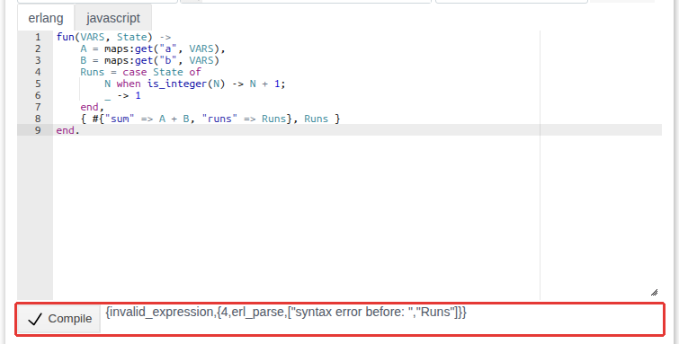

Кодты түзетіп, **Compile** батырмасын қайта басыңыз. Батырманың жанында `OK` пайда болғанда, **save** батырмасын басыңыз.

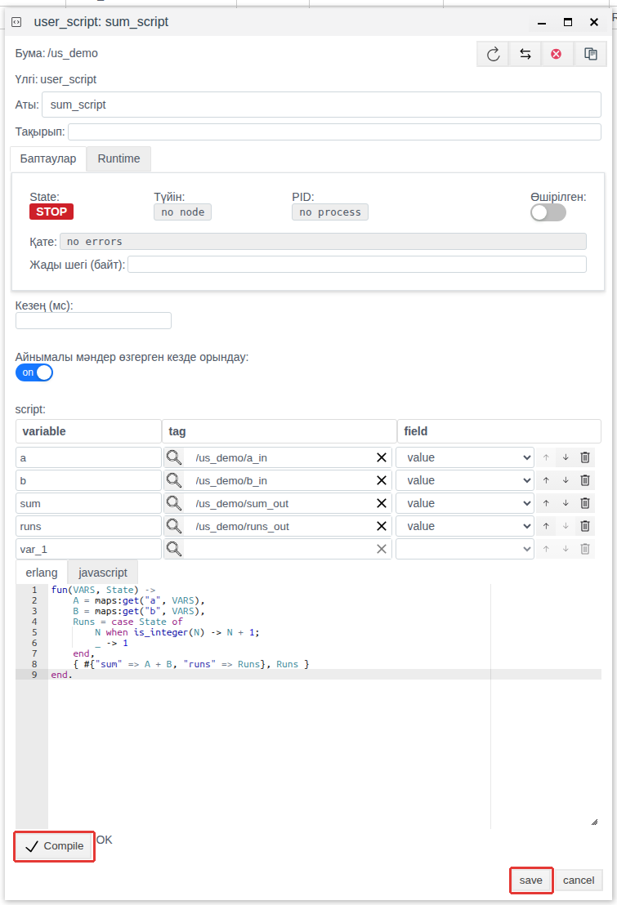

Тек `OK` шыққаннан кейін сақтаңыз.

## Жұмыс істеп тұрған скрипт

Сақталған скрипт бірден іске қосылады. **Жалпы құрылым** бөлімінде `sum_script` скриптінің **Runtime** бағанында `ҚОСУЛЫ`, **Run Nodes** бағанында ол жұмыс істейтін түйін көрсетіледі. Автоқосуы бар скрипт іске қосылғаннан кейін бір рет орындалды: `sum_out` нысанында — `5` (`a_in` = 2 және `b_in` = 3 болғанда), `runs_out` нысанында — `1`.

`sum_script` скриптін қайта ашыңыз: күй панелі толтырылған.

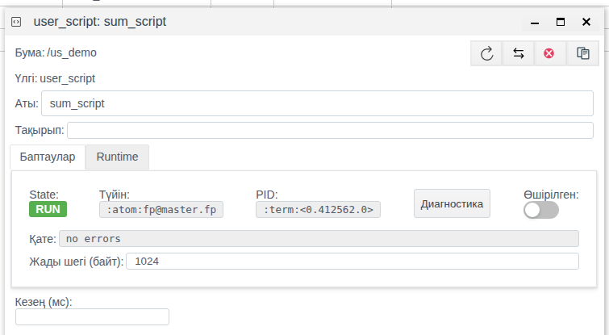

| Өріс | Мағынасы |
|---|---|
| **State** | `RUN` — скрипт жұмыс істейді, `STOP` — іске қосылмаған |
| **Түйін**, **PID** | Скрипт орындалатын кластер түйіні мен процесс |
| **Диагностика** | Скрипт процесін диагностикалау терезесі. Батырма тек сақталған скриптте бар |
| **Өшірілген** | Скриптті жоймай тоқтату. Өшірілген скриптте **State** `STOP`, ал **Жалпы құрылым** бөлімінде **Runtime** `ӨШІРУЛІ` және **State** `Stop` |
| **Қате** | Соңғы орындалу қатесінің мәтіні. `no errors` — қате жоқ |
| **Жады шегі (байт)** | Скрипт процесінің жады шегі. Сақтау кезінде `1024` қойылады |

**Баптаулар** қойындысын әр сақтау — тіпті тек **Тақырып** өзгерген болса да — скриптті қайта іске қосады: код қайта оқылады, `State` тасталады, ал `runs_out` есептегіші қайтадан `1`-ден басталады. **Өшірілген** ажыратылғанда да скрипт осылай қайта іске қосылады.

## Қолмен іске қосу

Мысалдағы скрипт кірістер өзгергенде өздігінен орындалады. Кірістерді өзгертпей, оны тағы бір рет орындау үшін қолмен іске қосыңыз:

1. Скрипт пішінінде **Runtime** қойындысын ашыңыз.
2. **trigger_execute** ауыстырғышын қосып, **save** батырмасын басыңыз.

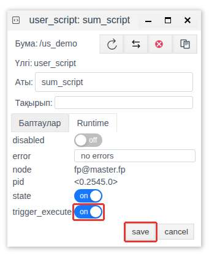

Скрипт бір рет орындалады, ауыстырғыш өздігінен өшеді. Мысалда `runs_out` мәні `2` болады. **Runtime** қойындысында сақтау скриптті қайта іске қоспайды: `State` сақталады. Қойындының қалған жолдары күй панеліндегі мәліметтерді қайталайды.

Екі іске қосу шарты да өшірулі скрипт өздігінен орындалмайды — кірістер өзгерсе де. Оны тек осылай, қолмен іске қосады.

## «Скрипт» бөлімі

**Жалпы құрылым** бөлімінде скрипт тек өз бумасында көрінеді. Жобаның барлық пайдаланушы скрипттері негізгі мәзірдің **Скрипт** бөлімінде бірге жиналған.


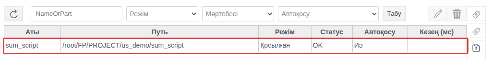

| Баған | Мағынасы |
|---|---|
| **Аты**, **Путь** | Скрипт нысанының атауы мен толық жолы |
| **Режім** | `Қосылған` немесе `Өшірулі` (**Өшірілген** ауыстырғышы) |
| **Статус** | `OK` немесе **Қате** |
| **Автоқосу** | **Айнымалы мәндер өзгерген кезде орындау** қосулы болса, `Иә` |
| **Кезең (мс)** | Кезең мәні немесе бос |

Кестенің үстінде — сүзгілер: атаудың бөлігі, **Режім**, **Мәртебесі** (`Error` / `OK`) және **Автоқосу**. Шарттарды таңдап, **Табу** батырмасын басыңыз; **Табу** батырмасының оң жағындағы айқыш белгісі сүзгілерді алып тастайды.

Бөлімде скрипт жасауға болмайды, тек **Жалпы құрылым** бөлімінде жасалады. Скрипт жолды екі рет шерту арқылы немесе кестенің оң жақ жоғарғы бұрышындағы қарындаш батырмасымен ашылады, қасындағы себет батырмасымен жойылады. Батырмалар жол белгіленгенде қолжетімді болады.

## Орындалу қателері

`sum_script` қатесіз жұмыс істейді: **Статус** бағанында — `OK`. **Compile** кезінде емес, орындалу кезінде пайда болатын қатенің қалай көрінетінін қарастырайық. Кодтағы `maps:get("b", VARS)` өрнегін `maps:get("c", VARS)` өрнегімен ауыстырыңыз: кестеде `c` айнымалысы жоқ. **Compile** `OK` қайтарады — синтаксис дұрыс, — бірақ скрипт орындалған бойда қатемен аяқталады.

Қате үш жерде көрінеді. Скрипт пішінінде — **Қате** өрісінде:

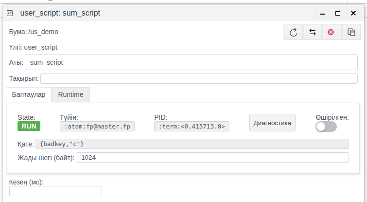

**Жалпы құрылым** бөлімінде — скрипт жолының **Errors** бағанында. **Скрипт** бөлімінде — қызыл фонды және **Қате** күйі бар жол; көрсеткішті **Қате** үстіне апарғанда қатенің мәтіні қалқымалы кеңесте шығады. Үлкен жобада тек осындай скрипттерді көру үшін **Мәртебесі** сүзгісінде `Error` мәнін таңдап, **Табу** батырмасын басыңыз:

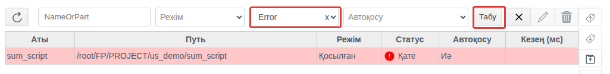

| Мәтін | Себебі |
|---|---|
| `badarith` | Сан емес мәнмен арифметика, мысалы жол өрісімен |
| `{badkey,"c"}` | Кодта айнымалылар кестесінде жоқ `c` айнымалысы оқылады |
| `badarg` | Мысалы, `fp.api.set_value` (JavaScript) ішіндегі жол `/root/FP/PROJECT` префиксінсіз берілген |

Скрипт қатемен орындалғанда айнымалылардың мәндері жазылмайды: `sum_out` пен `runs_out` бұрынғы мәндерін сақтайды. Кодқа `maps:get("b", VARS)` өрнегін қайтарып, **Compile** және **save** батырмаларын басыңыз: бірінші сәтті орындалудан кейін қате пішіннен, **Жалпы құрылым** бөлімінен және **Скрипт** бөлімінен жоғалады.

## JavaScript коды

Сол есептеуді JavaScript тілінде жазуға болады. Салыстыру үшін `us_demo` бумасында [«Скрипт жасау»](#скрипт-жасау) бөліміндегідей екінші `sum_js` скриптін жасаңыз, **javascript** қойындысын ашып, кодты қойыңыз:

```javascript
async function(VARS, State) {
    const runs = Number.isInteger(State) ? State + 1 : 1;
    await fp.api.set_value('/root/FP/PROJECT/us_demo/sum_out', 'value', VARS.a + VARS.b);
    await fp.api.set_value('/root/FP/PROJECT/us_demo/runs_out', 'value', runs);
    return { state: runs };
}
```

Скриптке тек `a` және `b` кіріс айнымалылары керек: ол мәндерді айнымалылар арқылы емес, `fp.api.set_value` шақыруымен жазады. **Айнымалы мәндер өзгерген кезде орындау** режимін қосып, **Compile** батырмасын, ал `OK` шыққаннан кейін **save** батырмасын басыңыз.

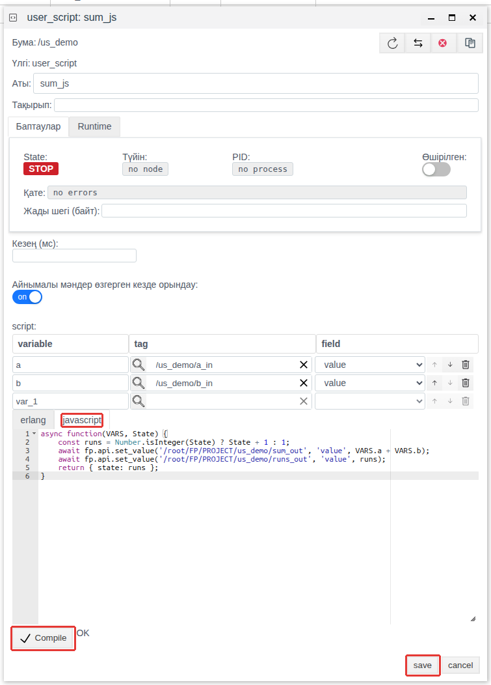

Erlang тілінен айырмашылығы:

| | Erlang | JavaScript |
|---|---|---|
| Функция | `fun(VARS, State) -> … end.` | `async function(VARS, State) { … }` |
| Айнымалыны оқу | `maps:get("a", VARS)` | `VARS.a` |
| Мәнді жазу | Функция нәтижесіндегі map; тек айнымалы ретінде жарияланған өрістерге | `await fp.api.set_value(жол, өріс, мән)`; кез келген өріске, жол толық — `/root/FP/PROJECT` префиксімен |
| Жаңа `State` | Кортеждің екінші элементі | `return { state: … }` |

Код **Compile** басылған кезде ашық тұрған қойындының тілінде тексеріледі және орындалады: **javascript** қойындысындағы Erlang коды тексеруден өтпейді.

## Скриптті жою

Скрипт жобада тұрғанша орындалады. Есептеу енді қажет болмаса немесе басқа скриптке көшірілсе, ескі скриптті жойыңыз, әйтпесе ол сол өрістерге жаза береді. Скриптті уақытша тоқтатып, баптауларын сақтау үшін оны жоймайды, **Өшірілген** ауыстырғышын қосады ([«Жұмыс істеп тұрған скрипт»](#жұмыс-істеп-тұрған-скрипт) бөлімін қараңыз).

Мысалда `sum_js` салыстыру үшін жазылды, енді `sum_out` пен `runs_out` нысандарына бір мезгілде екі скрипт жазады. `sum_script` скриптін қалдырып, `sum_js` скриптін жоямыз: **Скрипт** бөлімінде оның жолын белгілеп, себет батырмасын басыңыз да, **yes** батырмасымен растаңыз.

Растау терезесі белгіленген скрипттердің атын емес, санын көрсетеді. Бірнеше скриптті бірден жою үшін оларды Ctrl пернесін басып тұрып шерту арқылы белгілеңіз. Жойылған скрипт **Скрипт** бөлімінен және **Жалпы құрылым** бөліміндегі өз бумасынан жоғалады.

# Қорытынды

Жұмыс реті:

1. **Жалпы құрылым** бөлімінде `user_script` (`system` тобы) жасаңыз.
2. Скрипт оқитын және жазатын өрістер үшін айнымалыларды жариялаңыз.
3. Іске қосуды таңдаңыз: **Кезең (мс)**, **Айнымалы мәндер өзгерген кезде орындау** немесе екеуі де.
4. Функцияны **erlang** немесе **javascript** қойындысында жазыңыз.
5. **Compile** батырмасын басып, `OK` шыққанын күтіңіз де, сақтаңыз.
6. **Скрипт** бөлімінде **Статус** бағанын тексеріңіз; **Қате** болса, мәтінді пішіннің **Қате** өрісінен оқыңыз.
