# Каталогтар

Бұл құжат жобада анықтамалық деректерді кесте түрінде сақтайтын интегратор инженерге арналған.

# Мазмұны

- [Терминдер сөздігі](#терминдер-сөздігі)
- [Кіріспе](#кіріспе)
- [Негізгі бөлім](#негізгі-бөлім)
    - [Каталог жасау](#каталог-жасау)
    - [Өрістер](#өрістер)
    - [Жазбалар](#жазбалар)
    - [Жазбаларды іздеу](#жазбаларды-іздеу)
    - [Әдеттер](#әдеттер)
    - [Көшіру және жою](#көшіру-және-жою)
    - [Каталогты экспорттау және импорттау](#каталогты-экспорттау-және-импорттау)
    - [Excel арқылы алмасу](#excel-арқылы-алмасу)
    - [Мнемосызбадағы каталог](#мнемосызбадағы-каталог)
- [Қорытынды](#қорытынды)

# Терминдер сөздігі

| Термин | Мағынасы |
|---|---|
| Каталог | **Каталогтар** бөліміндегі жобаның анықтамалық деректер кестесі: өрістер жиыны (бағандар), жазбалар (жолдар) және міндетті емес Әдеттер |
| Жазба | Каталогтың жолы. Жазбаның атауы (`.name`) каталог ішінде бірегей |
| Әдеттер | `on_create/1`, `on_edit/1`, `on_delete/1` функциялары бар Erlang модулі. Сервер оларды жазба жасалғанда, өзгертілгенде және жойылғанда шақырады |
| `.prt` файлы | Каталогтың экспорт файлы: өрістер, жазбалар және Әдеттер |

# Кіріспе

Каталог — жоба ішіндегі анықтамалық деректер кестесі: жабдық модельдері, датчик түрлері, себеп кодтары, материал параметрлері және нысандар ағашынан гөрі кестемен жүргізуге ыңғайлы кез келген басқа тізімдер. Кестенің құрылымын каталогтың өрістері, деректерін — оның жазбалары анықтайды. Әдеттер сақтау кезінде жазбаларды тексеруге немесе толықтыруға мүмкіндік береді.

Бөлім Studio негізгі мәзірінде орналасқан: **Каталогтар**. Әр каталогтың үш бөлігі бар, олардың әрқайсысы жеке батырмамен ашылады:

| Бөлік | Батырма | Не қамтиды |
|---|---|---|
| **Content** | **Контент** | Каталог жазбаларының кестесі |
| **Fields** | **Өрістер** | Кесте бағандары: атауы, түрі, сақтау орны, индексі, әдепкі мәні |
| **Behaviour** | **Әдеттер** | Жазбалармен әрекеттер орындалғанда сервер орындайтын Erlang коды |

Құжат бойындағы мысал — `vendor` (өндіруші), `unit` (өлшем бірлігі), `range_min`, `range_max` (ауқым) және `certified` (тексеру белгісі) өрістері бар датчик модельдерінің `sensor_models` каталогы.

Жобаны өзгерту құқығы бар тіркелгімен Studio ортасына (`http://<сервер>:9000/fp/studio`) кіру мүмкіндігі қажет.

# Негізгі бөлім

## Каталог жасау

Studio негізгі мәзірінен **Каталогтар** бөлімін ашыңыз. Кестеде әр каталогтың атауы мен пікірі көрсетілген, кестенің үстіндегі іздеу жолы атау бойынша іздейді.

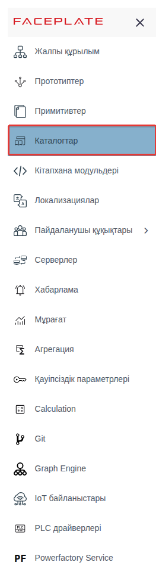

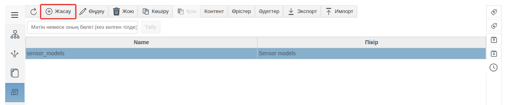

**Жасау** батырмасын басып, **Name** (міндетті) және **Пікір** өрістерін толтырыңыз да, сақтаңыз. Каталогпен бірге бос Өрістер мен Контент жасалады.

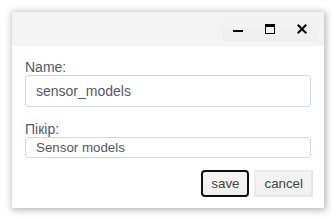

Сақтағаннан кейін каталог тізімде пайда болады. Оны ашу үшін каталогты таңдап, **Контент**, **Өрістер** немесе **Әдеттер** батырмасын басыңыз не оны екі рет шертіңіз: Контент ашылады. Ашық каталогтың кестесінің үстінде навигациялық жол пайда болады (**Каталогтар / sensor_models / Content**): **Каталогтар** тізімге қайтарады, бөліктің жанындағы көрсеткі каталогтың бөліктерін ауыстырады.

## Өрістер

Каталогты таңдап, **Өрістер** батырмасын басыңыз. Өріс пішіні прототиптікімен бірдей: әр параметрдің мақсаты [«Прототиптер»](../prototypes/prototypes.md#өрістер) құжатының «Өрістер» бөлімінде сипатталған. Каталог үшін маңыздылары:

| Параметр | Каталогта не береді |
|---|---|
| **Type** | Жазба пішініндегі енгізу өрісінің түрі: `string` — мәтін, `integer` және `float` — сан, `bool` — ауыстырғыш |
| **Әдепкі мән** | Жаңа жазбаның пішініне қойылады |
| **Индекс** | `3gram` 3 және одан көп таңбалы сұраумен мәннің бөлігі бойынша іздеуді қосады (төмендегі [«Жазбаларды іздеу»](#жазбаларды-іздеу) бөлімі) |
| **excel** | Өріс Excel арқылы алмасуға енеді (төмендегі [«Excel арқылы алмасу»](#excel-арқылы-алмасу) бөлімі) |

Мысалдың өрістері: `string` түріндегі `vendor` және `unit`, әдепкі мәндері `0` және `100` болатын `float` түріндегі `range_min` және `range_max`, `bool` түріндегі `certified`. Барлық өрісте **export** және **excel** құсбелгілері қойылған.

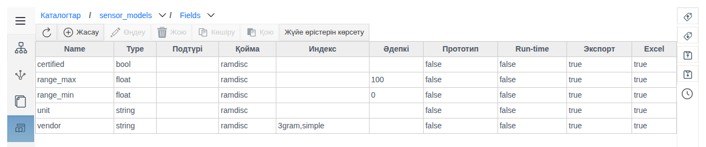

## Жазбалар

Каталогты таңдап, **Контент** батырмасын басыңыз. Кестенің бағандары — `.name` және каталог өрістері.

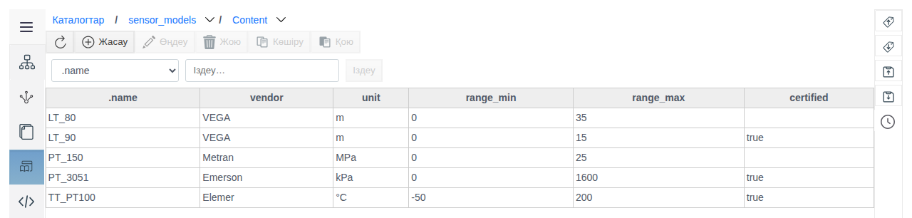

**Жасау** батырмасын басып, `.name` және өріс мәндерін көрсетіңіз де, сақтаңыз. Бар жазба екі рет шерту арқылы ашылады.

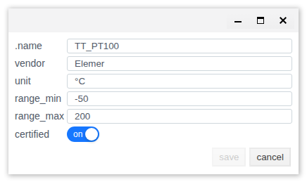

> [!NOTE]
> `bool` өрісінің `false` мәні кестеде көрсетілмейді: ұяшық бос. Жазба пішінінде ауыстырғыш **off** күйінде тұрады.

## Жазбаларды іздеу

Жазбалар кестесінің үстінде бағанды таңдап, мәнді енгізіңіз де, **Іздеу** батырмасын басыңыз. Оң жақтағы айқыш белгісі бар батырма сүзгіні алып тастайды.

Әріп регистрі бір жағдайдан басқа барлық жерде маңызды: `3gram` индексі бар мәтіндік өріс және 3 не одан көп таңбалы сұрау.

| Баған | 1–2 таңбалы сұрау | 3 және одан көп таңбалы сұрау |
|---|---|---|
| `.name` | Атаудың бөлігі бойынша, регистрді ескере отырып: `PT` сұрауы `PT_150`, `PT_3051` және `TT_PT100` жазбаларын табады, `pt` — ештеңе таппайды | Дәл солай: `3051` сұрауы `PT_3051` жазбасын табады |
| `3gram` индексі бар мәтіндік өріс | Мәннің бөлігі бойынша, регистрді ескере отырып: `vendor` өрісіндегі `Em` сұрауы `Emerson` мәнін, `em` — `Elemer` мәнін табады | Мәннің бөлігі бойынша, регистрді ескермей: `Emer` және `emer` сұраулары `Emerson` және `Elemer` мәндерін табады (`Elemer` ішінде `emer` бар) |
| `3gram` индексі жоқ мәтіндік өріс | Мәннің бөлігі бойынша, регистрді ескере отырып: `unit` өрісіндегі `Pa` сұрауы `kPa` және `MPa` мәндерін табады, `pa` — ештеңе таппайды | Тек дәл мән бойынша, регистрді ескере отырып: `kPa` сұрауы `kPa` мәнін табады, `kpa` — ештеңе таппайды |
| Сандық өріс және `bool` | Тек дәл мән бойынша: `20` сұрауы `200` мәнін таппайды | Тек дәл мән бойынша: `200`, `true` |

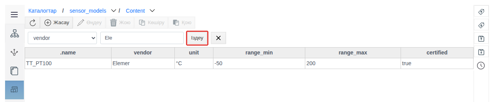

## Әдеттер

Каталогты таңдап, **Әдеттер** батырмасын басыңыз. `fp_prototype_<каталог атауы>` модулінің үлгісі бар Erlang код редакторы ашылады:

| Функция | Қай кезде шақырылады |
|---|---|
| `on_create/1` | Жазба жасалды |
| `on_edit/1` | Жазба өзгертілді |
| `on_delete/1` | Жазба жойылды |

Функция жазба нысанын қабылдайды. `ok` қайтару — әрекетке рұқсат беру. Ерекше жағдай (`throw`) шақыру — оған тыйым салу: жазба жасалмайды, өзгертілмейді немесе жойылмайды, ал пайдаланушы ерекше жағдай мәтінін көреді. **Compile** батырмасын басып, `OK` шыққанын күтіңіз, содан кейін **save** басыңыз.

Мысал: ауқымның төменгі шегі жоғарғы шегінен кіші екенін тексеру.

```erlang
-module(fp_prototype_sensor_models).

-include("fp.hrl").

-export([
    on_create/1,
    on_delete/1,
    on_edit/1
  ]).

on_create(Object)->
  check_range(Object).
on_edit(Object)->
  check_range(Object).
on_delete(_Object)->
  ok.

check_range(Object)->
  #{<<"range_min">> := Min, <<"range_max">> := Max} =
    fp_db:read_fields(Object, [<<"range_min">>, <<"range_max">>]),
  if
    is_number(Min), is_number(Max), Min >= Max ->
      throw(<<"range_min must be less than range_max">>);
    true ->
      ok
  end.
```

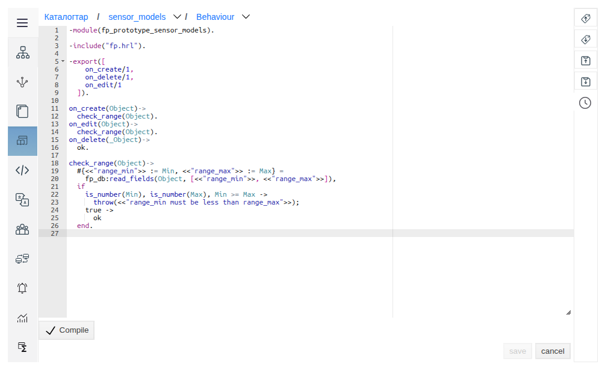

`range_min` = `10` және `range_max` = `5` болатын жазба сақталмайды: ерекше жағдай мәтіні бар **ERROR!** терезесі шығады, жазба пішіні енгізілген мәндерімен ашық күйінде қалады.

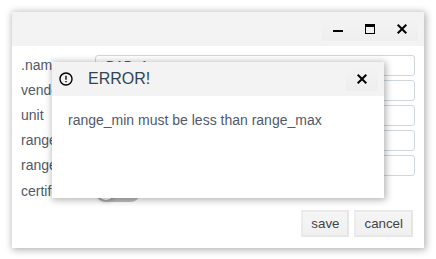

Әдеттер Excel файлынан импорттау кезінде де іске қосылады. Тексеруден өтпеген жол өзгермейді, ал **ERROR!** терезесінде жазбаның жолы мен ерекше жағдай мәтіні көрсетіледі.

## Көшіру және жою

**Каталогтар** тізіміндегі каталогтар және **Контент** ішіндегі жазбалар бірдей көшіріледі және жойылады.

**Көшіру.** Жолды таңдап, **Көшіру**, содан кейін **Қою** батырмасын басыңыз. «Элементтерді енгізу керек пе?» терезесінде **Operation** = `copy` мәнін қалдырып, **Көшірмелер саны** өрісін толтырыңыз да, **OK** батырмасын басыңыз. Көшірме `_1` жұрнағы бар атау алады: `PT_150` → `PT_150_1`, `sensor_models` → `sensor_models_1`. Каталогтың көшірмесі түпнұсқаның барлық өрісі мен жазбасын алады.

**Жою.** Жолды таңдап, **Жою** батырмасын басыңыз да, **yes** батырмасымен растаңыз.

## Каталогты экспорттау және импорттау

**Экспорт.** Каталогты таңдап, **Экспорт** батырмасын басыңыз. Браузер каталогтың өрістері, жазбалары және Әдеттері бар `catalog.prt` файлын сақтайды.

**Импорт.** **Импорт** батырмасын басып, режимдерді қосыңыз да, **Select files...** арқылы `.prt` файлын таңдап, сақтаңыз. Сәтті болса, «The catalog was imported successfully» хабарламасы шығады.

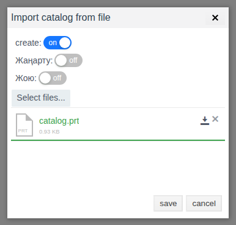

| Ауыстырғыш | Не істейді |
|---|---|
| **create** | Файлдағы, бірақ каталогта жоқ өрістер мен жазбаларды жасайды. Бар өрістерді, жазбаларды және Әдеттерді өзгертпейді |
| **Жаңарту** | Бар өрістерді, жазбаларды және Әдеттерді файлдағы мәндермен қайта жазады |
| **Жою** | Файлда жоқ каталог өрістері мен жазбаларын жояды |

## Excel арқылы алмасу

Excel жазбаларды жаппай толтыруға және түзетуге ыңғайлы.

**Түсіру.** **Каталогтар** бөлімінде оң жақ панельдегі **Экспорт .xlsx** батырмасын басыңыз: белгіленгендердің жоғарғысы. Таңдау терезесінде каталогтарды белгілеп (бірнешеуін — Ctrl арқылы), **Ok** батырмасын басыңыз. **Бәрін таңдау** батырмасы барлық каталогты бірден түсіреді. Браузер `faceplate_project.xlsx` файлын сақтайды.

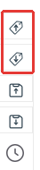

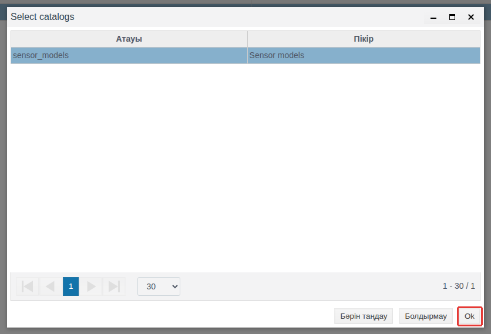

Әр каталог — жеке `catalog@<каталог атауы>` парағы. Бірінші баған — жазбаның атауы, қалғандары — **excel** құсбелгісі қойылған өрістер. `bool` мәндері `:atom:true` және `:atom:false` түрінде жазылады.

| catalog@sensor_models | certified | range_max | range_min | unit | vendor |
|---|---|---|---|---|---|
| PT_3051 | :atom:true | 1600 | 0 | kPa | Emerson |
| LT_80 | :atom:false | 35 | 0 | m | VEGA |

**Жүктеу.** **Импорт .xlsx** батырмасын (белгіленгендердің төменгісі) басып, файлды таңдаңыз да, **ok** басыңыз. `select_import_items` терезесінде парақтарды таңдап, **OK** батырмасын басыңыз. Импорттың сәтті болғаны туралы хабарлама шығады. Жаңа атаулы жолдар жазбаларды жасайды, бар атаулы жолдар оларды жаңартады.

## Мнемосызбадағы каталог

Оператор каталог жазбасын мнемосызбада **Controls** палитрасындағы **CatalogSelect** элементімен таңдайды: `catalog` қасиетінде каталог беріледі, `value` тег өрісіне байланыстырылады, ал жазба таңдалғанда оның толық жолы тегке жазылады. Баптау және Runtime ортасындағы жұмысы — [«Тізімдерден таңдау» құжатының «Каталог жазбасын таңдау» бөлімінде](../../mnemo/lists.md#каталог-жазбасын-таңдау).

# Қорытынды

Каталогпен жұмыс реті:

1. **Каталогтар** бөлімінде каталог жасаңыз.
2. **Өрістер** бөлімінде бағандарды сипаттаңыз.
3. Қажет болса, **Әдеттер** бөлімінде жазба тексерулерін жазыңыз.
4. Жазбаларды **Контент** бөлімінде толтырыңыз немесе Excel файлынан жүктеңіз.
5. Каталогты басқа жобаға **Экспорт** және **Импорт** арқылы тасымалдаңыз.
