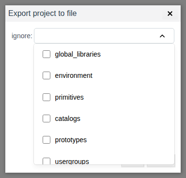
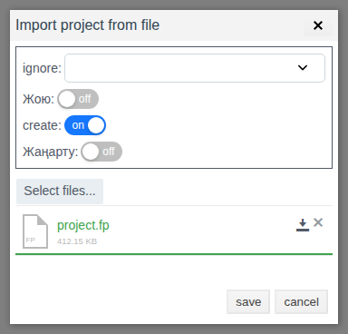
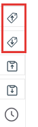
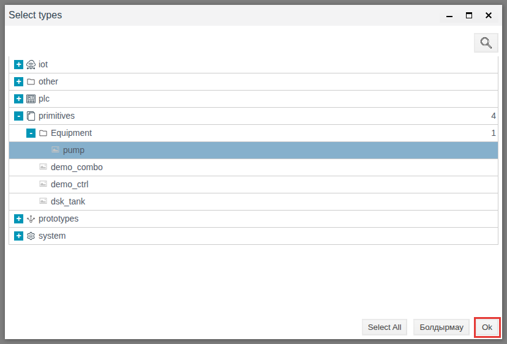
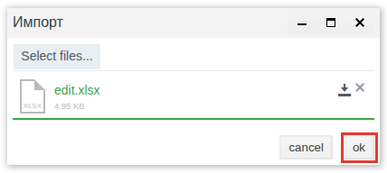
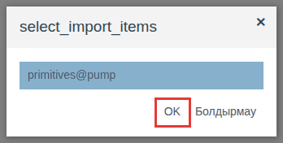
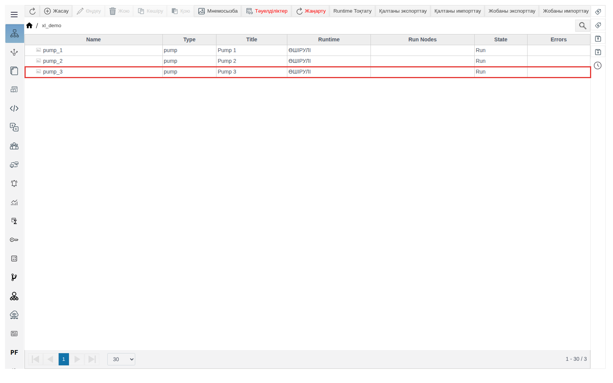
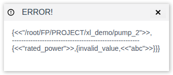

# Жобаны импорттау және экспорттау

Құжат жобаны серверлер арасында көшіретін, оның сақтық көшірмесін сақтайтын немесе нысандарды жаппай түзететін интегратор инженерге арналған: жобаны `project.fp` файлына қалай сақтау және осы файлды жобаға қалай жүктеу, нысандарды Excel кестесіне қалай түсіру және кестені қайта қалай жүктеу.

# Мазмұны

- [Терминдер сөздігі](#терминдер-сөздігі)
- [Кіріспе](#кіріспе)
- [Негізгі бөлім](#негізгі-бөлім)
    - [Экспорт](#экспорт)
    - [Файлға не кірмейді](#файлға-не-кірмейді)
    - [Экспорт файлын импорттау](#экспорт-файлын-импорттау)
    - [Excel арқылы алмасу](#excel-арқылы-алмасу)
- [Қорытынды](#қорытынды)

# Терминдер сөздігі

| Термин | Мағынасы |
|---|---|
| Экспорт файлы | Жоба нысандары бөлімдер бойынша жазылған `project.fp` файлы |
| Бөлім | Экспорт файлындағы жобаның бөлігі: жоба ағашы, примитивтер, пайдаланушылар және басқалар. Тізімі — [«Экспорт»](#экспорт) бөлімінде |
| Нысан түрі | Нысан құрылған Studio-ның кірістірілген түрі (бума, мұрағат, байланыс және басқалар), примитив немесе прототип. Жалпы құрылымның **Type** бағанында көрсетіледі |
| **export** құсбелгісі | Түр өрісінің қасиеті: өріс мәні экспорт файлына жазылады |
| **excel** құсбелгісі | Түр өрісінің қасиеті: өріс Excel кестесіне түсіріледі және одан жүктеледі |
| Нысан жолы | Нысанның жоба ағашындағы `/PROJECT` түбірінен бастап орны, мысалы `/PROJECT/<бума>/<нысан>` |

# Кіріспе

`project.fp` экспорт файлы жоба нысандарын сақтайды. Ол арқылы жобаны толығымен немесе жеке бөлімдерін басқа серверге көшіреді және ірі түзетулер алдында жобаның сақтық көшірмесін сақтайды. Файл FACEPLATE жаңартуында да қолданылады, [«FACEPLATE нұсқасы және жаңарту»](../../administration/update/update.md) қараңыз.

Excel кестесі басқа міндетті шешеді: бір түрдегі көп нысанның өрістерін толтыру немесе түзету және тізім бойынша нысандар құру. Кестеге тек **excel** құсбелгісі бар өрістер түседі, ал кестені жүктеу нысандарды жоймайды.

Жобаны өзгертуге құқығы бар есептік жазбамен Studio-ға (`http://<сервер>:9000/fp/studio`) қолжетімділік қажет.

# Негізгі бөлім

## Экспорт

**Жобаны файлға экспорттау** және **Жобаны файлдан импорттау** батырмалары — Studio-ның оң жақ тік панеліндегі жоғарыдан үшінші және төртінші белгішелер: белгіленгендердің жоғарғысы — экспорт, төменгісі — импорт.

**Жобаны файлға экспорттау** батырмасын басыңыз. Жоба файлға бөлімдер бойынша жазылады. **ignore** тізімінде сақтаудың қажеті жоқ бөлімдерді белгілеңіз: экспорт белгіленген бөлімдерді өткізіп жібереді, ал белгіленбегендердің бәрін файлға сақтайды. Жобаны толығымен сақтау үшін тізімді бос қалдырыңыз. **save** басыңыз. Браузер `project.fp` файлын сақтайды.

**ignore** тізіміндегі бөлімдер:

| Бөлім | Ішінде не бар |
|---|---|
| `global_libraries` | [Кітапхана модульдері](../../project_logic/library_modules/library_modules.md) және [JS кітапханалары](../../project_logic/js_library/js_library.md) |
| `environment` | [Суреттер кітапханасы](../../mnemo/images.md), [локализация сөздігі](../localization/localization.md) және жобаның жүйелік баптаулары: [дабылдар](../../../en/alarms/alarm/alarm.md), авторизация, [графикалық редактор](../../mnemo/editor.md) және басқалар |
| `primitives` | [Примитивтер](../primitives/primitives.md) |
| `catalogs` | [Каталогтар](../catalogs/catalogs.md) |
| `prototypes` | [Прототиптер](../prototypes/prototypes.md) |
| `usergroups` | [Рөлдер](../../access/roles.md) |
| `users` | [Пайдаланушылар](../../access/users.md): парольсіз есептік жазбалар. Импорттан кейін парольдер қайта беріледі, [«Пайдаланушылар», «Пароль» бөлімін](../../access/users.md#пароль) қараңыз |
| `project` | Жоба ағашы: бумалар, нысандар, сызбалар |
| `user_rights` | [Рөлдердің мнемосызбаларға құқықтары](../../access/roles.md#мнемосызбаларға-құқықтар): қарау және өзгерту |

## Файлға не кірмейді

Мұрағаттардың жинақталған мәндері және оқиғалар журналының жазбалары түйін базасында сақталады және файлға кірмейді. Бос базаға импорттағаннан кейін жобаның мұрағаттары бос болады және қайтадан толтырылады.

Примитивтің немесе прототиптің өз өрісінің мәні файлға өрісте **export** құсбелгісі қойылған жағдайда ғана түседі, [«Примитивтер» құжатының «Өрістер» бөлімін](../primitives/primitives.md#өрістер) және [«Прототиптер» құжатының «Өрістер» бөлімін](../prototypes/prototypes.md#өрістер) қараңыз. Құсбелгісі жоқ өрістердің мәндері файлға жазылмайды, басқа базаға импорттағаннан кейін оларды қайта береді. Мұндай мәндерді көшіру үшін экспорттан бұрын өріске **export** құсбелгісін қойыңыз немесе мәндерді Excel арқылы көшіріңіз: ол үшін өрісте **excel** құсбелгісі болуы керек, [«Excel арқылы алмасу»](#excel-арқылы-алмасу) бөлімін қараңыз. Studio-ның кірістірілген түрлерінде (бумалар, мұрағаттар, дабылдар және басқалар) файлдағы өрістер жиыны алдын ала белгіленген.

## Экспорт файлын импорттау

1. **Жобаны файлдан импорттау** батырмасын басып, **Select files...** батырмасымен `project.fp` таңдаңыз.
2. **Жою**, **create**, **Жаңарту** ауыстырғыштарын қажетті тіркесімде қосыңыз, төмендегі тіркесімдер кестесін қараңыз. **ignore** тізімінде экспорттағыдай бөлімдерді белгілеңіз; бүкіл жобаның файлы үшін тізімді бос қалдырыңыз. **save** басыңыз.

    

3. `The project was imported successfully` хабарламасын күтіп, бетті жаңартыңыз. Жобаның бумалары мен нысандары ағашта пайда болады.

Импорт терезесі файл мен жоба нысандарын жол бойынша салыстырады. Ауыстырғыштар айырмашылықтармен не істеу керегін анықтайды:

| Ауыстырғыш | Не істейді |
|---|---|
| **Жою** | Файлда жоқ нысандарды жобадан жояды |
| **create** | Жобада жоқ нысандарды файлдан құрады. Бар нысандарды өзгертпейді |
| **Жаңарту** | Файлда да, жобада да бар нысандарға файлдағы өріс мәндерін жазады. **create**-пен бірге қосылады |

Ауыстырғыштардың тіркесімдері:

| Қосулы | Нысан тек файлда | Нысан файлда да, жобада да | Нысан тек жобада | Қашан қолдану керек |
|---|---|---|---|---|
| **create** | Құрылады | Өзгермейді | Қалады | Жобаны бос базаға көшіру; жобадағы түзетулерді өшірмей жетіспейтінін қосу |
| **create** және **Жаңарту** | Құрылады | Файлдан өрістерді алады | Қалады | Файлдан өзгерістерді әкелу және тек осы жобада құрылған нысандарды сақтау |
| **Жою** және **create** | Құрылады | Өзгермейді | Жойылады | Ортақ нысандардағы түзетулерді өшірмей артығын алып тастау және жетіспейтінін қосу |
| **Жою**, **create** және **Жаңарту** | Құрылады | Файлдан өрістерді алады | Жойылады | Жобаны файлдың дәл көшірмесі ету |
| **Жою** | Құрылмайды | Өзгермейді | Жойылады | Жобадан тек файлда жоқты алып тастау |

**Жою** қосулы импорт файл жасалғаннан кейін жобада құрылған нысандарды да жояды. Мұндай импорт алдында ағымдағы жобаның экспорт файлын сақтаңыз: жойылғанды одан **create** қосулы импортпен қайтаруға болады.

Импорт кезіндегі **ignore** тізімі файл экспортталған тізіммен сәйкес келуі керек. Экспорт кезінде белгіленген бөлімдер файлда жоқ, және **Жою** қосулы импорт олардың мазмұнын жобадан жояды. Мысалы, экспорт кезінде `users` және `usergroups` белгіленіп, импорт кезінде белгіленбесе, импорт жобаның пайдаланушылары мен рөлдерін, оның ішінде кіріктірілгендерін жояды.

Экспорт кезінде қандай бөлімдер белгіленгені белгісіз болса, **Жою** қосылмаған импорт жобаға зиян келтірмейді: **create** және **Жаңарту** файлда жоқ бөлімдерге тимейді. **Жою** қосу үшін **ignore** тізімінде жобада өзгеріссіз қалуы керек бөлімдерді белгілеңіз: импорт белгіленген бөлімдерді өзгертпейді және жоймайды.

## Excel арқылы алмасу

Excel кестесі арқылы көп нысанның өрістерін бірден толтырады: зауыттық нөмірлерді енгізеді, баптау мәндерін түзетеді, жабдық тізімі бойынша нысандар құрады. Экспорт файлынан айырмашылығы — кестені Excel-де немесе басқа кесте редакторында ашып түзетеді, содан кейін қайта жүктейді. Кесте арқылы **excel** құсбелгісі бар, бірақ **export** құсбелгісі жоқ өрістердің мәндері де көшіріледі: мұндай мәндер экспорт файлына түспейді.

| | `project.fp` экспорт файлы | `faceplate_project.xlsx` кестесі |
|---|---|---|
| Ішінде не бар | Жоба бөлімдері толығымен: **export** құсбелгісі қойылған өрістері бар нысандар, экрандар, пайдаланушылар және басқалар | Бір бумадағы таңдалған түрлердің нысандары, тек **excel** құсбелгісі бар өрістер |
| Қайда түзетеді | Түзетпейді, тек Studio-ға жүктейді | Excel-де немесе басқа кесте редакторында |
| Нысанның сызбалары (`screen`, `view1`–`view15`, `settings`) | Көшіріледі | Көшірілмейді; кестені жүктегенде бұрынғы күйінде қалады |
| Жүктегенде нысандарды жоя ма | Иә, **Жою** ауыстырғышымен | Жоқ |
| Қашан қолданады | Жобаны көшіру, сақтық көшірме | Өрістерді жаппай түзету, тізім бойынша нысандар құру |

**Экспорт .xlsx** және **Импорт .xlsx** батырмалары — Studio-ның оң жақ панеліндегі жоғарыдан бірінші және екінші белгішелер. Олар **Жалпы құрылым** бөлімінде, сондай-ақ **Каталогтар** және **Локализациялар** бөлімдерінде жұмыс істейді; басқа бөлімдерде белсенді емес. Мұнда Жалпы құрылым сипатталған. Каталог жазбаларымен алмасу [«Каталогтар» құжатының «Excel арқылы алмасу» бөлімінде](../catalogs/catalogs.md#excel-арқылы-алмасу), сөздікпен алмасу [«Локализация» құжатының «Excel арқылы алмасу» бөлімінде](../localization/localization.md#excel-арқылы-алмасу) сипатталған.

### Excel-ге түсіру

1. **Жалпы құрылым** бөлімінде нысандары бар буманы екі рет шертіп ашыңыз. Кестеге бума ішіндегі кез келген тереңдіктегі барлық нысандар түседі, буманың өзі кірмейді. Бүкіл жобаны түсіру үшін түбірде қалыңыз.
2. **Экспорт .xlsx** басыңыз. **Select types** терезесінде түрлер топтастырылған: `iot`, `other`, `plc`, `primitives`, `prototypes`, `system`. Қажетті түрлерді таңдап (бірнешеуін — Ctrl арқылы), **Ok** басыңыз. **Select All** батырмасы барлық түрдің нысандарын бірден түсіреді.

    

3. Браузер `faceplate_project.xlsx` файлын сақтайды.

### .xlsx кестесі

Әр түр — жеке парақ. Парақтың атауы және бірінші бағанның тақырыбы — түр:

| Түр | Парақ |
|---|---|
| Studio-ның кірістірілген түрі: бума, мұрағат, скрипт, IoT немесе PLC байланысы және басқалар | Түр атауы, мысалы `FOLDER` немесе `plc_modbus_connection` |
| Примитив | `primitives@<примитив>` |
| Прототип | `prototype@<прототип>` |

Бірінші баған — нысанның жолы, бір жол — бір нысан. Қалған бағандар — **excel** құсбелгісі бар өрістер, әліпби ретімен. Кірістірілген түрлердің өрістер жиыны алдын ала белгіленген (`title`, `disabled` және басқалар). Примитивтер мен прототиптерде жүйелік өрістерге **Өрістер** бөлімінде **excel** құсбелгісі қойылған өз өрістері қосылады, Құсбелгі қайда қойылады: [«Примитивтер» құжатының «Өрістер» бөлімі](../primitives/primitives.md#өрістер), [«Прототиптер» құжатының «Өрістер» бөлімі](../prototypes/prototypes.md#өрістер). Каталог өрістеріне **excel** құсбелгісі дәл солай қойылады, [«Каталогтар» құжатының «Өрістер» бөлімін](../catalogs/catalogs.md#өрістер) қараңыз.

Мысалда `pump` примитивінің екі данасы бар `xl_demo` бумасы түсірілген. `rated_power` және `serial_no` өрістерінде **excel** құсбелгісі бар, `in_service` өрісінде жоқ, сондықтан `in_service` кестеге түспеді:

| primitives@pump | comment | icon | prototype | rated_power | serial_no | title |
|---|---|---|---|---|---|---|
| /PROJECT/xl_demo/pump_2 | :atom:null | :atom:null | :atom:null | 30 | SN-1002 | Pump 2 |
| /PROJECT/xl_demo/pump_1 | :atom:null | :atom:null | :atom:null | 22 | SN-1001 | Pump 1 |

Мәндер қалай жазылады:

| Ұяшықта | Мәні |
|---|---|
| Сан немесе мәтін | Өріс мәні сол күйінде: `30`, `SN-1002` |
| `:atom:null` | Өріс берілмеген |
| `:atom:true`, `:atom:false` | Логикалық мән. Жүктегенде Excel-дің `TRUE` және `FALSE` логикалық мәндері де жарайды |
| `fp://PROJECT/...` | Жоба нысанына сілтеме, мысалы прототип данасының `prototype` бағанындағы прототипке |
| Бұйра жақшадағы мәтін `{ ... }` | Құрама мән, мысалы нысанның белгішесі немесе баптаулары |
| `:string:` және `:term:` префикстері бар мәндер | Қызметтік жазба. Оны өзгертпей қалдырыңыз |

### Excel-ден жүктеу

1. Кестеге өзгерістер енгізіп, оны сақтаңыз. Мысалда `pump_2` данасының `rated_power` мәні өзгертілді (30 → 37) және `pump_3` жолы қосылды, өзгерістер белгіленген:

    | primitives@pump | comment | icon | prototype | rated_power | serial_no | title |
    |---|---|---|---|---|---|---|
    | /PROJECT/xl_demo/pump_2 | :atom:null | :atom:null | :atom:null | **37** | SN-1002 | Pump 2 |
    | /PROJECT/xl_demo/pump_1 | :atom:null | :atom:null | :atom:null | 22 | SN-1001 | Pump 1 |
    | **/PROJECT/xl_demo/pump_3** | **:atom:null** | **:atom:null** | **:atom:null** | **18.5** | **SN-1003** | **Pump 3** |

2. **Импорт .xlsx** басыңыз. Нысандар кестедегі жолдар бойынша табылады, сондықтан ашық бума маңызды емес. **Select files...** батырмасымен файлды таңдап, **ok** басыңыз.

    

3. `select_import_items` терезесінде файлдың парақтары берілген. Қажеттілерін таңдап (бірнешеуін — Ctrl арқылы), **OK** басыңыз.

    

4. `Импорт выполнен успешно` хабарламасын күтіп, оны жабыңыз. Нысандар тізімі жаңарады.

Мысалда жүктегеннен кейін `pump_2` жаңа мәнге ие болды, ал бумада `pump_3` пайда болды:

Жүктеу жолдар мен ұяшықтарды қалай өңдейді:

| Кестеде | Нәтиже |
|---|---|
| Жол жобада бар | Парақ бағандарындағы өрістер кестедегі мәндерді алады |
| Жол жобада жоқ | Парақ түріндегі нысан жолдың соңғы бөлігіндегі атаумен құрылады. Жолдағы жетіспейтін бумалар құрылады |
| Міндетті өрістері толтырылмаған жаңа нысан | Құрылмайды; **ERROR!** терезесінде толтырылмаған өріс көрсетіледі |
| Өрістің бағаны парақта жоқ | Өріс өзгермейді. Түзету үшін жол бағаны мен қажетті өрістердің бағандары жеткілікті |
| Ұяшық бос | Өріс тазартылады |
| **excel** құсбелгісі жоқ өрістің бағаны | Жүктелмейді |
| Нысан жобада бар, бірақ кестеде жоқ | Өзгермейді: Excel-ден жүктеу нысандарды жоймайды |

Егер мән өріске сай келмесе, мысалы `float` түріндегі өрісте мәтін болса, жол толығымен жүктелмейді, ал қалған жолдар жүктеледі. **ERROR!** терезесінде жүктелмеген нысандардың жолдары, өріс атаулары және қате мәндер көрсетіледі:

# Қорытынды

Экспорт файлы **Жобаны файлға экспорттау** батырмасымен сақталады: бос **ignore** тізімімен — бүкіл жоба, белгіленген бөлімдермен — оларсыз. **Жобаны файлдан импорттау** батырмасымен экспорттағыдай **ignore** тізімімен импортталады. **Жою**, **create** және **Жаңарту** ауыстырғыштары тіркесімдер кестесі бойынша таңдалады. Мұрағат мәндері және оқиғалар журналы файлға кірмейді.

Нысандардың өрістері Excel арқылы жаппай түзетіледі: Жалпы құрылым бумасындағы **Экспорт .xlsx** таңдалған түрлердің нысандарын түсіреді, **Импорт .xlsx** өзгертілген кестені жүктейді. Жүктеу парақ бағандарындағы өрістерді қайта жазады және жаңа жолдар бойынша нысандар құрады, бірақ ештеңені жоймайды.
