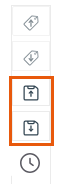

# Жобаны импорттау және экспорттау

Құжат жобаны серверлер арасында көшіретін немесе оның сақтық көшірмесін сақтайтын интегратор инженерге арналған: жобаны `project.fp` файлына қалай сақтау және осы файлды жобаға қалай жүктеу.

# Мазмұны

- [Кіріспе](#кіріспе)
- [Негізгі бөлім](#негізгі-бөлім)
    - [Экспорт](#экспорт)
    - [Файлға не кірмейді](#файлға-не-кірмейді)
    - [Экспорт файлын импорттау](#экспорт-файлын-импорттау)
- [Қорытынды](#қорытынды)

# Кіріспе

`project.fp` экспорт файлы жоба нысандарын сақтайды. Ол арқылы жобаны толығымен немесе жеке бөлімдерін басқа серверге көшіреді және ірі түзетулер алдында жобаның сақтық көшірмесін сақтайды. Файл FACEPLATE жаңартуында да қолданылады, [«FACEPLATE нұсқасы және жаңарту»](../../administration/update/update.md) қараңыз.

Жобаны өзгертуге құқығы бар есептік жазбамен Studio-ға (`http://<сервер>:9000/fp/studio`) қолжетімділік қажет.

# Негізгі бөлім

## Экспорт

**Жобаны файлға экспорттау** және **Жобаны файлдан импорттау** батырмалары — Studio-ның оң жақ тік панеліндегі жоғарыдан үшінші және төртінші белгішелер: белгіленгендердің жоғарғысы — экспорт, төменгісі — импорт.

**Жобаны файлға экспорттау** батырмасын басыңыз. Жоба файлға бөлімдер бойынша жазылады. **ignore** тізімінде сақтаудың қажеті жоқ бөлімдерді белгілеңіз: экспорт белгіленген бөлімдерді өткізіп жібереді, ал белгіленбегендердің бәрін файлға сақтайды. Жобаны толығымен сақтау үшін тізімді бос қалдырыңыз. **save** басыңыз. Браузер `project.fp` файлын сақтайды.

**ignore** тізіміндегі бөлімдер:

| Бөлім | Ішінде не бар |
|---|---|
| `global_libraries` | [Кітапхана модульдері](../../../en/project_logic/library_modules/library_modules.md) және [JS кітапханалары](../../../en/project_logic/js_library/js_library.md) |
| `environment` | [Суреттер кітапханасы](../../mnemo/images.md), [локализация сөздігі](../localization/localization.md) және жобаның жүйелік баптаулары: [дабылдар](../../../en/alarms/alarm/alarm.md), авторизация, [графикалық редактор](../../mnemo/editor.md) және басқалар |
| `primitives` | [Примитивтер](../primitives/primitives.md) |
| `catalogs` | [Каталогтар](../catalogs/catalogs.md) |
| `prototypes` | [Прототиптер](../prototypes/prototypes.md) |
| `usergroups` | [Рөлдер](../../access/roles.md) |
| `users` | [Пайдаланушылар](../../access/users.md): парольсіз есептік жазбалар. Импорттан кейін парольдер қайта беріледі, [«Пайдаланушылар», «Пароль» бөлімін](../../access/users.md#пароль) қараңыз |
| `project` | Жоба ағашы: бумалар, нысандар, сызбалар |
| `user_rights` | [Рөлдердің мнемосызбаларға құқықтары](../../access/roles.md#мнемосызбаларға-құқықтар): қарау және өзгерту |

## Файлға не кірмейді

Мұрағаттардың жинақталған мәндері және оқиғалар журналының жазбалары түйін базасында сақталады және файлға кірмейді. Бос базаға импорттағаннан кейін жобаның мұрағаттары бос болады және қайтадан толтырылады.

## Экспорт файлын импорттау

1. **Жобаны файлдан импорттау** батырмасын басып, **Select files...** батырмасымен `project.fp` таңдаңыз.
2. **Жою**, **create**, **Жаңарту** ауыстырғыштарын қажетті тіркесімде қосыңыз, төмендегі тіркесімдер кестесін қараңыз. **ignore** тізімінде экспорттағыдай бөлімдерді белгілеңіз; бүкіл жобаның файлы үшін тізімді бос қалдырыңыз. **save** басыңыз.

    

3. `The project was imported successfully` хабарламасын күтіп, бетті жаңартыңыз. Жобаның бумалары мен нысандары ағашта пайда болады.

Импорт терезесі файл мен жоба нысандарын жол бойынша салыстырады. Ауыстырғыштар айырмашылықтармен не істеу керегін анықтайды:

| Ауыстырғыш | Не істейді |
|---|---|
| **Жою** | Файлда жоқ нысандарды жобадан жояды |
| **create** | Жобада жоқ нысандарды файлдан құрады. Бар нысандарды өзгертпейді |
| **Жаңарту** | Файлда да, жобада да бар нысандарға файлдағы өріс мәндерін жазады. **create**-пен бірге қосылады |

Ауыстырғыштардың тіркесімдері:

| Қосулы | Нысан тек файлда | Нысан файлда да, жобада да | Нысан тек жобада | Қашан қолдану керек |
|---|---|---|---|---|
| **create** | Құрылады | Өзгермейді | Қалады | Жобаны бос базаға көшіру; жобадағы түзетулерді өшірмей жетіспейтінін қосу |
| **create** және **Жаңарту** | Құрылады | Файлдан өрістерді алады | Қалады | Файлдан өзгерістерді әкелу және тек осы жобада құрылған нысандарды сақтау |
| **Жою** және **create** | Құрылады | Өзгермейді | Жойылады | Ортақ нысандардағы түзетулерді өшірмей артығын алып тастау және жетіспейтінін қосу |
| **Жою**, **create** және **Жаңарту** | Құрылады | Файлдан өрістерді алады | Жойылады | Жобаны файлдың дәл көшірмесі ету |
| **Жою** | Құрылмайды | Өзгермейді | Жойылады | Жобадан тек файлда жоқты алып тастау |

**Жою** қосулы импорт файл жасалғаннан кейін жобада құрылған нысандарды да жояды. Мұндай импорт алдында ағымдағы жобаның экспорт файлын сақтаңыз: жойылғанды одан **create** қосулы импортпен қайтаруға болады.

Импорт кезіндегі **ignore** тізімі файл экспортталған тізіммен сәйкес келуі керек. Экспорт кезінде белгіленген бөлімдер файлда жоқ, және **Жою** қосулы импорт олардың мазмұнын жобадан жояды. Мысалы, экспорт кезінде `users` және `usergroups` белгіленіп, импорт кезінде белгіленбесе, импорт жобаның пайдаланушылары мен рөлдерін, оның ішінде кіріктірілгендерін жояды.

Экспорт кезінде қандай бөлімдер белгіленгені белгісіз болса, **Жою** қосылмаған импорт жобаға зиян келтірмейді: **create** және **Жаңарту** файлда жоқ бөлімдерге тимейді. **Жою** қосу үшін **ignore** тізімінде жобада өзгеріссіз қалуы керек бөлімдерді белгілеңіз: импорт белгіленген бөлімдерді өзгертпейді және жоймайды.

# Қорытынды

Экспорт файлы **Жобаны файлға экспорттау** батырмасымен сақталады: бос **ignore** тізімімен — бүкіл жоба, белгіленген бөлімдермен — оларсыз. **Жобаны файлдан импорттау** батырмасымен экспорттағыдай **ignore** тізімімен импортталады. **Жою**, **create** және **Жаңарту** ауыстырғыштары тіркесімдер кестесі бойынша таңдалады. Мұрағат мәндері және оқиғалар журналы файлға кірмейді.
