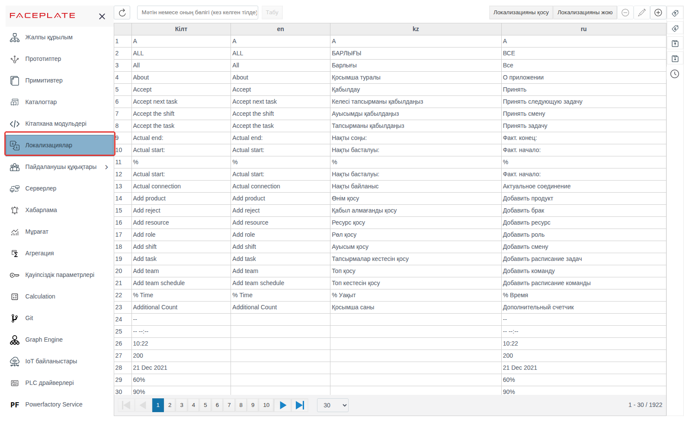
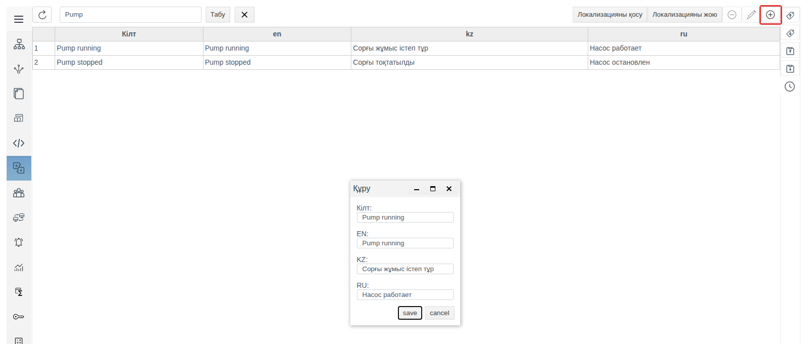
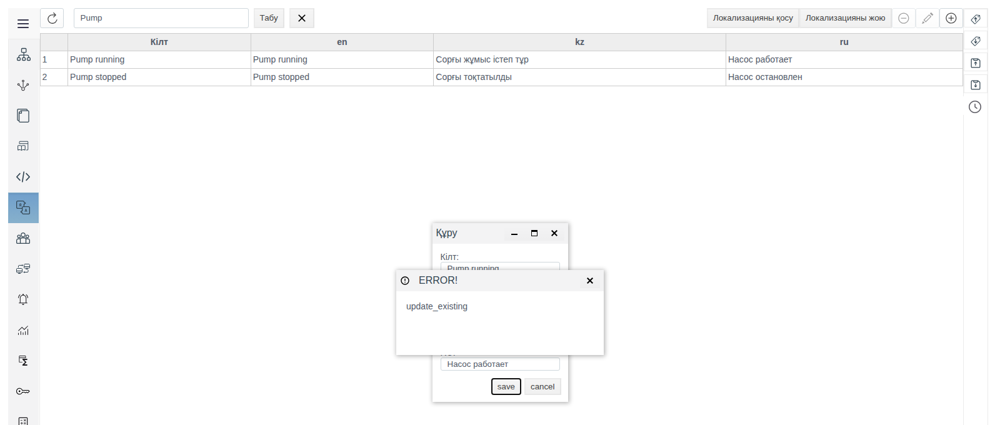
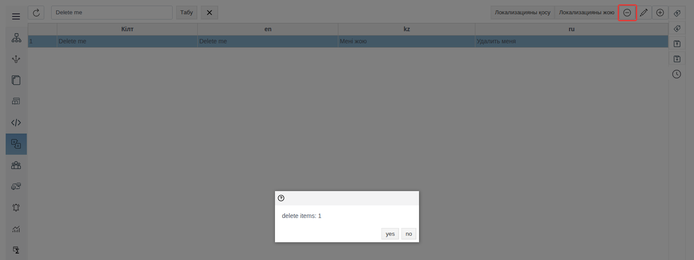
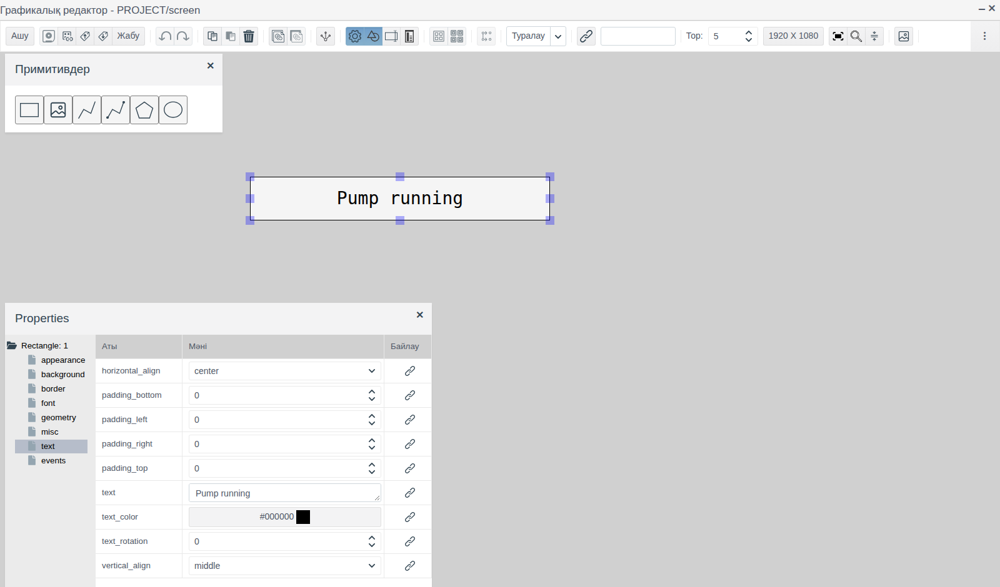
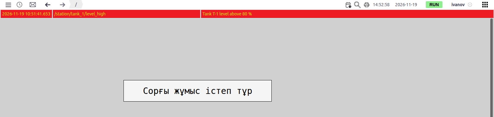
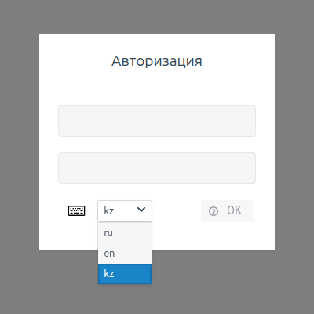
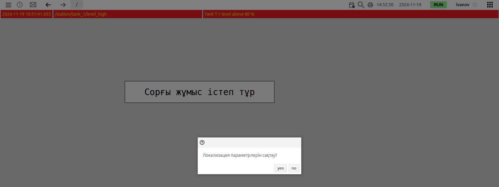
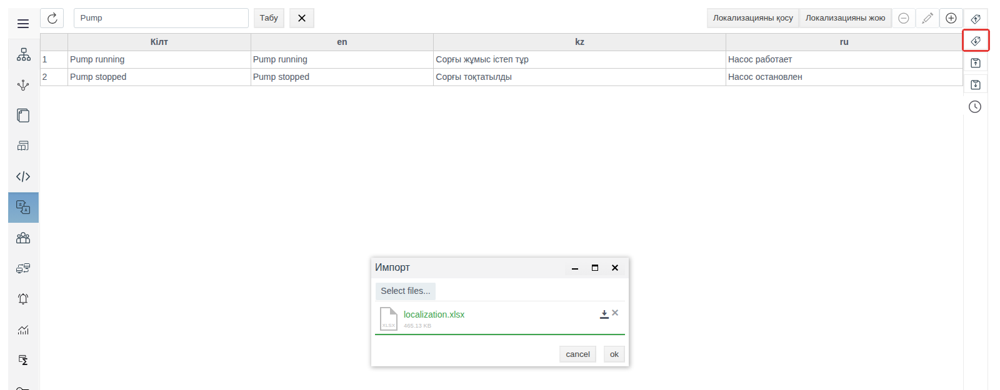

# Локализация

Бұл құжат FACEPLATE интерфейсінің және жоба мнемосызбалары мәтіндерінің аудармаларын баптайтын интегратор инженерге арналған.

# Мазмұны

- [Терминдер сөздігі](#терминдер-сөздігі)
- [Кіріспе](#кіріспе)
- [Негізгі бөлім](#негізгі-бөлім)
    - [Сөздік](#сөздік)
    - [Кілттер мен аудармалар](#кілттер-мен-аудармалар)
    - [Мнемосызбадағы мәтін](#мнемосызбадағы-мәтін)
    - [Тілді таңдау](#тілді-таңдау)
    - [Excel арқылы алмасу](#excel-арқылы-алмасу)
- [Қорытынды](#қорытынды)

# Терминдер сөздігі

| Термин | Мағынасы |
|---|---|
| Сөздік | **Локализациялар** бөлімінің кестесі: жол — кілт, баған — тіл |
| Кілт | Аударма ол бойынша ізделетін бастапқы мәтін. Studio немесе Runtime интерфейсінің жазуымен не мнемосызба элементінің қасиетіне енгізілген мәтінмен сәйкес келеді |
| Локализация | Сөздіктің тілі: тіл коды бар баған (`ru`, `en`, `kz`). |

# Кіріспе

Локализация Studio және Runtime интерфейсін кіру кезінде таңдалған тілде шығарады: мәзір, батырмалар, тақырыптар, хабарламалар. Сол сөздік бойынша Runtime ортасында мнемосызбалардың мәтіндері де аударылады: инженер мнемосызбаға кілт-мәтінді жазып, оның аудармаларын сөздікке енгізеді, ал оператор өз сеансының тіліндегі аударманы көреді.

Сөздік жоба мен FACEPLATE интерфейсіне ортақ: онда Studio және Runtime жазулары орыс, ағылшын және қазақ тілдерінде берілген 1900-ге жуық кілт бар. Мнемосызбаларға арналған кілттер сол кестеге қосылады.

Құжат бойындағы мысал — сорғы күйінің жазуы: `Pump running` кілті, аудармалары `Pump running` (en), `Сорғы жұмыс істеп тұр` (kz), `Насос работает` (ru).

Жобаны өзгерту құқығы бар тіркелгімен Studio ортасына (`http://<сервер>:9000/fp/studio`) кіру мүмкіндігі қажет.

# Негізгі бөлім

## Сөздік

Studio негізгі мәзірінен **Локализациялар** бөлімін ашыңыз. Бірінші баған — **Кілт**, қалғандары — әр тілге бір-бірден. Іздеу жолы (**Мәтін немесе оның бөлігі (кез келген тілде)**, **Табу** батырмасы) кілт және барлық аударма бойынша іздейді, сұрау кемінде үш таңбадан тұруы керек. Айқыш белгісі бар батырма іздеуді тастайды.

Кестенің оң жақ жоғарғы бұрышындағы белгіше-батырмалар кілттермен жұмыс істейді: **Кілтті жою**, **Кілтті өңдеу**, **Создать ключ и переводы** (атаулары қалқымалы кеңесте көрсетіледі).

## Кілттер мен аудармалар

**Создать ключ и переводы** батырмасын басыңыз. **Құру** пішінінде **Кілт** өрісін және тіл өрістерін (**EN**, **KZ**, **RU**) толтырып, **save** батырмасын басыңыз.

Кілт бірегей. Кілт сөздікте бұрыннан бар болса, сақтау `update_existing` мәтіні бар `ERROR!` қатесімен аяқталады, бар жазба өзгермейді. Аударманы өзгерту үшін кілтті тауып, жолды таңдаңыз да, **Кілтті өңдеу** батырмасын басыңыз.

Шығарылатын мәтінді өзгерту үшін қажетті тілдегі аударманы түзетіңіз. Кілт жазудың немесе элемент қасиетінің мәтінімен сәйкес келуі керек: кілттің атауын өзгертсеңіз, ескі мәні бар мәтін аудармасыз шығарылады.

Жою үшін жолды таңдап, **Кілтті жою** батырмасын басыңыз да, `delete items: 1` сұрауын **yes** батырмасымен растаңыз.

## Мнемосызбадағы мәтін

Runtime ортасында элемент қасиетінің мәні ретінде берілген мәтін аударылады. Мысал — **Примитивдер** палитрасындағы **Төртбұрыш** элементінің **text** тобындағы **text** қасиеті. Мән кілтпен таңбасына дейін сәйкес келуі керек.

Мнемосызбаны сақтап, оны Runtime ортасында ашыңыз. `kz` тілінде төртбұрыш `Сорғы жұмыс істеп тұр` мәтінін көрсетеді.

Мәтін әр жерде қалай көрсетіледі:

| Қай жерде | Не көрсетіледі |
|---|---|
| Runtime | Сеанс тіліндегі аударма; бұл тілде аударма болмаса — кілттің өзі |
| Studio ортасындағы графикалық редактор және **Алдын ала қарау режимі** | Аудармасыз кілт |
| **Енгізу-шығару өрісінің** **value** мәні | Аудармасыз енгізілген мәтін: бұл жазу емес, өрістің мәні |

Сөздік кіру кезінде жүктеледі. Ашық Studio немесе Runtime ортасында өзгерістерді көру үшін бетті жаңартыңыз (F5 немесе Ctrl+R) және қайта кіріңіз: интерфейс жазулары мен мнемосызба мәтіндері жаңа аудармалармен шығарылады.

## Тілді таңдау

Тіл кіру пішінінде (**Авторизация**) **OK** батырмасының жанындағы ашылмалы тізімде таңдалады, Studio және Runtime ортасында бірдей. Тізімде үш тіл бар: `ru`, `en`, `kz`. Сеанстың бүкіл интерфейсі және мнемосызба мәтіндері осы тілде шығарылады.

Тіл браузерде және пайдаланушының тіркелгісінде есте сақталады. Таңдалған тіл тіркелгі тілінен өзгеше болса, кіргеннен кейін `Локализация параметрлерін сақтау?` сұрағы шығады:

- **yes** — таңдалған тіл тіркелгінің тілі болады, келесі кірулерде сұрақ шықпайды;
- **no** — ағымдағы сеанс таңдалған тілде қалады, ал кіру пішіні келесі жолы тіркелгі тілін ұсынады.

## Excel арқылы алмасу

Excel сөздікті аудармашыға беріп, нәтижені жүктеуге ыңғайлы.

**Түсіру.** **Локализациялар** бөлімінің оң жақ тақтасында **Экспорт .xlsx** батырмасын басыңыз. Браузер `localization.xlsx` файлын сақтайды: `localization` парағы, `key` бағаны және әр тілге арналған `loc_<тіл коды>` бағандары.

| key | loc_en | loc_kz | loc_ru |
|---|---|---|---|
| Pump running | Pump running | Сорғы жұмыс істеп тұр | Насос работает |
| Pump stopped | Pump stopped | Сорғы тоқтатылды | Насос остановлен |

**Жүктеу.** **Импорт .xlsx** батырмасын басып, **Импорт** терезесінде файлды таңдаңыз (**Select files...**) да, **ok** басыңыз. `Импорт выполнен успешно` хабарламасы шығады. Жолдар `key` бойынша сәйкестендіріледі: бар кілттер жаңартылады, жаңалары қосылады. Файлда жоқ кілттер өзгермейді, сондықтан файлда тек жаңа және өзгертілген жолдардың болуы жеткілікті.

# Қорытынды

Мнемосызбаны аудару реті:

1. Мнемосызбада кілт-мәтіндерді беріңіз, мысалы төртбұрыштың **text** қасиетінде.
2. **Локализациялар** бөлімінде аудармалары бар кілттерді жасаңыз немесе оларды **Импорт .xlsx** арқылы жүктеңіз.
3. Runtime ортасына қажетті тілмен кіріп, мнемосызбаны тексеріңіз; тіл тіркелгіге бекітілуі керек болса, `Локализация параметрлерін сақтау?` сұрағына **yes** деп жауап беріңіз.
4. Сөздікті түзеткеннен кейін жаңа аудармаларды жүктеу үшін бетті жаңартыңыз (F5) және қайта кіріңіз.
