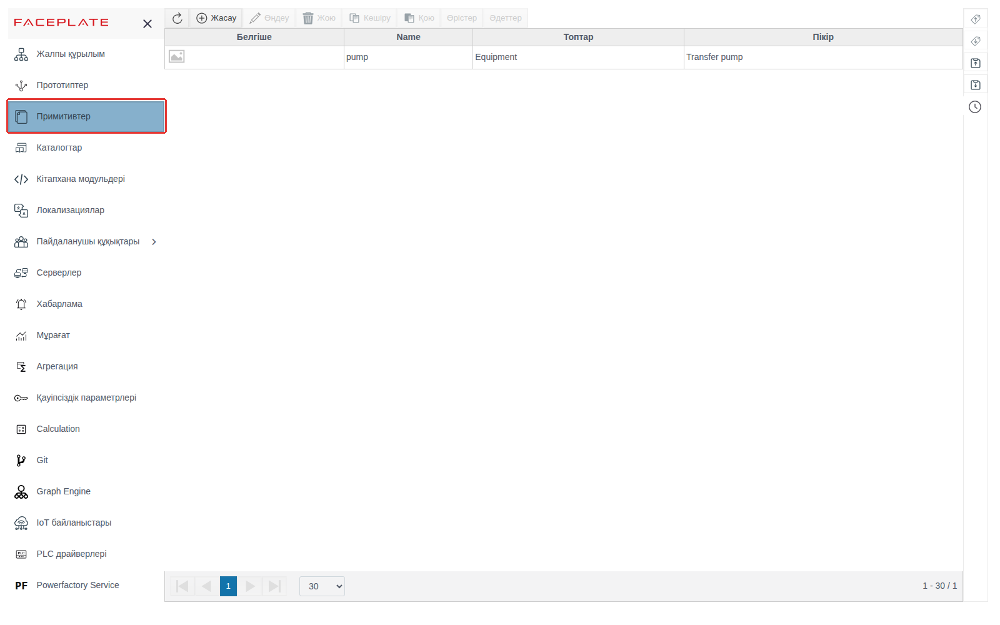
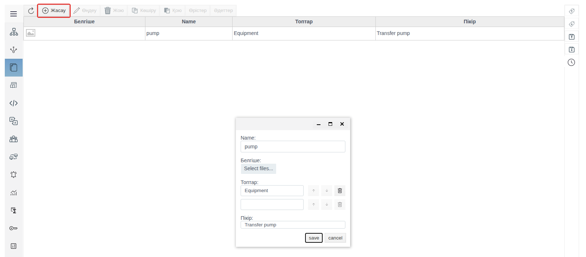
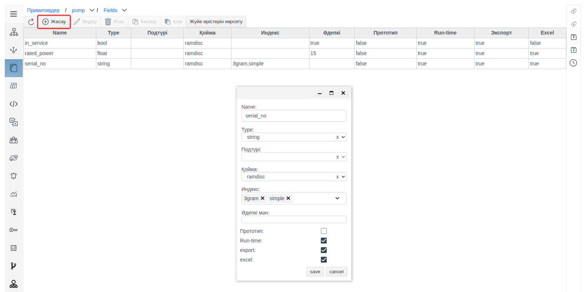
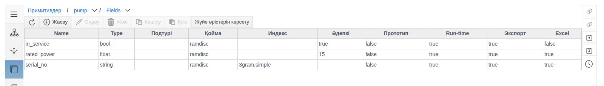
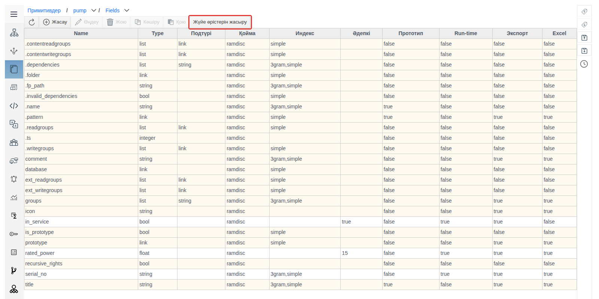
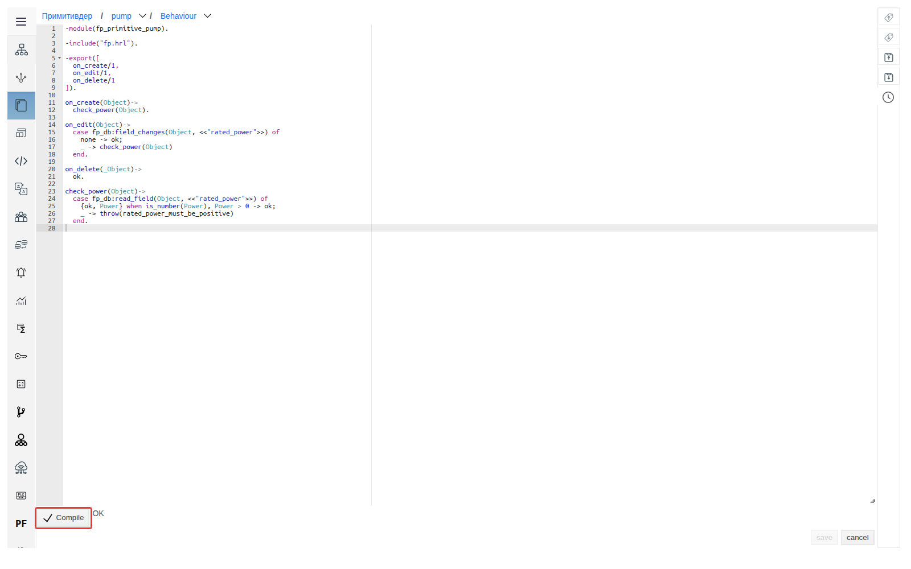
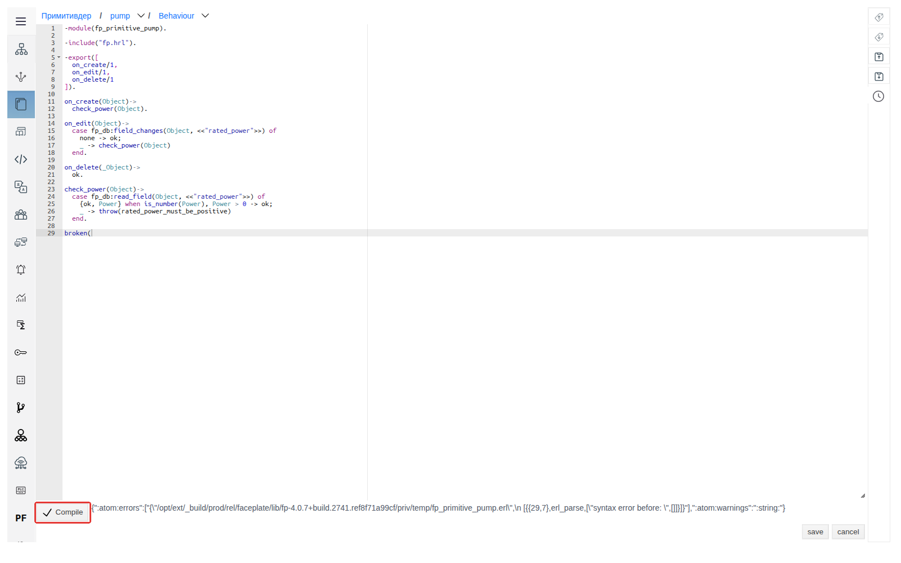
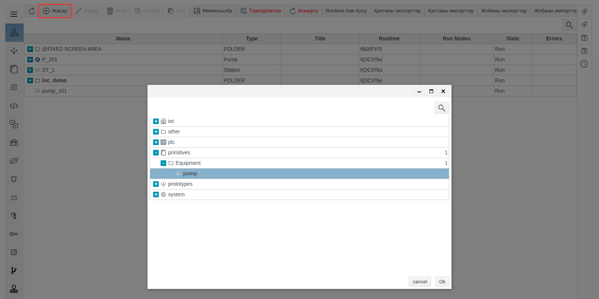
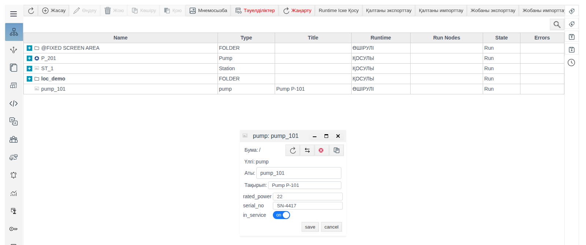
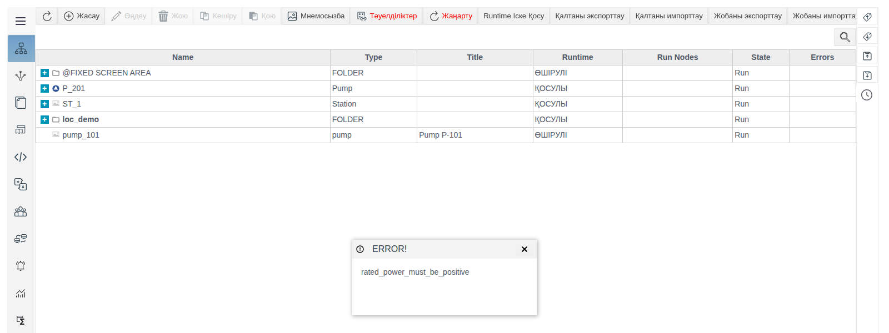

# Примитивтер

Бұл құжат интегратор инженерге арналған.

# Мазмұны

- [Терминдер сөздігі](#терминдер-сөздігі)
- [Кіріспе](#кіріспе)
- [Негізгі бөлім](#негізгі-бөлім)
    - [Примитивтер тізімі](#примитивтер-тізімі)
    - [Примитив жасау](#примитив-жасау)
    - [Өрістер](#өрістер)
    - [Әдеттер](#әдеттер)
    - [Жалпы құрылымдағы даналар](#жалпы-құрылымдағы-даналар)
    - [Примитивті өзгерту және жою](#примитивті-өзгерту-және-жою)
- [Қорытынды](#қорытынды)

# Терминдер сөздігі

| Термин | Мағынасы |
|---|---|
| Примитив | Жоба нысанының пайдаланушы анықтайтын түрі: өрістер жиыны және әдеттер. **Примитивтер** бөлімінде жасалады. |
| Дана | Жалпы құрылымда примитив негізінде жасалған нысан. Оның **Type** бағанында примитивтің атауы көрсетіледі. |
| Жалпы құрылым | Жоба нысандарының ағашы орналасқан Studio бөлімі ([«Жоба құрылымы»](../../../en/general/project_structure/FACEPLATE-start.md) құжатын қараңыз). |
| Өріс | Дананың атрибуты: атауы, түрі, сақтау орны, индекстері, әдепкі мәні. |
| Жүйелік өріс | Жобаның әр нысанында болатын өріс. **Жүйе өрістерін көрсету** батырмасымен көрсетіледі және өзгертілмейді. |
| Run-time өрісі | **Run-time** құсбелгісі қойылған өріс. Дана пішінінде көрсетіледі. |
| Топ | Түрді таңдау терезесіндегі примитив бумасы (`primitives / <топ>`). |
| Әдеттер | `on_create/1`, `on_edit/1`, `on_delete/1` функциялары бар Erlang модулі. Сервер оларды даналармен әрекеттер орындалғанда шақырады. |
| Прототип | **Прототиптер** бөліміндегі үлгі ([«Прототиптер»](../prototypes/prototypes.md) құжатын қараңыз). Өрістің **Прототип** құсбелгісі прототипті синхрондау кезінде оның мәнін көшіруді қосады. |

# Кіріспе

**Примитив** — жоба нысанының өз түрі. Интегратор оған өрістер жиынын және қажет болса Erlang тіліндегі серверлік логиканы (әдеттерді) береді. Сақталғаннан кейін примитив **Жалпы құрылымда** нысан жасау кезінде түрді таңдау терезесінде пайда болады, ал одан даналар жасалады — мысалы, станцияның атрибуттар жиыны және мәндерді тексеруі бірдей барлық сорғылары.

Бөлім Studio негізгі мәзірінде орналасқан: **Примитивтер** (**Прототиптерден** төмен). Әр примитивтің екі қойындысы бар:

* **Өрістер** — дана өрістерінің құрамы мен параметрлері;
* **Әдеттер** — дананы жасау, өзгерту және жою кезінде сервер орындайтын код.

Құжат бойындағы мысал — номиналды қуат, зауыттық нөмір және «жұмыста» белгісі өрістері бар, қуаттың нөлден үлкен екенін тексеретін `pump` (сорғы) примитиві.

Жобаны өзгерту құқығы бар тіркелгімен Studio ортасына (`http://<сервер>:9000/fp/studio`) кіру мүмкіндігі қажет.

# Негізгі бөлім

## Примитивтер тізімі



Кестеде әр примитивтің **Белгішесі**, **Name**, **Топтары** және **Пікірі** көрсетіледі. Құралдар тақтасы: **Жасау**, **Өңдеу**, **Жою**, **Көшіру**, **Қою**, **Өрістер**, **Әдеттер**. **Өрістер** және **Әдеттер** батырмалары дәл бір примитив таңдалғанда қолжетімді. Жолды екі рет шерту **Өрістер** қойындысын ашады.

Примитивтің ішінде жоғарыда `Примитивтер / pump / Fields` навигациялық жолы орналасқан. Ондағы ашылмалы тізімдер арқылы тізімге оралмай-ақ басқа примитивке немесе **Behaviour** қойындысына ауысуға болады.

## Примитив жасау

**Жасау** батырмасын басып, пішінді толтырыңыз, содан кейін **save** батырмасын басыңыз.



| Өріс | Мақсаты |
|---|---|
| **Name** | Примитивтің атауы. Бұл атау даналардың түрінде (Жалпы құрылымның **Type** бағаны) және әдеттер модулінде болады. Міндетті. |
| **Белгіше** | `.svg`, `.png`, `.jpg` немесе `.jpeg` суреті (**Select files...** батырмасы). Тізімде және түрді таңдау терезесінде көрсетіледі. Белгіше болмаса, орнына бос белгі көрсетіледі. |
| **Топтар** | Түрді таңдау терезесінде примитив түсетін бума (`primitives / <топ>`). Жол толтырылғаннан кейін жаңа бос жол пайда болады. ↑ ↓ батырмаларымен рет өзгертіледі, себет батырмасымен жол жойылады. |
| **Пікір** | Примитивтер тізіміне арналған еркін мәтін. |

Мысал: **Name** — `pump`, **Топтар** — `Equipment`, **Пікір** — `Transfer pump`.

## Өрістер

Примитивті таңдап, **Өрістер** батырмасын басыңыз. Жаңа примитив үшін тізім бос: тек өзіндік өрістер көрсетіледі, ал мұраланғандары жасырылған.

### Өріс жасау

**Жасау** батырмасын басып, пішінді толтырыңыз да, **save** батырмасын басыңыз. **save** батырмасы **Name** және **Type** толтырылғанда белсенді болады.



| Параметр | Мәндері | Мақсаты және шектеулері |
|---|---|---|
| **Name** | мәтін | Өрістің атауы. Цифрдан басталмауы керек. |
| **Type** | `string`, `integer`, `float`, `bool`, `link`, `atom`, `term`, `list` | Мәннің түрі. Міндетті. |
| **Подтүрі** | `string`, `integer`, `float`, `bool`, `link`, `atom`, `term` | Тізім элементтерінің түрі. Тек **Type** = `list` болғанда қолжетімді және міндетті. |
| **Қойма** | `disc`, `ramdisc`, `ram` | Мән сақталатын орын. Әдепкісі — `ramdisc`. |
| **Индекс** | төменде қараңыз | Өріс бойынша іздеуге және сүзуге арналған индекстер. Бірнешеуін таңдауға болады. |
| **Әдепкі мән** | мәтін | Жаңа дананың пішініне қойылады. |
| **Прототип** | құсбелгі | Прототипті оның көшірмелерімен синхрондау кезінде өріс мәні көшіріледі. Примитив данасы прототиптің ішінде орналасса қажет ([«Прототиптер»](../prototypes/prototypes.md) құжатының синхрондау бөлімін қараңыз). |
| **Run-time** | құсбелгі | Өріс Жалпы құрылымдағы дананы жасау және өңдеу пішінінде көрсетіледі. Құсбелгісіз өріс пішінде көрсетілмейді. |
| **export** | құсбелгі | Өріс буманың немесе жобаның экспортына енеді. |
| **excel** | құсбелгі | Өріс `.xlsx` файлына түсіру мен одан жүктеуге қатысады. |

Қандай индекстерді таңдауға болатыны түрге байланысты:

| Type | Қолжетімді индекстер |
|---|---|
| `string`, ішкі түрі `string` болатын `list` | `simple`, `3gram` |
| `integer` | `simple`, `datetime` |
| `float` | жоқ: **Индекс** өрісі қолжетімсіз |
| қалғандары | `simple` |

Мысалдың өрістері:

| Name | Type | Индекс | Әдепкі | Run-time | export | excel |
|---|---|---|---|---|---|---|
| `rated_power` | `float` | — | `15` | ✓ | ✓ | ✓ |
| `serial_no` | `string` | `simple`, `3gram` | — | ✓ | ✓ | ✓ |
| `in_service` | `bool` | — | `true` | ✓ | ✓ | — |



Түр өріс сақталған бойда өзгереді, қайта іске қосу қажет емес.

### Жүйелік өрістер

**Жүйе өрістерін көрсету** батырмасы (қайта басқанда — **Жүйе өрістерін жасыру**) тізімге жобаның әр нысанында болатын өрістерді қосады: `.name`, `.folder`, `.pattern`, `title`, `comment`, `groups`, `icon`, `prototype` және басқалары. Жүйелік өрістердің жолдары түспен ерекшеленген. Олардың параметрлерін өзгертуге болмайды.



## Әдеттер

Әдеттер — примитив даналарымен әрекеттер орындалғанда сервер шақыратын Erlang модулі. Модуль транзакцияның ішінде орындалады:

| Функция | Қай кезде шақырылады |
|---|---|
| `on_create/1` | дана жасалғанда |
| `on_edit/1` | дананың өрістері өзгертілгенде |
| `on_delete/1` | дана жойылғанда |

Әр функция дана нысанын қабылдайды және сәтті болғанда `ok` мәнін қайтаруы керек. Функция ерекше жағдай тудырса немесе құласа, транзакция кері қайтарылады: нысан жасалмайды, өзгертілмейді немесе жойылмайды, ал Studio ортасында ерекше жағдай мәтіні бар **ERROR!** терезесі шығады.

### Жазу және сақтау

Примитивті таңдап, **Әдеттер** батырмасын басыңыз. Жаңа примитив үшін редакторда үлгі ашылады: `fp_primitive_<примитив атауы>` атты модуль және `ok` мәнін қайтаратын үш функция. Бірінші жолдағы модуль атауын өзгертпеңіз.

Сақтау реті:

1. Кодты жазыңыз.
2. **Compile** батырмасын басып, батырманың оң жағында `OK` шыққанын күтіңіз.
3. **save** батырмасын басыңыз.

> **Маңызды.** Пішін редактордағы мәтінді тек **Compile** басылғанда алады. **Compile** баспай **save** басылса, кодтың алдыңғы нұсқасы сақталады.

**save** басылғаннан кейін сервер модульді бірден компиляциялап, қосады. Жаңа әдеттер даналармен орындалатын келесі әрекеттерге қолданылады.

`pump` үшін мысал: номиналды қуаттың нөлден үлкен екенін тексеру. Дана өзгертілгенде тексеру тек `rated_power` өрісі өзгерсе орындалады.

```erlang
-module(fp_primitive_pump).

-include("fp.hrl").

-export([
  on_create/1,
  on_edit/1,
  on_delete/1
]).

on_create(Object)->
  check_power(Object).

on_edit(Object)->
  case fp_db:field_changes(Object, <<"rated_power">>) of
    none -> ok;
    _ -> check_power(Object)
  end.

on_delete(_Object)->
  ok.

check_power(Object)->
  case fp_db:read_field(Object, <<"rated_power">>) of
    {ok, Power} when is_number(Power), Power > 0 -> ok;
    _ -> throw(rated_power_must_be_positive)
  end.
```



Мысалда қолданылатын функциялар:

| Шақыру | Нәтижесі |
|---|---|
| `fp_db:read_field(Object, <<"өріс">>)` | `{ok, Мән}` |
| `fp_db:field_changes(Object, <<"өріс">>)` | өріс осы әрекетте өзгермесе — `none` |
| `throw(Себеп)` | әрекетті кері қайтару; `Себеп` **ERROR!** терезесінде шығады |

Кері қайтарусыз диагностика үшін `?LOGWARNING(Пішім, Аргументтер)` және `?LOGERROR(Пішім, Аргументтер)` макростарын қолданыңыз: олар сервер журналына жазады.

### Компиляция қателері

Кодта қате болса, **Compile** батырмасының оң жағында оның сипаттамасы жол нөмірімен және орнымен шығады, мысалы `[{29,7},erl_parse,["syntax error before: ",[]]]`.



> **Назар аударыңыз.** Компиляция қатесінен кейін **save** батырмасы белсенді күйде қалады. Кодты тек `OK` жауабынан кейін сақтаңыз.

## Жалпы құрылымдағы даналар

**Жалпы құрылымды** ашып, қажетті бумаға өтіңіз де, **Жасау** батырмасын басыңыз. Түрді таңдау терезесінде **primitives** тобын және примитив тобын ашып, примитивті таңдаңыз да, **Ok** батырмасын басыңыз.



Дана пішінінде **Аты** және **Тақырып**, ал олардан төмен — әдепкі мәндермен толтырылған, **Run-time** құсбелгісі бар примитив өрістері орналасқан. Енгізу элементі өрістің түріне байланысты: `string` үшін — мәтін өрісі, `integer` және `float` үшін — сандық өріс, `bool` үшін — **on/off** ауыстырғышы, `list` үшін — жолдар тізімі, `link` үшін — нысанды таңдау.



Дана ағымдағы бумада пайда болады. **Type** бағанында примитивтің атауы, **Title** бағанында — **Тақырып** көрсетіледі.

Мысалдың әдеттерін тексеру:

| Әрекет | Нәтижесі |
|---|---|
| `rated_power` = `22` мәнімен `pump_101` жасау | дана жасалды |
| `rated_power` = `0` мәнімен дана жасау | `rated_power_must_be_positive` мәтіні бар **ERROR!** терезесі, дана жасалмады |
| `pump_101` данасында `rated_power` мәнін `-1` етіп өзгерту | **ERROR!** терезесі, мән сақталмады |



## Примитивті өзгерту және жою

**Өңдеу** батырмасы **Жасау** ашатын пішінді ашады. Өрістер мен әдеттер өз қойындыларында өзгертіледі.

> **Назар аударыңыз.** **Жою** примитивті жобадағы **барлық данасымен бірге** жояды. Растау терезесі (`delete items: N`, **yes** / **no** батырмалары) даналардың емес, тек жойылатын примитивтердің санын көрсетеді. Жоймас бұрын Жалпы құрылымда даналарды **Type** бағаны бойынша табыңыз.

# Қорытынды

Примитивпен жұмыс реті:

1. **Примитивтер → Жасау**: атауы, тобы, белгішесі.
2. **Өрістер**: өрістерді қосыңыз. Дана пішінінде толтырылатын өрістерге **Run-time**, ал экспортта және `.xlsx` файлында қажет өрістерге **export** және **excel** құсбелгілерін қойыңыз.
3. Логика қажет болса — **Әдеттер**: кодты жазып, **Compile** басыңыз, `OK` шыққанын күтіңіз, содан кейін **save** басыңыз.
4. **Жалпы құрылым → Жасау → primitives**: даналарды жасаңыз.

Примитивті жою оның барлық данасын жояды.
