# Прототиптер

Бұл құжат Studio ортасында жоба құрастыратын интегратор инженерлерге арналған.

# Мазмұны

- [Терминдер сөздігі](#терминдер-сөздігі)
- [Кіріспе](#кіріспе)
- [Негізгі бөлім](#негізгі-бөлім)
    - [Прототип жасау](#прототип-жасау)
    - [Контент](#контент)
    - [Өрістер](#өрістер)
    - [Әдеттер](#әдеттер)
    - [Дана жасау](#дана-жасау)
    - [Прототипті даналарымен синхрондау](#прототипті-даналарымен-синхрондау)
    - [Ішкі прототиптер](#ішкі-прототиптер)
    - [Прототипті экспорттау және импорттау](#прототипті-экспорттау-және-импорттау)
- [Қорытынды](#қорытынды)

# Терминдер сөздігі

| Термин | Мағынасы |
|---|---|
| Прототип | **Прототиптер** бөліміндегі үлгі. Ол Контенттен, Өрістерден және Әдеттерден тұрады. Прототип негізінде даналар жасалады |
| Дана | Прототип негізінде жасалған жоба нысаны. Ол прототипке сілтемені және оның контентінің көшірмесін сақтайды. **Type** (Түрі) бағанында прототиптің атауы көрсетіледі |
| Контент | Әр данаға көшірілетін прототип нысандарының ағашы |
| Прототип өрістері | **Өрістер** қойындысында анықталған даналардың өзіндік өрістері |
| Әдеттер | `on_create/1`, `on_edit/1`, `on_delete/1` функциялары бар Erlang модулі. Сервер бұл функцияларды даналармен тиісті әрекеттер орындалғанда шақырады |
| Синхрондау (Sync) | Таңдалған режимдер бойынша даналарды прототиптің ағымдағы күйіне сәйкестендіру |
| Ішкі прототип | Данасы басқа прототиптің контентінде орналасқан прототип |
| Прототип тобы | Түрді таңдау терезесіндегі прототип бумасы (`prototypes / <топ>`) |
| Жалпы құрылым | Жоба нысандарының ағашы орналасқан Studio бөлімі ([«Жоба құрылымы»](../../../en/project_structure/FACEPLATE-start.md) құжатын қараңыз) |
| Run-time өрісі | **Run-time** құсбелгісі қойылған өріс. Дана пішінінің **Runtime** қойындысында көрсетіледі |
| `disc` / `ramdisc` / `ram` сақтау орны | Өріс мәні сақталатын орын: дискіде; дискідегі көшірмесімен бірге жедел жадта; тек жедел жадта |
| `simple` / `3gram` / `datetime` индексі | Өрісті іздеуге арналған индекс: дәл мәні бойынша; жол үзіндісі бойынша; күн мен уақыт бойынша |
| `.prt` файлы | Прототиптің экспорт файлы |

# Кіріспе

**Прототип** — жобаның кез келген қайталанатын бөлігінің үлгісі. Ол жабдық бірлігі, технологиялық учаске, есепке алу торабы, қосылымдар немесе [есептеулер](../../../en/project_logic/calculation/calculation.md) жиынтығы болуы мүмкін: жоба нысандарынан құрастырылатын және бірнеше рет кездесетін кез келген құрылым. Бұл құрылым прототипте бір рет сипатталады, содан кейін оның негізінде қажетті сандағы **даналар** жасалады. Әр дана құрылымның көшірмесін алады. Прототиптегі өзгерістер барлық данаға **Sync** командасымен қолданылады.

Бөлім Studio негізгі мәзірінде орналасқан: **Прототиптер**. Әр прототиптің үш бөлігі бар, олардың әрқайсысы жеке батырмамен ашылады:

| Бөлік | Батырма | Не қамтиды |
|---|---|---|
| Контент | **Контент** | Әр данаға көшірілетін нысандар ағашы |
| Өрістер | **Өрістер** | Дананың өзіндік өрістері: атауы, түрі, сақтау орны, әдепкі мәні |
| Әдеттер | **Әдеттер** | Дананы жасау, өзгерту және жою кезінде сервер орындайтын Erlang коды |

Құжат бойындағы мысал сорғы станциясына негізделген:

| Нысан | Міндеті |
|---|---|
| `Pump` прототипі («Сорғылар» тобы) | Сорғы: контентінде `motor` бумасы, `rated_power`, `location`, `running` өрістері бар |
| `P_201` данасы | Жобаның түбіріндегі P-201 сорғысы |
| `Station` прототипі | Контентінде `P1` сорғы данасы орналасқан станция |
| `ST_1` данасы | Жобаның түбіріндегі станция |

Жобаны өзгерту құқығы бар тіркелгімен Studio ортасына (`http://<сервер>:9000/fp/studio`) кіру мүмкіндігі қажет.

# Негізгі бөлім

## Прототип жасау

Studio негізгі мәзірінен **Прототиптер** бөлімін ашыңыз. Тізімде әр прототиптің белгішесі, атауы, топтары және түсініктемесі көрсетілген.

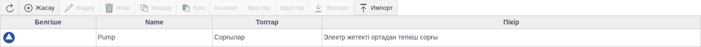

**Жасау** батырмасын басып, пішінді толтырыңыз:

| Өріс | Мақсаты |
|---|---|
| **Name** (Атауы) | Прототиптің атауы, міндетті өріс. Түрді таңдау терезесінде прототип осы атаумен көрсетіледі |
| **Белгіше** | `.svg`, `.png`, `.jpg` немесе `.jpeg` файлы. Бұл белгіше даналарға мұраланады |
| **Топтар** | Түрді таңдау терезесіндегі прототип бумасы. Әр келесі жол ішкі буманы анықтайды |
| **Пікір** | Еркін мәтін |

**Sync** және **Show fields** (Өрістерді көрсету) батырмалары тек сақталған прототип үшін жұмыс істейді. Олар [«Прототипті даналарымен синхрондау»](#прототипті-даналарымен-синхрондау) және [«Өрістер»](#өрістер) бөлімдерінде сипатталған.

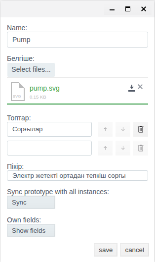

Сақтаңыз. Прототиппен бірге бос Контент пен Өрістер жасалады, ал Әдеттерге дайын код үлгісі беріледі.

Прототипті екі рет шерту оның Контентін ашады. Кестенің үстіндегі навигация жолы (**Прототиптер / Pump / Content**) тізімге қайтуға мүмкіндік береді.

## Контент

Прототипті таңдап, **Контент** батырмасын басыңыз. Мұнда Жалпы құрылымдағыдай нысандар ағашы және сол батырмалар бар: **Жасау**, **Өңдеу**, **Жою**, **Көшіру**, **Қою**, **Мнемосызба**, **Тәуелділіктер**.

`Pump` контентіне `motor` бумасын қосыңыз:

1. **Жасау** батырмасын басыңыз.
2. **system** тобын ашып, **FOLDER** түрін таңдаңыз да, **Ok** батырмасын басыңыз.

   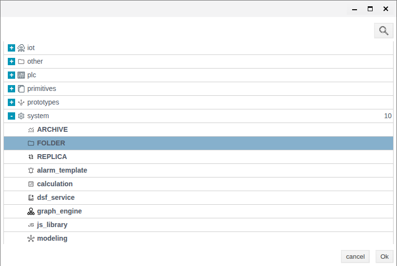

3. **Аты** өрісіне `motor`, ал **Тақырып** өрісіне «Электрқозғалтқыш» деп енгізіңіз. Сақтаңыз.

   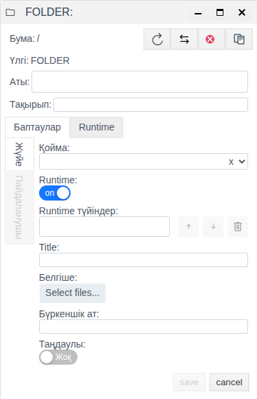

Басқа түрдегі нысандар да түрді таңдау терезесіндегі тиісті топтардан осылай қосылады: `iot` ([IoT](../../../en/data_collection/IoT/IoT.md)), `plc` ([PLC қосылымдары](../../../en/data_collection/plc_connections/general_en.md)), `primitives` ([«Примитивтер»](../../../en/project_objects/primitives/primitives.md)), `prototypes`, `system` (мысалы, [есептеулер](../../../en/project_logic/calculation/calculation.md) және [User Script](../../../en/project_logic/user_script/user_script.md)).

Пішіндегі **Бума** өрісі контент түбірінен басталатын жолды көрсетеді: `/` — түбірдің өзі. `P_201` данасында `/motor` бумасы `P_201/motor` жолында орналасады.

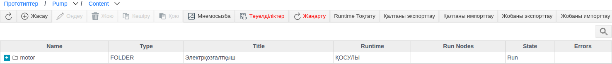

Контент түбіріндегі **Мнемосызба** батырмасы прототиптің мнемосызбаларын ашады: `screen`, `view1`–`view15` және `settings`. Олар жобаның мнемосызбаларына «Прототип» графикалық элементі ретінде енгізіледі, ал `settings` әр дана пішінінің **Пайдаланушы** қойындысында көрсетіледі. Толығырақ [«Мнемосызбалар редакторы»](../../mnemo/editor.md) құжатының «Прототип сызбалары» бөлімінен қараңыз.

## Өрістер

**Өрістер** батырмасын басыңыз. Кестеде прототиптің өзіндік өрістері көрсетіледі. **Жүйе өрістерін көрсету** батырмасы оларға мұраланған өрістерді (`.name`, `.folder`, `.pattern` және басқаларын) қосады. Мұраланған өрістің атауын өзгертуге болмайды.

**Жасау** батырмасын басып, өріс пішінін толтырыңыз.

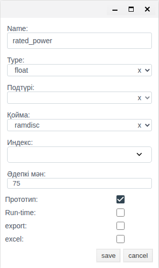

| Өріс | Мәндері | Ережелері |
|---|---|---|
| **Name** | — | Міндетті |
| **Type** | `string`, `integer`, `float`, `bool`, `link`, `atom`, `term`, `list` | Міндетті |
| **Подтүрі** (элемент түрі) | `list` түрінен басқа сол түрлер | Тек `list` түрі үшін міндетті: тізім элементтерінің түрін анықтайды |
| **Қойма** (сақтау орны) | `disc`, `ramdisc`, `ram` | Міндетті, әдепкісі — `ramdisc` |
| **Индекс** | `simple`, `3gram`, `datetime` | Міндетті емес. `string` үшін `simple` және `3gram`, `integer` үшін `simple` және `datetime` қолжетімді; `float` үшін тізім бос |
| **Әдепкі мән** | — | Өріске басқа мән берілгенге дейін қолданылатын мән |
| **Прототип** | Құсбелгі | `update` режимінде синхрондау кезінде өріс мәні прототиптен даналарға көшіріледі. Бұл құсбелгі қойылмаған өрісті `update` өзгертпейді |
| **Run-time** | Құсбелгі | Өріс дана пішінінің **Runtime** қойындысында және **Show fields** терезесінде көрсетіледі |
| **export** | Құсбелгі | Өріс жобаның экспорт файлына енгізіледі |
| **excel** | Құсбелгі | Өріс Excel арқылы дерек алмасуға қатысады |

Мысалда `Pump` прототипінің үш өрісі бар:

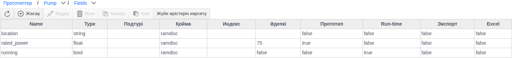

Дана пішінінің **Runtime** қойындысында тек **Run-time** құсбелгісі қойылған өрістер және `disabled` жүйелік өрісі көрінеді. Бұл құсбелгі қойылмаған өрістер (`rated_power`, `location`) дана пішінінде көрсетілмейді.

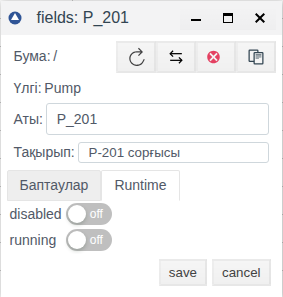

**Прототиптің өз Run-time өрістерінің мәндері.** Прототипті **Өңдеу** арқылы ашып, **Show fields** батырмасын басыңыз. Прототиптің Run-time өрістері көрсетілген «Pump default field values» терезесі ашылады. Терезе тек сақталған прототип үшін қолжетімді; әйтпесе прототиптің табылмағаны туралы хабарлама шығады.

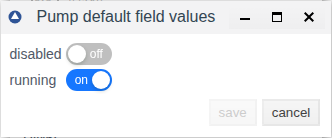

> [!NOTE]
> Бұл терезедегі мәндер жаңа дана жасалған кезде оған көшірілмейді. Мысалда `Pump` прототипінде `running` қосулы, ал одан кейін жасалған `P_202` данасында ол өшірулі. Бар даналарға мән `update` режимінде синхрондау арқылы көшіріледі, ол үшін өрістің **Прототип** құсбелгісі қойылуы керек.

## Әдеттер

**Әдеттер** батырмасын басыңыз. Үш функциядан тұратын дайын үлгісі бар Erlang код редакторы ашылады:

| Функция | Қай кезде шақырылады |
|---|---|
| `on_create/1` | Прототиптің жаңа данасы жасалғанда |
| `on_edit/1` | Дананың өзіндік өрістері өзгертілгенде |
| `on_delete/1` | Дана жойылғанда |

Әр функция дана нысанын қабылдап, `ok` мәнін қайтаруы керек. Функция ерекше жағдай тудырса, бүкіл транзакция кері қайтарылады. Жұмысты тоқтатуды қажет етпейтін қателерді `?LOGWARNING` және `?LOGERROR` макростары арқылы журналға жазыңыз.

Кодты **Compile** (Компиляциялау) батырмасымен тексеріп, сақтаңыз.

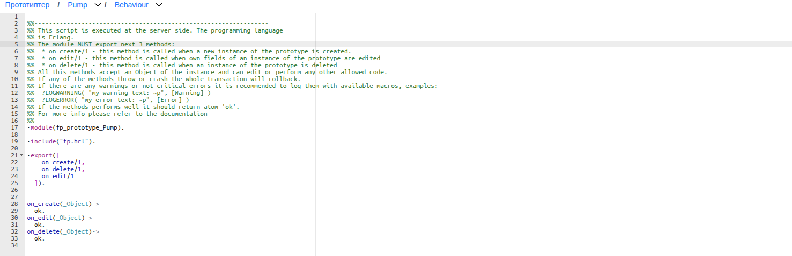

## Дана жасау

1. Жалпы құрылымда дана орналасатын буманы ашып, **Жасау** батырмасын басыңыз.
2. **prototypes** тобын, одан кейін прототиптің «Сорғылар» тобын ашыңыз. `Pump` прототипін таңдап, **Ok** батырмасын басыңыз.

   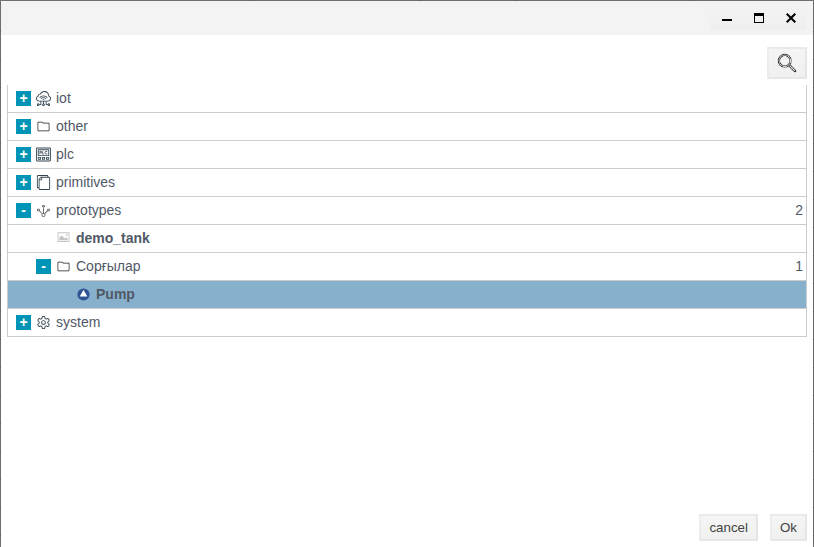

3. **Аты** өрісіне `P_201`, ал **Тақырып** өрісіне «P-201 сорғысы» деп енгізіңіз. Сақтаңыз.

   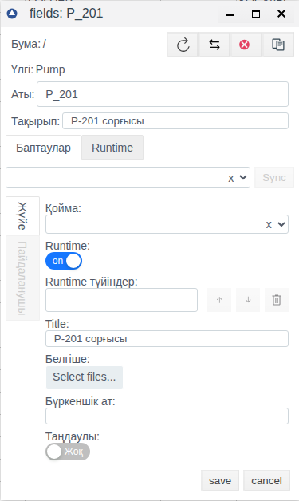

Ағашта прототиптің белгішесі бар `P_201` данасы пайда болады, оның **Type** бағанында `Pump` көрсетіледі. Ішінде контенттің көшірмесі орналасады.

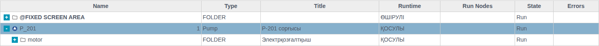

Дана пішінінде оның прототипіне сілтеме көрсетілген: `Pump/content`.

## Прототипті даналарымен синхрондау

Синхрондау прототиптің барлық данасын оның ағымдағы күйіне сәйкестендіреді. Прототипті таңдап, **Өңдеу**, одан кейін **Sync** батырмасын басыңыз. Қажетті режимдерді белгілеп, **OK** батырмасын басыңыз.

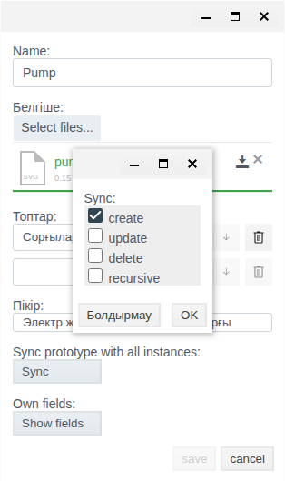

| Режим | Не істейді |
|---|---|
| `create` | Даналарға оларда әлі жоқ контент нысандарын қосады. Бар нысандарды өзгертпейді |
| `update` | Дана нысандарындағы **Прототип** құсбелгісі қойылған өрістерді, соның ішінде дана түбірінің өрістерін прототиптегі мәндермен қайта жазады |
| `delete` | Прототиптен жойылған нысандарды даналардан да жояды. Данаға қолмен қосылған нысандар сақталады |
| `recursive` | Синхрондауды контентінде осы прототиптің данасы орналасқан сыртқы прототиптердің даналарына да қолданады ([«Ішкі прототиптер»](#ішкі-прототиптер) бөлімін қараңыз) |

Режимдерді бірге қолдануға болады. `update`, `delete` және `recursive` үшін жүйе растауды сұрайды; **yes** жауабын таңдаңыз. Ешбір режим таңдалмаса, «Синхрондау опциялары таңдалмаған» хабарламасы шығады. Синхрондау сәтті аяқталғанда «Синхрондау аяқталды» хабарламасы көрсетіледі.

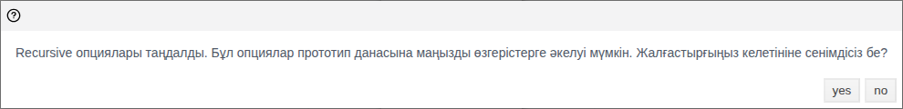

> [!WARNING]
> `update` режимі дана түбірінің өрістерін де қайта жазады. Мысалда `update` орындалғаннан кейін `P_201` данасының «P-201 сорғысы» тақырыбы өшіп қалды, себебі `Pump` контентінің түбіріндегі тақырып бос. `update` орындалғаннан кейін даналардың тақырыптары мен өзіндік өрістерін тексеріңіз.

Жобадан алынған мысал:

| `Pump` прототипіндегі өзгеріс | Режим | `P_201` данасындағы нәтиже |
|---|---|---|
| `valve` бумасы қосылды | `create` | `valve` пайда болды |
| `motor` тақырыбы → «Электрқозғалтқыш» | `update` | `motor` тақырыбы = «Электрқозғалтқыш», `P_201` тақырыбы тазартылды |
| `valve` бумасы жойылды | `delete` | `valve` жойылды, қолмен қосылған `local_notes` сақталды |
| Прототипте `running` қосулы, **Прототип** құсбелгісі алынып тасталған | `update` | `running` өзгермеді |
| `running` өрісінің **Прототип** құсбелгісі қойылды | `update` | `running` қосылды |

## Ішкі прототиптер

Бір прототиптің данасын басқа прототиптің контентіне орналастыруға болады. Мысалда `Station` контентінде `Pump` прототипінің `P1` данасы жасалған (**Контент** → **Жасау** → **prototypes** → «Сорғылар» → `Pump`).

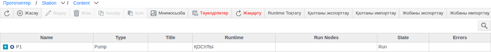

`ST_1` станция данасы `P1` көшірмесін алады. `Pump` прототипінің тікелей даналары — `P_201` және `Station` контентіндегі `P1`; `Pump` прототипін кез келген режимде синхрондау сол даналарға қолданылады. `ST_1/P1` — екінші деңгейдегі дана, оған өзгерістер әртүрлі жолмен жетеді:

| Синхрондау | `P_201` | `ST_1/P1` |
|---|---|---|
| `Pump`: `create` + `recursive`, `seal` бумасы қосылды | `seal` пайда болды | `seal` пайда болды |
| `Pump`: `create`, `bearing` бумасы қосылды | `bearing` пайда болды | Өзгеріс жоқ |
| `Pump`: `update` + `recursive`, `motor` тақырыбы өзгертілді | Тақырып жаңартылды | Өзгеріс жоқ |
| `Station`: `update` | — | `motor` тақырыбы жаңартылды |

> [!NOTE]
> `recursive` екінші деңгейге жаңа нысандарды (`create`) көшіреді, бірақ өрістердің өзгерістерін (`update`) көшірмейді. Сыртқы прототиптің даналарындағы өрістерді жаңарту үшін `Pump` прототипін синхрондағаннан кейін `Station` үшін **Sync** командасын `update` режимінде орындаңыз.

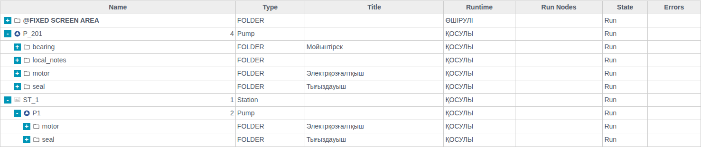

## Прототипті экспорттау және импорттау

**Экспорттау.** Прототипті таңдап, **Экспорт** батырмасын басыңыз. Браузер `prototype.prt` файлын сақтайды. Прототип таңдалмаған кезде батырма белсенді емес.

**Импорттау.** **Импорт** батырмасын басып, қажетті режимдерді қосыңыз, `.prt` файлын таңдаңыз да, сақтаңыз. Сәтті аяқталғанда «The prototype was imported successfully» хабарламасы көрсетіледі.

| Ауыстырғыш | Не істейді |
|---|---|
| **create** | Файлда бар, бірақ жобада әлі жоқ нысандарды жасайды |
| **Жаңарту** | Бар нысандарды файлдағы мәндермен жаңартады |
| **Жою** | Файлда жоқ прототип нысандарын жояды |

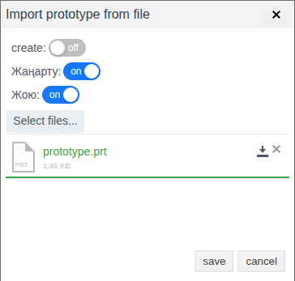

Өзгерістер даналарға да қолданылуы керек болса, импорттаудан кейін **Sync** командасын орындаңыз.

# Қорытынды

Прототиппен жұмыс істеудің әдеттегі реті:

1. Прототип жасап, оның белгішесі мен тобын орнатыңыз.
2. Жоба нысандарынан Контентті құрастырыңыз.
3. Өрістерді сипаттаңыз. Дана пішінінде көрсетілуі керек өрістерге **Run-time**, ал синхрондалуы керек өрістерге **Прототип** құсбелгісін қойыңыз. Run-time өрістерінің мәндерін даналарға `update` режимінде синхрондау арқылы көшіріңіз.
4. Қажет болса, Әдеттерді толықтырып, **Compile** батырмасымен тексеріңіз.
5. Жалпы құрылымда даналарды жасаңыз.
6. Прототипті өзгерткеннен кейін **Sync** командасын орындаңыз: жаңа нысандар үшін `create`, өзгерген өрістер үшін `update`, жойылған нысандар үшін `delete`, ішкі прототиптер үшін `recursive` қолданыңыз. Ішкі даналардың өрістерін сыртқы прототипті `update` режимінде синхрондау арқылы жаңартыңыз. `update` орындалғаннан кейін дана түбірлерінің өрістерін тексеріңіз.
7. Прототипті жобалар арасында тасымалдау үшін **Экспорт** және **Импорт** батырмаларын пайдаланыңыз.
