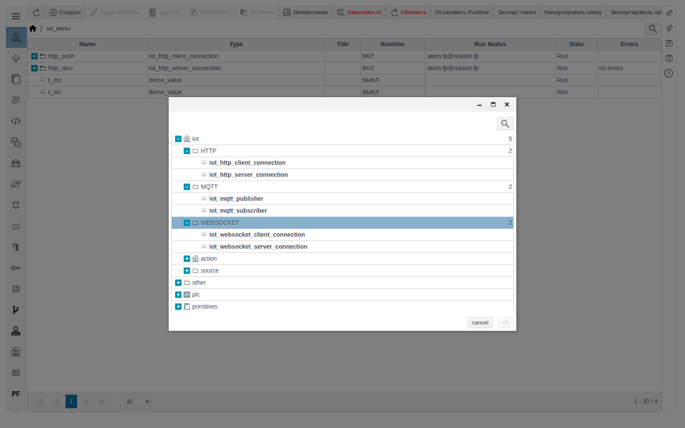
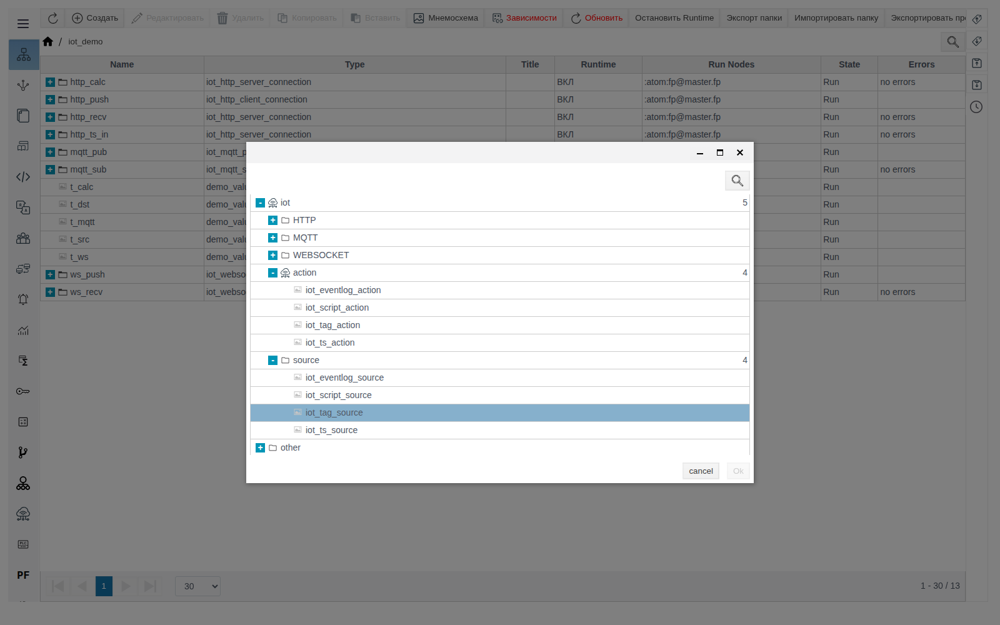
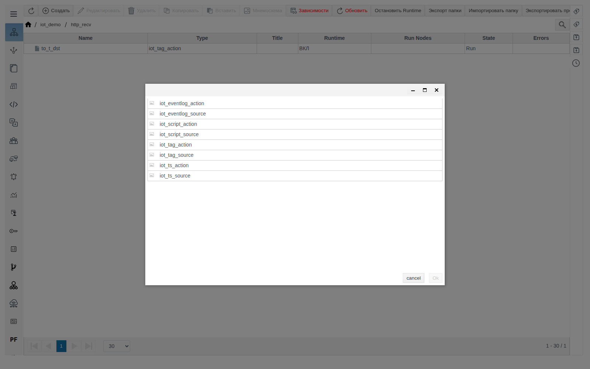
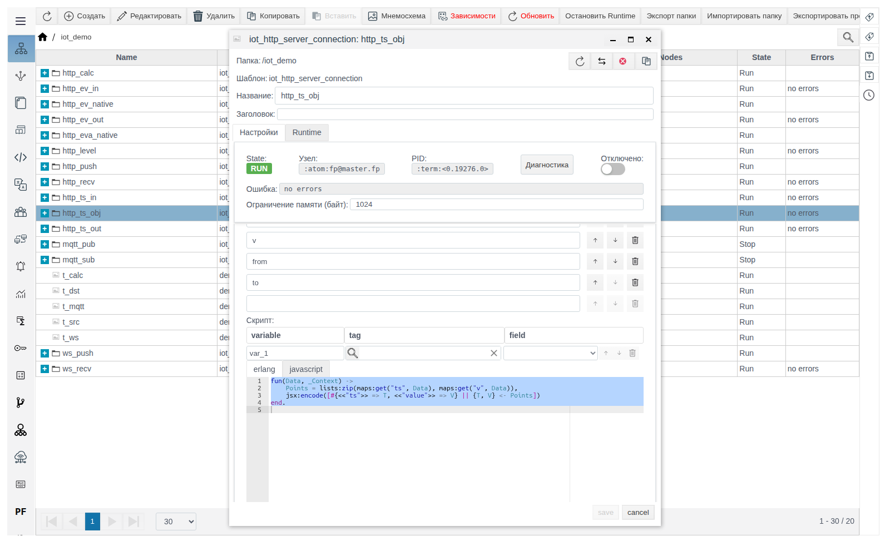
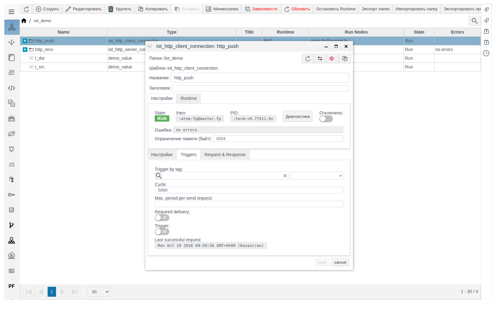
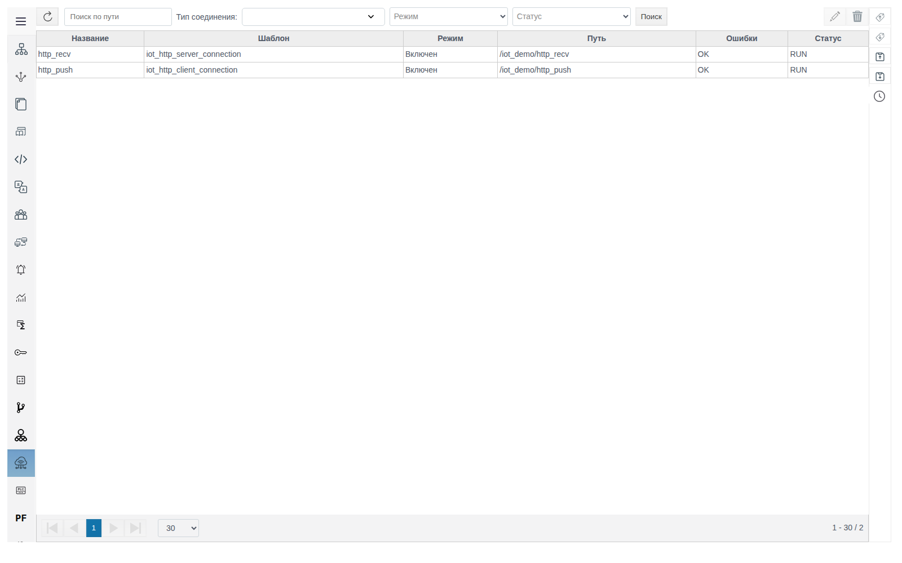
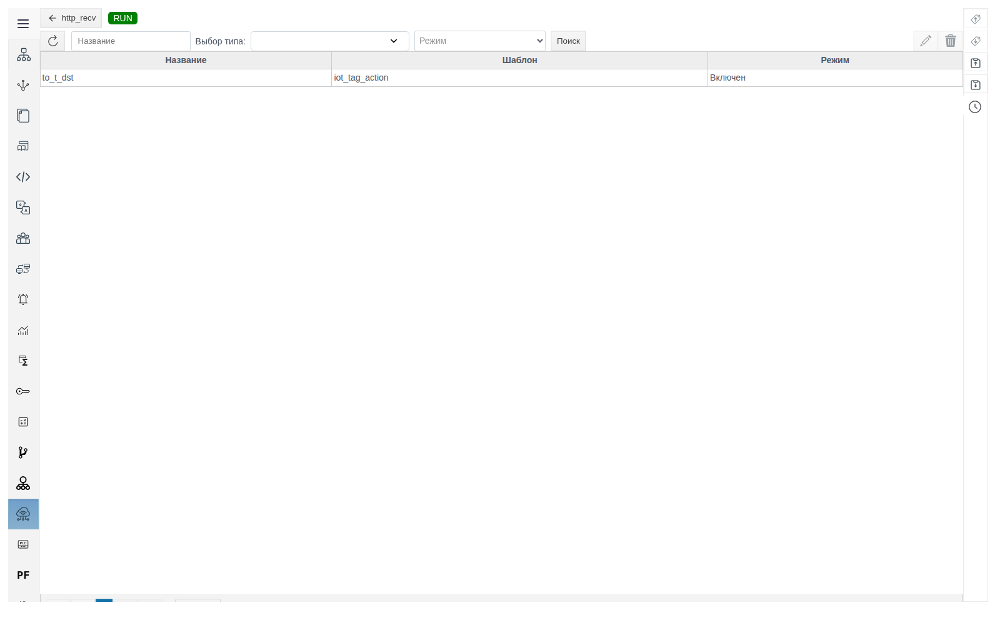
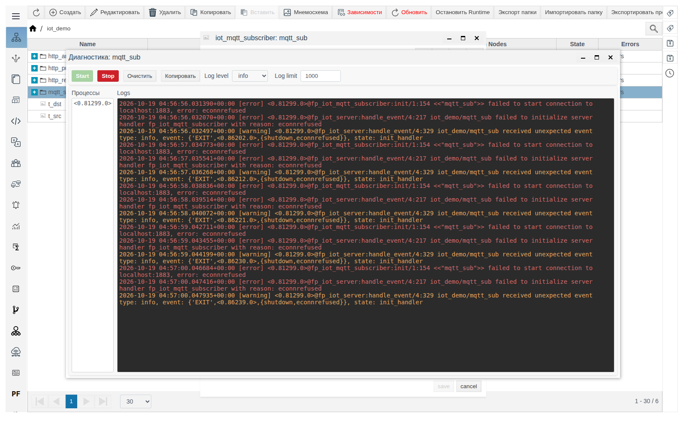

# IoT-соединения

Документ для инженера-интегратора, который настраивает обмен данными FACEPLATE с внешними системами по HTTP, MQTT и WebSocket.

# Содержание

- [Глоссарий](#глоссарий)
- [Введение](#введение)
- [Основная часть](#основная-часть)
    - [Состав модуля](#состав-модуля)
    - [Роли и переменные](#роли-и-переменные)
    - [Как источник и действие связаны с соединением](#как-источник-и-действие-связаны-с-соединением)
    - [Создание соединения](#создание-соединения)
    - [Формат сообщения](#формат-сообщения)
    - [Triggers](#triggers)
    - [Вкладка «IoT соединения»](#вкладка-iot-соединения)
    - [Диагностика](#диагностика)
- [Заключение](#заключение)

# Глоссарий

| Термин | Значение |
|---|---|
| IoT-соединение | Объект проекта одного из шести типов из групп **HTTP**, **MQTT**, **WEBSOCKET**. Работает в Runtime как отдельный процесс и является папкой: внутри лежат его источники и действия |
| Клиентская роль | Соединение само начинает обмен: по таймеру, по изменению тега или вручную |
| Серверная роль | Соединение ждёт входящее сообщение и обрабатывает его |
| Переменная соединения | Имя из списка **Data** на вкладке **Request & Response**. Через переменные шаблон сообщения связан с источниками и действиями |
| Источник | Объект из группы **source** внутри соединения. Заполняет переменные исходящего сообщения |
| Действие | Объект из группы **action** внутри соединения. Получает переменные входящего сообщения и записывает их в теги или архив |
| JSON-шаблон | Текст JSON, в котором вместо значений стоят переменные `$имя` |

# Введение

IoT-соединения нужны для обмена данными с внешними системами по HTTP, MQTT или WebSocket — например, с облачной платформой, веб-сервисом, шлюзом или другим приложением. Для MQTT внешней системой выступает брокер: FACEPLATE публикует в него сообщения или подписывается на его топики. Оборудование с промышленными протоколами ПЛК подключается не через IoT-соединения. FACEPLATE может быть клиентом (сам отправляет данные или опрашивает сервис) и сервером (принимает данные, которые присылает внешняя система).

Любое соединение устроено одинаково:

1. На вкладке **Request & Response** задаётся формат сообщения и список переменных **Data**.
2. Источники внутри соединения дают значения переменным исходящего сообщения.
3. Действия внутри соединения записывают переменные входящего сообщения в теги или архив.

Все примеры собраны в папке `iot_demo`. В ней есть теги типа `demo_value` с числовым полем `value`: `t_src` (значение `21.5`), `t_dst`, `t_mqtt`, `t_ws`, `t_calc`. Примеры HTTP и WebSocket работают внутри одного FACEPLATE без внешних систем, для примера MQTT нужен брокер.

Типы описаны в отдельных документах раздела:

- [HTTP-соединения](http.md)
- [MQTT-соединения](mqtt.md)
- [WebSocket-соединения](websocket.md)
- [Источники](sources.md)
- [Действия](actions.md)

Понадобится доступ к Studio (`http://<сервер>:9000/fp/studio`) под учётной записью с правом изменять проект.

# Основная часть

## Состав модуля

При создании объекта в **Общем виде** группа **iot** окна выбора типа содержит:

| Группа | Тип | Роль | Назначение |
|---|---|---|---|
| **HTTP** | [`iot_http_client_connection`](http.md#iot_http_client_connection) | Клиент | Отправляет HTTP-запрос и разбирает ответ |
| | [`iot_http_server_connection`](http.md#iot_http_server_connection) | Сервер | Принимает HTTP-запросы на заданный путь и отвечает |
| **MQTT** | [`iot_mqtt_publisher`](mqtt.md#iot_mqtt_publisher) | Клиент | Публикует сообщения в топик брокера |
| | [`iot_mqtt_subscriber`](mqtt.md#iot_mqtt_subscriber) | Сервер | Получает сообщения из топика брокера |
| **WEBSOCKET** | [`iot_websocket_client_connection`](websocket.md#iot_websocket_client_connection) | Клиент | Подключается к WebSocket-серверу и обменивается сообщениями |
| | [`iot_websocket_server_connection`](websocket.md#iot_websocket_server_connection) | Сервер | Принимает WebSocket-подключения |
| **source** | [`iot_tag_source`](sources.md#iot_tag_source) | Источник | Значения полей тегов |
| | [`iot_script_source`](sources.md#iot_script_source) | Источник | Результат скрипта |
| | [`iot_ts_source`](sources.md#iot_ts_source) | Источник | Значения из архива |
| | [`iot_eventlog_source`](sources.md#iot_eventlog_source) | Источник | Записи журнала событий |
| **action** | [`iot_tag_action`](actions.md#iot_tag_action) | Действие | Запись в поля тегов |
| | [`iot_script_action`](actions.md#iot_script_action) | Действие | Обработка скриптом и запись в теги |
| | [`iot_ts_action`](actions.md#iot_ts_action) | Действие | Запись серии в архив |
| | [`iot_eventlog_action`](actions.md#iot_eventlog_action) | Действие | Создание записей в журнале событий |



Соединения создаются в любой папке. Источники и действия создаются только внутри соединения: в обычной папке группы **source** и **action** видны, но кнопка **Ok** для их типов недоступна.



Внутри соединения окно выбора типа показывает только восемь типов источников и действий.



## Роли и переменные

Что означают **Request** и **Response**, зависит от роли соединения:

| | Клиентская роль | Серверная роль |
|---|---|---|
| **Request** | Сообщение, которое отправляет FACEPLATE. Переменные из **Data** заполняют источники | Сообщение, которое приходит в FACEPLATE. Переменные из **Data** получают действия |
| **Response** | Ответ внешней системы. Переменные из **Data** получают действия | Ответ FACEPLATE на входящее сообщение. Переменные из **Data** заполняют источники |

- В выпадающем списке **variable** источника или действия доступны только переменные соответствующего списка **Data**.
- Если список **Data** пуст, источники или действия этой стороны не выполняются.
- У MQTT ответа нет: на вкладке **Request & Response** есть только **Request**.

## Как источник и действие связаны с соединением

Источник или действие с одним только **Названием** ничего не делает. Он начинает работать, когда в нём выбрана переменная соединения и указано, откуда брать или куда записывать её значение. Порядок:

1. В соединении на вкладке **Request & Response** задайте **Type** и перечислите переменные в **Data**. Для **JSON** вставьте те же переменные в шаблон через `$`. Сохраните соединение.
2. Войдите в соединение двойным щелчком: путь над таблицей должен заканчиваться именем соединения. Создайте источник или действие.
3. В строке привязки выберите **variable** — в списке будут переменные из **Data** шага 1. Затем выберите **tag** кнопкой с лупой и **field**.
4. Сохраните и проверьте обмен.

Пример — сервер `http_recv` записывает температуру из запроса в тег `t_dst`:

| Где | Что задать |
|---|---|
| `http_recv`, **Request** | **Type** `JSON`, **Data** `t`, шаблон `{"temperature": $t}` |
| `http_recv` → `to_t_dst` (`iot_tag_action`) | `t` — `/iot_demo/t_dst` — `value` |

Запрос `{"temperature": 23.4}` → переменная `t` = `23.4` → действие `to_t_dst` пишет `23.4` в `t_dst.value`. Полная настройка — в [`iot_http_server_connection`](http.md#iot_http_server_connection).

Если список **variable** пуст — в **Data** нужной стороны нет переменных или соединение не сохранено (см. таблицу выше: у сервера действия берут переменные из **Request**, источники — из **Response**; у клиента наоборот).

## Создание соединения

1. Откройте **Общий вид** и войдите двойным щелчком в папку, где будет соединение.
2. Нажмите **Создать**, раскройте **iot**, затем **HTTP**, **MQTT** или **WEBSOCKET**, выберите тип и нажмите **Ok**.
3. Заполните **Название**, параметры на вкладках и сохраните.
4. Войдите в соединение двойным щелчком и создайте в нём источники и действия.

Соединение запускается сразу после сохранения. Чтобы остановить обмен, не удаляя настроек, включите **Отключено**. Источник или действие выключается флагом **Отключить**.

Если источник или действие не удаётся подготовить к работе (например, привязка ссылается на несуществующий объект), останавливается всё соединение: **State** `STOP`, текст ошибки в поле **Ошибка** и в колонке **Errors** Общего вида.

Верхняя панель формы одинакова для всех соединений:

| Поле | Значение |
|---|---|
| **State** | `RUN` — процесс соединения запущен, `STOP` — не запущен |
| **Узел**, **PID** | Узел FACEPLATE и идентификатор процесса |
| **Отключено** | Остановить соединение, сохранив настройки |
| **Ошибка** | Текст последней ошибки обмена; `no errors`, если её нет |
| **Ограничение памяти (байт)** | Предел памяти процесса соединения |
| **Диагностика** | Журнал процесса соединения (см. раздел [«Диагностика»](#диагностика) ниже) |

## Формат сообщения

На вкладке **Request & Response** для каждого сообщения выбирается **Type**:

| Type | Исходящее сообщение | Входящее сообщение |
|---|---|---|
| **Const** | Постоянный текст из поля **Текст** | Содержимое не разбирается, переменных нет |
| **JSON** | JSON по шаблону, переменные заменяются значениями | JSON разбирается по шаблону, значения попадают в переменные |
| **Скрипт** | Функция на Erlang или JavaScript возвращает текст сообщения | Функция разбирает сообщение и возвращает карту переменных |

### JSON-шаблон

```json
{
  "temperature": $t,
  "pressure": $p
}
```

- Каждую переменную шаблона добавьте в **Data**.
- Редактор подчёркивает `$t` как ошибку JSON. На сохранение и работу это не влияет.
- Во входящем JSON должны быть все ключи шаблона, лишние ключи игнорируются. Если ключа нет, сообщение отклоняется с ошибкой `{invalid_parse_request_result,false}`.
- Массив во входящем JSON разбирается конструкцией `$$`: шаблон `{"items": [$$ {"v": $v}]}` для сообщения `{"items": [{"v": 1}, {"v": 2.5}]}` даёт `v` = `[1, 2.5]`.
- Переменная со списком значений в исходящем шаблоне (`{"got": $v}`) превращается в JSON-массив (`{"got": [1, 2.5]}`).

> **Важно.** Конструкция `$$` в исходящем шаблоне (например, `[$$ {"x": $v}]`) приводит к ошибке обработки. Массив объектов в исходящем сообщении формируйте скриптом — см. пример в следующем разделе.

### Скрипт сообщения

Скрипт пишется на вкладке **erlang** или **javascript**, редактор открывается с шаблоном функции. После правки нажмите **Compile**, дождитесь успешной компиляции и сохраните.

| Роль и сообщение | Первый аргумент | Возвращает |
|---|---|---|
| Клиент, **Request** | `Data` — переменные из источников | Текст запроса |
| Клиент, **Response** | `Response` — тело ответа | Карту переменных для действий |
| Сервер, **Request** | `Request` — тело входящего сообщения | Карту переменных для действий |
| Сервер, **Response** | `Data` — переменные из источников | Текст ответа |

Пример — ответ сервера `http_ts_obj` в виде массива объектов. **Response**: **Type** `Скрипт`, **Data** `ts`, `v`, `from`, `to` (`ts` и `v` заполняет источник `iot_ts_source`, как `ts_read` в разделе [iot_ts_source](sources.md#iot_ts_source)), скрипт:

```erlang
fun(Data, _Context) ->
    Points = lists:zip(maps:get("ts", Data), maps:get("v", Data)),
    jsx:encode([#{<<"ts">> => T, <<"value">> => V} || {T, V} <- Points])
end.
```

Ответ: `[{"ts":1792387500000,"value":"undefined"},{"ts":1792387513000,"value":10.5},{"ts":1792387543000,"value":11.25}]` на запрос `{"from": 1792387500000, "to": 1792387550000}`. `jsx:encode/1` превращает карты и списки Erlang в JSON.



## Triggers

Вкладка есть у соединений с клиентской ролью: `iot_http_client_connection`, `iot_mqtt_publisher`, `iot_websocket_client_connection`.

| Поле | Значение |
|---|---|
| **Trigger by tag** | Запрос отправляется при каждом изменении выбранного поля тега |
| **Cycle** | Период отправки, мс. Пусто — периодической отправки нет |
| **Max. period per send request** | Максимальная длина интервала `from`–`to` одного запроса, мс. Пусто — интервал не ограничен |
| **Required delivery** | Что делать, если с момента последнего успешного запроса прошло больше **Max. period per send request**. Включено — данные отправляются по порядку частями не длиннее максимума, пока не догонят текущий момент. Выключено — отправляется только последний интервал |
| **Trigger** | Включите и сохраните, чтобы отправить один запрос сразу. После отправки флаг сбрасывается |
| **Last successful request** | Время последнего успешного запроса |

Интервал `from`–`to` начинается с последнего успешного запроса и заканчивается текущим моментом. Его получает `Context` скриптового источника. Если запрос завершился ошибкой (её текст появляется в поле **Ошибка**), **Last successful request** сохраняет прежнее значение. Следующий запрос начинается с того же момента, поэтому данные неудачного запроса отправляются повторно и не теряются.




## Вкладка «IoT соединения»

Пункт **IoT соединения** главного меню Studio показывает все соединения проекта: **Название**, **Шаблон** (тип), **Режим** (`Включен` / `Отключен`), **Путь**, **Ошибки**, **Статус** (`RUN` / `STOP`).



- Фильтры над таблицей: **Поиск по пути**, **Тип соединения** (можно выбрать несколько), **Режим**, **Статус**, затем **Поиск**.
- Кнопка с карандашом открывает форму выделенного соединения, кнопка с корзиной удаляет выделенные соединения (подтверждение **yes**). Несколько строк выделяются Ctrl+щелчком.
- Двойной щелчок по соединению открывает список его источников и действий с теми же кнопками. Кнопка с названием соединения возвращает к общему списку.



Создавать объекты на этой вкладке нельзя — только в **Общем виде**.

## Диагностика

Поле **Ошибка** показывает ошибки обмена; ошибки подключения в нём могут не отображаться. Откройте форму соединения, нажмите **Диагностика**, затем **Start**: в окне появится журнал процесса соединения. **Log level** задаёт подробность, **Stop** останавливает вывод. Подробно окно описано в документе [«Диагностика объектов Runtime»](../diagnostics/diagnostics.md).



| Признак | Причина | Что сделать |
|---|---|---|
| `RUN`, `no errors`, но обмена нет | Ошибка подключения: брокер или сервер недоступен, неверный адрес, не прошло рукопожатие WebSocket | Откройте **Диагностика** |
| `STOP`, ошибка в поле **Ошибка** | Не удалось подготовить источник или действие | Исправьте привязки и скрипты внутри соединения |
| HTTP-сервер отвечает `405` | **Method** написан не заглавными или не совпадает с методом запроса | Укажите метод заглавными |
| `{invalid_parse_request_result,false}` | Входящий JSON не совпал с шаблоном | Сверьте шаблон с реальным сообщением |
| Действие не записывает значения | Пустой список **Data** входящей стороны, переменная не выбрана в привязке или действие отключено | Добавьте переменную в **Data** и в привязку |
| **Last successful request** не обновляется | На вкладке **Triggers** не задано условие, или запросы завершаются ошибкой | Задайте **Cycle** или **Trigger by tag**, проверьте **Ошибка** |

# Заключение

Порядок настройки:

1. Определите роль FACEPLATE (клиент или сервер) и протокол, выберите тип соединения.
2. Создайте соединение в **Общем виде** и заполните параметры транспорта. У HTTP-сервера **Method** пишется заглавными, у WebSocket-клиента проверьте поля рукопожатия.
3. На вкладке **Request & Response** выберите формат сообщений и перечислите переменные в **Data**.
4. Внутри соединения создайте источники для исходящих переменных и действия для входящих.
5. Для клиентской роли задайте условие отправки на вкладке **Triggers**.
6. Проверьте **State**, **Ошибка** и **Last successful request**. Если обмена нет, а ошибок не видно, откройте **Диагностика**.
