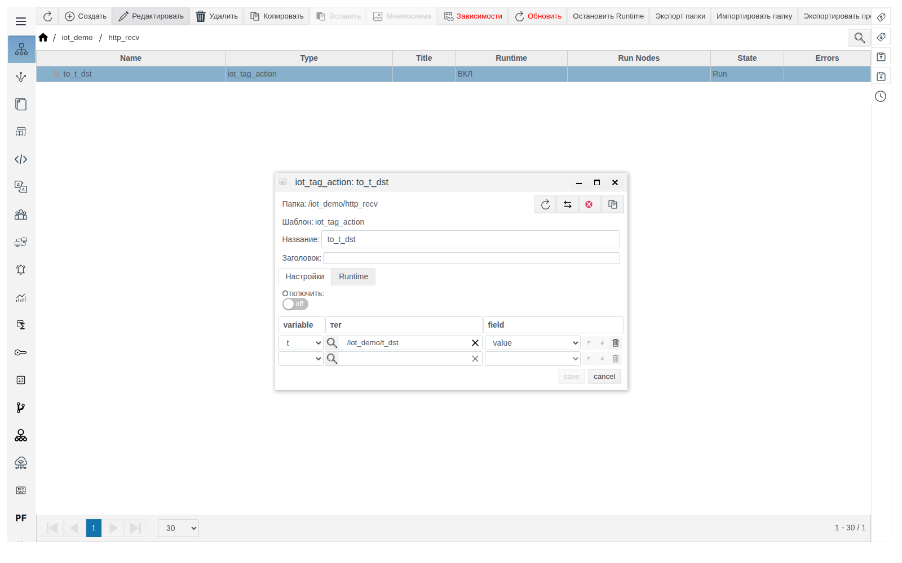
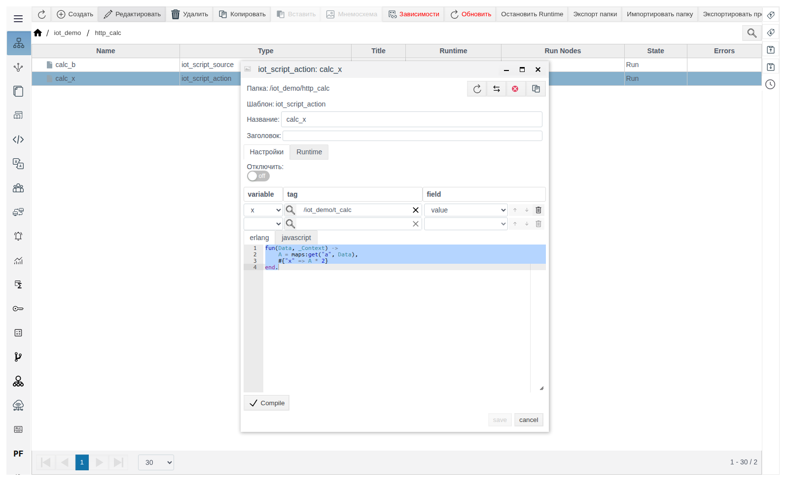
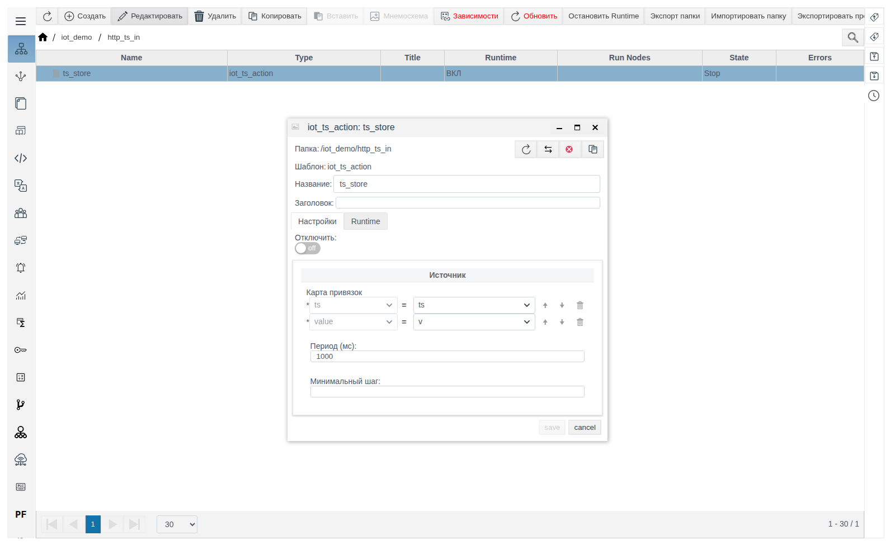
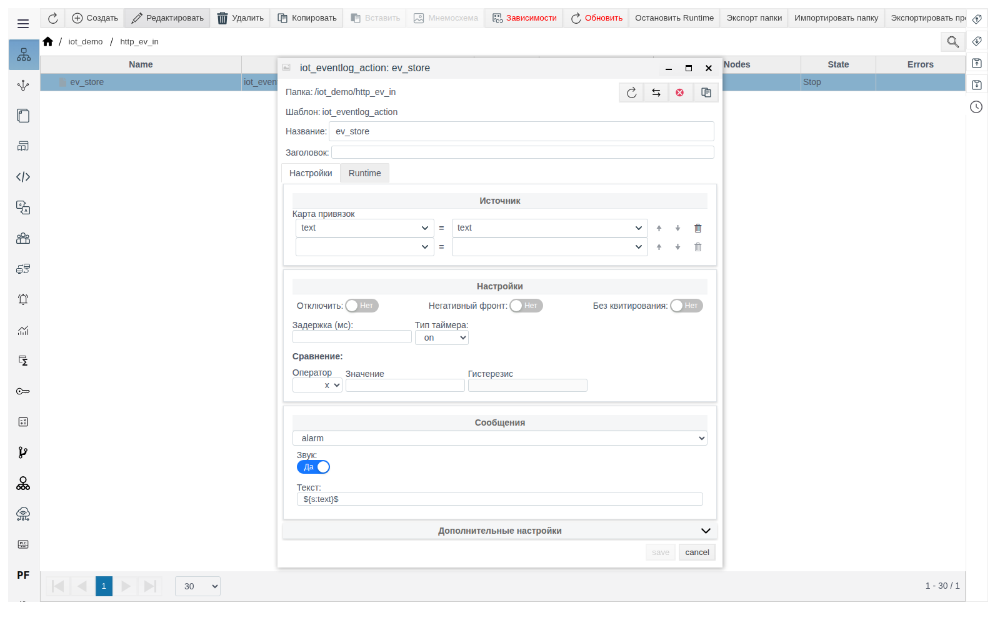
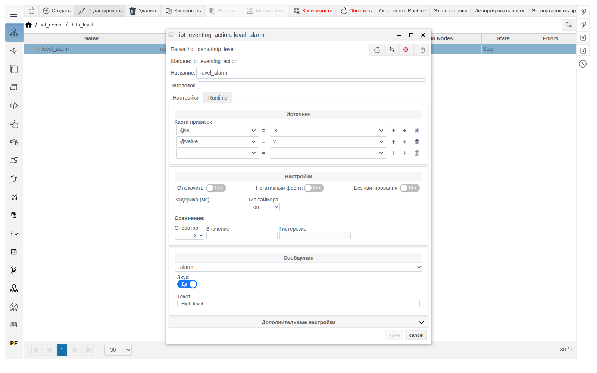

# Действия IoT

Документ для инженера-интегратора. Общие понятия (роли, переменные **Data**, формат сообщения, вкладка **Triggers**, диагностика) описаны в документе [«IoT-соединения»](IoT.md).

# Содержание

- [Введение](#введение)
- [Основная часть](#основная-часть)
    - [iot_tag_action](#iot_tag_action)
    - [iot_script_action](#iot_script_action)
    - [iot_ts_action](#iot_ts_action)
    - [iot_eventlog_action](#iot_eventlog_action)
- [Заключение](#заключение)

# Введение

Действие получает переменные входящего сообщения соединения (запроса у сервера, ответа у клиента) и записывает их в теги или архив. Действия создаются только внутри соединения и выполняются раньше источников. Порядок настройки и пример — в разделе [«Как источник и действие связаны с соединением»](IoT.md#как-источник-и-действие-связаны-с-соединением) документа [«IoT-соединения»](IoT.md).

Понадобится доступ к Studio (`http://<сервер>:9000/fp/studio`) под учётной записью с правом изменять проект.

# Основная часть

## iot_tag_action

Записывает переменные входящего сообщения в поля тегов. Строки привязки такие же, как у [iot_tag_source](sources.md#iot_tag_source). Значение приводится к типу поля.



Примеры: `to_t_dst` в [`http_recv`](http.md#iot_http_server_connection), `to_t_mqtt` в [`mqtt_sub`](mqtt.md#iot_mqtt_subscriber), `to_t_ws` в [`ws_recv`](websocket.md#iot_websocket_server_connection).

## iot_script_action

Обрабатывает входящее сообщение скриптом и записывает результат в теги. В строках привязки над редактором задаются переменные скрипта: имена из **Data**, теги, куда пишутся значения. Функция `fun(Data, Context)` получает в `Data` все переменные входящего сообщения, в `Context` — текущие значения переменных скрипта, и возвращает карту `имя => значение`. Каждое значение записывается в тег, привязанный к этому имени. Нажмите **Compile**, затем сохраните.

Пример — сервер `http_calc` принимает число `a`, записывает `a * 2` в `t_calc` и отвечает этим значением плюс 1:

1. В `iot_demo` создайте `iot_http_server_connection` `http_calc`: **Точка** `/calc`, **Method** `POST`.
2. **Request**: **Type** `JSON`, **Data** `a`, `x`, шаблон `{"a": $a}`. **Response**: **Type** `JSON`, **Data** `b`, `x`, шаблон `{"b": $b}`. Переменная `x` нужна в обоих списках, потому что её используют скрипты действия и источника. Сохраните.
3. Внутри `http_calc` создайте `iot_script_action` `calc_x`: привязка `x` — `/iot_demo/t_calc` — `value`, скрипт:

   ```erlang
   fun(Data, _Context) ->
       A = maps:get("a", Data),
       #{"x" => A * 2}
   end.
   ```

   

4. Внутри `http_calc` создайте `iot_script_source` `calc_b`: привязка `x` — `/iot_demo/t_calc` — `value`, скрипт:

   ```erlang
   fun(Data, _Context) ->
       X = maps:get("x", Data),
       #{"b" => X + 1}
   end.
   ```

Запрос `curl -X POST -d '{"a": 5}' http://<сервер>:7080/calc` возвращает `{"b":11}`, в `t_calc` записано `10`. Действия выполняются раньше источников, поэтому источник читает уже обновлённый тег.

## iot_ts_action

Записывает серию значений в архив. Действие само является архивом: **Период (мс)** и **Минимальный шаг** — его настройки архива. **Карта привязок** в группе **Источник** указывает переменные с массивами меток времени (`ts`) и значений (`value`). Метки времени — миллисекунды Unix или строка даты, длины массивов должны совпадать, нечисловые значения записываются как пустые.

Пример — сервер `http_ts_in` принимает пачку точек и пишет её в архив `ts_store`:

1. В `iot_demo` создайте `iot_http_server_connection` `http_ts_in`: **Точка** `/ts_in`, **Method** `POST`.
2. **Request**: **Type** `JSON`, **Data** `ts`, `v`, шаблон `{"points": [$$ {"ts": $ts, "value": $v}]}`. **Response**: **Type** `Const`, **Текст** `OK`. Сохраните.
3. Внутри `http_ts_in` создайте `iot_ts_action` `ts_store`. В **Карте привязок** `ts` подставляется автоматически, для `value` выберите `v`. Сохраните.

   

```
curl -X POST -d '{"points": [{"ts": 1792387513000, "value": 10.5}, {"ts": 1792387543000, "value": 11.25}]}' http://<сервер>:7080/ts_in
```

Ответ — `OK`, в архиве `ts_store` появляются точки `10.5` и `11.25` с указанными метками времени.

## iot_eventlog_action

Создаёт записи в журнале событий. Действие само является шаблоном события: в нём те же группы **Настройки**, **Сообщения** (тип, звук, **Текст**) и **Дополнительные настройки**, что у обычного шаблона события. **Карта привязок** в группе **Источник** связывает поля события с переменными входящего сообщения. Поля **Сравнение** на это действие не влияют: заданное в них условие не проверяется ни в одном из режимов ниже.

Режим работы зависит от привязок:

| Привязки | Что происходит |
|---|---|
| Без `@value` (например, только `text`) | Каждое входящее сообщение создаёт новую запись. Привязанные поля берутся из переменных, остальные — из настроек действия |
| `@value` и `@ts` | Событие с состоянием. `@value` = `true` открывает событие с временем `@ts`, `false` закрывает его (время закрытия — `@ts`). Повторное `true` при открытом событии новую запись не создаёт |

Значение `@value` передавайте как `true`/`false` (или строки `"true"`/`"false"`). Число в `@value` не принимается: сервер отвечает ошибкой 500, событие не меняется. Если переменная в сообщении — массив, создаётся по записи на каждый элемент.

Пример 1 — сервер `http_ev_in` записывает в журнал текст из запроса:

1. В `iot_demo` создайте `iot_http_server_connection` `http_ev_in`: **Точка** `/ev_in`, **Method** `POST`. **Request**: **Type** `JSON`, **Data** `text`, шаблон `{"text": $text}`. **Response**: **Type** `Const`, **Текст** `OK`. Сохраните.
2. Внутри `http_ev_in` создайте `iot_eventlog_action` `ev_store`: **Карта привязок** `text` = `text`. Тип сообщения и звук задайте как для обычного шаблона события. Сохраните.

   

```
curl -X POST -d '{"text": "Door open"}' http://<сервер>:7080/ev_in
```

Ответ — `OK`, в журнале событий появляется запись `Door open`. Выгрузка таких записей — источник `ev_read` в [iot_eventlog_source](sources.md#iot_eventlog_source).

Пример 2 — сервер `http_level` открывает и закрывает событие «High level» по признаку из запроса:

1. В `iot_demo` создайте `iot_http_server_connection` `http_level`: **Точка** `/level`, **Method** `POST`. **Request**: **Type** `JSON`, **Data** `v`, `ts`, шаблон `{"alarm": $v, "ts": $ts}`. **Response**: **Type** `Const`, **Текст** `OK`. Сохраните.
2. Внутри `http_level` создайте `iot_eventlog_action` `level_alarm`: **Карта привязок** `@value` = `v`, `@ts` = `ts`; **Текст** `High level`. Сохраните.

   

```
curl -X POST -d '{"alarm": true, "ts": 1792406684878}' http://<сервер>:7080/level
curl -X POST -d '{"alarm": false, "ts": 1792406686025}' http://<сервер>:7080/level
```

После первого запроса в журнале открыто событие `High level` (`dt_on` = 1792406684878), после второго оно закрыто (`dt_off` = 1792406686025).

# Заключение

- Для записи в теги используйте `iot_tag_action`, для обработки — `iot_script_action`, для пачек архивных данных — `iot_ts_action`.
- События создавайте `iot_eventlog_action`: по каждому сообщению — привязкой полей события, с открытием и закрытием — привязкой `@value` и `@ts`.
