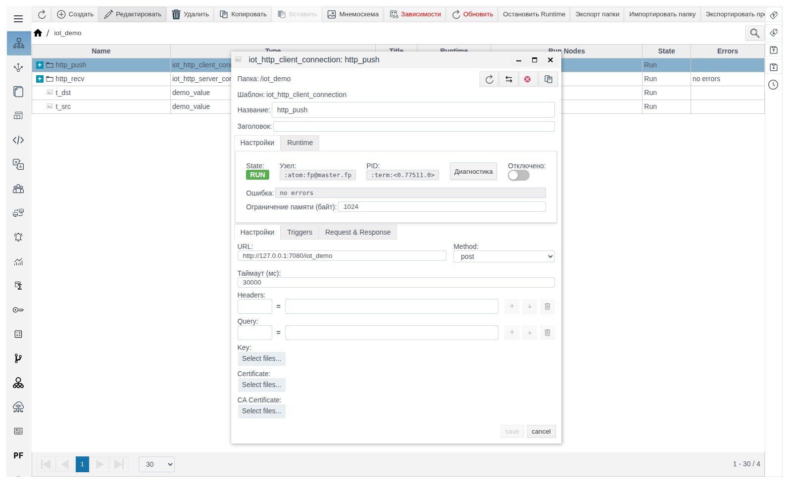
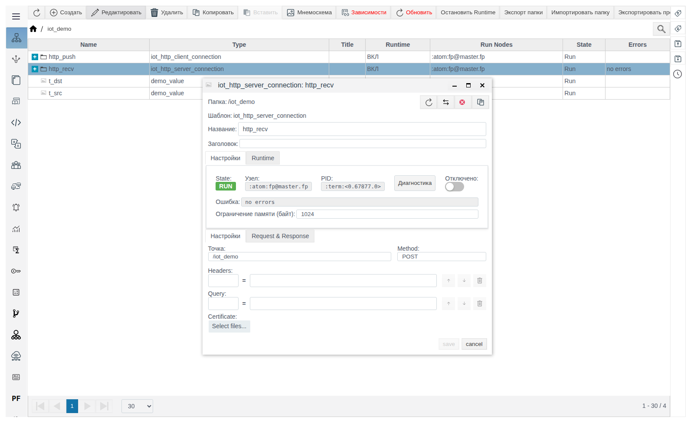
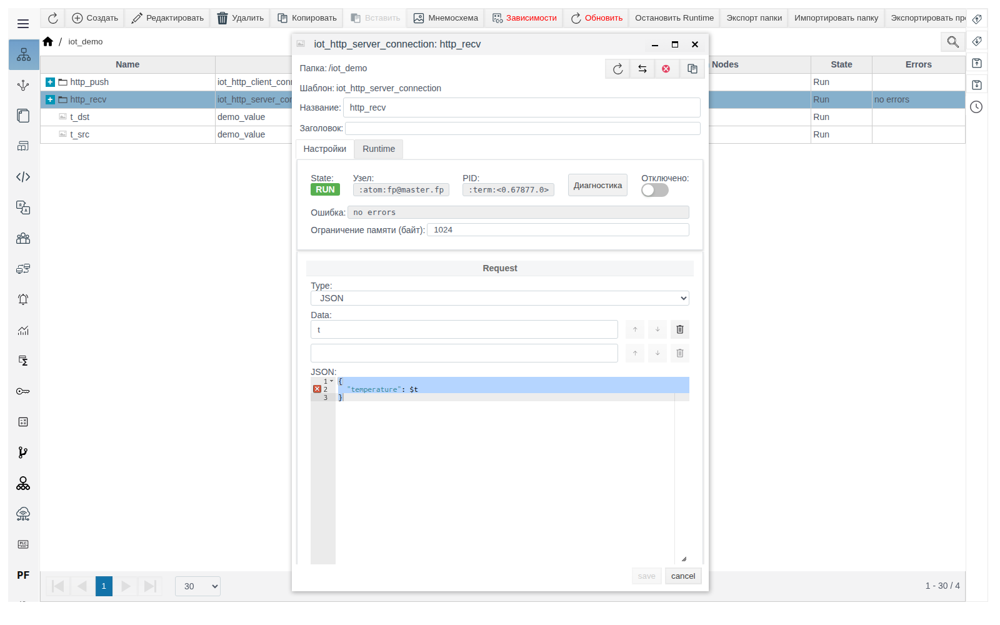

# HTTP-соединения

Документ для инженера-интегратора. Общие понятия (роли, переменные **Data**, формат сообщения, вкладка **Triggers**, диагностика) описаны в документе [«IoT-соединения»](IoT_ru.md). Проверено на FACEPLATE Studio 4.0.7.

# Введение

HTTP-соединения связывают FACEPLATE с веб-сервисами: `iot_http_client_connection` сам отправляет запросы, `iot_http_server_connection` принимает запросы внешних систем. Пример в документе — пара клиент → сервер внутри одного FACEPLATE: значение тега `t_src` попадает в тег `t_dst`.

Понадобится доступ к Studio (`http://<сервер>:9000/fp/studio`) под учётной записью с правом изменять проект.

# Основная часть

## iot_http_client_connection

HTTP-клиент: по условию с вкладки **Triggers** отправляет запрос на **URL** и разбирает ответ.

| Поле (вкладка **Настройки**) | Назначение | По умолчанию |
|---|---|---|
| **URL** | Полный адрес сервиса: `http://...` или `https://...` | `http://127.0.0.1:7080/myserver` |
| **Method** | HTTP-метод запроса | `get` |
| **Таймаут (мс)** | Время ожидания ответа | `30000` |
| **Headers**, **Query** | Заголовки и параметры строки запроса: имя = значение. В значение можно подставить переменную запроса: `${имя}` | пусто |
| **Key**, **Certificate**, **CA Certificate** | Ключ и сертификаты клиента для HTTPS | не загружены |

- **Type** запроса задаёт заголовок `Content-Type`: `text/plain` для **Const**, `application/json` для **JSON**, `application/octet-stream` для **Скрипт**.
- Ответ с кодом 4xx или 5xx считается ошибкой и выводится в поле **Ошибка**.

Пример — клиент `http_push`, который каждые 5 секунд отправляет значение `t_src` серверу `http_recv` из следующего раздела:

1. В `iot_demo` создайте `iot_http_client_connection` `http_push`. **Настройки**: **URL** `http://127.0.0.1:7080/iot_demo`, **Method** `post`. **Таймаут (мс)** оставьте по умолчанию.

   

2. Вкладка **Triggers**: **Cycle** `5000` — период отправки, мс. Это не **Таймаут (мс)** с вкладки **Настройки**: таймаут ограничивает ожидание ответа на каждый запрос.

   

3. **Request & Response**, **Request**: **Type** `JSON`, **Data** `t`, шаблон `{"temperature": $t}`. **Response**: **Type** `Const`. Сохраните.
4. Внутри `http_push` создайте `iot_tag_source` `from_t_src`: `t` — `/iot_demo/t_src` — `value`.

Через несколько секунд в `t_dst` появится `21.5`, а в **Last successful request** — время запроса.

## iot_http_server_connection

HTTP-сервер: принимает запросы на путь **Точка**, передаёт данные действиям и отвечает сообщением из **Response**. Серверы FACEPLATE слушают порты 7080 (HTTP) и 7443 (HTTPS).

| Поле (вкладка **Настройки**) | Назначение | По умолчанию |
|---|---|---|
| **Точка** | Путь, на который принимаются запросы. Полный адрес: `http://<сервер>:7080<Точка>`. Путь уникален среди HTTP-серверов проекта | пусто (подсказка `/myserver`) |
| **Method** | Принимаемый метод. Поле обязательное, значение сравнивается с учётом регистра: пишите заглавными (`POST`, `GET`, `PUT`) | пусто (подсказка `post`) |
| **Headers**, **Query** | Заголовки и параметры строки запроса, которые сервер извлекает из запроса: имя = значение, если в запросе его нет | пусто |
| **Certificate** | Сертификаты клиентов, которым разрешён доступ. Если файл загружен, запросы без подходящего клиентского сертификата получают `401 Access denied` | не загружен |

| Ответ сервера | Когда |
|---|---|
| `200` и тело из **Response** | Запрос обработан |
| `404` | Путь не совпадает с **Точка** ни одного включённого сервера |
| `405 Method not allowed` | Метод не совпадает с **Method**, в том числе по регистру |
| `500 Internal error` | Ошибка обработки: входящий JSON не совпал с шаблоном, ошибка источника или скрипта |

Пример — сервер `http_recv`, который записывает полученную температуру в `t_dst`:

1. В `iot_demo` создайте `iot_http_server_connection` `http_recv`. **Настройки**: **Точка** `/iot_demo`, **Method** `POST`.

   

2. **Request & Response**, **Request**: **Type** `JSON`, **Data** `t`, шаблон `{"temperature": $t}`. **Response**: **Type** `Const`, **Текст** `OK`. Сохраните.

   

3. Внутри `http_recv` создайте `iot_tag_action` `to_t_dst`: `t` — `/iot_demo/t_dst` — `value`.

Проверка любым HTTP-клиентом:

```
curl -X POST -d '{"temperature": 23.4}' http://<сервер>:7080/iot_demo
```

Ответ — `OK`, в `t_dst` записано `23.4`.

# Заключение

- У HTTP-сервера **Method** пишется заглавными, **Точка** уникальна в проекте.
- У HTTP-клиента задайте условие отправки на вкладке **Triggers**.
- Проверяйте сервер запросом `curl` и смотрите поле **Ошибка** у клиента.
