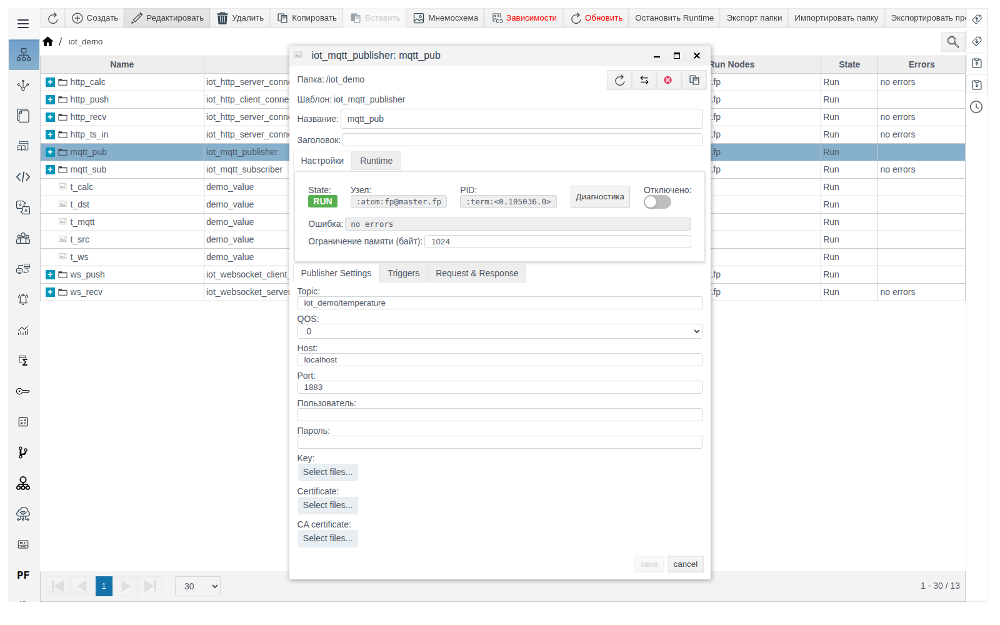
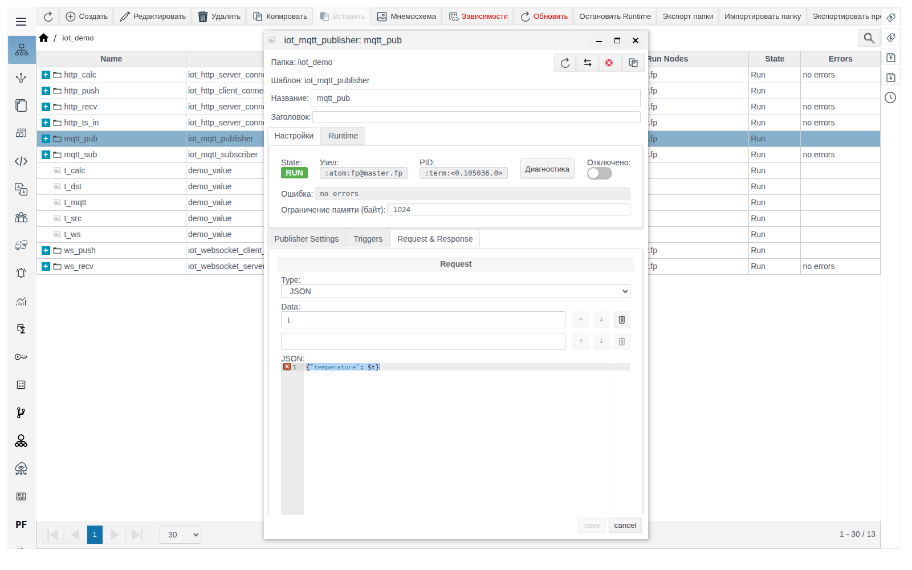
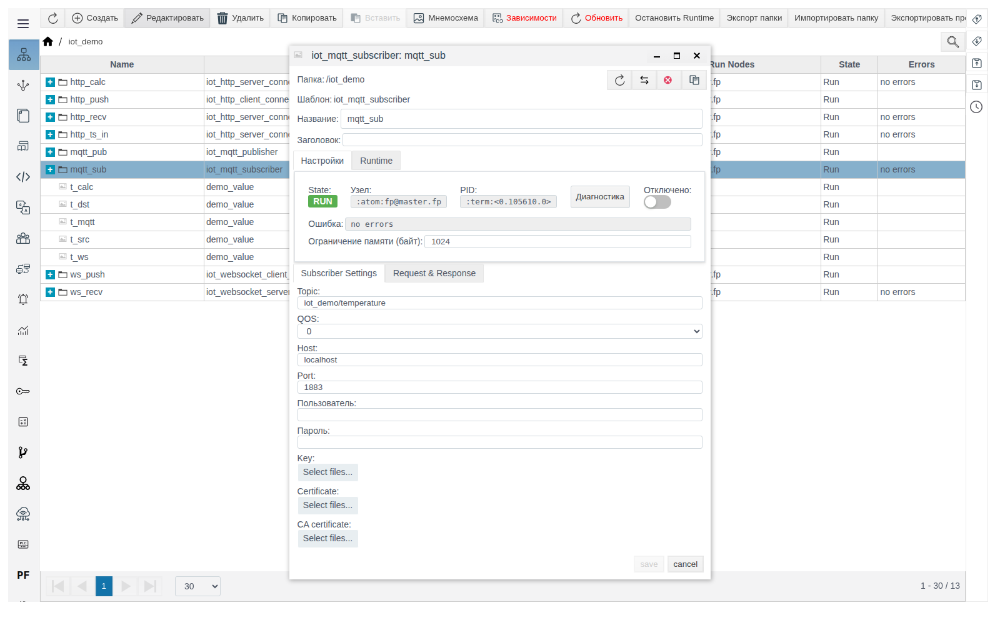

# MQTT-соединения

Документ для инженера-интегратора. Общие понятия (роли, переменные **Data**, формат сообщения, вкладка **Triggers**, диагностика) описаны в документе [«IoT-соединения»](IoT.md).

# Содержание

- [Введение](#введение)
- [Основная часть](#основная-часть)
    - [iot_mqtt_publisher](#iot_mqtt_publisher)
    - [iot_mqtt_subscriber](#iot_mqtt_subscriber)
- [Заключение](#заключение)

# Введение

MQTT-соединения работают через внешний брокер: `iot_mqtt_publisher` публикует сообщения в топик, `iot_mqtt_subscriber` получает их. Пример в документе — цепочка `t_src` → брокер → `t_mqtt`.

Понадобится доступ к Studio (`http://<сервер>:9000/fp/studio`) под учётной записью с правом изменять проект.

# Основная часть

## iot_mqtt_publisher

MQTT-издатель: по условию с вкладки **Triggers** публикует сообщение **Request** в топик брокера. MQTT-брокер в состав FACEPLATE не входит.

| Поле (вкладка **Publisher Settings**) | Назначение | По умолчанию |
|---|---|---|
| **Topic** | Топик публикации. Обязательное поле | пусто |
| **QOS** | Уровень гарантии доставки: 0, 1 или 2 | `0` |
| **Host** | Адрес брокера | `localhost` |
| **Port** | Порт брокера | `1883` |
| **Пользователь**, **Пароль** | Учётные данные брокера. Используются, только если заполнены оба поля, иначе подключение анонимное | пусто |
| **Key**, **Certificate**, **CA certificate** | Файлы для TLS-подключения. Сертификат брокера не проверяется | не загружены |

Пример — издатель `mqtt_pub` публикует `t_src` каждые 5 секунд:

1. В `iot_demo` создайте `iot_mqtt_publisher` `mqtt_pub`. **Publisher Settings**: **Topic** `iot_demo/temperature`, **Host** — адрес брокера.

   

2. Вкладка **Triggers**: **Cycle** `5000` — период отправки, мс.
3. **Request & Response**, **Request**: **Type** `JSON`, **Data** `t`, шаблон `{"temperature": $t}`. Сохраните.

   

4. Внутри `mqtt_pub` создайте `iot_tag_source` `from_t_src`: `t` — `/iot_demo/t_src` — `value`.

Подписчик брокера на топик `iot_demo/#` получает `iot_demo/temperature {"temperature":21.5}`.

## iot_mqtt_subscriber

MQTT-подписчик: подписан на **Topic** и разбирает каждое полученное сообщение шаблоном **Request**, переменные передаются действиям. Параметры подключения те же, что у издателя (вкладка **Subscriber Settings**), вкладки **Triggers** нет.

Пример — подписчик `mqtt_sub` записывает температуру из топика в `t_mqtt`:

1. В `iot_demo` создайте `iot_mqtt_subscriber` `mqtt_sub`. **Subscriber Settings**: **Topic** `iot_demo/temperature`, **Host** — адрес брокера.

   

2. **Request & Response**, **Request**: **Type** `JSON`, **Data** `t`, шаблон `{"temperature": $t}`. Сохраните.
3. Внутри `mqtt_sub` создайте `iot_tag_action` `to_t_mqtt`: `t` — `/iot_demo/t_mqtt` — `value`.

Вместе с `mqtt_pub` получается цепочка `t_src` → брокер → `t_mqtt`: в `t_mqtt` появляется `21.5`.

> **Важно.** Если брокер недоступен, подписчик и издатель остаются в состоянии `RUN` с `no errors` и раз в секунду пытаются подключиться. Ошибка подключения (`econnrefused`) видна только в окне **Диагностика**.

# Заключение

- Брокер в состав FACEPLATE не входит, укажите его адрес в **Host** и **Port**.
- У издателя задайте условие отправки на вкладке **Triggers**.
- Если обмена нет, а ошибок не видно, откройте **Диагностика**: ошибки подключения к брокеру видны только там.
