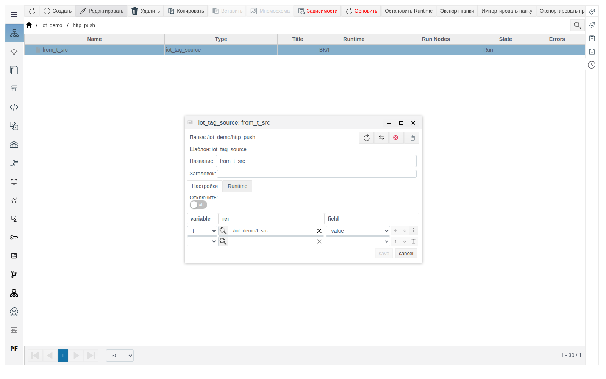
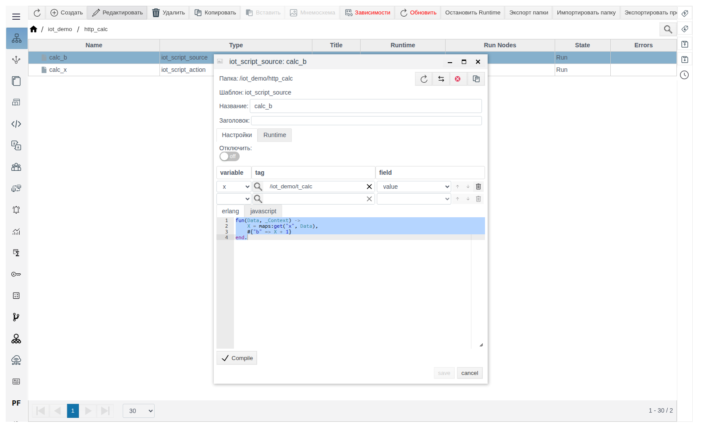
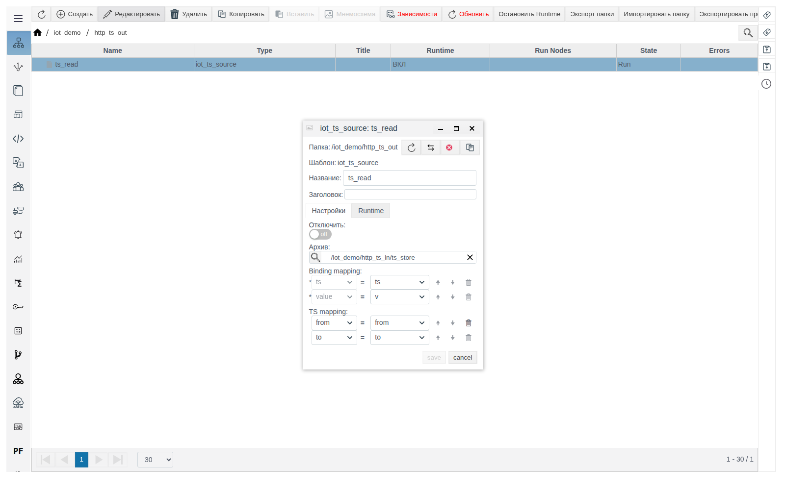
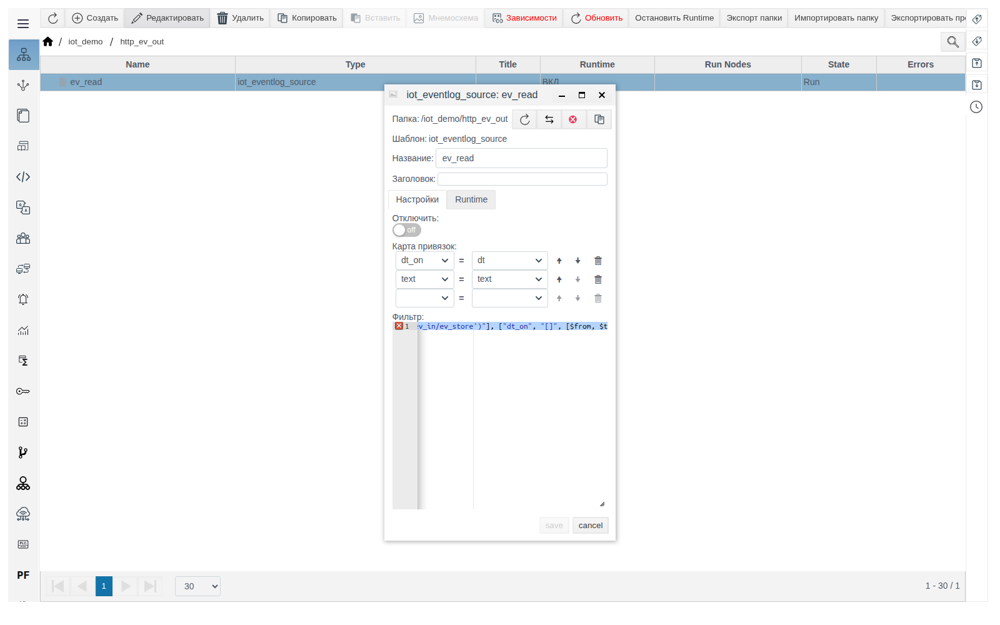

# Источники IoT

Документ для инженера-интегратора. Общие понятия (роли, переменные **Data**, формат сообщения, вкладка **Triggers**, диагностика) описаны в документе [«IoT-соединения»](IoT.md).

# Содержание

- [Введение](#введение)
- [Основная часть](#основная-часть)
    - [iot_tag_source](#iot_tag_source)
    - [iot_script_source](#iot_script_source)
    - [iot_ts_source](#iot_ts_source)
    - [iot_eventlog_source](#iot_eventlog_source)
- [Заключение](#заключение)

# Введение

Источник заполняет переменные исходящего сообщения соединения: запроса у клиента, ответа у сервера. Источники создаются только внутри соединения, их переменные берутся из списка **Data** соответствующей стороны. Порядок настройки и пример — в разделе [«Как источник и действие связаны с соединением»](IoT.md#как-источник-и-действие-связаны-с-соединением) документа [«IoT-соединения»](IoT.md).

Понадобится доступ к Studio (`http://<сервер>:9000/fp/studio`) под учётной записью с правом изменять проект.

# Основная часть

## iot_tag_source

Передаёт значения полей тегов в переменные соединения. Каждая строка привязки: **variable** (переменная из **Data**) — **tag** (тег, выбирается кнопкой с лупой) — **field** (поле тега). Новая пустая строка появляется после заполнения предыдущей.



Примеры: `from_t_src` в [`http_push`](http.md#iot_http_client_connection), [`mqtt_pub`](mqtt.md#iot_mqtt_publisher), [`ws_push`](websocket.md#iot_websocket_client_connection).

## iot_script_source

Вычисляет переменные соединения скриптом. В строках привязки над редактором задаются переменные скрипта: их имена берутся из **Data**, значения читаются из указанных тегов. Функция `fun(Data, Context)` получает в `Data` значения этих переменных, в `Context` — служебные данные (у клиента — границы интервала `from` и `to`) и возвращает карту `имя переменной соединения => значение`. Нажмите **Compile**, затем сохраните.



Пример — см. [iot_script_action](actions.md#iot_script_action): источник `calc_b` читает `t_calc` и возвращает в ответе значение на 1 больше.

## iot_ts_source

Передаёт значения из архива за интервал. **Архив** — объект-архив: `ARCHIVE` или [`iot_ts_action`](actions.md#iot_ts_action). **Binding mapping** указывает переменные для массивов меток времени (`ts`) и значений (`value`). **TS mapping** указывает переменные с границами интервала `from` и `to`.

- У клиента **TS mapping** можно не заполнять: интервал берётся из вкладки **Triggers** (от последнего успешного запроса до текущего момента).
- У сервера границы приходят в запросе. Переменные `from` и `to` добавьте в **Data** запроса и в **Data** ответа — в **TS mapping** предлагаются переменные ответа.
- Границы — миллисекунды Unix или строка даты.
- Первая точка ответа — значение архива на момент `from`. Если в этот момент значения нет, в ответе будет `"undefined"`.

Пример — сервер `http_ts_out` отдаёт точки архива `ts_store` (его заполняет [`iot_ts_action`](actions.md#iot_ts_action)) за интервал из запроса:

1. В `iot_demo` создайте `iot_http_server_connection` `http_ts_out`: **Точка** `/ts_out`, **Method** `POST`.
2. **Request**: **Type** `JSON`, **Data** `from`, `to`, шаблон `{"from": $from, "to": $to}`. **Response**: **Type** `JSON`, **Data** `ts`, `v`, `from`, `to`, шаблон `{"ts": $ts, "value": $v}`. Сохраните.
3. Внутри `http_ts_out` создайте `iot_ts_source` `ts_read`: **Архив** `/iot_demo/http_ts_in/ts_store`; **Binding mapping** `ts` = `ts`, `value` = `v`; **TS mapping** `from` = `from`, `to` = `to`. Сохраните.

   

```
curl -X POST -d '{"from": 1792387500000, "to": 1792387550000}' http://<сервер>:7080/ts_out
```

Ответ — `{"ts":[1792387500000,1792387513000,1792387543000],"value":["undefined",10.5,11.25]}`. Если нужен массив объектов (`[{"ts": ..., "value": ...}]`), сформируйте ответ скриптом — см. раздел [«Скрипт сообщения»](IoT.md#скрипт-сообщения) документа [«IoT-соединения»](IoT.md).

## iot_eventlog_source

Передаёт записи журнала событий. **Карта привязок** связывает поля события (`dt_on`, `dt_off`, `text`, `type`, `active` и др.) с переменными: каждая переменная получает массив значений поля по всем найденным записям. **Фильтр** — условие выборки в виде JSON-шаблона, в нём можно использовать переменные:

| Элемент фильтра | Значение |
|---|---|
| `["and", [условие, ...]]`, `["or", [...]]`, `["andnot", [условие, условие]]` | Логические операции |
| `["поле", "=", значение]` | Сравнение поля со значением, например `=` |
| `["поле", "[]", [$from, $to]]` | Время в интервале |
| `"$oid('/root/FP/PROJECT/...')"` | Ссылка на объект проекта, например на шаблон события в поле `prototype` |

`$from` и `$to` — границы интервала: у клиента из вкладки **Triggers**, у сервера — переменные запроса с этими именами.

Пример — сервер `http_ev_out` отдаёт события действия `ev_store` (см. [iot_eventlog_action](actions.md#iot_eventlog_action)) за интервал из запроса:

1. В `iot_demo` создайте `iot_http_server_connection` `http_ev_out`: **Точка** `/ev_out`, **Method** `POST`.
2. **Request**: **Type** `JSON`, **Data** `from`, `to`, шаблон `{"from": $from, "to": $to}`. **Response**: **Type** `JSON`, **Data** `dt`, `text`, шаблон `{"dt": $dt, "text": $text}`. Сохраните.
3. Внутри `http_ev_out` создайте `iot_eventlog_source` `ev_read`: **Карта привязок** `dt_on` = `dt`, `text` = `text`; **Фильтр**:

   ```json
   ["and", [
     ["prototype", "=", "$oid('/root/FP/PROJECT/iot_demo/http_ev_in/ev_store')"],
     ["dt_on", "[]", [$from, $to]]
   ]]
   ```

   Сохраните.

   

```
curl -X POST -d '{"from": 1792406000000, "to": 1792407000000}' http://<сервер>:7080/ev_out
```

Ответ — `{"dt":[1792406684717,1792406684854],"text":["Door open","Door closed"]}`.

# Заключение

- Для значений тегов используйте `iot_tag_source`, для вычислений — `iot_script_source`.
- Для архива используйте `iot_ts_source`, для журнала событий — `iot_eventlog_source` с фильтром по шаблону события и интервалу.
