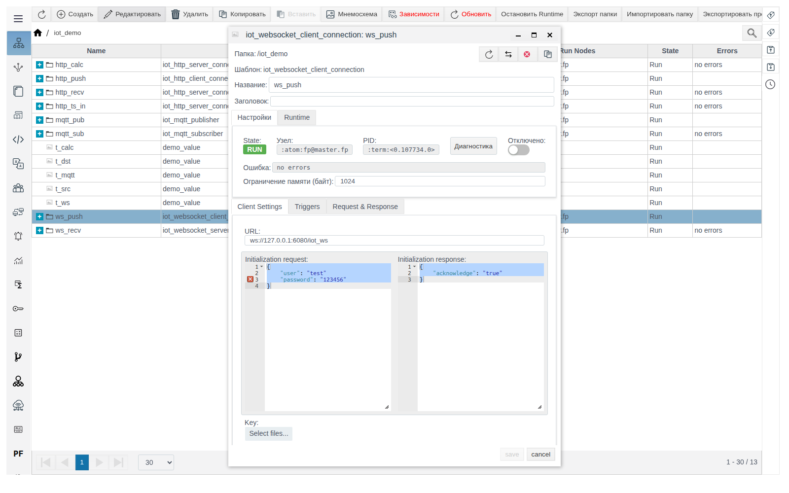
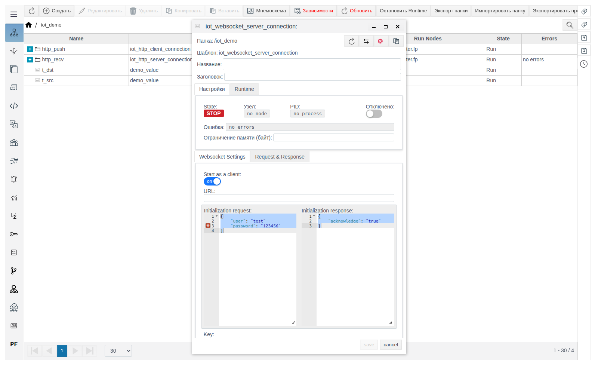
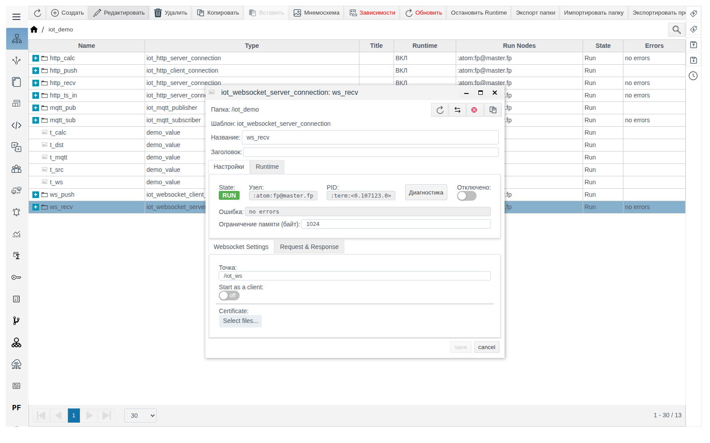

# WebSocket-соединения

Документ для инженера-интегратора. Общие понятия (роли, переменные **Data**, формат сообщения, вкладка **Triggers**, диагностика) описаны в документе [«IoT-соединения»](IoT_ru.md). Проверено на FACEPLATE Studio 4.0.7.

# Введение

WebSocket-соединения держат постоянный канал: `iot_websocket_client_connection` подключается к серверу, `iot_websocket_server_connection` принимает подключения. Пример в документе — пара клиент → сервер внутри одного FACEPLATE: значение `t_src` попадает в `t_ws`.

Понадобится доступ к Studio (`http://<сервер>:9000/fp/studio`) под учётной записью с правом изменять проект.

# Основная часть

## iot_websocket_client_connection

WebSocket-клиент: держит постоянное соединение с сервером, по условию с вкладки **Triggers** отправляет **Request** и ждёт ответ.

| Поле (вкладка **Client Settings**) | Назначение | По умолчанию |
|---|---|---|
| **URL** | Адрес сервера: `ws://<хост>:<порт>/<путь>` или `wss://...` | пусто |
| **Initialization request**, **Initialization response** | Рукопожатие после подключения: FACEPLATE отправляет JSON из **Initialization request** и ждёт ответ, совпадающий с JSON-шаблоном **Initialization response**. Если ответ не совпал, соединение не устанавливается | пример с `user`/`password` и `acknowledge` (см. ниже) |
| **Key**, **Certificate**, **CA certificate** | Файлы для WSS | не загружены |

> **Важно.** Поля рукопожатия заполнены примером, который не является корректным JSON (между строками нет запятой). Если его не изменить, клиент раз в секунду завершается с ошибкой `{initialization_error,badarg}`, а поле **Ошибка** показывает `no errors`. Если сервер не требует рукопожатия, очистите оба поля. Форма и после очистки показывает пример, но сохраняются пустые поля.

Пример — клиент `ws_push` отправляет `t_src` серверу `ws_recv` из следующего раздела каждые 5 секунд:

1. В `iot_demo` создайте `iot_websocket_client_connection` `ws_push`. **Client Settings**: **URL** `ws://127.0.0.1:6080/iot_ws`, поля рукопожатия очистите.

   

2. Вкладка **Triggers**: **Cycle** `5000` — период отправки, мс.
3. **Request & Response**, **Request**: **Type** `JSON`, **Data** `t`, шаблон `{"temperature": $t}`. **Response**: **Type** `Const`. Сохраните.
4. Внутри `ws_push` создайте `iot_tag_source` `from_t_src`: `t` — `/iot_demo/t_src` — `value`.

## iot_websocket_server_connection

WebSocket-сервер: принимает подключения на путь **Точка**, разбирает каждое сообщение шаблоном **Request** и отвечает **Response**. Серверы слушают порты 6080 (WS) и 6443 (WSS).

| Поле (вкладка **Websocket Settings**) | Назначение | По умолчанию |
|---|---|---|
| **Точка** | Путь подключений. Полный адрес: `ws://<сервер>:6080<Точка>` | `/myserver` |
| **Start as a client** | Соединение само подключается к внешнему серверу по **URL** (с рукопожатием, как у клиента), но обрабатывает входящие сообщения как сервер. Нужно, когда данные присылает внешняя система, а подключаться должен FACEPLATE | выключено |
| **Certificate** | Сертификаты клиентов, которым разрешено подключение | не загружен |

Пример — сервер `ws_recv` записывает температуру от `ws_push` в `t_ws`:

1. В `iot_demo` создайте `iot_websocket_server_connection` `ws_recv`. **Websocket Settings**: **Точка** `/iot_ws`.

   

2. **Request & Response**, **Request**: **Type** `JSON`, **Data** `t`, шаблон `{"temperature": $t}`. **Response**: **Type** `Const`, **Текст** `OK`. Сохраните.
3. Внутри `ws_recv` создайте `iot_tag_action` `to_t_ws`: `t` — `/iot_demo/t_ws` — `value`.

Вместе с `ws_push` в `t_ws` появляется `21.5`.

# Заключение

- У клиента проверьте поля рукопожатия: пример по умолчанию — некорректный JSON.
- У клиента задайте условие отправки на вкладке **Triggers**.
- Режим **Start as a client** нужен, когда данные присылает внешняя система, а подключаться должен FACEPLATE.
