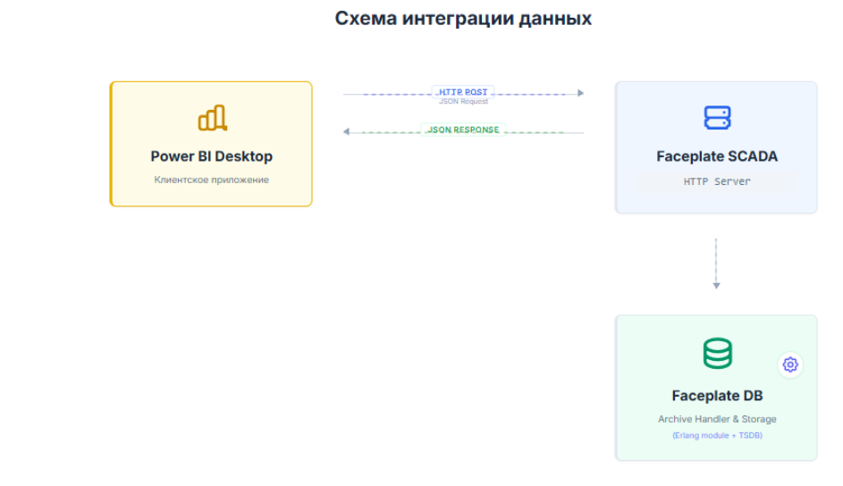

# Faceplate

## Интеграция с Microsoft Power BI

[Введение	3](#введение)

[Настройка REST API сервера в Faceplate	5](#настройка-rest-api-сервера-в-faceplate)

[Создание объекта HTTP сервера	5](#создание-объекта-http-сервера)

[Режимы обработки	5](#режимы-обработки)

[Ответ на запрос (Request)	5](#ответ-на-запрос-\(request\))

[Ответ на запрос (Response)	6](#ответ-на-запрос-\(response\))

[Проверка REST API сервера Faceplate	6](#проверка-rest-api-сервера-faceplate)

[Настройка Power BI Desktop	7](#настройка-power-bi-desktop)

[Пример Power Query скрипта	7](#пример-power-query-скрипта)

[Полезные советы	9](#полезные-советы)

[Внешние источники	10](#внешние-источники)

# **Введение** {#введение}

Интеграция Faceplate/EMS с Power BI превращает сырые технологические данные SCADA в управленческую аналитику. В основе лежит принцип «запрос-ответ»: Power BI выступает клиентом, который через HTTP-шлюз забирает данные из промышленной базы.

Архитектура решения

1. **Источник (Faceplate/EMS):** Хранит архивы тегов (давление, температура, потребление энергии). Сервер Faceplate предоставляет API-интерфейс (REST), который принимает внешние запросы.  
2. **Транспорт (HTTP API):** Слой обмена данными. Power BI отправляет HTTP-запрос, содержащий ID параметров и временной интервал, а сервер возвращает данные (обычно в формате JSON).  
3. **Обработка (Power Query):** Внутри Power BI Desktop происходит парсинг JSON-ответа, преобразование типов данных и «разворачивание» списков в плоские таблицы.  
   Ключевые преимущества

* **Агрегация на стороне сервера:** Вместо передачи миллионов строк «сырых» данных (raw data), вы можете запрашивать уже усредненные значения (минутные, часовые), что критически ускоряет работу отчетов.  
* **Единое окно:** Возможность совместить данные из SCADA с данными из ERP (например, 1С или SAP) для расчета себестоимости или удельного расхода ресурсов.  
* **Автоматизация:** Один раз настроенная модель данных будет обновляться нажатием одной кнопки или по расписанию в Power BI Service.

### 

 

# **Настройка REST API сервера в Faceplate** {#настройка-rest-api-сервера-в-faceplate}

## Создание объекта HTTP сервера {#создание-объекта-http-сервера}

Чтобы Faceplate «услышал» Power BI, нужно создать объект на основе системного шаблона `iot_http_server_connection`.

Основные настройки соединения:

1. Endpoint		/api/data 	URL-адрес, по которому будет доступно API  
2. Method		POST		Тип запроса для передачи параметров в теле  
3. State			RUN		Статус сервера должен быть «ВКЛЮЧЕНО»

## Режимы обработки {#режимы-обработки}

### **Ответ на запрос (Request)** {#ответ-на-запрос-(request)}

Вам потребуется настроить обработку запроса через режим обработки JSON со следующей схемой:

{      
       		"from": $from,      
       		"to": $to,      
       		"archive": $archives,      
        		"step": $step      
    	}

$from, $to, $archives, $step \- переменные для передачи значений в переменные Faceplate.

Power BI будет формировать и отправлять JSON-объект в теле запроса. Вот что должно быть внутри:

* **from / to**: 	Даты в формате `YYYY-MM-DDTHH:mm:ss.SSS+TZ` (например, `2026-01-16T00:00:00.000+5`).  
* **archive**: 	Массив полных путей к архивам (например, `/root/FP/PROJECT/block-A/pump-1/flow/archives/out_value`).  
* **step**: 		Шаг агрегации в секундах. Для суточного анализа используйте `3600` (1 час), для месячного — `86400` (1 день).

### **Ответ на запрос (Response)** {#ответ-на-запрос-(response)}

Для обработки ответа Вам потребуется настроить логику ответа в поле Response. Для этого необходимо выбрать обработку через скрипт (Внимание\! В примере используется код на Erlang). Скрипт принимает JSON с временными границами и списком архивов, парсит даты и возвращает готовый набор данных.

Фрагмент кода:

archive\_handler:get\_json(\#{

"from" \=\> fp\_util:parse\_dt(From),

"to" \=\> fp\_util:parse\_dt(To), 

"archive" \=\> Archive, 

"step" \=\> Step })

Функция `fp_util:parse_dt()` является функцией встроенного модуля Faceplate **fp\_util**, она необходима для корректного перевода строки даты из ISO 8601 во внутренний формат системы.

Функция `archive_handler:get_json()` \- обработчик получения данных из архива и преобразованием в JSON.

## Проверка REST API сервера Faceplate {#проверка-rest-api-сервера-faceplate}

После завершения настройки серверной части подготовленную API можно проверить через через команду **cURL.**

Пример запроса:       

`curl --location 'http://192.168.20.200:7080/api/data' \`    

     `--header 'Content-Type: application/json' \`

 	`--data '{"from": "2026-01-28T00:00:00.000+5","to": "2026-01-29T00:00:00.000+5","archive": [  "/root/FP/PROJECT/block-A/pump-1/flow/archives/out_value",`    

`"/root/FP/PROJECT/block-A/pump-1/pressure/archives/out_value"],"step": 3600}'`

# **Настройка Power BI Desktop** {#настройка-power-bi-desktop}

Для получения данных необходимо использовать **Power Query**.

1. Создайте **Пустой запрос** (**Get Data** → **Blank Query**).  
2. Откройте **Расширенный редактор** (**Advanced Editor**).  
3. Вставьте Power Query скрипт (M-language) из примера ниже.

## Пример Power Query скрипта {#пример-power-query-скрипта}

Скрипт для получения данных из одного архива. Идеально подходит для мониторинга одного параметра (например, расход одного насоса).

Тело скрипта (m-script):  
 let     
        // \=== ПАРАМЕТРЫ ЗАПРОСА \===     
        DateFrom \= "2026-01-28T00:00:00.000+5",     
        DateTo \= "2026-01-29T23:59:59.000+5",     
        ArchivePath \= "/root/FP/PROJECT/block-A/pump-1/flow/archives/out\_value",     
        StepSeconds \= 3600,     
        ApiUrl \= "http://192.168.20.200:7080/api/data",     
             
        // \=== ФОРМИРОВАНИЕ ЗАПРОСА \===     
        body \= Text.ToBinary("{     
        ""from"": """ & DateFrom & """,     
        ""to"": """ & DateTo & """,     
        ""archive"": \[""" & ArchivePath & """\],     
        ""step"": " & Number.ToText(StepSeconds) & "     
    }"),     
             
        // \=== ОТПРАВКА ЗАПРОСА \===     
        response \= Web.Contents(ApiUrl, \[     
            Headers \= \[\#"Content-Type"="application/json"\],     
            Content \= body     
        \]),     
             
        // \=== ОБРАБОТКА ОТВЕТА \===     
        json \= Json.Document(response),     
        archiveData \= Record.Field(json, ArchivePath),     
             
        // \=== ПРЕОБРАЗОВАНИЕ В ТАБЛИЦУ \===     
        toTable \= Table.FromList(archiveData, Splitter.SplitByNothing()),     
             
        addTimestamp \= Table.AddColumn(toTable, "Timestamp", each      
            if \[Column1\] is list and List.Count(\[Column1\]) \> 0 then \[Column1\]{0} else null     
        ),     
             
        addValue \= Table.AddColumn(addTimestamp, "Value", each      
            if \[Column1\] is list and List.Count(\[Column1\]) \> 1 then \[Column1\]{1} else null     
        ),     
             
        removeColumn \= Table.RemoveColumns(addValue, {"Column1"}),     
             
        // \=== ФИЛЬТРАЦИЯ NULL ЗНАЧЕНИЙ \===     
        filtered \= Table.SelectRows(removeColumn, each \[Value\] \<\> null),     
             
        // \=== ПРЕОБРАЗОВАНИЕ TIMESTAMP В DATETIME \===     
        addDateTime \= Table.AddColumn(filtered, "DateTime", each      
            \#datetime(1970,1,1,0,0,0) \+ \#duration(0,0,0,\[Timestamp\]/1000),     
            type datetime     
        ),     
             
        // \=== УСТАНОВКА ТИПОВ ДАННЫХ \===     
        setTypes \= Table.TransformColumnTypes(addDateTime, {     
            {"Timestamp", Int64.Type},     
            {"Value", type number}     
        }),     
             
        // \=== ПЕРЕУПОРЯДОЧИВАНИЕ КОЛОНОК \===     
        reordered \= Table.ReorderColumns(setTypes, {"DateTime", "Timestamp", "Value"})     
    in     
        reordered   

| DateTime | Timestamp | Value |
| :---- | :---- | :---- |
| 28.01.2026 01:00:00 | 1769281200000 | 0.332 |
| 28.01.2026 02:00:00 | 1769284800000 | 0.954 |

# **Полезные советы** {#полезные-советы}

* **Часовые пояса**: Помните, что Faceplate при обработке запроса использует часовой пояс сервера.

* **Формат даты**: Power BI очень капризен к формату. Всегда используйте двузначные значения для часов (пишите 00, а не 0).

* **Null-значения**: Если данных за какой-то период нет, API вернет null. В предложенных скриптах уже встроена фильтрация таких строк, чтобы они не портили ваши графики.

* **Структура элемента массива Faceplate:** Каждый элемент массива представляет собой массив из 3 элементов: \[timestamp, value, quality\]. В примере метрика **quality** была сознательно отброшена.

# **Внешние источники** {#внешние-источники}

[PowerBI Desktop](https://www.microsoft.com/ru-ru/power-platform/products/power-bi/desktop?market=ru) \- это бесплатное приложение для Windows, предназначенное для глубокого анализа данных и создания профессиональных интерактивных отчетов. Оно служит основным инструментом разработки в экосистеме Microsoft Power BI.

 ### written by Marlen Meimanov

