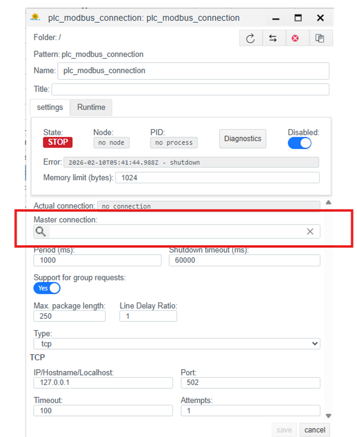
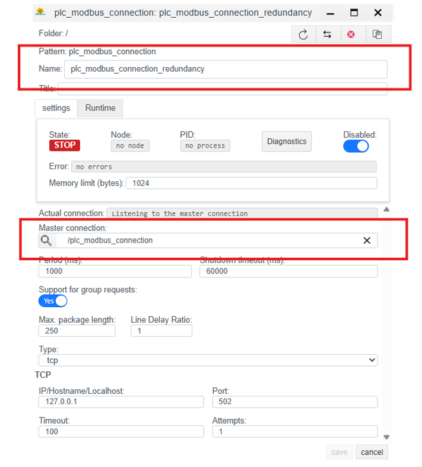

# Резервирование ресурсов в Faceplate

Для обеспечения непрерывности технологических процессов и высокой доступности в Faceplate реализована многоуровневая система резервирования. Архитектура продукта минимизирует риски возникновения «единой точки отказа» за счет дублирования ключевых компонентов системы.

## 1. Резервирование соединений с оборудованием

Faceplate поддерживает различные протоколы для связи с полевыми устройствами (ПЛК, датчиками, RTU).

- **Механизм:** Система позволяет настроить несколько путей обмена данными для одного логического узла.

- **Результат:** При обрыве основной линии связи или сборе на сетевом интерфейсе, Faceplate автоматически переключается на резервный канал, обеспечивая бесперебойный сбор телеметрии и передачу команд управления.

## 2. Резервирование служб Faceplate

Резервирование служб достигается за счет **кластеризации**. Несколько серверов (Runtime) объединяются в единый кластер Erlang.

- **Масштабирование:** Процессы распределяются между узлами. Если один узел (сервер) падает, остальные продолжают работу, обеспечивая доступность системы.

- **Идентификация:** Узлы «видят» друг друга благодаря единому «Cookie» (секретному ключу) и настройкам DNS/Hosts.

## 3. Базовая конфигурация (Tuning)

Тонкая настройка параметров производится в конфигурационных файлах, расположенных в директории релиза (например, `/DATASET/project/scada/faceplate/releases/4.0.6/`).

### 3.1. Настройка виртуальной машины (vm.args)

В файле `vm.args` задаются уникальные параметры среды Erlang для каждого узла:

- **-name:** Уникальное имя узла (например, `fp@rt-server1.fp`).

- **-setcookie:** Единый идентификатор (cookie) для всех серверов кластера, обеспечивающий авторизацию при взаимодействии узлов.

- **+MIscs:** Лимит памяти литерала (задается в мегабайтах) для оптимизации потребления ресурсов.

### 3.2. Конфигурация логирования (fp.logger.config)

Настройте пути вывода журналов в секциях `console_handler` и `error_handler`. Пути должны соответствовать структуре каталогов, указанной в п. 2.1:

- **Путь для консоли:** `/DATASET/project/scada/local/logs/console.log`

- **Путь для ошибок:** `/DATASET/project/scada/local/logs/error.log`

## 4. Запуск и сборка кластера

Первичный запуск рекомендуется производить в сессии tmux с именем `scada` для обеспечения непрерывности процесса.

### 4.1. Запуск ведущего узла

На первом сервере кластера инициируйте запуск в режиме консоли:

```bash
./faceplate console
```

### 4.2. Присоединение дополнительных узлов

Для подключения последующих серверов (Runtime 2, Runtime 3 или Historian) используется переменная окружения `ATTACH_TO`, указывающая на адрес уже активного узла.

**Команда для первого подключения:**

```bash
env ATTACH_TO=fp@rt-server1.fp ./faceplate console
```

*(где `fp@rt-server1.fp` — имя ведущего узла).*

**Примечание:** После того как узел был успешно добавлен в кластер, все последующие перезапуски производятся обычной командой `./faceplate console`.


*Рисунок 1. Кластерная конфигурация узлов*

## 5. Резервирование PLC-соединений

Модуль связи Faceplate обеспечивает гарантированную доставку телеметрической информации и команд управления за счет поддержки избыточных физических и логических каналов обмена данными. Механизм резервирования соединений работает на уровне драйверов протоколов (OPC UA, Modbus TCP, IEC 60870-5-104 и др.) и включает следующие возможности:


*Рисунок 2. Схема резервных каналов связи*

**Результат:** Использование данных механизмов сводит вероятность возникновения «пробелов» в данных к минимуму и обеспечивает мгновенную реакцию системы управления в аварийных ситуациях.

### 5.1. Подробный пример и настройка

#### Настройка в Faceplate Studio (Master Connection)

**1. Создание Главного соединения:**

Создайте стандартное соединение (например, `plc_modbus_connection`). Поле Master Connection оставьте пустым. Это соединение будет основным.



*Рисунок 3. Создание главного соединения*

**2. Создание Резервного объекта:**

Создайте второе соединение (например, `plc_modbus_connection_redundancy`). В поле Master Connection укажите ссылку на Главное соединение (выберите его из списка).



*Рисунок 4. Создание резервного соединения*

#### Логи и мониторинг

Статус соединения отображается в поле State (RUN/STOP) и Status (OK/ERROR) в редакторе драйверов.


*Рисунок 5. Статус соединения в редакторе*

Окно Диагностики позволяет просматривать логи по текущему соединению. Кнопки старт и стоп позволяют запустить и остановить процесс логирования. Log level разделяет на уровни по степени важности и детализации. Выбор конкретного уровня обычно работает как «фильтр порога»: в консоли отображаются сообщения выбранного уровня и все сообщения более высокой критичности.


*Рисунок 6. Окно диагностики соединения*

### written by Marlen Meimanov
