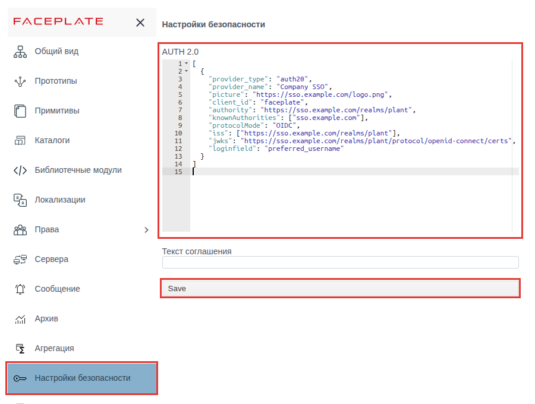
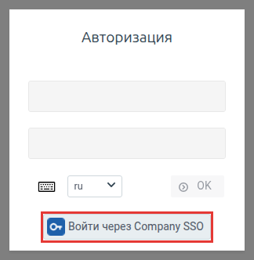

# Внешняя авторизация

Документ для инженера-интегратора, который подключает вход в Studio и Runtime через корпоративный провайдер учётных записей (OpenID Connect, единый вход).

# Содержание

- [Глоссарий](#глоссарий)
- [Введение](#введение)
- [Основная часть](#основная-часть)
    - [Как проходит вход](#как-проходит-вход)
    - [Регистрация приложения у провайдера](#регистрация-приложения-у-провайдера)
    - [Поле AUTH 2.0](#поле-auth-20)
    - [Учётные записи и права](#учётные-записи-и-права)
    - [Повторный вход и срок действия токена](#повторный-вход-и-срок-действия-токена)
    - [Выход](#выход)
    - [Проверка настройки](#проверка-настройки)
- [Заключение](#заключение)

# Глоссарий

| Термин | Значение |
|---|---|
| AUTH 2.0 | Поле в **Настройки безопасности**. Список провайдеров в формате JSON. Для каждого провайдера форма входа показывает свою кнопку |
| Описание провайдера | Один объект JSON в списке **AUTH 2.0**: адрес провайдера, идентификатор приложения, правила проверки токена |
| Кнопка провайдера | Кнопка «Войти через <название>» под кнопкой **OK** формы входа |

# Введение

Внешняя авторизация добавляет на форму входа Studio и Runtime кнопку провайдера. Пользователь входит у провайдера под корпоративной учётной записью, а Faceplate по полученному токену определяет логин и открывает сеанс от имени пользователя Faceplate с тем же логином. Пароль Faceplate при этом не нужен. Вход по логину и паролю на той же форме остаётся.

Провайдер только подтверждает личность. Роли и права по-прежнему задаются в Faceplate, см. [«Пользователи»](users.md) и [«Роли и права доступа»](roles.md). Сама форма входа описана в [«Вход и сеансы»](login.md).

В примере провайдер — сервер OpenID Connect `https://sso.example.com/realms/plant`, приложение зарегистрировано у него с идентификатором `faceplate`, кнопка называется **Company SSO**, через неё входит оператор `petrov`.

Понадобятся:

- доступ к Studio (`http://<сервер>:9000/fp/studio`) под учётной записью с правом изменять проект;
- права администратора у провайдера, чтобы зарегистрировать приложение.

# Основная часть

## Как проходит вход

1. Пользователь нажимает на форме входа кнопку провайдера.
2. Браузер переходит на страницу входа провайдера. Если у пользователя уже открыт сеанс у провайдера, страница не показывается.
3. Провайдер возвращает браузер на адрес Faceplate, с которого начался вход, и выдаёт токен.
4. Сервер Faceplate проверяет токен: издателя (`iss`), подпись по открытым ключам провайдера, срок действия. Из токена берётся логин.
5. Открывается сеанс пользователя Faceplate с этим логином: Runtime или Studio, смотря с какого адреса начался вход.

## Регистрация приложения у провайдера

Зарегистрируйте Faceplate у провайдера как браузерное приложение без секрета (публичный клиент, поток Authorization Code с PKCE).

| Параметр у провайдера | Значение |
|---|---|
| Адреса возврата (Redirect URI) | `http://<сервер>:9000/fp/runtime` и `http://<сервер>:9000/fp/studio` — адреса, на которых пользователи открывают Runtime и Studio |
| Разрешённые источники запросов (CORS) | `http://<сервер>:9000` |
| Области доступа (scopes) | `openid`, `profile`, `User.Read`. Faceplate запрашивает все три, провайдер должен принимать каждую |
| Подпись токена | RSA: RS256, RS384 или RS512. Открытые ключи — по адресу JWKS провайдера |
| Поле с логином | Поле токена, значение которого совпадает с логином пользователя в Faceplate |

Если у провайдера нет области `User.Read`, создайте её и разрешите приложению: без неё провайдер отклоняет вход.

Провайдер выдаёт идентификатор приложения (client ID) — он понадобится в поле **AUTH 2.0**.

## Поле AUTH 2.0

В главном меню Studio откройте **Настройки безопасности**, введите в поле **AUTH 2.0** список провайдеров и нажмите **Save**. Появится сообщение «Настройки успешно сохранены». Кнопка появляется на форме входа при следующем её открытии.



Пример для одного провайдера:

```json
[
  {
    "provider_type": "auth20",
    "provider_name": "Company SSO",
    "picture": "https://sso.example.com/logo.png",
    "client_id": "faceplate",
    "authority": "https://sso.example.com/realms/plant",
    "knownAuthorities": ["sso.example.com"],
    "protocolMode": "OIDC",
    "iss": ["https://sso.example.com/realms/plant"],
    "jwks": "https://sso.example.com/realms/plant/protocol/openid-connect/certs",
    "loginfield": "preferred_username"
  }
]
```

| Ключ | Значение |
|---|---|
| `provider_type` | Всегда `auth20`. Для описания с другим значением кнопка не появляется |
| `provider_name` | Название на кнопке: «Войти через <provider_name>» |
| `picture` | Необязательный. Адрес картинки, которая показывается на кнопке слева от названия. Картинку загружает браузер пользователя, поэтому адрес должен открываться с его компьютера. Высота картинки подгоняется под кнопку, пропорции сохраняются |
| `client_id` | Идентификатор приложения у провайдера |
| `authority` | Адрес провайдера, на который браузер уходит за входом |
| `knownAuthorities` | Список с именем хоста провайдера: `["<хост провайдера>"]` |
| `protocolMode` | `"OIDC"` |
| `iss` | Список допустимых издателей токена. Значение `iss` в токене должно совпасть с одним из них символ в символ |
| `jwks` | Адрес набора открытых ключей провайдера (JWKS). Его открывает сервер Faceplate, поэтому адрес должен быть доступен с сервера, а не только из браузера |
| `loginfield` | Поле токена, из которого берётся логин. Если ключ не указан, используется поле `nickname` |

Без `knownAuthorities` и `protocolMode` страница провайдера не открывается: после нажатия кнопки форма входа показывается снова.

Для нескольких провайдеров перечислите описания в списке через запятую — на форме будет по кнопке на каждого, в порядке списка.



Чтобы убрать кнопки, оставьте в поле **AUTH 2.0** пустой список `[]` и сохраните. Если JSON в поле записан с ошибкой, он сохраняется, но кнопки на форме не появляются; вход по логину и паролю при этом работает.

Поле **Текст соглашения** в том же окне описано в [«Вход и сеансы», раздел «Текст соглашения»](login.md#текст-соглашения).

## Учётные записи и права

Вход через провайдер открывает сеанс пользователя Faceplate, логин которого совпадает со значением поля `loginfield` в токене. Заведите таких пользователей в **Права** → **Пользователи** и дайте им роли, см. [«Пользователи»](users.md). Пароль Faceplate для входа через провайдер не используется.

Правила доступа те же, что при входе по паролю: Studio открывается только пользователям с ролью `.administrators`.

Если пользователя с таким логином в Faceplate нет или у него нет доступа к Studio, после входа у провайдера появляется вопрос «У вас нет доступа к этой системе. Вы сможете войти под другим пользователем. При этом вы выйдете и из других систем.»

| Ответ | Что происходит |
|---|---|
| **yes** | Выход у провайдера (см. [«Выход»](#выход)), затем форма входа. Следующее нажатие кнопки провайдера снова спросит логин и пароль у провайдера — можно войти под другой учётной записью |
| **no** | Форма входа. Сеанс у провайдера остаётся, поэтому кнопка провайдера снова войдёт под той же учётной записью и снова получит отказ |

В примере у провайдера и в Faceplate есть пользователь `petrov` с ролью `operators`: через кнопку **Company SSO** он входит в Runtime, а при входе в Studio видит вопрос «У вас нет доступа к этой системе…» с кнопками **yes** и **no**, потому что роли `.administrators` у него нет.

## Повторный вход и срок действия токена

После входа через провайдер браузер хранит токен до конца срока его действия, который задаёт провайдер. Пока токен действует, Studio и Runtime в новой вкладке или после обновления страницы входят сами, без формы.

Когда срок истёк, открытые сеансы продолжают работать, а при новом открытии показывается форма входа. Если сеанс у провайдера ещё открыт, кнопка провайдера входит без ввода пароля.

## Выход

**Выход** → **yes** в Studio или Runtime у пользователя, вошедшего через провайдер, завершает и сеанс у провайдера: открывается отдельное окно выхода провайдера. После выхода в нём окно закрывается, Faceplate показывает форму входа, и следующее нажатие кнопки провайдера потребует логин и пароль у провайдера.

У пользователя, вошедшего по логину и паролю, **Выход** работает как обычно, см. [«Вход и сеансы», раздел «Выход и конец сеанса»](login.md#выход-и-конец-сеанса).

## Проверка настройки

Если после настройки кнопки провайдера нет на форме входа или вход через неё не проходит, найдите в таблице то, что видно на экране, и проверьте указанное рядом.

Проверяйте в отдельном окне браузера в режиме инкогнито: так не мешают сохранённые токен и сеанс у провайдера.

| Что видно | Что проверить |
|---|---|
| На форме нет кнопки провайдера | JSON в поле **AUTH 2.0**, значение `provider_type` |
| После нажатия кнопки снова форма входа | `authority`, `knownAuthorities`, `protocolMode` в **AUTH 2.0**; область `User.Read` разрешена приложению у провайдера |
| «Ошибка аутентификации. Вы сможете войти под другим пользователем. При этом вы выйдете и из других систем.» | Адрес `jwks` доступен с сервера Faceplate; значение `iss` в токене есть в списке `iss`; в токене есть поле, указанное в `loginfield` |
| «У вас нет доступа к этой системе…» | Пользователь с логином из токена есть в Faceplate, у него есть нужная роль |

# Заключение

1. Зарегистрируйте Faceplate у провайдера: публичный клиент, адреса возврата `/fp/runtime` и `/fp/studio`, области `openid`, `profile`, `User.Read`.
2. Заполните **Настройки безопасности** → **AUTH 2.0** → **Save**: `provider_type` `auth20`, `client_id`, `authority`, `knownAuthorities`, `protocolMode`, `iss`, `jwks`, `loginfield`.
3. Заведите в Faceplate пользователей с логинами, как в токене, и дайте им роли. Studio — только с ролью `.administrators`.
4. Проверьте вход кнопкой провайдера в Runtime и Studio в окне инкогнито.
5. **Выход** у пользователя провайдера завершает и сеанс у провайдера.
