# Вход и сеансы

Документ для инженера-интегратора, который готовит вход в Studio и Runtime для операторов и других пользователей проекта.

# Содержание

- [Глоссарий](#глоссарий)
- [Введение](#введение)
- [Основная часть](#основная-часть)
    - [Форма входа](#форма-входа)
    - [Экранная клавиатура](#экранная-клавиатура)
    - [Язык интерфейса](#язык-интерфейса)
    - [Текст соглашения](#текст-соглашения)
    - [Ошибки входа](#ошибки-входа)
    - [История авторизаций](#история-авторизаций)
    - [Выход и конец сеанса](#выход-и-конец-сеанса)
- [Заключение](#заключение)

# Глоссарий

| Термин | Значение |
|---|---|
| Сеанс | Работа в одной вкладке браузера от входа до выхода, обновления или закрытия страницы |
| Язык учётной записи | Язык интерфейса, сохранённый у пользователя. С ним сравнивается язык, выбранный на форме входа |
| Текст соглашения | Поле в **Настройки безопасности**. Если оно заполнено, форма входа показывает этот текст под кнопкой **OK** |
| История авторизаций | Окно с датой и временем последнего успешного и последнего неуспешного входа под учётной записью |

# Введение

Studio и Runtime открываются одной и той же формой входа. На ней выбирают язык интерфейса, а на сенсорной панели без клавиатуры набирают логин и пароль на экранной клавиатуре. Под кнопкой **OK** форма может показывать текст соглашения.

Учётные записи, пароли и роли заводятся в разделе **Права** → **Пользователи**, см. [«Пользователи»](users.md). Смена пароля самим оператором и восстановление сеанса после обрыва связи описаны в [«Строка состояния и связь»](../operator/status.md#учётная-запись-и-смена-пароля), экран, который открывается после входа в Runtime, — в [«Рабочий стол и навигатор»](../operator/desktop.md#последний-экран-после-входа).

Сквозной пример — оператор `petrov` с ролью `operators`.

Понадобится доступ к Studio (`http://<сервер>:9000/fp/studio`) под учётной записью с правом изменять проект.

# Основная часть

## Форма входа

Форма открывается по адресу Studio (`http://<сервер>:9000/fp/studio`) или Runtime (`http://<сервер>:9000/fp/runtime`). После входа открывается то, что было запрошено.

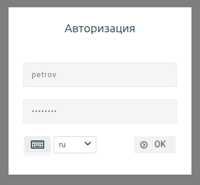

Верхнее поле — логин, нижнее — пароль; подписей у полей нет. Под полями — кнопка экранной клавиатуры, список языков и **OK**. Кнопка **OK** доступна, когда заполнены оба поля. **Enter** в поле пароля работает как **OK**.

## Экранная клавиатура

Кнопка с клавиатурой открывает экранную клавиатуру для поля, в котором стоит курсор. Она нужна на сенсорных панелях без физической клавиатуры.

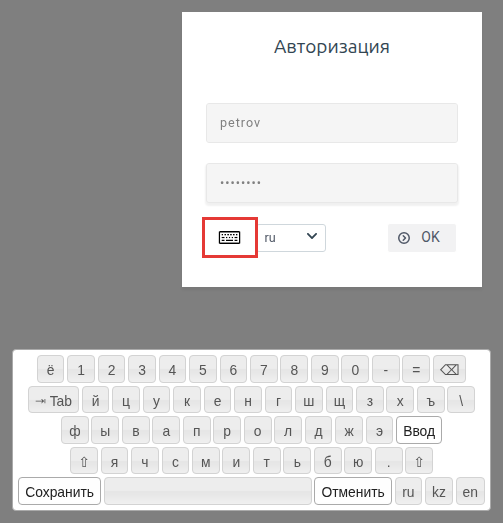

Раскладка соответствует языку формы, кнопки **ru**, **kz**, **en** в нижнем ряду переключают её.

## Язык интерфейса

Список под полями (**ru**, **en**, **kz**) переключает язык формы и интерфейса Studio и Runtime. Браузер запоминает выбор, и при следующем открытии форма показывается на том же языке.

У каждой учётной записи есть свой язык. При первом входе им становится язык формы. Если при следующем входе язык формы отличается от языка учётной записи, после входа появляется вопрос «Сохранить настройки локализации?».

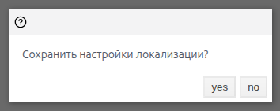

| Ответ | Текущий сеанс | Следующее открытие формы в этом браузере |
|---|---|---|
| **yes** | На выбранном языке | На выбранном языке. Он становится языком учётной записи, вопрос больше не появляется |
| **no** | На выбранном языке | На языке учётной записи |

В примере язык учётной записи `petrov` — английский, а на форме выбран **ru**: Runtime открывается на русском и задаёт вопрос. По **yes** языком `petrov` становится русский.

## Текст соглашения

Текст соглашения показывается под кнопкой **OK** на форме входа Studio и Runtime. По умолчанию поле пустое, и под **OK** ничего нет.

В главном меню Studio откройте **Настройки безопасности**, введите текст в поле **Текст соглашения** и нажмите **Save**. Появится сообщение «Настройки успешно сохранены». Текст виден на форме при следующем открытии. Чтобы убрать его, очистите поле и сохраните.

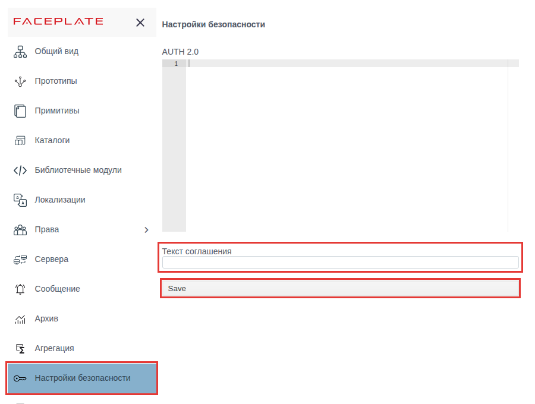

Поле **AUTH 2.0** в том же окне добавляет на форму вход через корпоративный провайдер учётных записей, см. [«Внешняя авторизация»](external_auth.md).

## Ошибки входа

| Ситуация | Сообщение |
|---|---|
| Runtime: неверный логин или пароль | **ERROR!** «Неверный логин или пароль. Пожалуйста, попробуйте еще раз» |
| Studio: неверный пароль у пользователя с ролью `.administrators` | То же |
| Studio: пользователь без роли `.administrators` или несуществующий логин | **Ошибка** «У вас нет доступа к этой системе. Обратитесь к администратору.» — при любом пароле |

После закрытия сообщения снова открывается форма входа.

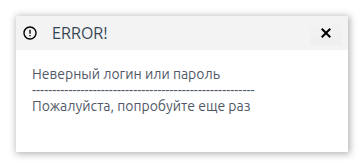

В примере `petrov` входит в Runtime, а в Studio получает сообщение «У вас нет доступа к этой системе». Чтобы открыть пользователю Studio, дайте ему роль `.administrators`, см. [«Пользователи», раздел «Роли пользователя»](users.md#роли-пользователя).

## История авторизаций

Окно **История авторизаций** показывает дату и время последнего успешного (строка **Успешный вход**) и последнего неуспешного (строка **Неуспешный вход**) входа под учётной записью, под которой открыт сеанс. Если такого входа не было, в строке — «Не найдено». Успешный вход — обычно вход, начавший текущий сеанс.

В Studio окно открывает значок часов на правой панели.

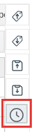

В Runtime — пункт **История авторизаций** в меню (☰).

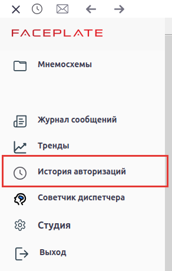

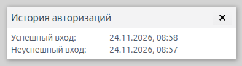

## Выход и конец сеанса

**Выход** есть в главном меню Studio (последний пункт) и в меню Runtime. После подтверждения «Вы точно хотите выйти?» → **yes** открывается форма входа.

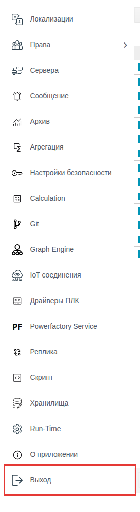

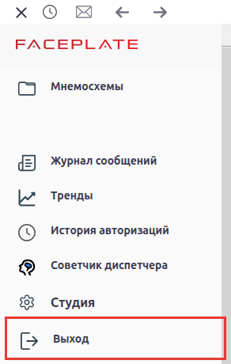

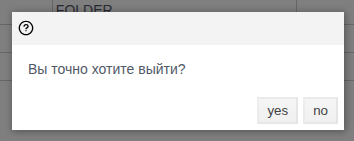

| Действие | Что происходит |
|---|---|
| **Выход** → **yes** | Сеанс завершён, открыта форма входа |
| Обновление страницы (F5) | Браузер может спросить, покинуть ли страницу. После обновления — форма входа |
| Закрытие вкладки или браузера | Сеанс завершается. При следующем открытии — форма входа |
| Обрыв связи с сервером | Runtime сам входит заново после восстановления связи, Studio показывает форму входа, см. [«Строка состояния и связь», раздел «Потеря связи с сервером»](../operator/status.md#потеря-связи-с-сервером) |

Под одной учётной записью можно работать одновременно в нескольких вкладках и браузерах: сеансы друг друга не закрывают.

# Заключение

1. Заведите пользователей и роли в **Права** → **Пользователи**. Studio открывается только пользователям с ролью `.administrators`.
2. Текст под кнопкой **OK** формы входа задаётся в **Настройки безопасности** → **Текст соглашения** → **Save**.
3. На сенсорных панелях используйте экранную клавиатуру формы.
4. Язык выбирается на форме. Ответ **yes** на вопрос «Сохранить настройки локализации?» делает его языком учётной записи.
5. Сеанс заканчивают **Выход**, обновление или закрытие страницы.
6. Последний успешный и последний неуспешный вход видны в окне **История авторизаций**: значок часов в Studio, пункт меню в Runtime.
