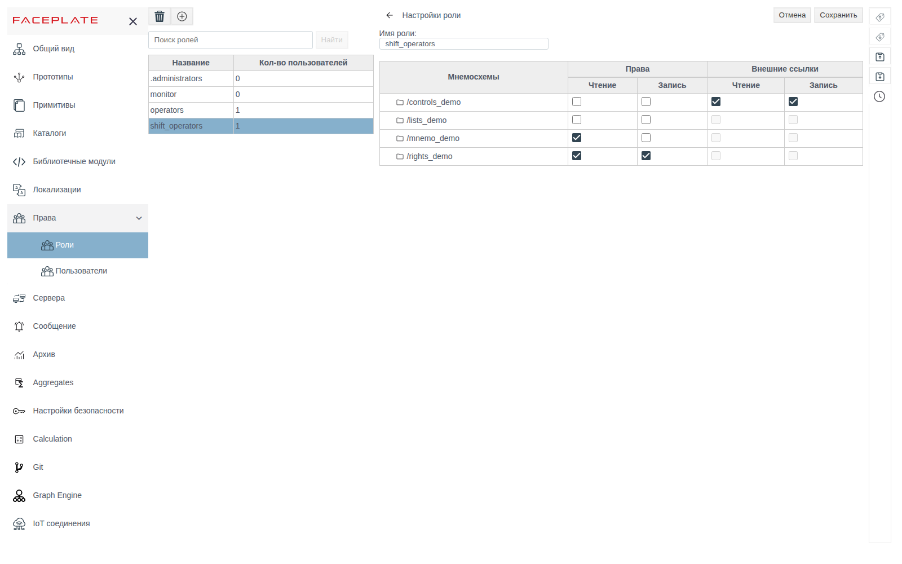
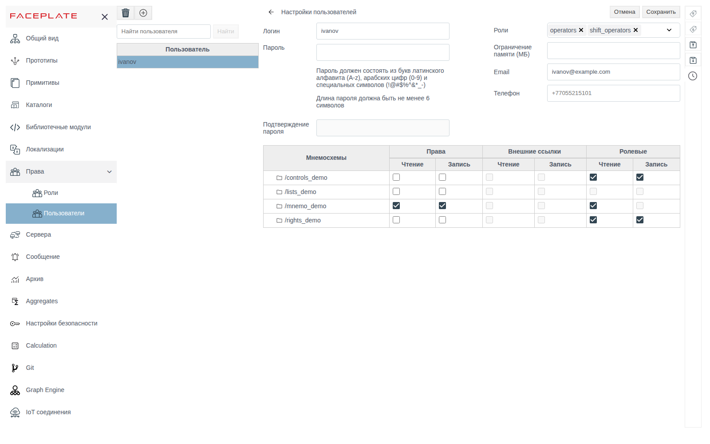
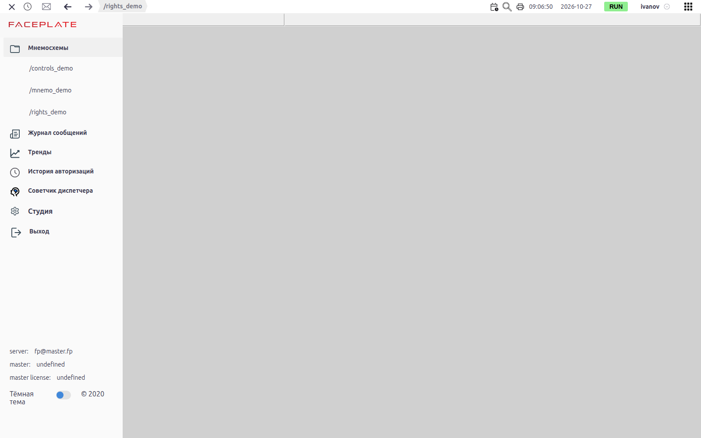
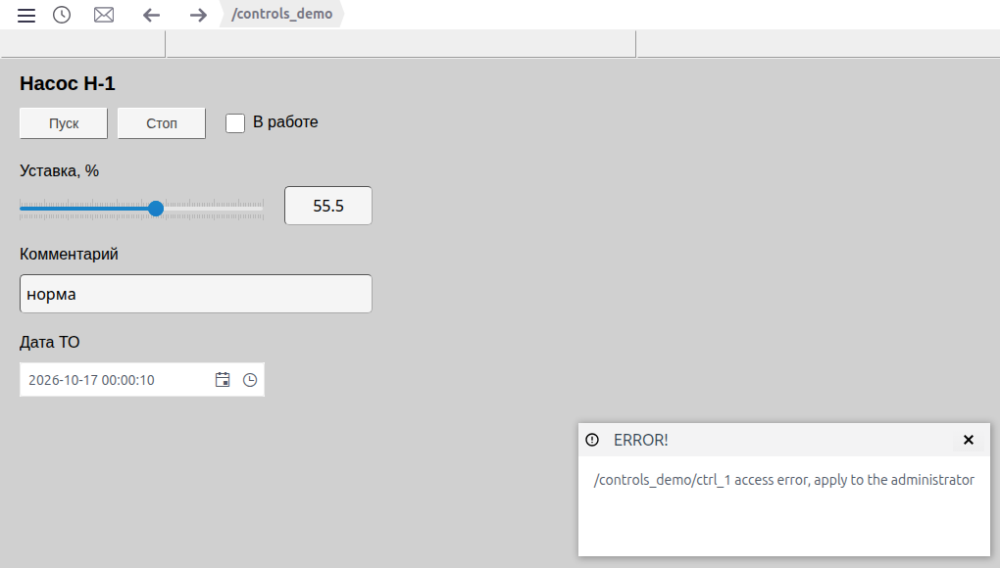

# Роли и права доступа

Документ для инженера-интегратора, который разграничивает доступ операторов к мнемосхемам проекта.

# Содержание

- [Глоссарий](#глоссарий)
- [Введение](#введение)
- [Основная часть](#основная-часть)
    - [Встроенные роли](#встроенные-роли)
    - [Создание роли](#создание-роли)
    - [Права на мнемосхемы](#права-на-мнемосхемы)
    - [Права на объекты](#права-на-объекты)
    - [Права пользователя](#права-пользователя)
    - [Что видит пользователь в Runtime](#что-видит-пользователь-в-runtime)
    - [Удаление роли](#удаление-роли)
- [Заключение](#заключение)

# Глоссарий

| Термин | Значение |
|---|---|
| Роль | Именованный набор прав на мнемосхемы. Роли назначаются пользователям в их карточке |
| Мнемосхема папки | Схема `screen` папки проекта. Права выдаются на неё и действуют на всё содержимое папки |

# Введение

Доступ в FACEPLATE разграничивается по мнемосхемам. На каждую мнемосхему папки выдаются права **Чтение** и **Запись** — роли или отдельному пользователю. Пользователь получает права всех своих ролей и свои личные права.

Раздел находится в главном меню Studio: **Права** → **Роли**. Личные права пользователя задаются в **Права** → **Пользователи**, см. документ [«Пользователи»](users.md).

Сквозной пример — роль `shift_operators` (операторы смены) и пользователь `ivanov` с этой ролью. Папки проекта:

| Папка | Что на мнемосхеме |
|---|---|
| `/mnemo_demo` | Обзорная схема |
| `/controls_demo` | Управление насосом `ctrl_1`: кнопки **Пуск**/**Стоп**, уставка |
| `/rights_demo` | Поле уставки насоса `ctrl_1` и встроенная схема `/controls_demo` (элемент **Folder Screen**) |

Понадобится доступ к Studio (`http://<сервер>:9000/fp/studio`) под учётной записью с правом изменять проект.

# Основная часть

## Встроенные роли

| Роль | Назначение |
|---|---|
| `.administrators` | Вход в Studio. Без этой роли Studio не открывается |
| `operators` | Есть у каждого пользователя, снять её нельзя. Права на мнемосхемы, выданные этой роли, получают все пользователи, поэтому для разграничения доступа создавайте свои роли |
| `monitor` | **Чтение** на всех мнемосхемах проекта, включая новые: право отмечено сразу после сохранения мнемосхемы папки. Пользователь с этой ролью видит в Runtime все мнемосхемы. **Запись** роль не даёт |

Колонка **Кол-во пользователей** в списке ролей показывает, сколько пользователей из раздела **Пользователи** имеют роль. Встроенные учётные записи `system` и `admin` не учитываются.

## Создание роли

Нажмите **+**, в окне «Задайте имя» введите имя роли и нажмите **ОК**. Щелчок по роли в списке открывает справа её настройки: **Имя роли** и таблицу прав. Отметьте права и нажмите **Сохранить**.

Поиск над списком находит роли, чьё имя начинается с введённой строки (от трёх символов).

## Права на мнемосхемы

В таблице перечислены папки проекта, у которых сохранена мнемосхема `screen`. Папка без мнемосхемы в таблице не появляется: сначала нарисуйте и сохраните её схему (см. [«Редактор мнемосхем»](../mnemo/editor.md)).

| Колонка | Смысл |
|---|---|
| **Права** → **Чтение** | Мнемосхема видна в Runtime, значения на ней показываются |
| **Права** → **Запись** | С мнемосхемы можно менять значения. Вместе с **Записью** после сохранения отмечается и **Чтение** |
| **Внешние ссылки** → **Чтение**, **Запись** | Права, полученные через другую мнемосхему, см. ниже. Флажки только показывают состояние |

**Внешние ссылки.** Если мнемосхема показывает схему другой папки (элемент **Folder Screen**, см. [«Редактор мнемосхем», раздел «Схема внутри схемы: Folder Screen»](../mnemo/editor.md#схема-внутри-схемы-folder-screen)), то роль с правами на первую схему получает те же права на вторую. В примере у `shift_operators` **Чтение** и **Запись** на `/rights_demo`, а `/rights_demo` показывает схему `/controls_demo`, поэтому у `/controls_demo` отмечены флажки **Внешние ссылки**.

## Права на объекты

Права мнемосхемы действуют на объекты своей папки: с **Чтением** оператор видит их значения, с **Записью** — меняет.

Объект другой папки, к которому привязан элемент мнемосхемы, получает права этой мнемосхемы. В примере поле уставки на `/rights_demo` привязано к `/controls_demo/ctrl_1`: с **Чтением** на `/rights_demo` оператор видит уставку, с **Записью** — меняет её, даже без прав на `/controls_demo`.

## Права пользователя

В карточке пользователя (**Права** → **Пользователи**) та же таблица прав и ещё колонки **Ролевые** → **Чтение**, **Запись**. Они отмечены, если право дают роли пользователя.

**Ролевые** и **Внешние ссылки** отвечают на разные вопросы. **Ролевые** показывают, что право пришло от роли, а не выдано лично пользователю. **Внешние ссылки** показывают, что право на мнемосхему получено через другую мнемосхему, которая её показывает (см. [Права на мнемосхемы](#права-на-мнемосхемы)). В карточке пользователя **Внешние ссылки** отмечаются только по его личным правам. Право, которое роль получила через внешнюю ссылку, видно у пользователя в колонке **Ролевые**. Например, у `shift_operators` на `/controls_demo` отмечены **Внешние ссылки**, а у `ivanov` то же право отмечено как **Ролевые**.

Итоговые права — объединение личных, ролевых и внешних.

У `ivanov` личные **Чтение** и **Запись** на `/mnemo_demo`, остальное он получает через роль `shift_operators`.

Права лучше выдавать ролям, а личные права — оставлять для исключений: при смене состава смены меняются только роли пользователей.

## Что видит пользователь в Runtime

В меню **Мнемосхемы** перечислены только мнемосхемы, на которые у пользователя есть **Чтение** — личное, ролевое или через внешние ссылки. Без прав список пуст.

Если у пользователя только **Чтение**, значения на мнемосхеме показываются, а попытка изменить их кнопкой или полем ввода заканчивается сообщением об ошибке доступа с путём объекта. Значение не меняется.

## Удаление роли

Выделите роль, нажмите корзину и подтвердите **yes**.

# Заключение

Порядок настройки доступа:

1. Нарисуйте и сохраните мнемосхемы папок — только они попадают в таблицу прав.
2. **Права** → **Роли** → **+** → имя роли → **ОК**. Отметьте **Чтение** и **Запись** по мнемосхемам и нажмите **Сохранить**.
3. В **Права** → **Пользователи** назначьте роли пользователям. Личные права задавайте только для исключений.
4. Учитывайте ссылки: права мнемосхемы распространяются на схемы, которые она показывает, и на объекты, к которым привязаны её элементы.
5. Проверьте результат, войдя под пользователем в Runtime.
