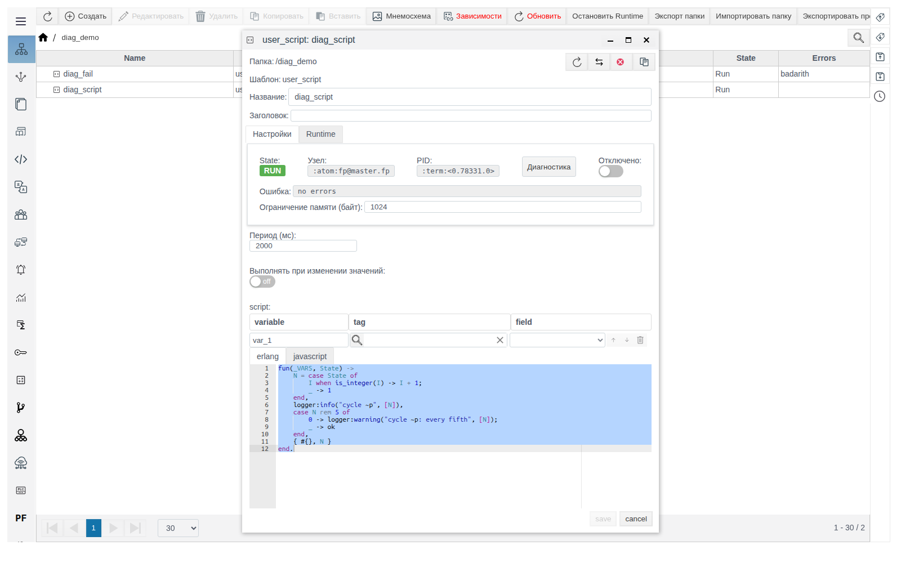
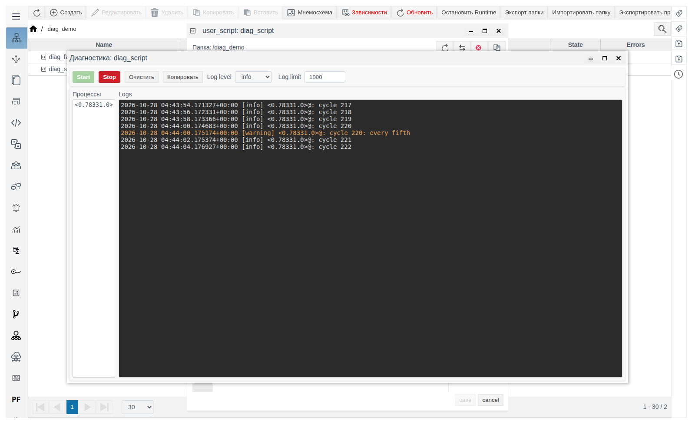
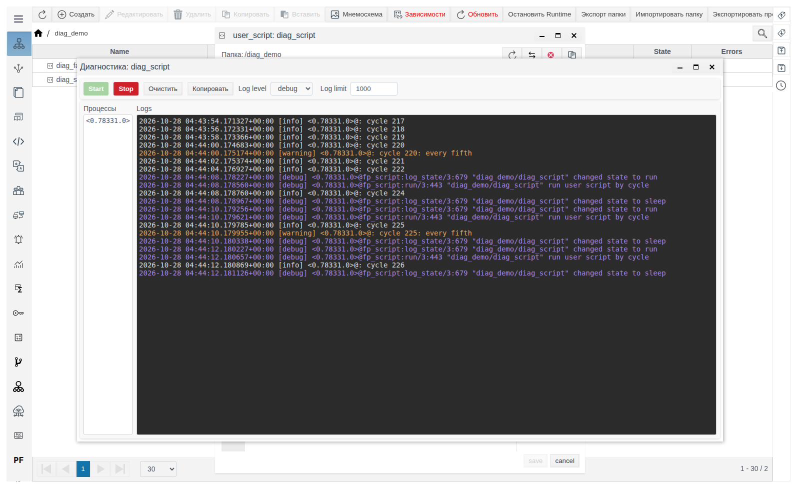
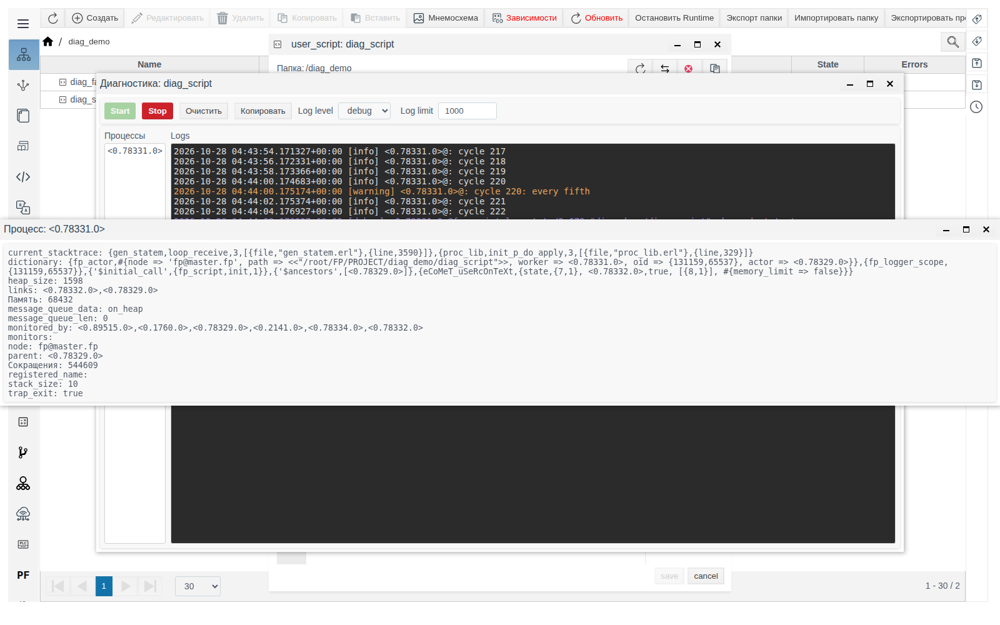
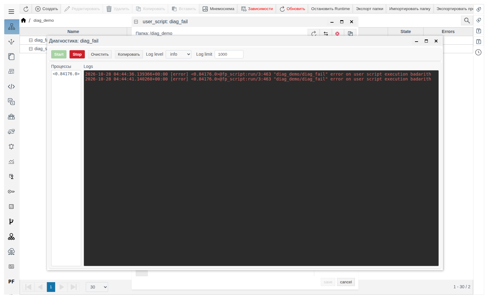

# Диагностика объектов Runtime

Документ для инженера-интегратора, который разбирается, почему расчёт, скрипт или соединение работает не так, как ожидалось.

# Содержание

- [Глоссарий](#глоссарий)
- [Введение](#введение)
- [Основная часть](#основная-часть)
    - [Где открыть диагностику](#где-открыть-диагностику)
    - [Окно «Диагностика»](#окно-диагностика)
    - [Уровень журнала](#уровень-журнала)
    - [Строка журнала](#строка-журнала)
    - [Предел строк](#предел-строк)
    - [Процессы объекта](#процессы-объекта)
    - [Свои сообщения из скрипта](#свои-сообщения-из-скрипта)
    - [Что искать в журнале](#что-искать-в-журнале)
- [Заключение](#заключение)

# Глоссарий

| Термин | Значение |
|---|---|
| Объект Runtime | Объект проекта, который выполняется на сервере: расчёт, пользовательский скрипт, IoT- или PLC-соединение и другие. В верхней панели его формы есть **State**, **Узел**, **PID** и **Отключено** |
| Процесс | Исполнитель работы объекта на сервере. Обозначается идентификатором вида `<0.78331.0>`; тот же идентификатор показан в поле **PID** формы |
| Журнал | Поток сообщений, которые процессы объекта выдают во время работы: ход выполнения, предупреждения, ошибки |

# Введение

Поле **Ошибка** в форме объекта и колонка **Errors** в **Общем виде** показывают только последнюю ошибку. Окно **Диагностика** показывает журнал объекта в реальном времени: каждое сообщение с временем, уровнем и процессом. По нему видно, как часто повторяется ошибка, что ей предшествовало и что объект делает между ошибками.

Окно открывается из формы любого объекта Runtime и показывает сообщения только этого объекта.

Сквозной пример — папка `diag_demo` с двумя пользовательскими скриптами на Erlang:

| Объект | Период (мс) | Что делает |
|---|---|---|
| `diag_script` | 2000 | Считает циклы, на каждом пишет в журнал `cycle N`, на каждом пятом — предупреждение `cycle N: every fifth` |
| `diag_fail` | 5000 | На каждом запуске делит на ноль и завершается с ошибкой `badarith` |

Как создать пользовательский скрипт, описано в документе [«Пользовательские скрипты»](../../user_script/user_script.md).

Понадобится доступ к Studio (`http://<сервер>:9000/fp/studio`) под учётной записью с правом изменять проект.

# Основная часть

## Где открыть диагностику

Откройте форму объекта в **Общем виде**. Кнопка **Диагностика** находится в верхней панели рядом с **PID**.



Кнопка появляется после первого сохранения объекта. В форме нового, ещё не сохранённого объекта её нет.

Кнопка есть только в формах с панелью **State**, **Узел**, **PID**. В окне **Создать** **Общего вида** это типы:

| Группа | Типы |
|---|---|
| **system** | `calculation`, `user_script`, `ARCHIVE`, `REPLICA`, `alarm_template`, `graph_engine`, `modeling`, `dsf_service` |
| **iot** | `iot_http_client_connection`, `iot_http_server_connection`, `iot_mqtt_publisher`, `iot_mqtt_subscriber`, `iot_websocket_client_connection`, `iot_websocket_server_connection` |
| **plc** | Все соединения `plc_…_connection` |

Панели и кнопки нет у папок (`FOLDER`), JS-библиотек (`js_library`), экземпляров примитивов и прототипов, источников и действий внутри IoT-соединения (`iot_…_source`, `iot_…_action`) и привязок внутри PLC-соединения (`plc_…_binding`).

Окно открывается поверх формы с заголовком **Диагностика: <название объекта>**. Форму можно не закрывать: окно и форма работают независимо.

## Окно «Диагностика»



| Элемент | Назначение |
|---|---|
| **Start** | Начать запись журнала. Окно показывает сообщения, появившиеся после нажатия; более ранних сообщений в окне нет |
| **Stop** | Остановить запись. Строки остаются в окне. Сообщения, выданные во время остановки, не собираются. Следующий **Start** дописывает новые строки к имеющимся |
| **Очистить** | Удалить строки из окна. Запись, если она идёт, продолжается |
| **Копировать** | Скопировать все строки окна в буфер обмена |
| **Log level** | Порог важности сообщений: `info` (по умолчанию), `warning`, `error`, `debug`. См. [Уровень журнала](#уровень-журнала) |
| **Log limit** | Сколько последних строк держит окно: от 1 до 100 000, по умолчанию 1000. См. [Предел строк](#предел-строк) |
| **Процессы** | Процессы объекта, от которых пришли сообщения. См. [Процессы объекта](#процессы-объекта) |
| **Logs** | Строки журнала. Щелчок по строке копирует её в буфер обмена |

Окно обновляется раз в секунду. Если пользователь не прокручивал журнал вверх, окно держит последнюю строку на виду.

## Уровень журнала

**Log level** работает как порог: окно показывает сообщения выбранного уровня и всех более важных.

| Log level | Что попадает в окно | Цвет строки |
|---|---|---|
| `error` | Только ошибки | Красный |
| `warning` | Предупреждения и ошибки | Оранжевый |
| `info` | Информационные сообщения, предупреждения и ошибки | Светло-серый |
| `debug` | Все сообщения, включая подробный ход работы объекта | Фиолетовый |

Уровень применяется при нажатии **Start**. Чтобы сменить уровень во время записи, нажмите **Stop**, выберите уровень и снова **Start**.

На уровне `warning` для `diag_script` в окно попадают только строки `cycle 5: every fifth`, `cycle 10: every fifth` и т. д. На уровне `debug` между ними видны служебные сообщения скрипта: смена состояния (`changed state to run`, `changed state to sleep`) и причина запуска (`run user script by cycle`).



## Строка журнала

```
2026-10-28 04:37:19.967153+00:00 [warning] <0.78331.0>@: cycle 20: every fifth
```

| Часть | Значение |
|---|---|
| `2026-10-28 04:37:19.967153+00:00` | Время сообщения в UTC с точностью до микросекунд |
| `[warning]` | Уровень |
| `<0.78331.0>` | Процесс, выдавший сообщение |
| `@…` | Источник сообщения. Для служебных сообщений FACEPLATE здесь указано место, где оно сформировано; для сообщений из пользовательского скрипта пусто |
| `cycle 20: every fifth` | Текст сообщения |

## Предел строк

**Log limit** ограничивает окно: при переполнении старые строки удаляются, остаются последние.

Если за одну секунду объект выдаёт больше строк, чем задано в **Log limit**, запись останавливается и появляется сообщение **ERROR!** с текстом `log_limit_exceeded`. Увеличьте **Log limit** или выберите менее подробный **Log level**, затем нажмите **Start**.

## Процессы объекта

Список **Процессы** показывает процессы объекта, от которых пришли сообщения. Щелчок по идентификатору открывает окно **Процесс: <идентификатор>** со сведениями о процессе; окно обновляется раз в секунду.



Полезные при поиске проблем поля:

| Поле | Что показывает |
|---|---|
| **node** | Узел кластера, на котором выполняется процесс |
| **Память** | Память процесса, байт |
| **message_queue_len** | Сколько сообщений ждут обработки. Постоянный рост — процесс не успевает обрабатывать входящие данные |
| **Сокращения** | Счётчик выполненной работы. Растёт, пока процесс работает |
| **current_stacktrace** | Где процесс находится в момент обновления. Если значение не меняется, а **message_queue_len** растёт — процесс завис |

Остальные поля окна — служебные сведения для разработчиков FACEPLATE; приложите их к обращению в поддержку.

## Свои сообщения из скрипта

Пользовательский скрипт на Erlang пишет в журнал своего объекта функциями `logger:info/2`, `logger:warning/2`, `logger:error/2`, `logger:debug/2`. Первый аргумент — шаблон текста, второй — список значений. Сообщения видны в окне **Диагностика** этого скрипта на соответствующем уровне.

Код `diag_script`:

```erlang
fun(_VARS, State) ->
    N = case State of
        I when is_integer(I) -> I + 1;
        _ -> 1
    end,
    logger:info("cycle ~p", [N]),
    case N rem 5 of
        0 -> logger:warning("cycle ~p: every fifth", [N]);
        _ -> ok
    end,
    { #{}, N }
end.
```

Такие сообщения помогают проверить значения переменных и ветви кода во время наладки. Временные отладочные сообщения пишите на уровне `debug`: при обычной работе с **Log level** `info` они не мешают.

## Что искать в журнале

Скрипт `diag_fail` в форме показывает **Ошибка** `badarith`. Журнал уточняет картину: ошибка повторяется на каждом запуске, раз в 5 секунд, процесс тот же — скрипт не перезапускается, а падает каждый цикл.



| Что видно | Что это значит | Что сделать |
|---|---|---|
| Красные строки `[error]` с одинаковым текстом через равные промежутки | Ошибка на каждом запуске | Исправьте код или данные, на которых он падает |
| Ошибка появилась один раз, дальше обычные строки | Разовый сбой, объект продолжает работу | Сверьте время ошибки с событиями на объекте |
| После **Start** на уровне `info` журнал пуст | Объект не выдаёт сообщений этого уровня | Выберите `debug` и снова **Start** |
| `State` `RUN`, **Ошибка** `no errors`, но объект не работает | Причина видна только в журнале: например, соединение не может подключиться к серверу | Откройте **Диагностика** на уровне `debug` |
| **message_queue_len** в окне процесса растёт | Объект не успевает обрабатывать данные | Увеличьте период, уменьшите объём данных |

Сообщения конкретных модулей и их значение описаны в документах модулей:

- IoT-соединения — [«IoT-соединения», раздел «Диагностика»](../../data_collection/IoT/IoT.md#диагностика);
- PLC-соединения — [«PLC-соединения в Faceplate», раздел «Диагностика»](../../data_collection/plc_connections/general_ru.md#диагностика);
- репликация — [«Репликация в Faceplate», раздел «Диагностика»](../replica/replica_ru.md#диагностика);
- архивы — [«Архивы», раздел «Диагностика и особенности записи»](../../data_storage/archives/archives_ru.md#диагностика-и-особенности-записи);
- советчик диспетчера (DSF) — [«Советчик диспетчера», раздел «Если рекомендация не появилась»](../../dsf/dsf_ru.md#если-рекомендация-не-появилась).

# Заключение

Порядок работы:

1. Откройте форму объекта → **Диагностика**.
2. Выберите **Log level** (`info` для начала, `debug` для подробностей) → **Start**.
3. Воспроизведите проблему и найдите строки `[error]` и `[warning]`.
4. При подозрении на зависание щёлкните процесс в списке **Процессы** и проверьте **message_queue_len** и **current_stacktrace**.
5. **Копировать** — для отчёта или обращения в поддержку. **Stop**, когда запись больше не нужна.
