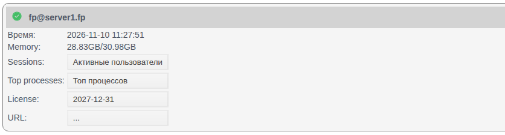
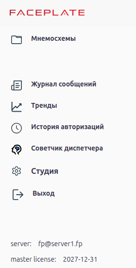
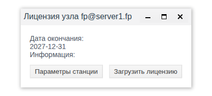
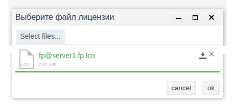
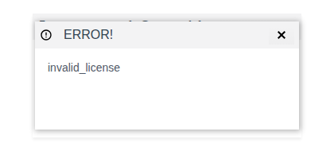
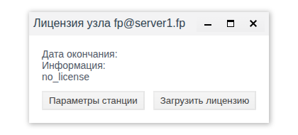
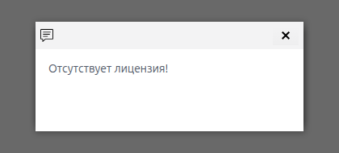

# Лицензирование

Документ для инженера-интегратора, который вводит узлы FACEPLATE в работу: где проверить лицензию узла, как её получить и загрузить и что видит оператор, если лицензии нет или она скоро закончится.

# Содержание

- [Глоссарий](#глоссарий)
- [Введение](#введение)
- [Основная часть](#основная-часть)
    - [Где видно лицензию](#где-видно-лицензию)
    - [Окно «Лицензия узла»](#окно-лицензия-узла)
    - [Получение и загрузка лицензии](#получение-и-загрузка-лицензии)
    - [Узел без лицензии](#узел-без-лицензии)
    - [Окончание срока лицензии](#окончание-срока-лицензии)
- [Заключение](#заключение)

# Глоссарий

| Термин | Значение |
|---|---|
| Узел | Один сервер FACEPLATE с именем вида `fp@<хост>`. Узлы кластера перечислены на панели **Сервера**, см. [«Узлы кластера»](../nodes/nodes.md) |
| Лицензия узла | Разрешение на работу конкретного узла. Загружается на каждый узел отдельно |
| Файл параметров станции | Файл `<имя узла>.stn`, который Studio сохраняет для узла. По нему поставщик выписывает лицензию |
| Файл лицензии | Файл `.lcn`, полученный от поставщика. Загружается на тот узел, для которого выписан |
| Дата окончания | Последний день действия лицензии в виде `ГГГГ-ММ-ДД` |

# Введение

Лицензия выдаётся на узел, а не на проект: в кластере из трёх серверов нужны три лицензии, каждая выписана по параметрам своего узла. Поэтому лицензию проверяют при вводе каждого нового сервера и при переносе узла на другое оборудование.

Документ отвечает на три вопроса:

- где посмотреть, есть ли у узла лицензия и до какого числа она действует — в Studio для всех узлов сразу, в Runtime для узла, к которому подключён оператор;
- как получить и загрузить лицензию;
- что происходит на рабочем месте оператора, если лицензии нет или срок подходит к концу.

Понадобится доступ к Studio (`http://<сервер>:9000/fp/studio`) под учётной записью с правом изменять проект.

# Основная часть

## Где видно лицензию

**Studio.** В меню слева выберите **Сервера**. В карточке каждого узла строка **License** показывает дату окончания лицензии или `...`, если лицензии нет. Это единственное место, где видны лицензии всех узлов кластера сразу.

**Runtime.** Откройте меню кнопкой ☰ в левом верхнем углу. Внизу меню:

- `server` — узел, к которому подключён Runtime;
- `master license` — лицензия этого узла: дата окончания или «отсутствует».

| | Studio, панель **Сервера** | Runtime, меню |
|---|---|---|
| Какие узлы | Все узлы кластера | Только узел, к которому подключён Runtime |
| Что можно сделать | Посмотреть, сохранить файл параметров станции, загрузить лицензию | Только посмотреть |
| Предупреждения | Нет | Уведомление каждые 10 минут, если лицензии нет или до окончания меньше 5 дней |

## Окно «Лицензия узла»

Щёлкните значение **License** в карточке узла. Откроется окно **Лицензия узла <имя узла>**.

| Элемент | Назначение |
|---|---|
| **Дата окончания** | Последний день действия лицензии. Пусто, если лицензии нет |
| **Информация** | Сведения о лицензии. Если лицензии нет, здесь причина, например `no_license` |
| **Параметры станции** | Сохраняет файл параметров станции `<имя узла>.stn` в папку загрузок браузера |
| **Загрузить лицензию** | Открывает окно **Выберите файл лицензии** для загрузки файла `.lcn` |

## Получение и загрузка лицензии

1. На панели **Сервера** откройте **License** нужного узла и нажмите **Параметры станции**. Браузер сохранит файл, например `fp@server1.fp.stn`.
2. Передайте файл поставщику FACEPLATE. В ответ придёт файл лицензии `.lcn` для этого узла.
3. В том же окне нажмите **Загрузить лицензию** → **Select files...** → выберите файл `.lcn` → **ok**.

После загрузки появляется сообщение об успешной загрузке, в окне заполняются **Дата окончания** и **Информация**, в карточке узла — **License**. Runtime показывает новую лицензию в меню без перезапуска.

В кластере повторите шаги для каждого узла: файл параметров станции описывает один узел и сервер, на котором он работает. Если загрузить на узел файл, выписанный для другого узла, появится окно **ERROR!** с текстом `invalid_license`, а лицензия узла не изменится.

По той же причине новая лицензия нужна, если узел переносят на другой сервер или меняют его имя в `vm.args`: сохраните файл параметров станции заново уже на новом месте.

## Узел без лицензии

Узел без лицензии работает как обычно: проект не останавливается, Studio и Runtime ничего не ограничивают. Studio не предупреждает об отсутствии лицензии сам: отсутствие лицензии видно на панели **Сервера** и в Runtime:

- в Studio в карточке узла **License** показывает `...`, в окне **Лицензия узла** поле **Дата окончания** пустое, а **Информация** — `no_license`;
- в Runtime в меню строка `master license` показывает «отсутствует» и выделена жирным;
- в Runtime через 10 минут после входа и затем каждые 10 минут появляется окно с текстом «Отсутствует лицензия!». Окно остаётся на экране, пока его не закроют крестиком.

Уведомление видит каждый, кто работает в Runtime на этом узле, в том числе оператор. Чтобы оно не появлялось на рабочих местах, загрузите лицензию до сдачи системы в работу.

## Окончание срока лицензии

Если до даты окончания осталось меньше 5 дней, Runtime выделяет строку `master license` жирным и каждые 10 минут показывает уведомление «Лицензия истекает <дата>! Пожалуйста продлите лицензию». После даты окончания узел показывает то же, что [узел без лицензии](#узел-без-лицензии): **License** `...` в Studio, «отсутствует» и уведомление «Отсутствует лицензия!» в Runtime; проект продолжает работать. Чтобы продлить лицензию, получите новый файл `.lcn` так же, как в разделе [Получение и загрузка лицензии](#получение-и-загрузка-лицензии), и загрузите его поверх старого.

# Заключение

Лицензия выписывается на конкретный узел по его файлу параметров станции и загружается в окне **Лицензия узла** на панели **Сервера**. В кластере у каждого узла своя лицензия; там же, на панели **Сервера**, видно, у каких узлов она есть и до какого числа действует. Оператор видит лицензию своего узла в меню Runtime и получает уведомление каждые 10 минут, если лицензии нет или до окончания меньше 5 дней. Загружайте лицензию на каждый новый узел до сдачи системы и запрашивайте новую при переносе узла на другой сервер.
