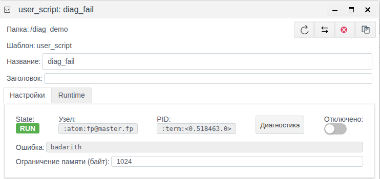

# Журналы сервера

Документ для инженера-интегратора, который ищет причину сбоя или выясняет, кто и когда менял проект, по файлам журналов на сервере FACEPLATE.

# Содержание

- [Глоссарий](#глоссарий)
- [Введение](#введение)
- [Основная часть](#основная-часть)
    - [Где лежат журналы](#где-лежат-журналы)
    - [Объём и ротация](#объём-и-ротация)
    - [Строка журнала](#строка-журнала)
    - [С чего начать поиск](#с-чего-начать-поиск)
    - [Как найти строки объекта](#как-найти-строки-объекта)
    - [Кто изменил объект](#кто-изменил-объект)
    - [Журналы, Диагностика и поле «Ошибка»](#журналы-диагностика-и-поле-ошибка)
- [Заключение](#заключение)

# Глоссарий

| Термин | Значение |
|---|---|
| Каталог установки | Папка, в которую установлен FACEPLATE на сервере. В ней лежат папки `bin`, `releases`, `logs`; команда `./faceplate console` запускается из `bin` этой папки |
| Узел | Один запущенный сервер FACEPLATE. Имя узла имеет вид `fp@<имя сервера>`, например `fp@master.fp`; оно же показано в поле **Узел** формы объекта Runtime и на панели **Сервера** |
| Журнал сервера | Текстовые файлы `console.log` и `error.log`, в которые узел пишет сообщения о своей работе и работе объектов проекта |
| Ротация | Переименование заполненного файла журнала в архивный (`console.log.0`, `console.log.1`, …) и начало нового файла |
| Процесс | Исполнитель работы объекта на сервере. Обозначается идентификатором вида `<0.518463.0>`; тот же идентификатор показан в поле **PID** формы объекта |

# Введение

Studio показывает состояние объекта сейчас: поле **Ошибка** — последнюю ошибку, окно **Диагностика** — сообщения одного объекта с момента нажатия **Start**. Журналы сервера пишутся постоянно, с запуска узла, по всем объектам сразу и по самой системе. По ним восстанавливают то, что Studio уже не показывает:

- когда объект начал выдавать ошибку и как часто она повторялась ночью;
- что произошло перед остановкой соединения или скрипта;
- кто и с какого адреса создал, изменил или удалил объект и что именно поменял;
- когда пользователи входили и выходили;
- какую версию FACEPLATE запустил узел.

Сквозной пример — папка `diag_demo` из документа [«Диагностика объектов Runtime»](../diagnostics/diagnostics.md): пользовательский скрипт `diag_fail` на каждом запуске, раз в 5 секунд, завершается с ошибкой `badarith`, скрипт `diag_script` каждые 2 секунды пишет в журнал `cycle N`.

Понадобится доступ к файловой системе сервера FACEPLATE (например, по SSH) и доступ к Studio (`http://<сервер>:9000/fp/studio`) под учётной записью с правом изменять проект.

# Основная часть

## Где лежат журналы

По умолчанию узел пишет два файла в папку `logs` каталога установки:

| Файл | Что пишется | Для чего |
|---|---|---|
| `<каталог установки>/logs/console.log` | Сообщения уровней `info`, `notice`, `warning`, `error` и выше | Полная история работы узла: запуск, входы пользователей, изменения проекта, работа и ошибки объектов |
| `<каталог установки>/logs/error.log` | Только сообщения уровня `error` и выше | Быстрый просмотр ошибок без потока рабочих сообщений. Те же строки есть и в `console.log` |

Сообщения уровня `debug` в файлы не пишутся. Их видно только в окне **Диагностика** на уровне `debug`, см. [«Диагностика объектов Runtime», раздел «Уровень журнала»](../diagnostics/diagnostics.md#уровень-журнала).

Окно консоли, в котором запущен `./faceplate console`, журнал не дублирует: читайте файлы.

В кластере каждый узел пишет свои файлы на своём сервере. Сообщения объекта ищите на узле, где он выполняется, — это значение поля **Узел** в форме объекта (см. [Как найти строки объекта](#как-найти-строки-объекта)). Список узлов — на панели **Сервера**, см. [«Узлы кластера»](../nodes/nodes.md).

При установке в Docker-контейнере папка `logs` обычно подключается к папке на сервере, см. [«Установка в Docker-контейнере»](../../samples/deploy%20as%20docker.md).

Журналы можно перенести в другую папку, например на отдельный диск, см. [«Резервирование ресурсов», раздел «Конфигурация логирования (fp.logger.config)»](../redundancy/redundancy.md#конфигурация-логирования-fploggerconfig). Новая папка используется после перезапуска узла.

## Объём и ротация

Когда файл достигает 1 ГБ, узел переименовывает его в архивный с номером `.0`, прежние архивы сдвигает на один номер (`.0` → `.1` и т. д.) и начинает новый файл. Архив с наибольшим номером сверх предела удаляется.

| Файл | Размер файла | Архивов | Наибольший объём на диске |
|---|---|---|---|
| `console.log` | 1 ГБ | 10 (`console.log.0` … `console.log.9`) | около 11 ГБ |
| `error.log` | 1 ГБ | 3 (`error.log.0` … `error.log.2`) | около 4 ГБ |

Чем меньше номер архива, тем он новее. Чтобы искать по всей сохранённой истории, передайте команде все файлы сразу: `grep '<текст>' logs/console.log*`.

На нагруженной системе 11 ГБ `console.log` могут вместить всего несколько дней. Если история нужна дольше, копируйте архивы в другое место до того, как они будут удалены.

## Строка журнала

Каждое сообщение — одна строка:

```
2026-11-09 12:13:22.704800+00:00 [error] <0.518463.0>@fp_script:run/3:463 "diag_demo/diag_fail" error on user script execution badarith
```

| Часть | Значение |
|---|---|
| `2026-11-09 12:13:22.704800+00:00` | Время по часам сервера с точностью до микросекунд и смещение от UTC. На сервере с часовым поясом UTC+5 строка заканчивается на `+05:00` |
| `[error]` | Уровень: `info`, `notice`, `warning`, `error` и выше |
| `<0.518463.0>` | Процесс, выдавший сообщение. Совпадает с **PID** в форме объекта, пока объект не перезапущен |
| `@` | Разделитель |
| `fp_script:run/3:463` | Место в коде платформы, откуда выдано сообщение. При разборе его можно пропускать. У сообщений пользовательского скрипта место не указывается, в строке остаётся только `:` |
| `"diag_demo/diag_fail" error on …` | Текст. Сообщения объектов проекта содержат путь объекта |

Путь объекта записывается по-разному: у скриптов — от папки проекта (`"diag_demo/diag_fail"`), у соединений — полностью (`/root/FP/PROJECT/plat_bugs/bt_master`), в строках изменений — от корня проекта (`<<"/diag_demo/diag_fail">>`). Во всех формах есть путь «папка/объект», поэтому ищите по нему: `diag_demo/diag_fail` находит строки любого вида.

Тот же формат строки у окна **Диагностика**, поэтому строку из окна можно найти в файле, и наоборот.

## С чего начать поиск

В журналы пишут платформа и все объекты проекта. Любая строка устроена одинаково (см. [Строка журнала](#строка-журнала)), поэтому разбор начинают с того, что известно о проблеме:

- **знаете объект** — ищите по пути `папка/объект`, см. [Как найти строки объекта](#как-найти-строки-объекта);
- **объект изменился, и непонятно, кто его менял** — ищите `USER ACTION`, см. [Кто изменил объект](#кто-изменил-объект);
- **в форме объекта есть ошибка** — ищите её текст из поля **Ошибка** в `error.log`, там будут время и узел;
- **нужны сообщения своего скрипта** — ищите текст, который скрипт передаёт в `logger`, см. [«Диагностика объектов Runtime», раздел «Свои сообщения из скрипта»](../diagnostics/diagnostics.md#свои-сообщения-из-скрипта);
- **проверяете копирование или закрытие баз** — см. [«Хранилища», раздел «Проверка по журналу»](../../data_storage/storage/storage.md#проверка-по-журналу);
- **в журнале есть `crasher:`** — это отчёт об аварийном завершении процесса. Приложите его к обращению в поддержку вместе с несколькими строками до и после.

## Как найти строки объекта

Начните с формы объекта в Studio: она подсказывает, что и где искать.



| Поле формы | Что даёт для поиска |
|---|---|
| **Узел** | На каком сервере открывать журналы: `fp@master.fp` |
| **PID** | Процесс объекта: `<0.518463.0>`. Сужает поиск до текущего запуска объекта |
| **Ошибка** | Текст последней ошибки: `badarith` |

Путь объекта виден в заголовке папки и в поле **Название**: `diag_demo/diag_fail`.

Все ошибки объекта, последние строки:

```bash
grep 'diag_demo/diag_fail' logs/error.log | tail -n 3
```

```
2026-11-09 12:13:17.704793+00:00 [error] <0.518463.0>@fp_script:run/3:463 "diag_demo/diag_fail" error on user script execution badarith
2026-11-09 12:13:22.704800+00:00 [error] <0.518463.0>@fp_script:run/3:463 "diag_demo/diag_fail" error on user script execution badarith
2026-11-09 12:13:27.704813+00:00 [error] <0.518463.0>@fp_script:run/3:463 "diag_demo/diag_fail" error on user script execution badarith
```

Ошибка повторяется ровно раз в 5 секунд — с периодом скрипта: скрипт не перезапускается, а падает на каждом запуске.

Полная история объекта, с запусками, остановками и изменениями, — в `console.log`:

```bash
grep 'diag_demo/diag_fail' logs/console.log
```

Следить за журналом в реальном времени, показывая только строки объекта:

```bash
tail -f logs/console.log | grep --line-buffered 'diag_demo/diag_fail'
```

В отличие от окна **Диагностика**, так видны и строки объекта, и системные строки о нём, например запись изменения от другого пользователя.

## Кто изменил объект

Каждое создание, изменение и удаление объекта через Studio записывается строкой `USER ACTION` уровня `info` в `console.log`:

| Действие | Что в строке |
|---|---|
| `create object` | Путь, пользователь, IP-адрес, значения полей нового объекта (`fields: …`) |
| `edit object` | Путь, пользователь, IP-адрес, изменённые поля: для каждого новое значение `value` и прежнее `previous_value` (`changes: …`) |
| `delete object` | Путь, пользователь, IP-адрес |

В примере скрипт `diag_fail` отключили переключателем **Отключено** и через минуту включили снова. В журнале:

```bash
grep 'diag_demo/diag_fail' logs/console.log | grep -v 'error on user script'
```

```
2026-11-09 12:11:21.456723+00:00 [info] <0.517054.0>@fp_item:log_user_action/1:1240 USER ACTION: edit object <<"/diag_demo/diag_fail">>, user <<"system">>, ip: {172,17,0,1}, changes: #{<<"disabled">> => #{value => true,previous_value => false}}
2026-11-09 12:11:21.457658+00:00 [info] <0.499862.0>@fp_script:terminate/3:530 "diag_demo/diag_fail" stop script, reason shutdown
2026-11-09 12:11:21.458121+00:00 [info] <0.499862.0>@fp_script:log_state/3:676 "diag_demo/diag_fail" changed state to stop
2026-11-09 12:12:22.675101+00:00 [info] <0.518133.0>@fp_item:log_user_action/1:1240 USER ACTION: edit object <<"/diag_demo/diag_fail">>, user <<"system">>, ip: {172,17,0,1}, changes: #{<<"disabled">> => #{value => false,previous_value => true}}
```

По строкам видно:

- в 12:11:21 пользователь `system` с адреса `172.17.0.1` включил **Отключено** (`disabled`: `false` → `true`);
- в ту же миллисекунду процесс `<0.499862.0>` остановился;
- в 12:12:22 тот же пользователь выключил **Отключено**.

Ошибки `badarith` между 12:11:21 и 12:12:22 в `error.log` нет, следующая — в 12:12:22 от нового процесса `<0.518463.0>`. Поэтому **PID** в форме после включения другой, чем до отключения.

Все изменения проекта одного пользователя:

```bash
grep 'USER ACTION' logs/console.log* | grep 'user <<"admin">>'
```

## Журналы, Диагностика и поле «Ошибка»

| | Поле **Ошибка**, колонка **Errors** | Окно **Диагностика** | Журналы сервера |
|---|---|---|---|
| Где | Форма объекта, **Общий вид** | Окно из формы объекта Runtime | Файлы на сервере |
| Что показывает | Последнюю ошибку объекта | Сообщения одного объекта | Сообщения всех объектов и системы |
| За какое время | Только сейчас | С нажатия **Start** до закрытия окна | С запуска узла, пока файл не удалён ротацией |
| Уровни | — | `debug`, `info`, `warning`, `error` | `info` и выше (`console.log`), `error` и выше (`error.log`) |
| Изменения проекта, входы пользователей | Нет | Нет | Есть |
| Нужен доступ | Studio | Studio | Файловая система сервера |

Порядок разбора: поле **Ошибка** говорит, что объект в ошибке; окно **Диагностика** показывает, что объект делает сейчас, в том числе на уровне `debug`; журналы сервера отвечают, что было раньше, на каком узле и кто менял объект.

Сообщения тревог, которые видит оператор, — отдельный журнал сообщений проекта, а не файлы сервера, см. [«Тревоги и тренды на экране»](../../mnemo/alarms_trends.md).

# Заключение

Каждый узел FACEPLATE пишет два файла в `<каталог установки>/logs`: `console.log` с сообщениями от `info` и выше и `error.log` только с ошибками. Файлы растут до 1 ГБ и ротируются: `console.log` хранит 10 архивов, `error.log` — 3. Журналы можно перенести в другую папку; новая папка используется после перезапуска узла. Строку объекта находят по пути «папка/объект» на узле из поля **Узел**; **PID** формы совпадает с процессом в строке до перезапуска объекта. Строки `USER ACTION` показывают, кто, когда и с какого адреса создал, изменил или удалил объект и какие поля поменял.
