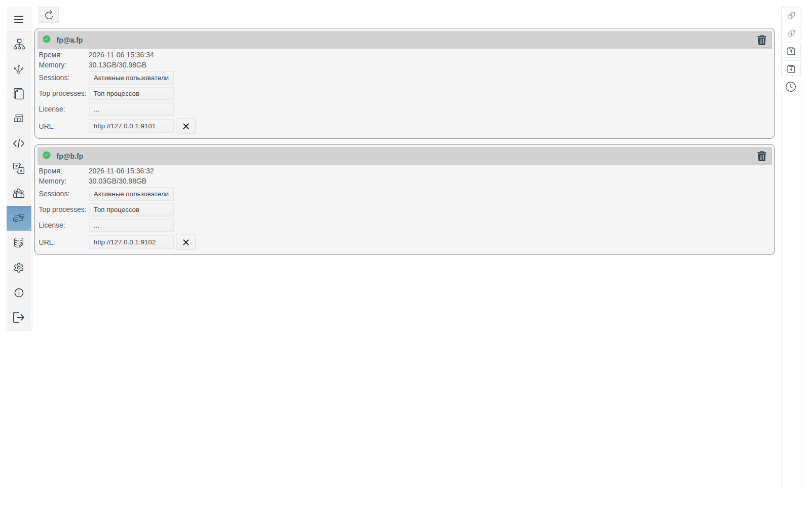
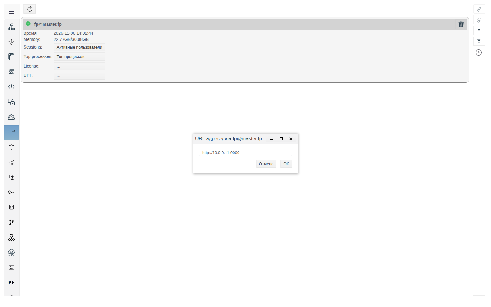
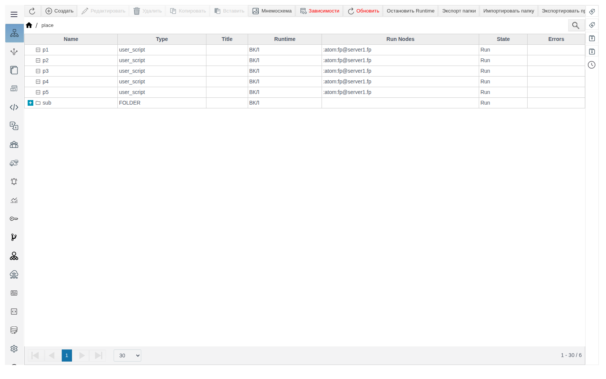
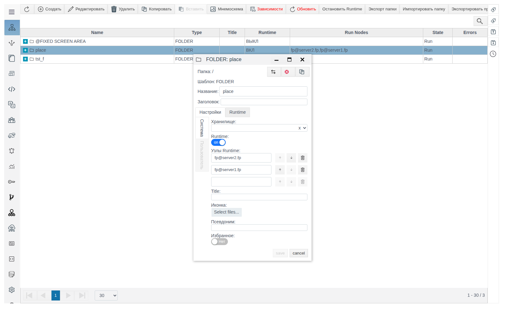
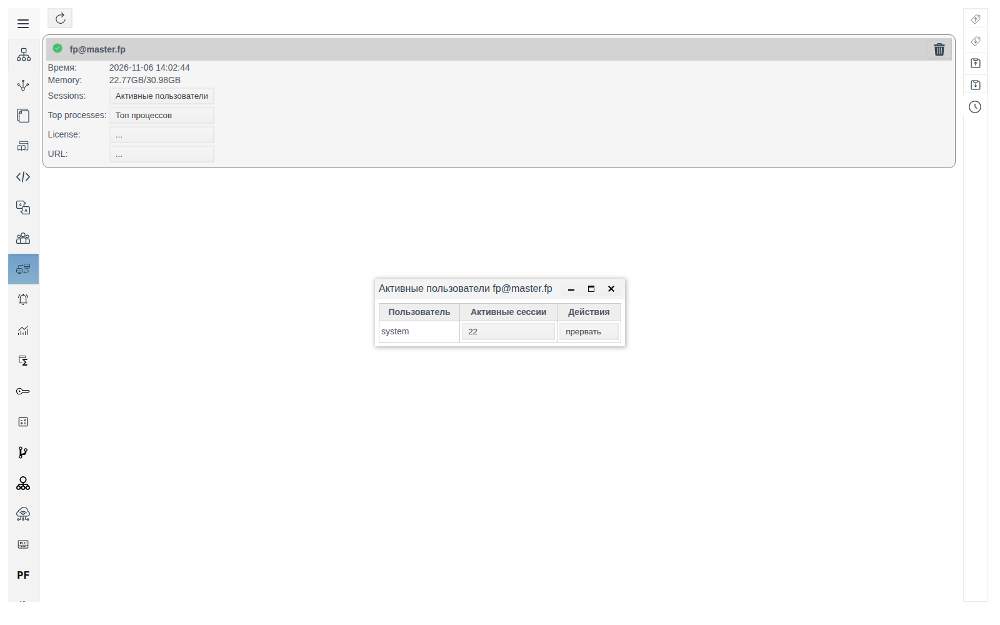
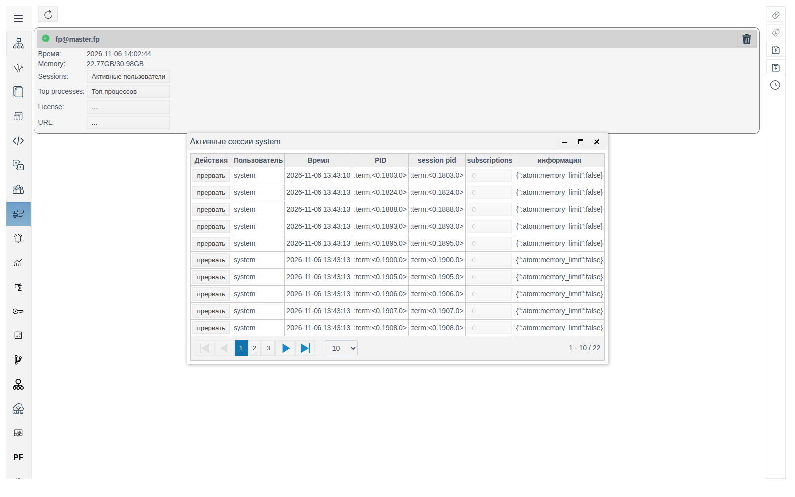
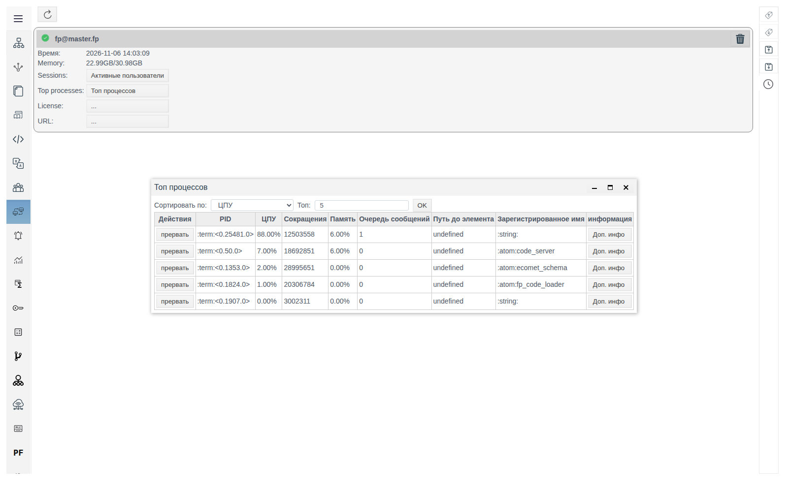
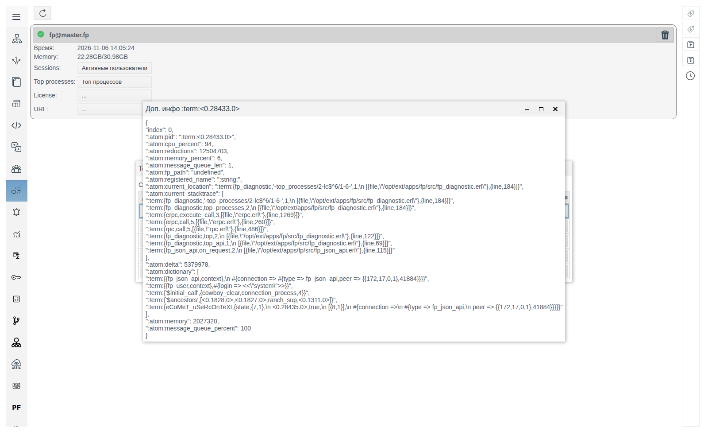
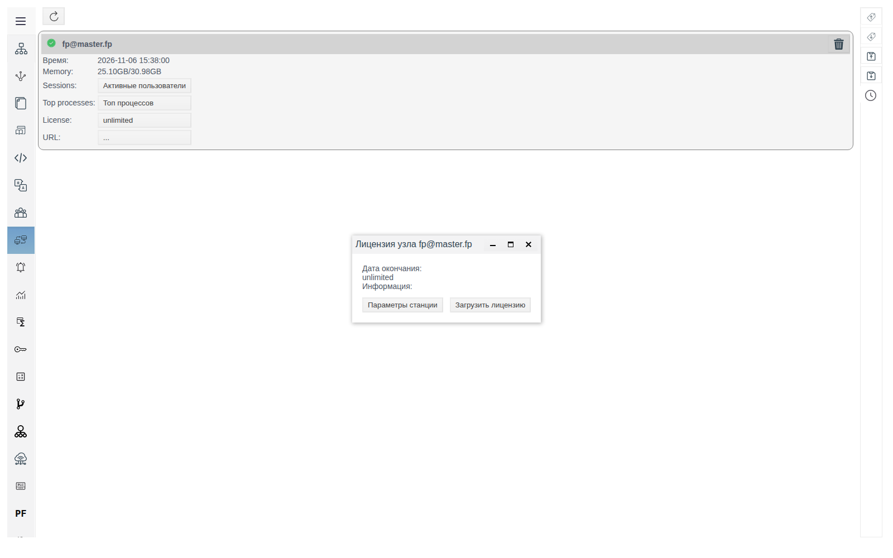

# Узлы кластера

Документ для инженера-интегратора, который следит за серверами FACEPLATE: какие узлы работают, кто к ним подключён, что их нагружает и куда переключится Runtime оператора, если сервер станет недоступен.

# Содержание

- [Глоссарий](#глоссарий)
- [Введение](#введение)
- [Основная часть](#основная-часть)
    - [Где открыть панель](#где-открыть-панель)
    - [Карточка узла](#карточка-узла)
    - [Адрес узла для Runtime](#адрес-узла-для-runtime)
    - [Где выполняются объекты](#где-выполняются-объекты)
    - [Активные пользователи и сессии](#активные-пользователи-и-сессии)
    - [Топ процессов](#топ-процессов)
    - [Лицензия узла](#лицензия-узла)
- [Заключение](#заключение)

# Глоссарий

| Термин | Значение |
|---|---|
| Узел | Один сервер FACEPLATE. Имя вида `fp@<хост>` задаётся параметром `-name` в `vm.args`, см. [«Резервирование ресурсов»](../Redundancy/Redundancy_ru.md#31-настройка-виртуальной-машины-vmargs) |
| Кластер | Несколько узлов, объединённых в одну систему. Порядок сборки — в [«Резервирование ресурсов»](../Redundancy/Redundancy_ru.md#4-запуск-и-сборка-кластера) |
| Сессия | Подключение к узлу под учётной записью пользователя. Каждое окно Studio и Runtime открывает свои сессии; кроме них узел держит служебные сессии, созданные при его запуске |
| Процесс | Исполнитель работы на узле. Обозначается идентификатором вида `<0.1353.0>` |

# Введение

Панель **Сервера** — список узлов кластера в Studio, по одной карточке на узел. Она отвечает на вопросы об узле целиком: работает ли он, сколько памяти занято на сервере, кто подключён, какие процессы нагружают узел сильнее всего, какая у него лицензия.

Окно **Диагностика** ([«Диагностика объектов Runtime»](../diagnostics/diagnostics.md)) работает на уровне одного объекта: журнал конкретного расчёта, скрипта или соединения. Панель **Сервера** нужна раньше, когда ещё неизвестно, какой объект виноват: если узел перегружен, **Топ процессов** показывает самые тяжёлые процессы и путь объекта проекта, которому принадлежит каждый из них. Дальше причину ищут в **Диагностике** этого объекта.

Второе назначение панели — резервирование Runtime. В карточке узла задаётся адрес, по которому Runtime оператора подключается к этому узлу, когда теряет связь со своим сервером. Третье — размещение объектов: на каком узле работает каждый скрипт, расчёт или соединение и куда он переходит при отказе узла.

В кластере из одного узла панель показывает одну карточку.

Понадобится доступ к Studio (`http://<сервер>:9000/fp/studio`) под учётной записью с правом изменять проект.

# Основная часть

## Где открыть панель

В меню Studio слева выберите **Сервера**. Кнопка обновления над карточками перечитывает список узлов и значения в карточках.

## Карточка узла

| Элемент | Назначение |
|---|---|
| Имя узла | `fp@<хост>` |
| **Время** | Время, когда узел последний раз обновил свои данные. У работающего узла совпадает с текущим с точностью до нескольких секунд. Если узел остановлен, значение перестаёт меняться |
| **Memory** | Занятая и общая память сервера, например `22.13GB/30.98GB` |
| **Sessions** | Кнопка **Активные пользователи**, см. [Активные пользователи и сессии](#активные-пользователи-и-сессии) |
| **Top processes** | Кнопка **Топ процессов**, см. [Топ процессов](#топ-процессов) |
| **License** | Дата окончания лицензии узла; `...`, если лицензия не загружена. См. [Лицензия узла](#лицензия-узла) |
| **URL** | Адрес узла для Runtime; `...`, если адрес не задан. См. [Адрес узла для Runtime](#адрес-узла-для-runtime) |

## Адрес узла для Runtime

Runtime оператора открыт с одного узла и держит с ним связь. При подключении Runtime получает от сервера список работающих узлов кластера и их адреса. Если связь пропадает, Runtime по очереди пробует адреса из списка, подключается к первому доступному узлу, загружает страницу Runtime с его адреса и продолжает работу под той же учётной записью: оператору не нужно снова вводить пароль.

Адрес узла в списке:

| Поле **URL** | Какой адрес пробует Runtime |
|---|---|
| Заполнено | Значение **URL** |
| Пустое | Адрес из имени узла: хост после `@` с HTTP- и HTTPS-портом узла, например `http://<хост>:9000` |

Задайте **URL**, если имя хоста узла не открывается с рабочего места оператора: например, оно известно только внутри сети серверов или операторы подключаются по IP-адресу. Адрес указывается так, как его открывают с рабочего места оператора: протокол, хост или IP-адрес и порт, без пути, например `http://10.0.0.11:9000`.

Узел может принять оператора, только если на нём есть копия базы данных проекта. Как добавить копию на другой узел, описано в [«Хранилища»](../../data_storage/storage/Storage_ru.md#резервирование-копия-базы-на-втором-сервере). Без копии Runtime на таком узле после отказа первого не загружается.

Чтобы задать адрес:

1. Щёлкните значение **URL** в карточке узла. Откроется окно **URL адрес узла <имя узла>**.
2. Введите адрес и нажмите **OK**.

Адрес появляется в карточке; справа от него — крестик, который очищает поле. Значение сохраняется при перезапуске узла.

Проверить переключение можно без остановки сервера: откройте Runtime, затем в Studio прервите сессию этого Runtime (см. [Активные пользователи и сессии](#активные-пользователи-и-сессии)). Runtime потеряет связь и подключится к узлу из списка. При остановке FACEPLATE на узле Runtime переключается на другой узел за несколько секунд.

## Где выполняются объекты

Объекты Runtime — пользовательские скрипты, расчёты, соединения, архивы — работают на узлах кластера. Узел, на котором объект работает сейчас, виден в двух местах:

* колонка **Run Nodes** в **Общем виде**, например `:atom:fp@server1.fp`. У остановленного объекта узла нет;
* поле **Узел** в верхней панели формы объекта, рядом с **PID**.

На каких узлах объектам разрешено работать, задаётся у папки, а не у самого объекта. Это нужно, когда объект привязан к конкретному серверу: соединению с ПЛК нужен сервер с сетью до контроллера, тяжёлым расчётам — отдельный сервер, чтобы не нагружать остальные. Поля в форме папки, вкладка **Настройки**:

| Поле | Назначение |
|---|---|
| **Runtime** | Выключен — объекты папки и вложенных папок остановлены (**State** `Stop`, без узла), в колонке **Runtime** у папки `ВЫКЛ`. Включён — объекты работают |
| **Узлы Runtime** | Узлы, на которых могут работать объекты папки. Имя узла вводится целиком, например `fp@server2.fp`; после ввода появляется пустая строка для следующего узла. Корзина удаляет строку |

| **Узлы Runtime** у папки | Где работают объекты |
|---|---|
| Пусто | Как у родительской папки. Если список не задан ни у одной папки выше — на любом узле кластера: FACEPLATE распределяет объекты между узлами сам |
| Заданы | Только на узлах из списка. Объекты распределяются между ними |

У папки колонка **Run Nodes** показывает её список **Узлы Runtime**.

Изменение списка применяется при сохранении папки: объекты перезапускаются на подходящих узлах в течение нескольких секунд.

Если узел останавливается, объекты, которые на нём работали, перезапускаются на другом узле из списка за несколько секунд. Чтобы объекты папки переживали отказ сервера, укажите в списке не меньше двух узлов, и на каждом из этих узлов должна быть копия базы данных проекта, см. [«Хранилища»](../../data_storage/storage/Storage_ru.md#резервирование-копия-базы-на-втором-сервере).

Кнопки **Остановить Runtime** и **Запустить Runtime** на панели **Общего вида** после подтверждения останавливают и запускают все объекты проекта сразу.

В примере у папки `place` в списке `fp@server2.fp` и `fp@server1.fp`: пять скриптов папки работали на обоих узлах. После остановки FACEPLATE на `fp@server2.fp` его скрипт через несколько секунд работал на `fp@server1.fp`.

## Активные пользователи и сессии

Кнопка **Активные пользователи** открывает окно **Активные пользователи <имя узла>**: учётные записи, подключённые к узлу, и число их сессий в колонке **Активные сессии**.

Щелчок по числу сессий открывает окно **Активные сессии <пользователь>**.

| Колонка | Значение |
|---|---|
| **Действия** | Кнопка **прервать** — закрыть сессию |
| **Пользователь** | Учётная запись |
| **Время** | Время открытия сессии |
| **PID**, **session pid** | Процесс сессии |
| **subscriptions** | Число подписок сессии на данные |
| **информация** | Для окон Studio и Runtime — адрес клиента (`peer`): IP-адрес и порт, с которых открыто окно |

Окно показывает по 10 сессий на странице; число строк меняется списком под таблицей.

**прервать** спрашивает подтверждение «Вы уверены что хотите прервать сессию пользователя <пользователь>, id: <PID>» и после **yes** закрывает сессию. Окно Studio или Runtime, которому принадлежала сессия, теряет связь с сервером: Runtime переключается по правилам из раздела [Адрес узла для Runtime](#адрес-узла-для-runtime).

Сессию нужного окна узнают по колонкам **Время** (время входа) и **информация** (адрес рабочего места).

## Топ процессов

Кнопка **Топ процессов** собирает статистику процессов узла за несколько секунд и открывает окно **Топ процессов**.

| Элемент | Назначение |
|---|---|
| **Сортировать по** | По какому показателю отбирать процессы: **ЦПУ**, **Сокращения**, **Память**, **Очередь сообщений** |
| **Топ** | Сколько процессов показать, по умолчанию 5 |
| **OK** | Собрать список заново с выбранными параметрами |

| Колонка | Значение |
|---|---|
| **Действия** | Кнопка **прервать** — остановить процесс |
| **PID** | Идентификатор процесса |
| **ЦПУ** | Доля процессорного времени узла за время сбора |
| **Сокращения** | Счётчик выполненной процессом работы. Чем больше, тем больше процесс вычислял |
| **Память** | Доля памяти узла, занятой процессом |
| **Очередь сообщений** | Сколько сообщений ждут обработки. Растущая очередь означает, что процесс не успевает за входящими данными |
| **Путь до элемента** | Путь объекта проекта, которому принадлежит процесс, например `"<папка>/<объект>"`. `undefined` — процесс самой платформы, а не объекта проекта |
| **Зарегистрированное имя** | Имя служебного процесса платформы, если оно есть |
| **информация** | Кнопка **Доп. инфо** |

Какую сортировку выбрать:

| Признак на узле | Сортировка |
|---|---|
| Загружен процессор, интерфейс отвечает медленно | **ЦПУ** |
| Растёт занятая память в **Memory** карточки | **Память** |
| Данные приходят с задержкой | **Очередь сообщений** |

Первой строкой при сортировке по **ЦПУ** обычно идёт процесс, который сам собирает этот список для текущего пользователя.

Если в **Пути до элемента** указан объект проекта, откройте его форму в **Общем виде** и запустите **Диагностику**, см. [«Диагностика объектов Runtime»](../diagnostics/diagnostics.md#где-открыть-диагностику).

**Доп. инфо** открывает окно **Доп. инфо <PID>** со всеми сведениями о процессе: текущее место выполнения (`current_location`) и стек вызовов (`current_stacktrace`), объём памяти в байтах (`memory`), длина очереди сообщений (`message_queue_len`), служебные данные процесса (`dictionary`). В `dictionary` процесса сессии указаны учётная запись (`login`) и адрес клиента (`peer`).

**прервать** спрашивает подтверждение «Вы уверены что хотите прервать процесс <PID>» и после **yes** останавливает процесс.

## Лицензия узла

Щелчок по значению **License** открывает окно **Лицензия узла <имя узла>**.

| Элемент | Назначение |
|---|---|
| **Дата окончания** | До какого числа действует лицензия узла; `unlimited` — бессрочная |
| **Информация** | Сведения из файла лицензии |
| **Параметры станции** | Сохранить файл `<имя узла>.stn` с параметрами сервера. Файл передают поставщику, чтобы получить лицензию для этого узла |
| **Загрузить лицензию** | Открыть окно **Выберите файл лицензии**: **Select files...** → файл `.lcn` → **ok** |

После загрузки появляется сообщение «Лицензия успешно загружена», поля окна и значение **License** в карточке заполняются. Runtime показывает лицензию в своём меню, в строке `master license`.

Файл лицензии выписывается по файлу параметров конкретного узла, поэтому лицензия загружается на каждый узел отдельно.

# Заключение

Панель **Сервера** показывает каждый узел кластера отдельной карточкой. **URL** узла определяет адрес, по которому Runtime оператора переключается на этот узел при потере связи: задайте его, если имя хоста узла не открывается с рабочих мест операторов. Узел принимает операторов, только если на нём есть копия базы данных проекта. Переключение проверяется без остановки сервера, если прервать сессию Runtime. На каких узлах работают объекты, задаёт поле **Узлы Runtime** папки; при отказе узла объекты переходят на другой узел из списка. **Активные пользователи** показывают, кто и откуда подключён. **Топ процессов** находит процесс, который нагружает узел, и объект проекта, которому он принадлежит. Причину ищите в **Диагностике** этого объекта. Лицензия загружается на каждый узел из окна **Лицензия узла**.
