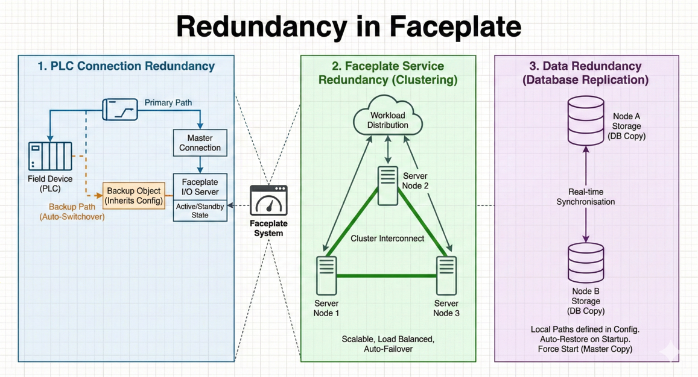
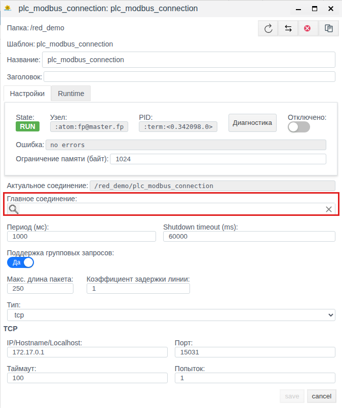
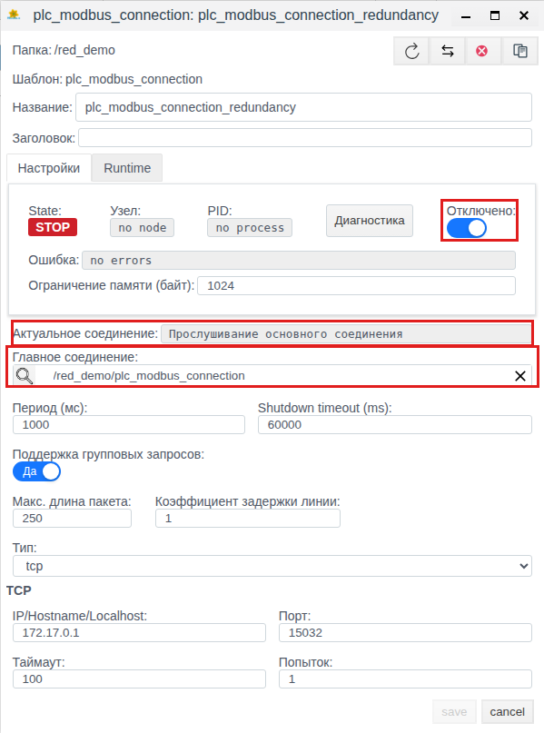
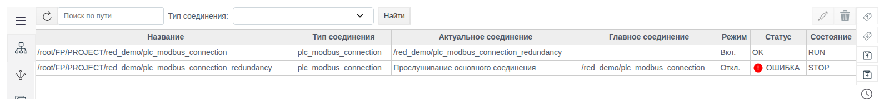
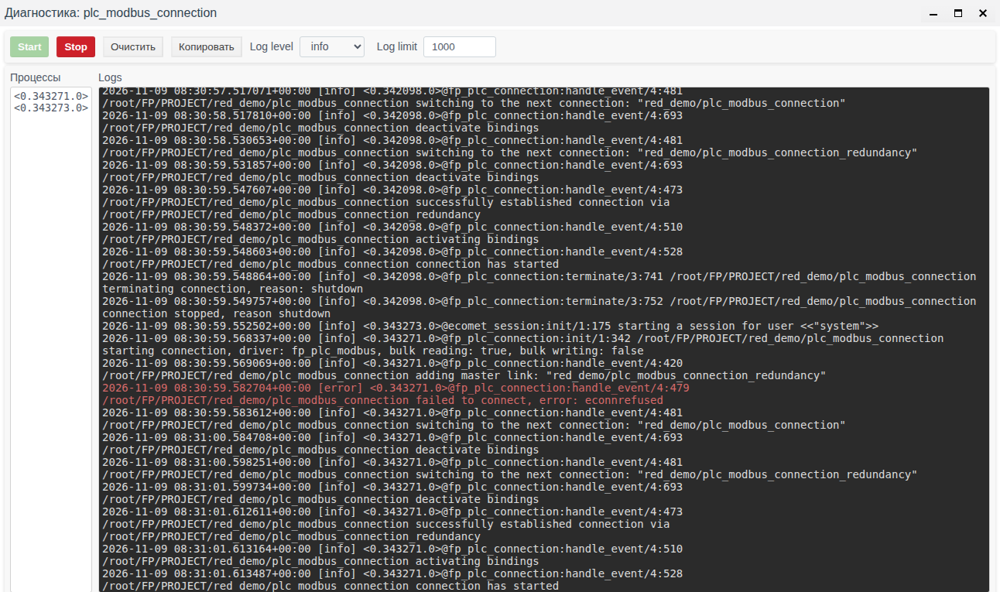

# Резервирование ресурсов

Для обеспечения непрерывности технологических процессов и высокой доступности в Faceplate реализована многоуровневая система резервирования. Архитектура продукта минимизирует риски возникновения «единой точки отказа» за счёт дублирования ключевых компонентов системы.

# Содержание

- [Глоссарий](#глоссарий)
- [Введение](#введение)
- [Основная часть](#основная-часть)
    - [Резервирование соединений с оборудованием](#резервирование-соединений-с-оборудованием)
    - [Резервирование служб Faceplate](#резервирование-служб-faceplate)
    - [Базовая конфигурация](#базовая-конфигурация)
    - [Запуск и сборка кластера](#запуск-и-сборка-кластера)
    - [Резервирование PLC-соединений](#резервирование-plc-соединений)
- [Заключение](#заключение)

# Глоссарий

| Термин | Значение |
|---|---|
| Узел | Один сервер Faceplate с именем вида `fp@<хост>`. Узлы кластера видны в Studio на панели **Сервера**, см. [«Узлы кластера»](../nodes/nodes.md) |
| Кластер | Несколько серверов (Runtime), объединённых в единый кластер Erlang |
| Копия базы | Экземпляр базы данных проекта на конкретном узле, см. [«Хранилища»](../../data_storage/storage/storage.md) |
| Главное соединение | Основное PLC-соединение, через которое идёт обмен с оборудованием. Поле **Главное соединение** у него пустое |
| Резервное соединение | PLC-соединение того же типа с параметрами резервного канала. В его поле **Главное соединение** выбрано основное соединение |

# Введение

Faceplate резервирует три звена: соединения с оборудованием, службы Faceplate и данные проекта.



| Уровень | Чем резервируется | Где описано |
|---|---|---|
| Соединения с оборудованием | Резервное PLC-соединение | [Резервирование PLC-соединений](#резервирование-plc-соединений) |
| Службы Faceplate | Кластер из нескольких серверов | [Резервирование служб Faceplate](#резервирование-служб-faceplate), [«Узлы кластера»](../nodes/nodes.md) |
| Данные проекта | Копии баз на нескольких узлах | [«Хранилища»](../../data_storage/storage/storage.md#резервирование-копия-базы-на-втором-сервере) |

# Основная часть

## Резервирование соединений с оборудованием

Faceplate поддерживает [различные протоколы](../../data_collection/plc_connections/index.md#выбрать-соединение) для связи с полевыми устройствами (ПЛК, датчиками, RTU).

- **Механизм:** система позволяет настроить несколько путей обмена данными для одного логического узла.
- **Результат:** при обрыве основной линии связи или сбое на сетевом интерфейсе Faceplate автоматически переключается на резервный канал и продолжает сбор телеметрии и передачу команд управления.

Настройка резервного канала описана в разделе [Резервирование PLC-соединений](#резервирование-plc-соединений).

## Резервирование служб Faceplate

Резервирование служб достигается за счёт **кластеризации**. Несколько серверов (Runtime) объединяются в единый кластер Erlang. Порядок сборки кластера — в разделе [Запуск и сборка кластера](#запуск-и-сборка-кластера).

- **Масштабирование:** процессы распределяются между узлами. Если один узел (сервер) падает, остальные продолжают работу, обеспечивая доступность системы. Для этого на оставшихся узлах должны быть копии баз данных проекта, см. [«Хранилища»](../../data_storage/storage/storage.md#резервирование-копия-базы-на-втором-сервере).
- **Идентификация:** узлы «видят» друг друга благодаря единому cookie (секретному ключу) и настройкам DNS/Hosts.

Что при остановке узла происходит с Runtime оператора и как объекты проекта переходят на другие узлы, описано в [«Узлы кластера»](../nodes/nodes.md).

## Базовая конфигурация

Тонкая настройка параметров производится в конфигурационных файлах, расположенных в директории релиза (например, `/DATASET/project/scada/faceplate/releases/4.0.6/`).

### Настройка виртуальной машины (vm.args)

В файле `vm.args` задаются уникальные параметры среды Erlang для каждого узла:

| Параметр | Значение |
|---|---|
| `-name` | Уникальное имя узла, например `fp@rt-server1.fp` |
| `-setcookie` | Единый идентификатор (cookie) для всех серверов кластера, обеспечивающий авторизацию при взаимодействии узлов |
| `+MIscs` | Лимит памяти литерала (задаётся в мегабайтах) для оптимизации потребления ресурсов |

### Конфигурация логирования (fp.logger.config)

Настройте пути вывода журналов в секциях `console_handler` и `error_handler`, например:

| Секция | Путь |
|---|---|
| `console_handler` (журнал консоли) | `/DATASET/project/scada/local/logs/console.log` |
| `error_handler` (журнал ошибок) | `/DATASET/project/scada/local/logs/error.log` |

## Запуск и сборка кластера

Чтобы узлы соединились в кластер, серверы должны видеть друг друга по сети и по именам и иметь общий `-setcookie` (см. таблицу в разделе [Настройка виртуальной машины (vm.args)](#настройка-виртуальной-машины-vmargs) выше). Что для этого настроить, см. [«Хранилища», раздел «Подготовка серверов»](../../data_storage/storage/storage.md#подготовка-серверов). Первичный запуск рекомендуется производить в сессии tmux с именем `scada` для обеспечения непрерывности процесса.

### Запуск ведущего узла

На первом сервере кластера инициируйте запуск в режиме консоли:

```bash
./faceplate console
```

### Присоединение дополнительных узлов

Для подключения последующих серверов (Runtime 2, Runtime 3 или Historian) используется переменная окружения `ATTACH_TO`, указывающая на адрес уже активного узла.

Команда для первого подключения:

```bash
env ATTACH_TO=fp@rt-server1.fp ./faceplate console
```

Здесь `fp@rt-server1.fp` — имя ведущего узла.

После того как узел был успешно добавлен в кластер, все последующие перезапуски производятся обычной командой `./faceplate console`. Подключённые узлы видны в Studio на панели **Сервера**, см. [«Узлы кластера»](../nodes/nodes.md).

## Резервирование PLC-соединений

Модуль связи Faceplate поддерживает избыточные физические и логические каналы, по которым с оборудования поступают телеметрические данные. Механизм резервирования соединений работает на уровне драйверов протоколов (OPC UA, Modbus TCP, IEC 60870-5-104 и др.).

**Результат:** при обрыве связи по основному каналу соединение автоматически переходит на резервный, что сводит «пробелы» в данных к минимуму.

### Настройка в Faceplate Studio

**1. Создание главного соединения.** Создайте [стандартное соединение](../../data_collection/plc_connections/general.md#создать-объект-соединения-и-настроить-канал) (например, `plc_modbus_connection`). Поле **Главное соединение** оставьте пустым. Это соединение будет основным.

**2. Создание резервного соединения.** Создайте второе соединение того же типа (например, `plc_modbus_connection_redundancy`) с параметрами резервного канала. В поле **Главное соединение** укажите основное соединение (выберите его из списка).

Порядок проверки резервного канала — в [«Привязки» → Настроить альтернативный канал](../../data_collection/plc_connections/bindings.md#настроить-альтернативный-канал).






### Логи и мониторинг

Статус соединения отображается в полях **Состояние** (`RUN`/`STOP`) и **Статус** (`OK`/`ОШИБКА`) на странице **Драйверы ПЛК**. Значения состояний описаны в [справочнике PLC-соединений](../../data_collection/plc_connections/general.md#состояния-и-диагностические-элементы).



[Окно **Диагностика**](../diagnostics/diagnostics.md#окно-диагностика) позволяет просматривать журнал текущего соединения. Кнопки старт и стоп запускают и останавливают запись журнала. [Уровень журнала](../diagnostics/diagnostics.md#уровень-журнала) разделяет сообщения по степени важности и детализации. Выбор уровня работает как «фильтр порога»: отображаются сообщения выбранного уровня и все сообщения более высокой критичности.



# Заключение

Faceplate резервирует соединения с оборудованием — резервными PLC-соединениями, службы — кластером серверов, данные — копиями баз на нескольких узлах. Параметры узлов задаются в `vm.args` (`-name`, `-setcookie`, `+MIscs`), пути журналов — в `fp.logger.config`. Кластер собирается переменной `ATTACH_TO` при первом запуске узла, дальше узел перезапускается обычной командой. Резервное PLC-соединение — второе соединение того же типа с основным в поле **Главное соединение**; его состояние видно на странице **Драйверы ПЛК** и в окне **Диагностика**.
