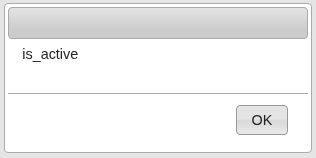
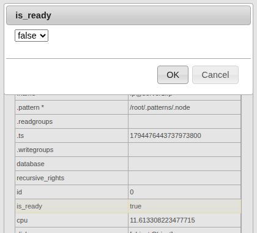
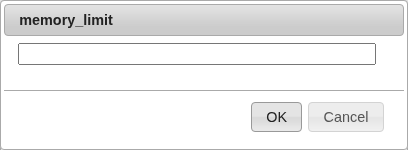

# Мажорное обновление

Документ для инженера-интегратора. Виды обновления описаны в документе [«Версия и обновление FACEPLATE»](update.md).

# Содержание

- [Глоссарий](#глоссарий)
- [Введение](#введение)
- [Основная часть](#основная-часть)
    - [Как идёт обновление](#как-идёт-обновление)
    - [Что переносится](#что-переносится)
    - [Консоль узла](#консоль-узла)
    - [Страница управления ECOMET](#страница-управления-ecomet)
    - [Порядок обновления](#порядок-обновления)
    - [Обновление с остановкой кластера](#обновление-с-остановкой-кластера)
- [Заключение](#заключение)

# Глоссарий

| Термин | Значение |
|---|---|
| Узел | Один запущенный сервер FACEPLATE. Имя узла имеет вид `fp@<сервер>`, см. [«Узлы кластера»](../nodes/nodes.md) |
| Кластер | Узлы, которые работают вместе с одним проектом и одной базой |
| Каталог установки | Папка на сервере, в которую установлен FACEPLATE. В ней лежат папки `bin`, `erts-<версия>`, `etc`, `lib` и `releases`. После первого запуска в ней появляются папка `logs` и база `DB`, после запуска в фоне — папка `log`, а после подключения модуля Git к репозиторию — папка `cvs` |
| Cookie | Пароль кластера в файле `vm.args`. Узлы соединяются, только если cookie у них одинаковый |
| `ATTACH_TO` | Переменная при запуске узла: имя узла, к кластеру которого он присоединяется |
| Консоль узла | Командная строка работающего узла, в которой выполняют команды |

# Введение

При мажорном обновлении меняется первое число номера версии. База прежней мажорной версии новой не подходит. Поэтому новая версия запускается с пустой базой, а проект переносят в неё: командами в консоли узла или из Git.

Основной порядок — без остановки кластера: узлы переводят на новую версию по одному. Пока переводят первые узлы, оставшиеся узлы старой версии продолжают работу, и Runtime не прерывается до перехода на новый кластер. Если Runtime можно остановить на время обновления, все узлы останавливают сразу, см. раздел [«Обновление с остановкой кластера»](#обновление-с-остановкой-кластера).

Переносится проект — то, что создано в Studio. История архивов и журнал событий хранятся в базе узла и не переносятся, см. раздел [«Что переносится»](#что-переносится).

Понадобятся доступ к файлам и консоли серверов (например, по SSH), Studio и [страница управления ECOMET](#страница-управления-ecomet).

# Основная часть

## Как идёт обновление

1. Первый узел выводят из старого кластера и запускают в новой версии с пустой базой и новым cookie. Новый cookie не даёт узлам разных версий соединиться.
2. В этот узел переносят проект.
3. Остальные узлы по одному переводят на новую версию и присоединяют к первому через `ATTACH_TO`. Узел получает базу от первого узла.
4. Когда остановлен последний узел старой версии, в новом кластере запускают Runtime.

Пока узлы переводят, Runtime работает на оставшихся узлах старого кластера. Если запустить Runtime нового кластера раньше, будут работать два Runtime, каждый со своей базой.

Данные, которые старый кластер запишет после экспорта (шаг [3](#3-экспортировать)), в новый кластер не попадут.

В примере кластер из узлов `fp@server1.fp` и `fp@server2.fp`, первым обновляется `fp@server1.fp`. Команды выполняются из папки, в которой лежит каталог установки `faceplate`.

## Что переносится

| Переносится | Не переносится |
|---|---|
| Объекты проекта: папки, теги, архивы, мнемосхемы, скрипты, прототипы, справочники, пользователи, роли и другие | Накопленные значения архивов, а значит и история трендов |
| Системные настройки проекта | Записи журнала событий |
| Значения полей, у которых отмечен флажок **export**, см. [«Прототипы»](../../project_objects/prototypes/prototypes.md) | Значения полей без флажка **export** |
| | Пароли пользователей: после переноса их задают заново |

История после обновления остаётся в базе прежней версии: её смотрят в прежней версии, запущенной на резервной копии, или заранее выгружают в файлы — [тренды](../../data_storage/archives/trends.md#выгрузка-выбранного-периода) и [архив тревог](../../alarms/alarm/alarm.md#5-архив-и-экспорт).

## Консоль узла

Команды шагов 3, 6, 12 и 15 выполняют в консоли узла. Как её открыть и как выйти, не остановив узел, — см. [«Запуск и остановка узла», раздел «Консоль узла»](../start_stop/start_stop.md#консоль-узла).

## Страница управления ECOMET

В шагах 6, 12 и 13 нужна страница управления базой: `http://<сервер>:8000/static/admin.html`, вход под встроенной учётной записью. Адреса — в [«Общих сведениях», раздел «ECOMET»](../../general/project_structure/FACEPLATE-start.md#ecomet).

На странице папки базы, начиная с `/root`:

- папку открывают двойным щелчком;
- объект отмечают флажком слева, затем нажимают кнопку внизу: **edit** — свойства, **delete** — удалить;
- в свойствах значение меняют двойным щелчком, в окне задают новое и нажимают **OK**, затем **Save**.

## Порядок обновления

Проект переносят одним из двух путей: файлом или из Git. Шаги 3, 8, 12 и 13 у путей разные, остальные общие:

| Шаг | Файлом | Из Git |
|---|---|---|
| [3. Экспортировать](#3-экспортировать) | Сохраните проект в файл | Отправьте последние изменения проекта в репозиторий |
| [8. Копировать](#8-копировать) | Перенесите папку `cvs`, если с Git работают и после обновления | Папку `cvs` не переносите |
| [12. Импортировать](#12-импортировать) | Выполните | Пропустите |
| [13. Клонировать](#13-клонировать) | Пропустите | Выполните |

### 1. Ознакомиться

Прочитайте описание выпуска новой версии. Если после обновления нужна история архивов или журнал событий, выгрузите их в файлы, см. раздел [«Что переносится»](#что-переносится).

### 2. Подключиться

Проверьте, что все узлы работают: Studio, панель **Сервера**, см. [«Узлы кластера»](../nodes/nodes.md).

Выберите узел, который обновите первым, — любой из работающих. Пока он остановлен, его объекты работают на остальных узлах. Если у папки в поле **Узлы Runtime** указан только этот узел, её объекты на время обновления остановятся, см. [«Узлы кластера», раздел «Где выполняются объекты»](../nodes/nodes.md#где-выполняются-объекты). В примере первым обновляется `fp@server1.fp`.

Подключитесь к серверу этого узла.

### 3. Экспортировать

Если проект переносят из Git, файл не нужен: отправьте последние изменения проекта в репозиторий модулем Git, см. [«Git в Faceplate», раздел «Отправить коммит»](../git/git.md#отправить-коммит), и перейдите к шагу [4](#4-остановить).

Сохраните проект в файл. В [консоли узла](#консоль-узла) выполните:

```erlang
ecomet:login(<<"<пользователь>">>, <<"<пароль>">>).
fp_export:project_to_file("<папка>/prj_old.zip", #{}).
```

Первая команда — вход. `<пользователь>` и `<пароль>` — учётная запись с ролью `.administrators` (см. [«Роли и права доступа», раздел «Встроенные роли»](../../access/roles.md#встроенные-роли)). Вход отвечает `ok`, при неверном пароле — `error`. Под пользователем без этой роли экспорт сохраняет не весь проект, а импорт завершается ошибками `access_denied`.

`<папка>` — папка вне каталога установки, например домашняя: в шаге 8 каталог установки заменяется. Команда экспорта отвечает `ok`, в папке появляется файл `prj_old.zip`.

### 4. Остановить

Остановите узел, см. [«Запуск и остановка узла», раздел «Остановка»](../start_stop/start_stop.md#остановка).

### 5. Сохранить

Сделайте резервную копию каталога установки вместе с базой `DB` и журналами `logs`, например в папку `faceplate_backup`. Объекты проекта можно также сохранить в файл экспорта, см. [«Импорт и экспорт проекта», раздел «Экспорт»](../../project_objects/import_export/import_export.md#экспорт).

### 6. Изолировать

Выведите узел из кластера. Откройте [страницу управления ECOMET](#страница-управления-ecomet) другого работающего узла, в примере `fp@server2.fp`:

1. Откройте папку `.nodes`, отметьте `fp@server1.fp` и нажмите **delete**.
2. Если появилось окно `is_active`, нажмите **OK**:

    

    Отметьте узел, нажмите **edit**, дважды щёлкните `is_ready`, выберите `false`, нажмите **OK** и **Save**. Снова удалите узел.

    

3. В [консоли](#консоль-узла) работающего узла выполните:

    ```erlang
    zaya:all_nodes().
    ```

    В списке не должно быть `fp@server1.fp`.

### 7. Проверить

Проверьте, что в `/etc/hosts` сервера есть все узлы кластера, см. [«Хранилища», раздел «Подготовка серверов»](../../data_storage/storage/storage.md#подготовка-серверов).

### 8. Копировать

1. Распакуйте дистрибутив новой версии на место каталога установки.
2. Если проект переносят файлом (шаг [12](#12-импортировать)), а с Git работают и после обновления, перенесите папку `cvs` из `faceplate_backup` в новый каталог установки. В ней настройки подключения модуля Git к репозиторию; без неё подключение настраивают заново.

    Если проект переносят из Git (шаг [13](#13-клонировать)), папку `cvs` не переносите: пока она есть, в модуле Git нет кнопки **Клонировать**.

### 9. Изменить

Распаковка заменяет файл `faceplate/releases/<версия>/vm.args` файлом по умолчанию. Задайте в нём:

| Параметр | Значение |
|---|---|
| `-name` | Прежнее имя узла, например `fp@server1.fp` |
| `-setcookie` | Новый cookie, одинаковый для всех узлов нового кластера |
| `+MIscs` | Прежнее значение |

Описание параметров — в [«Резервировании», раздел «Настройка виртуальной машины (vm.args)»](../redundancy/redundancy.md#настройка-виртуальной-машины-vmargs).

### 10. Запустить

Удалите папку `DB` в каталоге установки (копия есть в `faceplate_backup`).

Задайте предел открытых файлов и запустите узел, см. [«Запуск и остановка узла»](../start_stop/start_stop.md#предел-открытых-файлов). Ошибки запуска смотрите в журналах сервера, см. [«Журналы сервера»](../logs/logs.md) и шаг [11](#11-мониторить).

Узел создаёт пустой проект: в журнале сервера строка `init faceplate environment`, в дереве Studio только папка `@FIXED SCREEN AREA`.

### 11. Мониторить

Проверьте:

- в [журнале сервера](../logs/logs.md) до запуска Runtime нет строк `error` и `crash`. Допустимы только:
    - две строки `error` про `FP_TS_SCHEMA` при первом запуске на пустой базе: база архивов ещё не создана;
    - строки `the attempt to obtain license failed`: у узла нет лицензии, см. [«Лицензирование», раздел «Узел без лицензии»](../license/license.md#узел-без-лицензии);
- открываются Studio и Runtime.

Если проверка не прошла, дальше не обновляйте: остановите узел и вернитесь к резервной копии из шага [5](#5-сохранить). Сделайте архив с журналами и базой на момент запуска и передайте его в службу поддержки.

Сколько мониторить, зависит от объёма проекта.

### 12. Импортировать

Если проект переносят из Git, перейдите к шагу [13](#13-клонировать).

1. Задайте ограничение памяти встроенной учётной записи, под которой будете импортировать: на [странице управления ECOMET](#страница-управления-ecomet) папка `.users` → пользователь → **edit** → `memory_limit` → число мегабайт, например `2048` → **OK** → **Save**. Ограничение действует и на команды в консоли. Если поле пустое, сеансу выделяется 100 МБ, и импорт большого проекта прерывается: команда отвечает `killed`, в журнале сервера строка `maximum heap size reached`. Ограничение применяется при входе, поэтому задайте его до команд ниже.
2. В [консоли узла](#консоль-узла) переведите файл из шага [3](#3-экспортировать) в формат новой версии и импортируйте его:

    ```erlang
    ecomet:login(<<"<пользователь>">>, <<"<пароль>">>).
    fp_export:upgrade("<папка>/prj_old.zip", "<папка>/prj_new.zip").
    fp_export:project_from_file("<папка>/prj_new.zip", #{create => true, update => true, delete => false}).
    ```

    Первая команда — вход, как в шаге [3](#3-экспортировать). Вторая отвечает `ok`. Третья выводит список ошибок импорта: `[]` — ошибок нет. Импорт большого проекта идёт несколько минут.

3. Задайте пароли пользователям, см. [«Пользователи», раздел «Пароль»](../../access/users.md#пароль).
4. Выполните шаг [11](#11-мониторить).

### 13. Клонировать

Если проект перенесли файлом (шаг [12](#12-импортировать)), перейдите к шагу [14](#14-деактивировать).

Проект клонируют из репозитория, в который его отправил модуль Git старого кластера.

1. Задайте ограничение памяти пользователю, под которым будете клонировать:
    - встроенным учётным записям — на [странице управления ECOMET](#страница-управления-ecomet): папка `.users` → пользователь → **edit** → `memory_limit` → число мегабайт, например `2048` → **OK** → **Save**;

        

    - остальным — в Studio, поле **Ограничение памяти (МБ)**, см. [«Пользователи», раздел «Карточка пользователя»](../../access/users.md#карточка-пользователя).
2. Клонируйте проект, см. [«Git в Faceplate», раздел «Клонировать ветку»](../git/git.md#клонировать-ветку). На вопрос о сохранении проекта в файл ответьте **no**.
3. Дождитесь сообщения `repository cloned successfully`.
4. Задайте пароли пользователям, см. [«Пользователи», раздел «Пароль»](../../access/users.md#пароль).
5. Выполните шаг [11](#11-мониторить).

### 14. Деактивировать

В Studio откройте **Общий вид**. Если на панели кнопка **Остановить Runtime**, нажмите её.

Пока работает хотя бы один узел старого кластера, Runtime нового не запускайте.

### 15. Присоединить

Переведите следующий узел, в примере `fp@server2.fp`:

1. Остановите узел (шаг [4](#4-остановить)) и сделайте резервную копию (шаг [5](#5-сохранить)).
2. Если в старом кластере ещё есть работающий узел, выведите этот узел из кластера (шаг [6](#6-изолировать)).
3. Выполните шаги [7](#7-проверить)–[9](#9-изменить). Cookie — тот же, что у первого обновлённого узла.
4. Удалите папку `DB` и запустите узел с `ATTACH_TO` — именем обновлённого узла, в примере `fp@server1.fp`, см. [«Запуск и остановка узла», раздел «Присоединение узла к кластеру»](../start_stop/start_stop.md#присоединение-узла-к-кластеру).

    Со старой базой узел к новому кластеру не присоединится.

5. В Studio в **Хранилищах** добавьте узлу копии баз на вкладках **Runtime**, **Сообщения** и **Архивы**, см. [«Хранилища», раздел «Резервирование: копия базы на втором сервере»](../../data_storage/storage/storage.md#резервирование-копия-базы-на-втором-сервере).
6. Дождитесь копирования. В [консоли узла](#консоль-узла) выполните:

    ```erlang
    zaya:all_dbs_available_copies().
    ```

    Узел должен быть в списке у баз `ECOMET_SCHEMA`, `FP_TS_SCHEMA`, `project`, `project___<даты>`, `project_ts_database_buffer_<номер>` и `root`. Копирование идёт в фоне, см. [«Хранилища», раздел «Проверка по журналу»](../../data_storage/storage/storage.md#проверка-по-журналу).

7. Выполните шаг [11](#11-мониторить).

Остальные узлы переводят так же.

### 16. Запустить

Когда остановлен последний узел старого кластера, в Studio нового кластера откройте **Общий вид** и нажмите **Запустить Runtime**.

Не дожидайтесь, пока присоединятся остальные узлы: шаг 15 можно выполнять при работающем Runtime.

## Обновление с остановкой кластера

Если Runtime можно остановить на время обновления, все узлы кластера останавливают сразу. Старый и новый кластеры тогда не работают одновременно: узлы не выводят из кластера, а Runtime нового кластера не нужно держать остановленным. Runtime не работает от остановки узлов до конца переноса проекта.

Выполните [порядок обновления](#порядок-обновления) с такими отличиями:

| Шаг | Отличие |
|---|---|
| [3. Экспортировать](#3-экспортировать) | Экспорт делают до остановки, на работающем кластере |
| [4. Остановить](#4-остановить) | Остановите все узлы кластера |
| [5. Сохранить](#5-сохранить) | Резервную копию делают на каждом узле |
| [6. Изолировать](#6-изолировать) | Пропустите: работающих узлов старого кластера нет |
| [14. Деактивировать](#14-деактивировать) | Пропустите |
| [15. Присоединить](#15-присоединить) | Узел уже остановлен и сохранён: начните с пункта 3 |
| [16. Запустить](#16-запустить) | Выполните сразу после переноса проекта, не дожидаясь остальных узлов. Если при экспорте Runtime работал, после переноса он уже запущен: на **Общем виде** кнопка **Остановить Runtime** |

Cookie в шаге [9](#9-изменить) задают новый, как и в основном порядке.

# Заключение

Узлы по одному выводят из старого кластера и переводят на новую версию; начинать можно с любого узла. Узел останавливают, сохраняют его каталог установки вместе с базой и журналами, устанавливают новую версию и запускают её с пустой базой и новым cookie. Затем проверяют журнал сервера, Studio и Runtime; при ошибках возвращают узлу сохранённый каталог. В первый обновлённый узел переносят проект: файлом, который командами в консоли переводят в формат новой версии, или из Git; перед переносом учётной записи задают ограничение памяти, после — пароли пользователям. Остальные узлы присоединяют через `ATTACH_TO`. Runtime нового кластера запускают, когда остановлен последний узел старого. Если Runtime можно остановить, все узлы останавливают сразу и не выводят из кластера по одному. История архивов и журнал событий не переносятся: их смотрят в прежней версии на сохранённом каталоге или заранее выгружают в файлы.
