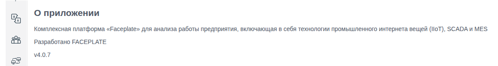

# Версия и обновление FACEPLATE

Документ для инженера-интегратора: как узнать, какая версия FACEPLATE запущена, и какой способ обновления выбрать. Сами способы описаны в отдельных документах раздела.

# Содержание

- [Глоссарий](#глоссарий)
- [Введение](#введение)
- [Основная часть](#основная-часть)
    - [Где видна версия](#где-видна-версия)
    - [Номер версии и вид обновления](#номер-версии-и-вид-обновления)
    - [Что узел делает с базой при запуске](#что-узел-делает-с-базой-при-запуске)
- [Заключение](#заключение)

# Глоссарий

| Термин | Значение |
|---|---|
| Узел | Один запущенный сервер FACEPLATE. Имя узла имеет вид `fp@<имя сервера>`. См. [«Узлы кластера»](../nodes/nodes.md) |
| Каталог установки | Папка на сервере, в которую установлен FACEPLATE. В ней лежат папки `bin`, `erts-<версия>`, `etc`, `lib` и `releases`. После первого запуска в ней появляются папка `logs` и база `DB`, после запуска в фоне — папка `log`, а после подключения модуля Git к репозиторию — папка `cvs` |
| База узла | Папка, где узел хранит проект, значения архивов и журнал событий. По умолчанию это `DB` в каталоге установки. |
| Файл экспорта проекта | Файл `project.fp`, который Studio сохраняет кнопкой **Экспорт проекта в файл**. В нём объекты проекта без накопленных данных. См. [«Импорт и экспорт проекта»](../../project_objects/import_export/import_export.md) |
| Хотфикс | Срочное исправление ошибки без смены номера версии: замена файлов в каталоге установки или правка прикладного проекта в Studio или Runtime. См. [«Хотфикс»](hotfix.md) |

# Введение

Номер версии нужен для обращения в поддержку, проверки после обновления и сверки узлов кластера. Studio показывает версию узла, к которому подключён браузер.

Как переводить проект на новую версию, зависит от [вида обновления](#номер-версии-и-вид-обновления):

| Документ | Что в нём |
|---|---|
| [Мажорное обновление](major.md) | Новая версия запускается с пустой базой, проект переносят из файла экспорта или из репозитория Git. Узлы переводят по одному, старый кластер работает, пока не переведён последний узел. Если Runtime можно остановить, все узлы останавливают сразу |
| [Минорное обновление и патч](minor.md) | Новая версия запускается на базе прежней версии и сама переводит её на свой формат. Проект, архивы и журнал событий переходят вместе с базой. Узлы обновляют по одному, Runtime работает на остальных узлах |
| [Хотфикс](hotfix.md) | Срочное исправление без смены версии и без переноса проекта: замена файлов в каталоге установки или правка прикладного проекта в Studio или Runtime |
| [Импорт и экспорт проекта](../../project_objects/import_export/import_export.md) | Сохранение проекта в файл и импорт файла: перенос проекта при мажорном обновлении, резервная копия при минорном и патче |

Понадобятся доступ к файловой системе сервера (например, по SSH) и доступ к Studio (`http://<сервер>:9000/fp/studio`) под учётной записью с правом изменять проект.

# Основная часть

## Где видна версия

Версию показывает страница **О приложении**. Она открывается значком «i» внизу левой панели Studio, над кнопкой **Выход**:

| Где | Что показано | Когда удобно |
|---|---|---|
| Studio, пункт **О приложении** — значок «i» внизу левой панели, над **Выход** | Название платформы, разработчик и номер версии в виде `v<версия>` | Скопировать номер для обращения в поддержку |
| Заголовок вкладки браузера | `Faceplate Studio <версия>` в Studio, `Faceplate RUN-TIME <версия>` в Runtime | Узнать версию, ничего не открывая. В Runtime пункта **О приложении** нет, поэтому версию там видно только в заголовке |
| Журнал сервера `console.log` | Одна из трёх строк, которые узел пишет при запуске: версия, переход на новую версию или создание пустого проекта. Какая что значит — в разделе [«Что узел делает с базой при запуске»](#что-узел-делает-с-базой-при-запуске) | Узнать, какую версию узел запустил и что сделал с базой, даже если Studio не открывается. Где лежит журнал — в [«Журналах сервера», раздел «Где лежат журналы»](../logs/logs.md#где-лежат-журналы) |

Все узлы кластера должны работать на одной версии. Studio показывает версию только того узла, к которому подключён браузер. Чтобы после обновления убедиться, что новая версия запущена на всех узлах, откройте **О приложении** в Studio по адресу каждого узла.

## Номер версии и вид обновления

Номер версии FACEPLATE записан по правилам [семантического версионирования (SemVer)](https://semver.org/lang/ru/) в виде `X.Y.Z`. По тому, какая часть номера меняется, обновление бывает мажорным, минорным или патчем.

| Часть номера | Вид обновления | Что меняется в новой версии | Как обновлять |
|---|---|---|---|
| `X` — мажорная | Мажорное | Несовместимые изменения: база прежней версии новой не подходит | [Мажорное обновление](major.md): пустая база, перенос проекта, узлы по одному |
| `Y` — минорная | Минорное | Новые возможности с сохранением совместимости | [Минорное обновление и патч](minor.md): запуск на прежней базе |
| `Z` — патч | Патч | Исправления ошибок | [Минорное обновление и патч](minor.md): запуск на прежней базе |

Какой порядок обновления подходит при переходе между конкретными версиями, зависит от того, что изменилось в выпуске.

Срочное исправление без смены номера версии — хотфикс — ставят иначе: без переноса проекта, заменой файлов в каталоге установки или правкой прикладного проекта в Studio или Runtime. См. [«Хотфикс»](hotfix.md).

## Что узел делает с базой при запуске

При запуске узел ищет в базе проект и сравнивает записанную там версию со своей. Что он сделал, видно по строке в `console.log`:

| Строка в журнале | Когда появляется | Что сделал узел |
|---|---|---|
| `faceplate version <версия>` | Обычный перезапуск узла на своей базе | Работает с проектом как раньше. **О приложении** показывает ту же версию |
| `upgrade faceplate version from <старая> to <новая>` | Минорное обновление или патч: новая версия запущена на базе прежней | Перевёл базу на свою версию. Проект на месте, **О приложении** показывает новую версию |
| `init faceplate environment` | Новая установка или мажорное обновление: узел запущен с пустой папкой базы | Создал пустой проект: в дереве только системная папка `@FIXED SCREEN AREA`. Проект создают заново или переносят из файла экспорта либо из Git |

Узел запускается, только если процессу разрешено открыть достаточно файлов. Поэтому перед запуском задают предел открытых файлов не меньше 200 000, см. [«Запуск и остановка узла», раздел «Предел открытых файлов»](../start_stop/start_stop.md#предел-открытых-файлов).

# Заключение

Версию узла показывают пункт **О приложении** в Studio, заголовок вкладки браузера и строка `console.log` при запуске узла.

Номер версии записан по SemVer: `X` — мажорная часть, `Y` — минорная, `Z` — патч. Порядок минорного обновления и патча описан в [«Минорное обновление и патч»](minor.md), мажорного — в [«Мажорное обновление»](major.md); какой из них подходит, зависит от того, что изменилось в выпуске. Хотфикс не меняет номер версии ([«Хотфикс»](hotfix.md)).
