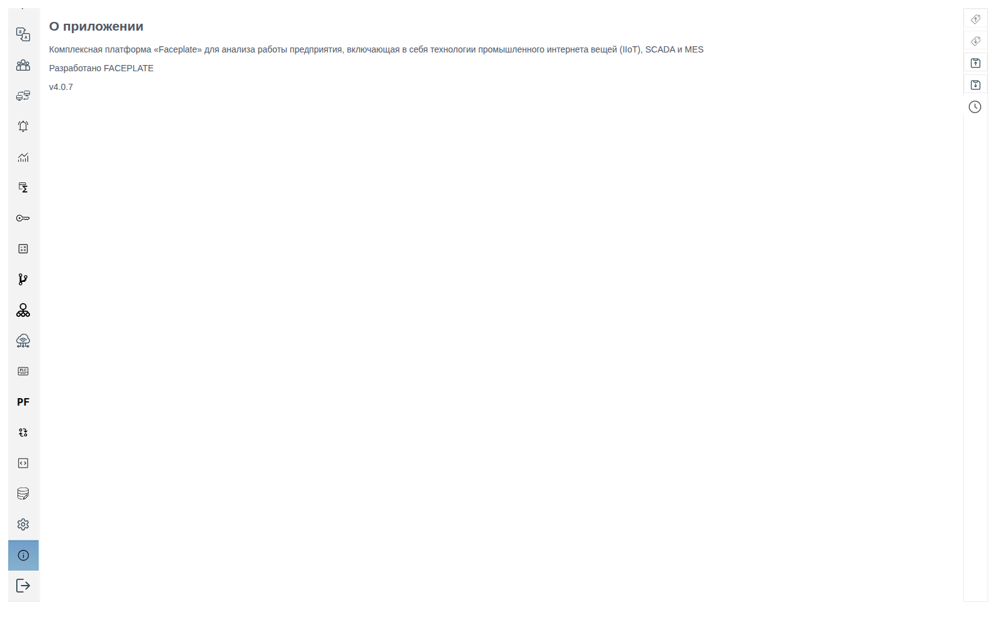
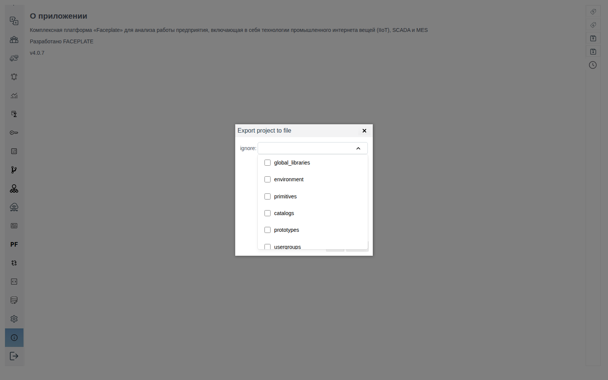
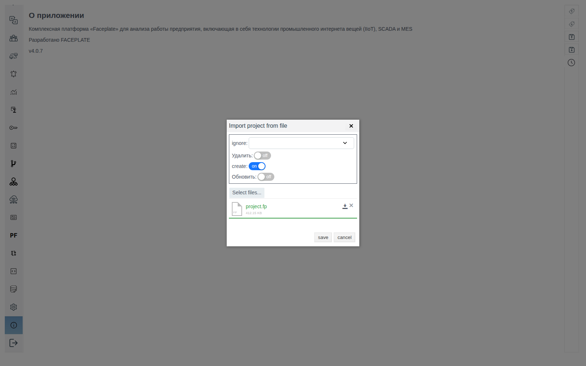

# Версия и обновление FACEPLATE

Документ для инженера-интегратора: как узнать, какая версия FACEPLATE запущена, и как перенести проект на новую версию.

# Содержание

- [Глоссарий](#глоссарий)
- [Введение](#введение)
- [Основная часть](#основная-часть)
    - [Где видна версия](#где-видна-версия)
    - [Что узел делает с базой при запуске](#что-узел-делает-с-базой-при-запуске)
    - [Какой путь выбрать](#какой-путь-выбрать)
    - [Запуск новой версии на старой базе](#запуск-новой-версии-на-старой-базе)
    - [Обновление кластера](#обновление-кластера)
    - [Перенос проекта через файл экспорта](#перенос-проекта-через-файл-экспорта)
- [Заключение](#заключение)

# Глоссарий

| Термин | Значение |
|---|---|
| Узел | Один запущенный сервер FACEPLATE. Имя узла имеет вид `fp@<имя сервера>`. См. [«Узлы кластера»](../nodes/nodes.md) |
| Каталог установки | Папка на сервере, в которую установлен FACEPLATE. В ней лежат папки `bin`, `releases`, `logs` |
| База узла | Папка, где узел хранит проект, значения архивов и журнал событий. По умолчанию это `DB` в каталоге установки. При установке в Docker к ней подключают папку на сервере, см. [«Установка в Docker-контейнере»](../../general/docker/deploy%20as%20docker.md) |
| Файл экспорта проекта | Файл `project.fp`, который Studio сохраняет кнопкой **Экспорт проекта в файл**. В нём объекты проекта без накопленных данных |

# Введение

Номер версии нужен для обращения в поддержку, проверки после обновления и сверки узлов кластера. Studio показывает версию узла, к которому подключён браузер.

Проект переводят на новую версию одним из двух способов:

- [запуск новой версии на старой базе](#запуск-новой-версии-на-старой-базе) — узел при запуске сам переводит базу на свою версию;
- [перенос через файл экспорта](#перенос-проекта-через-файл-экспорта) — экспорт в старой версии, импорт в новой.

Первый способ сохраняет историю архивов и журнала событий, но работает, только если узел узнаёт формат базы. По номеру версии это не определить: формат может различаться даже у сборок одной версии. Поэтому новую версию запускают на копии базы, а если узел её не узнал, переносят проект через файл экспорта.

Понадобятся доступ к файловой системе сервера (например, по SSH) и доступ к Studio (`http://<сервер>:9000/fp/studio`) под учётной записью с правом изменять проект.

# Основная часть

## Где видна версия



| Где | Что показано | Когда удобно |
|---|---|---|
| Studio, пункт **О приложении** — значок «i» внизу левой панели, над **Выход** | Название платформы, разработчик и номер версии, например `v4.0.7` | Скопировать номер для обращения в поддержку |
| Заголовок вкладки браузера | `Faceplate Studio 4.0.7` в Studio, `Faceplate RUN-TIME 4.0.7` в Runtime | Узнать версию, ничего не открывая. В Runtime пункта **О приложении** нет, поэтому версию там видно только в заголовке |
| Журнал сервера `console.log` | Одна из трёх строк, которые узел пишет при запуске: версия, переход на новую версию или создание пустого проекта. Какая что значит — в разделе [«Что узел делает с базой при запуске»](#что-узел-делает-с-базой-при-запуске) | Узнать, какую версию узел запустил и что сделал с базой, даже если Studio не открывается. Где лежит журнал — в [«Журналах сервера», раздел «Где лежат журналы»](../logs/logs.md#где-лежат-журналы) |

В кластере каждый узел показывает свою версию. Чтобы сверить узлы, откройте Studio по адресу каждого из них.

## Что узел делает с базой при запуске

При запуске узел ищет в базе проект и сравнивает записанную там версию со своей. Что он сделал, видно по одной из трёх строк в `console.log`:

| Строка в журнале | Что произошло | Что видно в Studio |
|---|---|---|
| `faceplate version 4.0.7` | Версии совпали, узел работает с проектом как раньше | Проект на месте, **О приложении** показывает ту же версию |
| `upgrade faceplate version from <старая> to <новая>` | Узел нашёл проект предыдущей версии, перевёл базу на свою версию и записал в проект новый номер | Проект на месте, **О приложении** показывает новую версию |
| `init faceplate environment` | Узел не нашёл проект в базе и создал новый пустой | В дереве только системная папка `@FIXED SCREEN AREA`, нет ни одного объекта проекта |

При первом запуске на пустой папке базы строка `init faceplate environment` — обычное дело. При запуске новой версии на рабочей базе она означает, что узел не узнал формат базы.

## Какой путь выбрать

| | Запуск новой версии на старой базе | Перенос через файл экспорта |
|---|---|---|
| Когда работает | Если новая версия узнаёт формат базы: в журнале строка `upgrade faceplate version from … to …` | Всегда, когда старая версия может сделать экспорт |
| Архивы и журнал событий | Переходят в новую версию | Остаются в старой базе, в новой версии начинаются с нуля |
| Старая база | Не меняется: новая версия работает на копии | Не меняется |

Если история архивов нужна, начните с запуска на копии базы. Если не нужна, оба пути равноценны.

## Запуск новой версии на старой базе

Основной путь: проект, архивы и журнал событий переходят в новую версию вместе с базой. Старая база остаётся нетронутой, новая версия запускается на её копии.

1. Сохраните файл экспорта проекта, как в шаге 1 раздела [«Перенос проекта через файл экспорта»](#перенос-проекта-через-файл-экспорта). Он понадобится, если новая версия базу не узнает.
2. Остановите старый узел (`./faceplate stop` из `bin` каталога установки) и скопируйте папку его базы.
3. Установите новую версию в новый каталог установки и положите копию базы в его папку `DB`. В `releases/<версия>/vm.args` нового каталога задайте то же имя узла (`-name`), что у старого, см. [«Резервирование», раздел «Настройка виртуальной машины (vm.args)»](../redundancy/redundancy.md#настройка-виртуальной-машины-vmargs). В Docker подключите копию базы к `/opt/faceplate/DB` нового контейнера.
4. Запустите новый узел и найдите в `console.log` строку о версии (см. [«Что узел делает с базой при запуске»](#что-узел-делает-с-базой-при-запуске)):
    - `upgrade faceplate version from <старая> to <новая>` — база переведена. Дерево проекта в Studio на месте, **О приложении** показывает новую версию. При следующих запусках в журнале будет строка `faceplate version <новая>`.
    - `init faceplate environment` — узел не узнал базу и записал в копию новый пустой проект. Остановите узел, удалите копию и перенесите проект [через файл экспорта](#перенос-проекта-через-файл-экспорта).

База помнит, на каком узле она работала. Если имя узла в `vm.args` отличается от прежнего, новый узел не доходит до строки о версии: он ждёт прежний узел. В `console.log` повторяются строки `trying to connect to 'fp@<прежнее имя>' node` и `'fp@<прежнее имя>' node is not available`, а Studio не открывается. Остановите узел, исправьте `-name` и запустите его снова.

## Обновление кластера

Узлы разных версий в одном кластере вместе не работают. Узел новой версии не присоединяется к узлам старой: в его `console.log` повторяется строка `database register lock error … retry`, Studio на нём не открывается. Поэтому кластер обновляют целиком: останавливают все узлы и запускают их в новой версии.

После полной остановки узлы при запуске ждут друг друга: на любом из них могут быть данные, которых нет у остальных. В `console.log` при этом повторяются строки `trying to connect to 'fp@<узел>' node` и `There were active nodes ['fp@<узел>'], when the node went down`. Чтобы кластер запустился, первым запускают узел, остановленный последним, с переменной `FORCE_START`: она разрешает узлу открыть базу, не дожидаясь остальных. Так же запускают кластер после любой полной остановки, не только при обновлении.

1. Сохраните файл экспорта проекта, как в шаге 1 раздела [«Перенос проекта через файл экспорта»](#перенос-проекта-через-файл-экспорта).
2. Остановите узлы по одному (`./faceplate stop`) и запомните, какой остановлен последним. Скопируйте папку базы каждого узла.
3. На каждом сервере установите новую версию, как в шаге 3 раздела [«Запуск новой версии на старой базе»](#запуск-новой-версии-на-старой-базе): копия базы этого узла в папке `DB`, прежнее имя узла в `vm.args`.
4. Запустите узел, остановленный последним:

    ```bash
    env FORCE_START=true ./faceplate console
    ```

    В его `console.log` должна появиться строка `upgrade faceplate version from <старая> to <новая>`.

5. Запустите остальные узлы обычной командой `./faceplate console`. Они получают уже переведённую базу, в их `console.log` строка `faceplate version <новая>`.
6. Откройте Studio по адресу каждого узла: дерево проекта на месте, **О приложении** показывает новую версию.

`FORCE_START` задают одному узлу и только на этот запуск. Узел с этой переменной считает свои данные самыми свежими, а изменения, которые попали только на другие узлы, теряются. Самые свежие данные — на узле, остановленном последним, поэтому переменную получает он.

Если узел новой версии уже запущен рядом с работающими узлами старой версии и ждёт, остановите все узлы, включая его, и выполните шаги 4–6.

## Перенос проекта через файл экспорта

Подходит, когда новая версия не узнала базу или история архивов в новой версии не нужна. Проект выгружают в файл в старой версии и загружают в новую, установленную с пустой базой. Переносятся только объекты проекта.

### Файл экспорта проекта

Кнопки **Экспорт проекта в файл** и **Импорт проекта из файла** — третий и четвёртый значки сверху на правой вертикальной панели Studio.



Проект записывается в файл по разделам. Список **ignore** в окне экспорта перечисляет те же разделы: отмеченные в файл не попадут. Для переноса на новую версию оставьте список пустым.

| Раздел | Что в нём |
|---|---|
| `global_libraries` | Библиотечные модули и JS-библиотеки |
| `environment` | Системные настройки проекта |
| `primitives` | Примитивы |
| `catalogs` | Каталоги |
| `prototypes` | Прототипы |
| `usergroups` | Группы пользователей |
| `users` | Пользователи |
| `project` | Дерево проекта: папки, объекты, экраны |
| `user_rights` | Права пользователей и групп |

Накопленные значения архивов и записи журнала событий хранятся в базе узла и в файл не входят. В новую версию они переходят только при [запуске на старой базе](#запуск-новой-версии-на-старой-базе). При переносе через файл история остаётся в старой базе: её смотрят в старой версии, запущенной на этой базе, или выгружают в файлы — [тренды](../../data_storage/archives/trends.md#выгрузка-выбранного-периода) и [архив тревог](../../alarms/alarm/alarm.md#5-архив-и-экспорт).

### Переключатели импорта

Окно **Импорт проекта из файла** сопоставляет объекты файла и проекта по пути. Переключатели определяют, что делать с расхождениями:

| Переключатель | Что делает |
|---|---|
| **Delete** | Удаляет из проекта объекты, которых нет в файле |
| **Create** | Создаёт объекты из файла, которых нет в проекте. Объекты, которые уже есть, не меняет |
| **Update** | Записывает в объекты, которые есть и в файле, и в проекте, значения полей из файла. Включается вместе с **Create** |

Сочетания переключателей:

| Включены | Объект только в файле | Объект в файле и в проекте | Объект только в проекте | Когда применять |
|---|---|---|---|---|
| **Create** | Создаётся | Не меняется | Остаётся | Перенос на новую версию в пустую базу; добавить недостающее, не затирая правок в проекте |
| **Create** и **Update** | Создаётся | Получает поля из файла | Остаётся | Принести изменения из файла и сохранить объекты, созданные только в этом проекте |
| **Delete** и **Create** | Создаётся | Не меняется | Удаляется | Убрать лишнее и добавить недостающее, не затирая правок в общих объектах |
| **Delete**, **Create** и **Update** | Создаётся | Получает поля из файла | Удаляется | Сделать проект точной копией файла |
| **Delete** | Не создаётся | Не меняется | Удаляется | Только убрать из проекта то, чего нет в файле |

Импорт с **Delete** удаляет и объекты, созданные в проекте после того, как сделан файл. Перед таким импортом сохраните файл экспорта текущего проекта: из него удалённое можно вернуть импортом с **Create**.

### Шаги переноса

1. В Studio старой версии нажмите **Экспорт проекта в файл**, оставьте **ignore** пустым и нажмите **save**. Браузер сохранит `project.fp`.
2. Остановите старый узел (`./faceplate stop` из `bin` каталога установки) и скопируйте папку его базы в отдельное место. Копия нужна, если придётся вернуться на старую версию.
3. Установите новую версию с пустой папкой базы: в новый каталог установки или, в Docker, в новый контейнер с новой пустой папкой, подключённой к `/opt/faceplate/DB`.
4. Запустите новый узел. В `console.log` должна появиться строка `init faceplate environment`, а **О приложении** — показать новую версию.
5. Нажмите **Импорт проекта из файла** и выберите `project.fp` кнопкой **Select files...**. Включите **Create**, переключатели **Delete** и **Update** оставьте выключенными, **ignore** — пустым. Нажмите **save**.

   

6. Дождитесь сообщения `The project was imported successfully` и обновите страницу. Папки и объекты старого проекта появятся в дереве.

# Заключение

Версию узла показывают пункт **О приложении** в Studio, заголовок вкладки браузера и строка `console.log` при запуске узла.

Обновление начинают с файла экспорта и копии базы. Новую версию с прежним именем узла запускают на копии. Строка `upgrade faceplate version from … to …` означает, что проект, архивы и журнал событий перешли в новую версию. Строка `init faceplate environment` означает, что проект переносят через файл экспорта с включённым **Create**, а история остаётся в старой базе.

Кластер обновляют целиком. Первым запускают с `FORCE_START=true` узел, остановленный последним, затем остальные.
